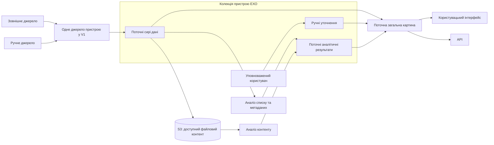
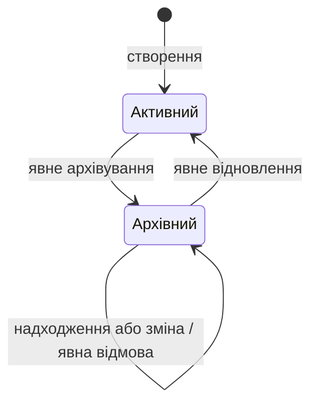

# Функціональний дизайн «Пристрої»

- **Статус:** Чернетка
- **Версія:** 0.4
- **Дата:** 2026-07-17

## Історія ревізій

| Версія | Дата       | Статус   | Зміни                                           |
| ------ | ---------- | -------- | ----------------------------------------------- |
| 0.1    | 2026-07-16 | Чернетка | Початковий функціональний дизайн                |
| 0.2    | 2026-07-16 | Чернетка | Визначено процес синхронізації зовнішніх джерел |
| 0.3    | 2026-07-17 | Чернетка | Файли переведено на модель останнього стану; ключі надає ЕХО |
| 0.4    | 2026-07-17 | Чернетка | Ключі зовнішніх пристроїв також створює ЕХО й повертає джерелу |

## Правила ідентифікації вимог

Нормативні вимоги мають незмінні ідентифікатори за групами `DEV-GEN-*`, `DEV-ID-*`, `DEV-LC-*`, `DEV-FILE-*`, `DEV-AN-*`, `DEV-INT-*`, `DEV-ACC-*`, `DEV-UX-*` і `DEV-NFR-*`. У наступних ревізіях нова вимога отримує новий ідентифікатор; наявні ідентифікатори не перенумеровуються і не використовуються повторно.

## Призначення документа

Це продуктова функціональна специфікація реєстру «Пристрої». Вона визначає погоджену поведінку продукту, спільну мову, межі V1 та спостережувані критерії приймання для узгодження між зацікавленими сторонами й подальшого планування реалізації.

Документ не описує поточний стан коду і не задає технічну реалізацію. Тут навмисно немає шляхів викликів, контрактів передавання, структури бази даних, форматів повідомлень, способів адресації файлового контенту, назв програмних компонентів, способів оркестрації чи алгоритмів аналізу. Розбіжність між цією специфікацією та наявною реалізацією є окремим розривом для планування, а не підставою непомітно змінювати продуктову вимогу.

## Загальна ідея

**Пристрій ЕХО** — це логічна, постійно поповнювана колекція сирих даних про один реальний пристрій, ручних уточнень і аналітичних результатів, які ЕХО формує на основі цієї колекції. Це не лише картка з атрибутами і не точна копія поточного стану зовнішньої системи.

Колекція накопичує прийняті факти в межах незмінної джерельної ідентичності. Джерело вирішує, коли та якими даними її доповнювати. Відсутність раніше переданого об’єкта в наступному надходженні не означає його видалення з ЕХО.

| ID            | Нормативна вимога                                                                                                   | Спостережуваний критерій приймання                                                                                                                 |
| ------------- | ------------------------------------------------------------------------------------------------------------------- | -------------------------------------------------------------------------------------------------------------------------------------------------- |
| `DEV-GEN-001` | Один пристрій ЕХО представляє накопичувальну колекцію даних, що стосуються одного реального пристрою.               | Після прийняття нового доповнення раніше прийняті об’єкти колекції лишаються доступними; нове надходження з ключем наявного файла замінює лише поточний стан цього файла. |
| `DEV-GEN-002` | Колекція містить окремі шари сирих даних, ручних уточнень та аналітичних результатів.                               | Для показаного значення або висновку користувач може визначити, до якого з трьох шарів він належить.                                               |
| `DEV-GEN-003` | ЕХО надає поточну загальну картину пристрою, сформовану з доступних відомостей, не приховуючи походження складових. | У загальній картині доступне маркування походження кожної представленої складової; суперечливі значення не зливаються в немарковане значення.      |

## Цілі та принципи

### Продуктові цілі

1. Зібрати дані про один реальний пристрій в одному зрозумілому контексті.
2. Не втрачати джерело, автора й час відомостей.
3. Дозволити окремий аналіз переліку та метаданих об’єктів і доступного контенту.
4. Збагачувати відомості про пристрій автоматичними результатами та ручними уточненнями.
5. Надавати користувачам та іншим авторизованим інструментам ЕХО поточну загальну картину й поточні результати.

### Принципи

- **Накопичення, а не дзеркалювання.** Уже прийняті дані не зникають лише через подальшу відсутність або видалення у джерелі.
- **Видиме походження.** Сирі, ручні й аналітичні відомості не втрачають свого походження.
- **Розділення шарів.** Ручне уточнення або аналіз не переписує сирі дані, а сире оновлення не видається за ручний чи аналітичний висновок.
- **Поточний стан та аудит.** Основне представлення показує поточні дані й результати, а аудит пояснює суттєві заміни та дії.
- **Явні стани.** Очікування, частковий успіх, помилка, заборона й архівний стан не маскуються під успіх.
- **Розширюваність.** Нові типи даних можуть розвивати колекцію без зміни самого поняття пристрою.

| ID            | Нормативна вимога                                                                                                                             | Спостережуваний критерій приймання                                                                                            |
| ------------- | --------------------------------------------------------------------------------------------------------------------------------------------- | ----------------------------------------------------------------------------------------------------------------------------- |
| `DEV-GEN-004` | Походження сирих даних, ручних уточнень і аналітичних результатів зберігається та доступне разом із ними.                                     | Для кожного доступного об’єкта відповідного шару можна побачити джерело або автора та час його створення чи оновлення.        |
| `DEV-GEN-005` | Поточна загальна картина та поточні доступні аналітичні результати надаються через користувацький інтерфейс і API відповідно до прав доступу. | Авторизовані користувачі обох каналів отримують узгоджений поточний результат і його маркування, а не різні історичні версії. |
| `DEV-GEN-006` | Колекція підтримує незалежні типи даних із власними атрибутами, станами, відображенням і дозволеними діями.                                   | Додавання нового типу даних не змінює ідентичність пристрою та не вимагає трактувати його об’єкти як файли.                   |

## Межі V1 і подальший розвиток

### У межах V1

- один пристрій має рівно один канал походження: одне зовнішнє джерело або ручне джерело;
- різні зовнішні джерела не об’єднуються в один запис і не дедуплікуються між собою;
- повний ручний канал створює окремі ручні пристрої й не доповнює сирими даними пристрої зовнішніх джерел;
- користувач може додавати до зовнішнього пристрою лише окремі ручні уточнення з власним походженням;
- єдиний тип даних — `Файли`;
- метадані файла можуть існувати без контенту, а доступний файловий контент зберігається в S3;
- аналіз списку та контенту запускається автоматично після релевантних змін і вручну уповноваженим користувачем;
- ЕХО показує та віддає поточну загальну картину й поточні доступні аналітичні результати.

| ID            | Нормативна вимога                                                                                                                             | Спостережуваний критерій приймання                                                                                              |
| ------------- | --------------------------------------------------------------------------------------------------------------------------------------------- | ------------------------------------------------------------------------------------------------------------------------------- |
| `DEV-GEN-007` | У V1 один пристрій має одне незмінне зовнішнє або ручне джерело походження.                                                                   | Після створення джерело пристрою неможливо замінити; надходження від іншого джерела не приєднується до цього запису.            |
| `DEV-GEN-008` | У V1 повний ручний канал створює й поповнює лише окремі ручні пристрої; зовнішній пристрій приймає ручні відомості тільки як ручні уточнення. | Спроба додати ручний сирий файл до зовнішнього пристрою відхиляється, тоді як окреме ручне уточнення з авторством зберігається. |
| `DEV-GEN-009` | У V1 підтримується тип даних `Файли`, включно з файлами без контенту та файлами з доступним контентом.                                        | Пристрій може містити видимий файл лише з метаданими, а пізніше прийняти новий стан того самого файла з контентом за ключем, наданим ЕХО.      |
| `DEV-GEN-010` | У V1 релевантні дані можуть аналізуватися автоматично та повторно за ручним запуском.                                                         | Релевантна зміна створює автоматичний запуск, а дозволена ручна дія створює окремий повторний запуск із видимим станом.         |

### Після V1

Наступні ревізії можуть визначити багатоджерельне об’єднання відомостей про один реальний пристрій і додати нові типи даних. Ця чернетка не визначає склад таких типів, правила злиття, дедуплікації або перенесення наявних записів і не робить їх критеріями приймання V1.

## Терміни

| Термін                       | Визначення                                                                                                                                                                                    |
| ---------------------------- | --------------------------------------------------------------------------------------------------------------------------------------------------------------------------------------------- |
| **Реальний пристрій**        | Фізичний або віртуальний пристрій у предметній області, якого стосуються зібрані дані.                                                                                                        |
| **Пристрій ЕХО**             | Логічна накопичувальна колекція ЕХО про один реальний пристрій у межах однієї джерельної ідентичності V1.                                                                                     |
| **Зовнішнє джерело**         | Авторизована зовнішня система, яка створює зовнішній пристрій та передає до нього сирі дані від власного імені.                                                                               |
| **Ручне джерело**            | Канал, у якому уповноважений користувач створює окремий ручний пристрій і безпосередньо поповнює його сирі дані.                                                                              |
| **Сирі дані**                | Прийняті від джерела або автора первинні відомості без підміни ручним чи автоматичним висновком.                                                                                              |
| **Ручне уточнення**          | Окрема інтерпретація або виправлення уповноваженого користувача з автором, часом і поясненням, яке не змінює сирі дані чи аналітичний результат.                                              |
| **Аналітичний результат**    | Результат окремого запуску аналізу на основі визначених даних пристрою, позначений походженням, методом, версією, часом, упевненістю та станом.                                               |
| **Загальна картина**         | Поточне продуктове представлення відомостей про пристрій із видимими сирими, ручними й аналітичними складовими; правило їхнього пріоритету поки не визначене.                                 |
| **Тип даних**                | Незалежний клас об’єктів колекції зі своїми атрибутами, життєвим циклом, аналізом, відображенням і діями.                                                                                     |
| **Файл**                     | Об’єкт типу даних `Файли`, ідентифікований ключем, який створює ЕХО, і представлений лише останнім прийнятим станом метаданих та, за наявності, контенту.                                      |
| **Метадані файла**           | Поточні відомості про файл, зокрема його назва, шлях, часові атрибути, походження, ключ, категорії та стани контенту й аналізу.                                                           |
| **Контент файла**            | Бінарний вміст останнього прийнятого стану файла, який може бути відсутнім, очікуватися, бути доступним або мати помилку отримання чи обробки.                                           |
| **Стабільний ключ пристрою** | Стабільний ідентифікатор зовнішнього пристрою, який ЕХО створює під час його створення, повертає зовнішньому джерелу й очікує в кожному наступному надходженні для цього пристрою. |
| **Ключ файла**               | Стабільний ідентифікатор файла, який ЕХО створює під час створення файла, повертає зовнішньому джерелу й очікує в кожному наступному надходженні стану цього файла.                       |
| **Аудит**                    | Незмінний запис про значущу дію або заміну: хто чи яке джерело її виконало та коли. Для заміни файла аудит не зберігає його попередній повний стан або старий бінарний контент.          |
| **Архівний пристрій**        | Пристрій у стані лише для читання: поточні дані збережені, але доповнення, файлові зміни й нові запуски аналізу заблоковані до явного відновлення.                                            |
| **Інтеграційний користувач** | Звичайний користувач ЕХО, від імені якого зовнішній клієнт автентифікується та виконує дозволені ролями дії через API.                                                                        |

## Учасники та права

### Учасники

| Учасник                     | Відповідальність і межі                                                                                                                                       |
| --------------------------- | ------------------------------------------------------------------------------------------------------------------------------------------------------------- |
| **Зовнішнє джерело**        | Через закріпленого за ним інтеграційного користувача створює зовнішні пристрої та поповнює сирі дані лише пристроїв зі своєю джерельною належністю.           |
| **Ручний автор**            | У межах редакторського права створює й поповнює окремі ручні пристрої.                                                                                        |
| **Автор ручного уточнення** | Додає до пристрою окреме пояснене уточнення, не змінюючи сирих або автоматичних відомостей.                                                                   |
| **Читач**                   | Переглядає дозволені пристрої, списки файлів, загальну картину, аналітичні результати та їхнє походження.                                                     |
| **Редактор**                | Виконує дозволені ручні зміни життєвого циклу, файлового стану й запуску аналізу; редакторське право не скасовує джерельної належності зовнішніх сирих даних. |
| **Автоматичний аналіз ЕХО** | Створює марковані результати на підставі визначених даних пристрою; не переписує сирі дані.                                                                   |

### Базова матриця ролей V1

| Роль            | Дозволені продуктові можливості                                                                                                                                                           |
| --------------- | ----------------------------------------------------------------------------------------------------------------------------------------------------------------------------------------- |
| `Cyber`         | Читання пристроїв, списків файлів, поточної загальної картини, поточних доступних аналітичних результатів і їхнього походження.                                                           |
| `DevicesEditor` | Усі можливості читача; створення й поповнення ручних пристроїв; створення ручних уточнень; приховування й відновлення файлів; архівування й відновлення пристроїв; ручний запуск аналізу. |
| `Admin`         | Задовольняє права ролей `Cyber` і `DevicesEditor`.                                                                                                                                        |

Окреме право понад право читача для відкриття або отримання файлового контенту визначить `OD-006`. До цього рішення матриця не надає жодній ролі нового неявного права на контент.

| ID            | Нормативна вимога                                                                                                                                                             | Спостережуваний критерій приймання                                                                                                                 |
| ------------- | ----------------------------------------------------------------------------------------------------------------------------------------------------------------------------- | -------------------------------------------------------------------------------------------------------------------------------------------------- |
| `DEV-ACC-001` | Доступ до пристроїв і дій із ними вимагає автентифікованого користувача та перевірки відповідних ролей і прав.                                                                | Неавтентифікований користувач не отримує даних або дій; автентифікований бачить лише те, що дозволено його ролями та окремими обмеженнями.         |
| `DEV-ACC-002` | Роль `Cyber` надає читання пристроїв, списків файлів, загальної картини, поточних аналітичних результатів і походження.                                                       | Користувач лише з `Cyber` може прочитати перелічені відомості, але не може виконати редакторські дії.                                              |
| `DEV-ACC-003` | Роль `DevicesEditor` включає права читача й дозволяє ручні пристрої та уточнення, файлове приховування/відновлення, архівування/відновлення пристрою й ручний запуск аналізу. | Користувач із `DevicesEditor` може виконати кожну перелічену дію для активного застосовного об’єкта, а користувач лише з `Cyber` отримує заборону. |
| `DEV-ACC-004` | Роль `Admin` задовольняє вимоги ролей `Cyber` і `DevicesEditor`.                                                                                                              | Користувач лише з `Admin` проходить ті самі перевірки читання й редагування, що й користувач із відповідними спеціалізованими ролями.              |
| `DEV-ACC-005` | Редакторське право не дозволяє джерелу додавати сирі дані до зовнішнього пристрою іншого джерела.                                                                             | Інтеграційний користувач із редакторським правом отримує явну відмову при спробі змінити чужий зовнішній пристрій.                                 |
| `DEV-ACC-006` | Право інтеграційного користувача читати пристрій визначається ролями й правами, а не тим, чи передавав він дані цього пристрою.                                               | Авторизований інтеграційний читач може прочитати дозволений чужий пристрій, а власник джерела без права читання не отримує його результатів.       |
| `DEV-ACC-007` | Один інтеграційний користувач представляє рівно одне наперед закріплене зовнішнє джерело й не може вибрати інше джерело в надходженні.                                        | Надходження автоматично отримує джерельну належність користувача; спроба представити інше джерело відхиляється без зміни даних.                    |

## Концептуальна модель

Діаграма показує продуктове проходження даних, а не склад програмних компонентів. У V1 зовнішнє й ручне джерело є взаємовиключними варіантами походження одного пристрою. Спосіб поєднання трьох шарів у загальній картині залишається відкритим продуктовим рішенням.

## Дані та життєвий цикл пристрою

### Три шари відомостей

| Шар                               | Що містить                                                                                         | Правило представлення                                                                                              |
| --------------------------------- | -------------------------------------------------------------------------------------------------- | ------------------------------------------------------------------------------------------------------------------ |
| **Поточні сирі дані джерела**     | Останній прийнятий стан метаданих пристрою та об’єктів його типів даних.                           | Показується як твердження конкретного зовнішнього або ручного джерела, а не як підтверджений аналітичний висновок. |
| **Ручні уточнення**               | Уточнення уповноважених користувачів з автором, часом і поясненням.                                | Зберігається поряд із сирими й аналітичними відомостями та не змінює їх.                                           |
| **Поточні аналітичні результати** | Останні доступні результати успішних запусків аналізу з походженням, доказами й атрибутами якості. | Зберігається окремо від вхідних даних і не видається за сире або ручне значення.                                   |

Жоден шар не переписує інший мовчки. Якщо шари містять суперечливі значення, усі вони зберігають маркування походження. Правило вибору або пріоритету в загальній картині визначить `OD-001`.

### Ідентичність пристрою

- Назва потрібна для відображення, але не є унікальною і не використовується для зіставлення надходжень.
- Зовнішній пристрій однозначно визначається парою «зовнішнє джерело + стабільний ключ пристрою», який створює ЕХО й повертає джерелу.
- Новий зовнішній пристрій джерело передає без ключа; кожне наступне надходження для нього містить отриманий від ЕХО ключ.
- Ручному пристрою ЕХО надає стабільну ідентичність під час створення.
- Джерело пристрою не змінюється протягом його життєвого циклу у V1.
- Записи з різними джерельними ідентичностями не зливаються й не дедуплікуються, навіть якщо, ймовірно, описують той самий реальний пристрій.

| ID           | Нормативна вимога                                                                                        | Спостережуваний критерій приймання                                                                                                               |
| ------------ | -------------------------------------------------------------------------------------------------------- | ------------------------------------------------------------------------------------------------------------------------------------------------ |
| `DEV-ID-001` | Кожен пристрій має обов’язкову непорожню назву для відображення; однакові назви дозволені.               | Два пристрої з однаковою непорожньою назвою можуть бути створені й лишаються різними записами; порожня назва відхиляється.                       |
| `DEV-ID-002` | Ідентичністю зовнішнього пристрою є пара «джерело + стабільний ключ пристрою», який створює ЕХО й повертає джерелу. | Створення без ключа повертає ключ ЕХО; подальше надходження від того самого джерела з цим ключем знаходить той самий пристрій, а довільний, невідомий або чужий ключ відхиляється. |
| `DEV-ID-003` | ЕХО надає ручному пристрою стабільну ідентичність, яка зберігається між подальшими ручними доповненнями. | Після створення наступна дозволена ручна дія однозначно доповнює той самий ручний пристрій без зіставлення за назвою.                            |
| `DEV-ID-004` | Джерело пристрою незмінне у V1; ручний пристрій не перетворюється на зовнішній, а зовнішній — на ручний. | Спроба змінити тип або назву джерела наявного пристрою відхиляється без зміни його даних.                                                        |
| `DEV-ID-005` | Пристрої з різними джерельними ідентичностями не зливаються та не дедуплікуються у V1.                   | Створення без ключа від іншого джерела отримує інший ключ і окремий запис; спроба використати чужий ключ відхиляється, а записи не зливаються навіть за збігу назви, hostname чи інших відомостей. |

### Групи відомостей пристрою

Поточні відомості пристрою охоплюють такі функціональні групи без приписування способу їх зберігання:

- **ідентичність і походження:** системна ідентичність, тип і назва джерела, стабільний ключ, створений ЕХО та збережений джерелом;
- **основні сирі відомості:** назва, зовнішнє посилання, hostname, SSH-порт;
- **авторство і час:** автор створення, час створення, час останнього прийнятого оновлення;
- **життєвий цикл:** активний або архівний стан і час відповідної зміни;
- **аналітичні або уточнювані відомості:** підрозділ, одна чи кілька наявних в ЕХО AOR («смуг»), теги або категорії, оцінка важливості та майбутні результати збагачення.

Назва є обов’язковою й непорожньою. Hostname і зовнішнє посилання необов’язкові. SSH-порт, якщо заданий, має бути валідним номером порту. Підрозділ і AOR мають посилатися на чинні довідники ЕХО.

| ID           | Нормативна вимога                                                                                                                                          | Спостережуваний критерій приймання                                                                                                                    |
| ------------ | ---------------------------------------------------------------------------------------------------------------------------------------------------------- | ----------------------------------------------------------------------------------------------------------------------------------------------------- |
| `DEV-ID-006` | Пристрій зберігає окремо системну і джерельну ідентичність, основні сирі відомості, авторство й час, життєвий стан та аналітичні або уточнювані відомості. | Для активного пристрою доступні всі застосовні групи, а відсутнє необов’язкове значення відрізняється від помилки або порожнього обов’язкового поля.  |
| `DEV-ID-007` | Назва, SSH-порт і посилання на довідники перевіряються за визначеними правилами; hostname та зовнішнє посилання можуть бути відсутні.                      | Порожня назва, невалідний порт або посилання на нечинний підрозділ чи AOR отримують явну відмову; відсутні hostname і зовнішнє посилання приймаються. |

### Правила внесення й оновлення

Зовнішній пристрій приймає сирі доповнення лише від свого зовнішнього джерела. Навіть уповноважений редактор не може додати до нього ручний сирий файл, але може створити окреме ручне уточнення. Ручний пристрій приймає сирі доповнення лише від уповноваженого користувача ручного каналу.

Для сирих метаданих пристрою основне представлення показує останній прийнятий стан. Після зміни аудит зберігає джерело або автора, час, перелік змінених полів та значення «до» і «після». Продукт не обіцяє окремого перегляду кожної попередньої версії сирих метаданих.

| ID           | Нормативна вимога                                                                                                                                        | Спостережуваний критерій приймання                                                                                                              |
| ------------ | -------------------------------------------------------------------------------------------------------------------------------------------------------- | ----------------------------------------------------------------------------------------------------------------------------------------------- |
| `DEV-LC-001` | Сирі дані, ручні уточнення й аналітичні результати зберігаються окремо та не переписують один одного.                                                    | Ручне уточнення або новий результат не змінює показані сирі значення; сире оновлення не змінює автора й зміст ручного уточнення або результату. |
| `DEV-LC-002` | Зовнішній пристрій приймає сирі доповнення тільки від свого джерела, а ручний — тільки від уповноваженого користувача ручного каналу.                    | Надходження від дозволеного власного каналу приймається; сире доповнення через інший канал отримує явну відмову без часткової зміни.            |
| `DEV-LC-003` | Основне представлення сирих метаданих пристрою показує останній прийнятий стан, а аудит фіксує походження, час, змінені поля та значення «до» і «після». | Після зміни видно нове поточне значення та аудиторський запис заміни; окремий повний перегляд усіх попередніх версій не вимагається.            |

### Життєвий цикл

Пристрій має два продуктові стани:

- **активний** — дозволені читання та всі дії, на які користувач або джерело має окреме право;
- **архівний** — усі поточні дані збережені для читання, але ручні й зовнішні доповнення, файлові дії та нові запуски аналізу заблоковані.

Повторне надходження від джерела не відновлює архівний пристрій автоматично. Повернути його до активного стану може лише явна дія уповноваженого користувача. Спроба запису до архівного пристрою завершується видимою відмовою, а не мовчазним ігноруванням чи частковим прийняттям.

Відсутність пристрою або файла в наступному надходженні й окреме повідомлення зовнішнього джерела про видалення не видаляють та не архівують уже прийняті дані. Така подія розпізнається як операція без зміни накопиченої колекції. Явне архівування пристрою в ЕХО лишається окремою дозволеною дією.

| ID           | Нормативна вимога                                                                                                                       | Спостережуваний критерій приймання                                                                                                                 |
| ------------ | --------------------------------------------------------------------------------------------------------------------------------------- | -------------------------------------------------------------------------------------------------------------------------------------------------- |
| `DEV-LC-004` | Пристрій перебуває в одному зі станів `активний` або `архівний`; архівування зберігає поточні дані доступними для дозволеного читання.  | Після архівування пристрій відображається як архівний, а його поточні відомості, файли, уточнення й результати можна прочитати за наявності права. |
| `DEV-LC-005` | Архівний пристрій блокує ручні та зовнішні доповнення, файлові дії й створення нових запусків аналізу.                                  | Кожна така спроба отримує явну відмову; жодні дані, поточні стани файлів чи запуски не змінюються.                                                |
| `DEV-LC-006` | Відновлення архівного пристрою є явною дією уповноваженого користувача; надходження джерела не відновлює його автоматично.              | Повтор джерела лишає пристрій архівним і відхиляється; після дозволеної дії відновлення той самий пристрій стає активним.                          |
| `DEV-LC-007` | Відсутність у наступному надходженні або зовнішня подія видалення не видаляє, не приховує й не архівує вже прийнятий пристрій або файл. | Після такої події склад і стани колекції не змінюються, а результат операції явно повідомляє, що видалення не застосовано.                         |
| `DEV-LC-008` | Явне архівування в ЕХО є окремою дозволеною дією й не виводиться автоматично зі стану зовнішнього джерела.                              | Дозволене архівування змінює стан активного пристрою незалежно від подальшої наявності у джерелі; без цієї дії зовнішній стан не архівує пристрій. |

## Тип даних «Файли»

У V1 `Файли` є єдиним типом даних пристрою. Файл є самостійним джерельним фактом: його існування й метадані корисні навіть тоді, коли контент не передано або його отримання завершилося помилкою.

### Відомості файла

Для кожного файла доступні:

- ключ файла, створений ЕХО;
- поточна назва;
- абсолютний шлях, якщо він відомий;
- часові мітки, якщо вони відомі;
- зовнішнє джерело або автор ручного файла;
- стан контенту;
- час першого надходження та останнього оновлення;
- поточні теги або категорії;
- стан аналізу.

Під час створення нового зовнішнього файла джерело не задає ключ файла. ЕХО створює ключ, пов’язує його з файлом і повертає джерелу в результаті операції. Джерело зберігає цей ключ і передає його з кожним наступним станом того самого файла. Для ручного файла ключ також створює ЕХО без вимоги до користувача придумувати його.

| ID             | Нормативна вимога                                                                                                                                                         | Спостережуваний критерій приймання                                                                                                                                     |
| -------------- | ------------------------------------------------------------------------------------------------------------------------------------------------------------------------- | ---------------------------------------------------------------------------------------------------------------------------------------------------------------------- |
| `DEV-FILE-001` | Файл має наданий ЕХО ключ, поточні метадані, походження, часові атрибути, поточні категорії та окремі стани контенту й аналізу.                                            | У представленні файла доступні всі застосовні поля, а необов’язкові шлях і часові мітки можуть бути явно відсутніми.                                                   |
| `DEV-FILE-002` | ЕХО створює ключ кожного нового зовнішнього або ручного файла; ключ зовнішнього файла повертається джерелу й надалі використовується ним для передавання нових станів. | Створення нового зовнішнього файла без ключа повертає створений ЕХО ключ; довільний, невідомий або належний іншому пристрою ключ відхиляється без створення чи зміни файла. |

### Стани контенту

| Стан                              | Значення                                                                                              |
| --------------------------------- | ----------------------------------------------------------------------------------------------------- |
| **лише метадані**                 | Контент не переданий і його подальше надходження не оголошене.                                        |
| **контент очікується**            | Надходження контенту оголошене або триває, але поточний контент ще не доступний.                       |
| **контент доступний**             | Контент останнього стану файла прийнятий, зберігається в S3 і може бути отриманий за відповідним правом. |
| **помилка отримання або обробки** | Контент намагалися отримати чи обробити, але він не став доступним; причина помилки видима.            |

Метадані файла видимі та можуть брати участь в аналізі списку в кожному з чотирьох станів. Щоб пізніше додати або замінити контент, джерело передає новий повний стан того самого файла з наданим ЕХО ключем і оголошує `контент очікується`. Окреме надходження контенту може завершити лише поточне очікування; якщо до цього прийнято інший стан файла, запізнілий контент відхиляється. Помилка контенту не прибирає файл із колекції, не блокує аналіз його метаданих і допускає повтор контенту, доки відповідний стан файла лишається поточним.

S3 є обов’язковим місцем зберігання доступного файлового контенту у V1. Специфікація не визначає спосіб адресації, передавання або безпосереднього доступу до нього.

| ID             | Нормативна вимога                                                                                                                           | Спостережуваний критерій приймання                                                                                                         |
| -------------- | ------------------------------------------------------------------------------------------------------------------------------------------- | ------------------------------------------------------------------------------------------------------------------------------------------ |
| `DEV-FILE-003` | Контент файла має рівно один зі станів `лише метадані`, `контент очікується`, `контент доступний` або `помилка отримання або обробки`.      | Для кожного файла показано один однозначний стан; оголошене очікування відрізняється від неоголошеної відсутності та від помилки.          |
| `DEV-FILE-004` | Метадані файла доступні для перегляду й аналізу списку незалежно від стану контенту.                                                        | Файл без доступного контенту присутній у списку та входить до запуску аналізу метаданих; помилка контенту цього не змінює.                 |
| `DEV-FILE-005` | Контент може надійти окремо лише для поточного стану `контент очікується` того самого файла з наданим ЕХО ключем.                           | Після прийняття контенту в колекції лишається один файл з тим самим ключем, а стан змінюється з `контент очікується` на `контент доступний`. |
| `DEV-FILE-006` | Доступний файловий контент зберігається в S3 і надається тільки через захищену продуктову дію.                                              | Контент зі станом `контент доступний` можна отримати за наявності відповідного права; без права доступ не надається.                       |

### Новий стан і заміна

Кожне валідне надходження від зовнішнього джерела з ключем наявного файла вважається новим повним станом цього файла, навіть якщо передані метадані та оголошення контенту не відрізняються від поточних. Воно не створює іншого файла: наданий ЕХО ключ зберігає ідентичність, а пізніше прийнятий стан стає єдиним поточним.

Новий стан атомарно замінює всі поточні метадані й задає початковий стан контенту `лише метадані` або `контент очікується`. Попередні метадані та контент більше не зберігаються й не доступні як історичний стан. Якщо новий стан оголошує очікування контенту, раніше доступний контент стає недоступним одразу після прийняття нового стану.

Окреме успішне надходження оголошеного контенту переводить поточний стан у `контент доступний`. Якщо інший новий стан того самого файла був прийнятий раніше за контент, запізнілий контент відхиляється. Ідентичний технічний повтор уже прийнятого поточного контенту не створює іншого файла, а інший контент для вже заповненого поточного стану вимагає спочатку передати новий повний стан файла.

Аудит зберігає факт заміни, джерело та час, але не зберігає попередній стан метаданих або старий бінарний контент. Поточний аналітичний результат може тимчасово лишатися видимим за загальними правилами аналізу й посилатися на ключ файла та час використання даних, але таке посилання не відновлює замінений стан.

Однаковий контент у файлах із різними наданими ЕХО ключами є окремими джерельними фактами. Можливе фізичне усунення дублювання не змінює продуктову ідентичність файлів і не є частиною цієї специфікації.

| ID             | Нормативна вимога                                                                                                                                           | Спостережуваний критерій приймання                                                                                                                          |
| -------------- | ----------------------------------------------------------------------------------------------------------------------------------------------------------- | ----------------------------------------------------------------------------------------------------------------------------------------------------------- |
| `DEV-FILE-007` | Кожне прийняте надходження повного стану з ключем наявного файла є новим поточним станом цього файла, навіть якщо значення не змінилися.                    | Повторне надходження з тим самим ключем не створює іншого файла, але фіксується як новий стан із новим часом прийняття та застосовує звичайні правила аналізу. |
| `DEV-FILE-008` | ЕХО зберігає для файла лише останній прийнятий стан; новий стан повністю замінює попередні метадані та оголошення контенту.                                  | Після двох надходжень з одним ключем доступні лише дані другого; попередній повний стан неможливо переглянути або отримати через UI чи API.                  |
| `DEV-FILE-009` | Контент попереднього стану стає недоступним одразу після прийняття нового стану; запізнілий контент для заміненого стану відхиляється.                     | Після заміни старий контент не повертається, а запізніле надходження не змінює поточні метадані, контент або стан файла.                                      |
| `DEV-FILE-010` | Посилання аналітичного результату на замінені вхідні дані зберігає лише ключ файла, час аналізу та зв’язок з аудитом без попереднього стану або контенту. | Поточний результат можна пов’язати з файлом і часом використання, але з цього посилання неможливо відкрити замінені метадані чи бінарний вміст.              |
| `DEV-FILE-011` | Однаковий контент у файлах із різними наданими ЕХО ключами лишається окремими файлами.                                                                       | Два окремі створення отримують різні ключі й дають два видимі джерельні факти незалежно від збігу контенту.                                                 |

### Приховування та відновлення

Файл має окремий від джерела ручний стан видимості: **активний** або **прихований**. Уповноважений редактор може явно приховати активний файл і відновити прихований. Це м’яке видалення:

- контент прихованого файла не стирається;
- новий стан від джерела не скасовує ручний стан;
- зовнішня подія видалення не замінює ручну дію приховування;
- в архівному пристрої приховування та відновлення заблоковані.

| ID             | Нормативна вимога                                                                                                    | Спостережуваний критерій приймання                                                                                                                |
| -------------- | -------------------------------------------------------------------------------------------------------------------- | ------------------------------------------------------------------------------------------------------------------------------------------------- |
| `DEV-FILE-012` | Уповноважений редактор може явно приховати та відновити файл; стан видимості не змінює ключ або джерельну належність файла. | Після приховування файл доступний у режимі перегляду прихованих, а після відновлення повертається до активного списку з тим самим ключем і поточним станом. |
| `DEV-FILE-013` | Приховування не стирає контент, а новий стан від джерела чи зовнішня подія видалення не скасовує ручний стан файла.   | Контент прихованого файла зберігається; нове надходження лишає файл прихованим, а відновлення можливе лише окремою дозволеною дією.                |
| `DEV-FILE-014` | Файлові дії заблоковані для архівного пристрою.                                                                      | Спроба додати, змінити, приховати або відновити файл архівного пристрою отримує явну відмову без зміни файла чи пристрою.                         |

### Представлення користувачеві

Розділ `Файли` показує список із походженням, наданим ЕХО ключем файла, поточною назвою та шляхом, доступними часовими атрибутами, тегами або категоріями, станом контенту й станом аналізу. Користувач може перемикати або фільтрувати активні та приховані файли. Дії з контентом показуються й виконуються лише за наявності відповідного права та доступного контенту.

| ID             | Нормативна вимога                                                                                                                                         | Спостережуваний критерій приймання                                                                                                   |
| -------------- | --------------------------------------------------------------------------------------------------------------------------------------------------------- | ------------------------------------------------------------------------------------------------------------------------------------ |
| `DEV-FILE-015` | Представлення файлів показує лише поточний стан, походження, наданий ЕХО ключ, часові атрибути, категорії, стани контенту й аналізу та режим видимості. | Користувач може відрізнити активний файл від прихованого й файл без контенту від файла з контентом, але не може перейти до попереднього стану. |

## Аналіз і загальна картина

### Джерела й запуск аналізу

Аналіз має два незалежні напрями:

1. **аналіз списку та метаданих файлів** — працює з відомостями про файли незалежно від доступності їхнього контенту;
2. **аналіз доступного контенту** — працює лише з контентом поточного стану файла, який має стан `контент доступний`.

Нові або змінені релевантні дані мають ініціювати автоматичний аналіз відповідного напряму. Уповноважений користувач може вручну створити повторний запуск для активного пристрою. Автоматичний запуск може застосовувати ШІ, але конкретний метод аналізу ця специфікація не визначає. Момент створення та групування автоматичних запусків після синхронізації визначить `OD-008`; чи охоплює повторний аналіз увесь пристрій або тільки приріст, визначить `OD-007`.

| ID           | Нормативна вимога                                                                                        | Спостережуваний критерій приймання                                                                                                      |
| ------------ | -------------------------------------------------------------------------------------------------------- | --------------------------------------------------------------------------------------------------------------------------------------- |
| `DEV-AN-001` | Аналіз списку й метаданих файлів та аналіз доступного контенту є незалежними напрямами.                  | Файли без контенту можуть дати результат аналізу списку, а поява контенту створює окрему можливість аналізу контенту.                   |
| `DEV-AN-002` | Нові або змінені релевантні дані активного пристрою автоматично створюють запуск відповідного аналізу.   | Після прийняття релевантної зміни видно новий автоматичний запуск із власним станом; нерелевантний незмінений повтор не створює запуск. |
| `DEV-AN-003` | Уповноважений користувач може вручну повторно запустити аналіз активного пристрою без зміни сирих даних. | Дозволена ручна дія створює новий запуск, а поточні метадані та контент файлів лишаються незмінними.                                    |

### Стани запуску

| Стан                   | Значення                                                                                                |
| ---------------------- | ------------------------------------------------------------------------------------------------------- |
| **не запускався**      | Для відповідного напряму ще не створювали запуску.                                                      |
| **очікує**             | Запуск створено, але виконання ще не почалося.                                                          |
| **виконується**        | Аналіз триває.                                                                                          |
| **завершено**          | Запуск повністю успішний і його результат може стати поточним.                                          |
| **частково завершено** | Оброблено лише частину запланованих даних; стан і причина неповноти видимі, результат не стає поточним. |
| **помилка**            | Запуск не завершився успішно; причина видима, результат не стає поточним.                               |

Лише запуск зі станом `завершено` повністю замінює відповідний поточний успішний аналітичний результат. Частково завершений або помилковий запуск лишається видимим як поточний стан виконання з причиною, але не підміняє останній успішний результат.

| ID           | Нормативна вимога                                                                                                                       | Спостережуваний критерій приймання                                                                                              |
| ------------ | --------------------------------------------------------------------------------------------------------------------------------------- | ------------------------------------------------------------------------------------------------------------------------------- |
| `DEV-AN-004` | Аналіз використовує стани `не запускався`, `очікує`, `виконується`, `завершено`, `частково завершено` та `помилка`.                     | У кожний момент UI й API показують один однозначний стан відповідного напряму; частковий стан відрізняється від повного успіху. |
| `DEV-AN-005` | Лише повністю завершений запуск замінює поточний успішний результат; частковий або помилковий запуск показує причину й не замінює його. | Після часткового завершення або помилки попередній успішний результат не змінюється, а новий стан і причина доступні поруч.     |

### Актуальність і доступна історія

Якщо сирі дані змінилися, останній успішний результат лишається видимим **без мітки застарілості**, доки новий запуск очікує, виконується, завершується частково або завершується помилкою. Якщо успішного результату ще не було, UI й API показують відсутність результату разом із поточним станом запуску.

UI й API надають тільки поточний успішний аналітичний результат кожного напряму. Попередні успішні результати не є доступною продуктовою історією. Новий повністю успішний результат повністю замінює попередній у представленні.

| ID           | Нормативна вимога                                                                                                                             | Спостережуваний критерій приймання                                                                                                                   |
| ------------ | --------------------------------------------------------------------------------------------------------------------------------------------- | ---------------------------------------------------------------------------------------------------------------------------------------------------- |
| `DEV-AN-006` | Після зміни сирих даних останній успішний результат лишається доступним без мітки застарілості до появи нового повністю успішного результату. | Під час очікування, виконання, часткового завершення або помилки видно попередній результат без stale-позначки та окремо видно стан нового запуску.  |
| `DEV-AN-007` | Якщо успішного результату ще немає, продукт показує його відсутність разом зі станом запуску.                                                 | До першого повного успіху UI й API не повертають вигаданий або частковий результат і однозначно показують, чи аналіз не запускався, триває або впав. |
| `DEV-AN-008` | UI й API надають лише поточний успішний результат; новий повний успіх замінює попередній, а історія замінених результатів не надається.       | Після другого повного успіху доступний тільки новий результат; попередній не можна запросити як продуктову версію.                                   |

### Походження результатів і ручні уточнення

Автоматичний результат, зокрема створений із застосуванням ШІ, набуває чинності одразу після повного успіху й не вимагає обов’язкового людського підтвердження. Кожен поточний результат показує:

- автоматичне походження;
- метод або модель та їхню версію;
- час формування;
- рівень упевненості;
- стан;
- посилання на використані дані або докази із зазначенням ключів файлів і часу використання.

Якщо використаний сирий контент уже замінено, доказове посилання зберігає ключ файла, час використання та зв’язок з аудитом, але не повертає попередній стан або старий контент.

Ручне уточнення має автора, час і пояснення. Воно зберігається окремо та не редагує сирий стан або автоматичний результат. Його пріоритет відносно інших шарів у загальній картині не визначається до рішення `OD-001`.

| ID           | Нормативна вимога                                                                                                                                | Спостережуваний критерій приймання                                                                                                           |
| ------------ | ------------------------------------------------------------------------------------------------------------------------------------------------ | -------------------------------------------------------------------------------------------------------------------------------------------- |
| `DEV-AN-009` | Повністю успішний автоматичний або ШІ-результат набуває чинності без обов’язкового підтвердження людиною.                                        | Після повного успіху результат стає поточним без додаткового стану погодження, з явною позначкою автоматичного походження.                   |
| `DEV-AN-010` | Результат містить метод або модель і версію, час, упевненість, стан та доказові посилання на використані дані з ключами файлів і часом використання. | Авторизований читач може для кожного поточного результату побачити всі перелічені атрибути та зіставити його з конкретними вхідними файлами. |
| `DEV-AN-011` | Після заміни сирого контенту доказове посилання зберігає ключ файла, час використання та зв’язок з аудитом без доступу до попереднього стану.        | Результат указує файл і час використання, але жодна дія з цього посилання не повертає замінені метадані або бінарний вміст.                 |
| `DEV-AN-012` | Ручне уточнення з автором, часом і поясненням зберігається окремо й не змінює сирі або автоматичні відомості.                                      | Після створення уточнення всі три шари відомостей можна відрізнити за типом і походженням; початкові сирі та аналітичні значення незмінні. |

### Напрями збагачення та загальна картина

V1 має підтримувати такі напрями збагачення:

- визначення підрозділу;
- прив’язка до однієї або кількох наявних AOR («смуг»);
- категоризація й тегування файлів;
- оцінка важливості пристрою;
- можливість додати інші аналітичні атрибути в наступних ревізіях.

Точна шкала важливості визначатиметься в `OD-005`, структурована чи текстова форма загальної картини — в `OD-003`, а рівень показу й агрегації результатів аналізу окремих файлів — у `OD-004`. До ухвалення цих рішень специфікація вимагає збереження та видимості походження результатів, але не встановлює відповідну шкалу, форму чи рівень агрегації.

| ID           | Нормативна вимога                                                                                                                                            | Спостережуваний критерій приймання                                                                                                                 |
| ------------ | ------------------------------------------------------------------------------------------------------------------------------------------------------------ | -------------------------------------------------------------------------------------------------------------------------------------------------- |
| `DEV-AN-013` | V1 підтримує результати визначення підрозділу, AOR, категорій або тегів файлів та важливості пристрою з можливістю майбутнього розширення іншими атрибутами. | Поточний результат може містити кожен із чотирьох напрямів із власним походженням; відсутній напрямок позначається як відсутній, а не вигадується. |

## Зовнішні інтеграції та API

### Джерельний контекст

API є основним каналом створення та поповнення зовнішніх пристроїв. Один інтеграційний користувач представляє рівно одне зовнішнє джерело. ЕХО визначає джерельну належність з автентифікованого користувача: клієнт не може довільно вибрати або підмінити джерело в надходженні.
Під час створення нового зовнішнього пристрою клієнт не задає стабільний ключ: ЕХО створює його, пов’язує з автентифікованим джерелом і повертає клієнту. Кожне наступне надходження для цього пристрою має містити отриманий ключ.

Зовнішнє джерело саме вирішує, коли передавати дані та який набір додавати. V1 не вимагає повного знімка, фіксованого розкладу або джерельної ревізії. Уже прийняті об’єкти, яких немає в наступному надходженні, лишаються в колекції; надходження з ключем наявного файла явно замінює лише поточний стан цього файла.

### Послідовність синхронізації

1. **Перевірка джерела й доступу.** ЕХО автентифікує інтеграційного користувача, визначає єдине закріплене за ним джерело та перевіряє право запису. Невідповідність джерела, недостатнє право або архівний стан цільового пристрою дають явну відмову до зміни даних.
2. **Створення або оновлення одного пристрою.** Новий пристрій джерело передає без стабільного ключа; ЕХО створює ключ, пов’язує його з автентифікованим джерелом і повертає в результаті. Оновлення адресує рівно один наявний пристрій за отриманим ключем; довільний, невідомий або чужий ключ відхиляється й не створює запис. Файли разом із цією операцією не приймаються.
3. **Створення або оновлення файлів після пристрою.** Новий файл джерело передає без ключа файла; ЕХО створює ключ і повертає його в результаті. Наступний стан цього файла джерело передає з отриманим ключем. Одна файлова операція адресує один наявний пристрій за його ключем; файл не створює пристрій неявно.
4. **Незалежне прийняття елементів батча.** Батч може містити нові файли без ключів і оновлення з відомими ключами, але не більше одного оновлення для кожного ключа файла. Кожен елемент перевіряється та застосовується незалежно; валідні елементи приймаються, навіть якщо інші відхилено. Результат кожного прийнятого нового елемента містить створений ЕХО ключ.
5. **Окреме передавання контенту.** Повний стан файла оголошує, чи контент відсутній або очікується. Оголошений контент надходить окремо й може завершити лише поточний стан очікування відповідного файла.
6. **Явний результат.** Операція пристрою повертає створений або переданий ключ ЕХО та поточний стан пристрою, файлова операція — окремий результат кожного елемента з наданим або створеним ЕХО ключем файла, а передавання контенту — поточний стан файла. Неприйняті дані не видаються за прийняті.

### Семантика оновлень

Оновлення пристрою є patch:

- пропущене поле не змінює поточне значення;
- передане значення замінює поточне;
- явне очищення прибирає лише необов’язкове значення;
- обов’язкове поле не можна очистити;
- невалідне поле відхиляє всю операцію одного пристрою без часткового patch.

Відсутній ключ пристрою означає створення нового пристрою й повернення ключа, створеного ЕХО. Відомий ключ означає patch наявного пристрою. Довільний, невідомий або чужий ключ відхиляється й не створює нового запису.

Надходження файла атомарно описує його повний поточний стан: усі метадані та початковий стан `лише метадані` або `контент очікується`. Відсутній ключ означає створення нового файла й повернення ключа, створеного ЕХО. Відомий ключ означає новий стан наявного файла й повну заміну його попереднього стану, навіть якщо передані значення не змінилися. Довільний або невідомий ключ відхиляється.

### Порядок і конкурентні надходження

ЕХО застосовує валідні зміни в порядку їх отримання. Пізніше отримана зміна того самого пристрою або файла перемагає раніше отриману; часові мітки джерела не змінюють цей порядок. Джерело відповідає за послідовність відправлення. Якщо надходження фактично конкурують, продуктовим порядком є зафіксований ЕХО порядок отримання.

Запізніле надходження з наданим ЕХО ключем файла також вважається новим станом і може знову зробити старі значення поточними. V1 не надає часовим міткам джерельного порядку й не відхиляє новий стан лише через його джерельний час.

### Повтори й відновлення після невизначеного результату

Окремого ключа операції синхронізації у V1 немає. Повтор patch пристрою з наданим ЕХО ключем, який не змінює значень, не створює нової зміни. Створення без ключа не є ідемпотентним; для операцій пристрою та файлів діють такі правила:

- повтор створення пристрою без ключа є запитом на створення ще одного пристрою й отримує інший ключ ЕХО;
- повтор створення файла без ключа є запитом на створення ще одного файла й отримує інший ключ ЕХО;
- кожне надходження повного стану з уже наданим ключем файла вважається новим станом цього файла;
- повтор батча повторно застосовує кожен файловий елемент за цими правилами;
- ідентичний технічний повтор уже прийнятого контенту поточного стану не дублює контент.

Якщо клієнт не отримав результату створення пристрою або файла, сліпий повтор без ключа може створити інший об’єкт; перед повтором клієнт має звірити поточний список і отримані ключі. Якщо не отримано результату patch пристрою, повтор із тим самим ключем знову застосовує patch і не створює зміни за незмінних значень. Повтор оновлення файла з тим самим ключем є ще одним новим станом. Результат кожної операції знову повідомляє поточний стан кожного адресованого об’єкта.

### Правила окремого контенту

Прийнятий повний стан файла зі значенням `контент очікується` зберігає наданий ЕХО ключ файла. Джерело окремо передає оголошений контент для поточного стану очікування. Успішне надходження переводить файл у `контент доступний`, а помилка — у `помилка отримання або обробки` з видимою причиною; джерело може повторити контент, доки цей стан файла лишається поточним.

Контент для вже заміненого стану відхиляється як запізнілий. Для вже доступного контенту ідентичний технічний повтор повертає поточний стан без зміни, а інший контент відхиляється. Щоб замінити доступний контент, джерело спочатку передає новий повний стан того самого файла з його ключем та ознакою `контент очікується`; прийняття цього стану одразу робить попередній контент недоступним.

### Видалення, архівний стан і запуск аналізу

Відсутність об’єкта або повідомлення джерела про видалення є операцією без зміни колекції. Архівний пристрій відхиляє операцію пристрою, файли й контент; повтор не відновлює його автоматично.

Прийняті релевантні зміни мають ініціювати автоматичний аналіз, але точний момент запуску та групування змін у запуски визначить `OD-008`. Повний чи інкрементальний обсяг повторного аналізу окремо визначить `OD-007`.

| ID            | Нормативна вимога                                                                                                                                                       | Спостережуваний критерій приймання                                                                                                                                                 |
| ------------- | ----------------------------------------------------------------------------------------------------------------------------------------------------------------------- | ---------------------------------------------------------------------------------------------------------------------------------------------------------------------------------- |
| `DEV-INT-001` | API є основним каналом створення й поповнення зовнішніх пристроїв.                                                                                                      | Авторизоване джерело може через API створити зовнішній пристрій без ключа, отримати ключ ЕХО й пізніше доповнити за ним той самий запис.                                                                         |
| `DEV-INT-002` | Джерело самостійно визначає час і склад доповнення; повний знімок, фіксований розклад або конкретний delta-підхід не є вимогами V1.                                     | Окреме валідне інкрементальне надходження приймається без вимоги передати всі раніше відомі об’єкти чи дотриматися розкладу.                                                       |
| `DEV-INT-003` | Ключі нового зовнішнього пристрою та нового файла створює ЕХО, повертає джерелу й вимагає для кожного наступного надходження відповідного об’єкта.                    | Новий пристрій і новий файл без відповідних ключів отримують ключі ЕХО; наступні надходження з ними адресують ті самі об’єкти, а довільний, невідомий або чужий ключ відхиляється.                                |
| `DEV-INT-004` | Кожне прийняте надходження повного стану з ключем наявного файла є новим станом; ключ файла не робить таке надходження ідемпотентним.                                  | Два послідовні однакові надходження з одним ключем не створюють другого файла, але кожне фіксується як окремий новий стан і застосовує звичайні правила аналізу.                    |
| `DEV-INT-005` | Файловий батч адресує один пристрій, допускає нові елементи без ключів і не більше одного оновлення на відомий ключ, частковий успіх та окремий результат кожного елемента. | Валідні елементи приймаються незалежно від невалідних; нові отримують різні ключі ЕХО, а повторені відомі ключі відхиляються без зміни відповідного файла.                           |
| `DEV-INT-006` | Джерело не може змінювати сирі дані зовнішнього пристрою іншого джерела навіть за наявності редакторського права.                                                       | Спроба з правильною роллю, але неправильною джерельною належністю, отримує явну заборону без зміни цільового пристрою.                                                             |
| `DEV-INT-010` | Одна операція пристрою створює або оновлює рівно один пристрій; файли приймаються тільки окремо після його створення.                                                   | Створення одного пристрою без ключа повертає ключ ЕХО, оновлення з відомим ключем застосовує patch, а операція з кількома пристроями або початковими файлами відхиляється.                                          |
| `DEV-INT-011` | Оновлення пристрою є атомарним patch із правилами «пропущено — без зміни», «значення — замінити», «явне очищення — очистити необов’язкове».                             | Валідний patch змінює тільки передані поля; невалідне поле або очищення обов’язкового поля відхиляє весь patch без часткової зміни.                                                |
| `DEV-INT-012` | Кожен файловий елемент атомарно описує повний стан: елемент без ключа створює файл і повертає ключ ЕХО, а елемент із відомим ключем повністю замінює поточний стан.     | Створення додає рівно один файл із новим ключем; оновлення не змінює ключ і лишає доступним тільки переданий поточний стан; помилка елемента не впливає на інші.                    |
| `DEV-INT-013` | Валідні нові стани файла застосовуються в порядку отримання ЕХО; пізніше отриманий стан того самого ключа перемагає незалежно від джерельних часових міток.             | Два послідовні надходження з тим самим ключем лишають поточним друге отримане значення, навіть якщо його джерельний час раніший.                                                    |
| `DEV-INT-014` | Контент надходить окремо лише для поточного стану очікування; успішне прийняття переводить той самий файл у стан `контент доступний`.                                  | Після прийняття контенту ключ файла незмінний, іншого файла не виникає, а ідентичний технічний повтор уже прийнятого контенту не змінює стан.                                      |
| `DEV-INT-015` | Контент для заміненого стану та інший контент для вже заповненого поточного стану відхиляються; заміна вимагає нового повного стану того самого файла.                 | Відхилене надходження не змінює поточний контент; після прийняття нового стану з ознакою очікування його контент може бути прийнятий за звичайними правилами.                       |

### Отримання результатів

Авторизований інтеграційний користувач може отримати через API поточну загальну картину та поточні доступні аналітичні результати дозволеного пристрою. Разом із кожним результатом доступні його походження, метод або модель і версія, упевненість, час, стан та доказові посилання.

Замінені аналітичні результати й попередні загальні картини через API не повертаються. Інтеграційний клієнт автентифікується й авторизується як звичайний користувач ЕХО. Право читання визначається ролями та правами, а не тим, які пристрої він раніше передавав; право додавання сирих даних додатково обмежене джерельною належністю.

| ID            | Нормативна вимога                                                                                                                                                   | Спостережуваний критерій приймання                                                                                                                |
| ------------- | ------------------------------------------------------------------------------------------------------------------------------------------------------------------- | ------------------------------------------------------------------------------------------------------------------------------------------------- |
| `DEV-INT-007` | Авторизований інтеграційний читач може отримати поточну загальну картину й поточні доступні аналітичні результати з маркуванням походження, якості, часу та стану.  | API повертає дозволений поточний результат і всі обов’язкові атрибути маркування; заборонений читач не отримує змісту.                            |
| `DEV-INT-008` | API не надає історію замінених загальних картин або аналітичних результатів.                                                                                        | Після нового успішного результату інтеграція отримує тільки його й не може запросити замінений результат як продуктову версію.                    |
| `DEV-INT-009` | Інтеграційний клієнт використовує звичайну автентифікацію й авторизацію користувача ЕХО; читання визначається правами, а сирий запис — також джерельною належністю. | Користувач із правом читання отримує дозволені результати незалежно від авторства надходження; запис із чужою джерельною належністю відхиляється. |

## Користувацькі можливості

### Список пристроїв

Список підтримує:

- пошук за назвою, системною ідентичністю або парою джерельної ідентичності;
- фільтри за станом активності, джерелом, AOR, підрозділом, автором, тегами й станом аналізу;
- сортування за назвою та часом останнього оновлення;
- пагінацію;
- окреме відображення активних та архівних пристроїв.

Оцінка важливості не є обов’язковим фільтром, доки не визначено її шкалу.

| ID           | Нормативна вимога                                                                                                     | Спостережуваний критерій приймання                                                                                               |
| ------------ | --------------------------------------------------------------------------------------------------------------------- | -------------------------------------------------------------------------------------------------------------------------------- |
| `DEV-UX-001` | Список пристроїв підтримує визначені пошук, фільтри, сортування та окреме відображення активних і архівних пристроїв. | Кожна операція повертає лише відповідні дозволені записи, а перехід між активними й архівними не змінює їхнього життєвого стану. |
| `DEV-UX-002` | Список має пагінацію, придатну для перегляду накопичувальної колекції без вимоги завантажувати всі записи одночасно.  | Користувач може послідовно перейти між сторінками без пропуску або повторення записів за незмінних умов пошуку й сортування.     |

### Сторінка пристрою

Сторінка пристрою надає:

- загальні поточні сирі відомості та джерело;
- поточну загальну картину;
- ручні уточнення;
- стан поточного запуску кожного напряму аналізу та останні успішні результати;
- аудит ключових змін;
- окрему навігацію за типами даних.

У V1 окремий розділ або вкладка `Файли` містить список і файлові дії. Майбутній тип даних отримує власне відображення та набір дій без зміни поняття або ідентичності пристрою.

| ID           | Нормативна вимога                                                                                                                     | Спостережуваний критерій приймання                                                                                                     |
| ------------ | ------------------------------------------------------------------------------------------------------------------------------------- | -------------------------------------------------------------------------------------------------------------------------------------- |
| `DEV-UX-003` | Сторінка пристрою розділяє сирі відомості, загальну картину, ручні уточнення, стан аналізу, поточні результати, аудит і типи даних.   | Читач може перейти до кожної складової та визначити її шар і походження без використання відомостей з іншого екрана.                   |
| `DEV-UX-004` | Тип `Файли` має окреме відображення; новий тип даних у майбутньому отримує окреме відображення й дії без зміни ідентичності пристрою. | Навігація V1 містить окремий розділ `Файли`, а додавання іншого типу не перетворює його об’єкти на файли й не створює нового пристрою. |

### Порожні, проміжні та помилкові стани

UI явно показує порожній список або відсутність результату, завантаження чи обробку, частковий успіх, помилку та заборону доступу. API повертає еквівалентний однозначний результат операції й поточний продуктовий стан, де він застосовний.

Видимими мають бути щонайменше помилки отримання контенту, аналізу, автентифікації або авторизації, запису до архівного пристрою та порушення джерельної належності. Зовнішня подія видалення розпізнається як операція без зміни колекції; вона не повідомляється як фізичне видалення.

| ID           | Нормативна вимога                                                                                                        | Спостережуваний критерій приймання                                                                                                             |
| ------------ | ------------------------------------------------------------------------------------------------------------------------ | ---------------------------------------------------------------------------------------------------------------------------------------------- |
| `DEV-UX-005` | UI й API однозначно представляють порожній стан, завантаження або обробку, частковий успіх, помилку та заборону доступу. | Для кожного стану користувач або інтеграція може відрізнити його від повного успіху й визначити, чи є доступний попередній поточний результат. |
| `DEV-UX-006` | Помилки контенту, аналізу, доступу, архівного запису й джерельної належності видимі та не маскуються під успіх.          | Кожна відповідна невдала дія повертає явну причину; стан даних після неї не змінюється всупереч повідомленому результату.                      |
| `DEV-UX-007` | Зовнішня подія видалення явно повідомляється як операція без зміни накопиченої колекції.                                 | Після події пристрій або файл лишається в попередньому стані, а UI чи API не стверджує, що об’єкт фізично видалено або архівовано.             |

## Вимоги до якості

Вимоги нижче визначають перевірні продуктові властивості без числових SLO, лімітів обсягу, строків зберігання або технічного способу їх досягнення.

| ID            | Нормативна вимога                                                                                                                                               | Спостережуваний критерій приймання                                                                                                                   |
| ------------- | --------------------------------------------------------------------------------------------------------------------------------------------------------------- | ---------------------------------------------------------------------------------------------------------------------------------------------------- |
| `DEV-NFR-001` | Походження та аудит супроводжують значущі сирі зміни, ручні дії й аналітичні результати протягом їхньої доступності.                                            | Для вибраної поточної складової можна визначити джерело або автора й час; для заміни файла аудит фіксує факт, джерело та час без збереження попереднього повного стану.             |
| `DEV-NFR-002` | Контроль доступу однаково захищає читання й зміни через UI та API й не послаблює джерельної належності.                                                         | Та сама особа з тим самим набором прав отримує узгоджений дозвіл або заборону в обох каналах; заборонена відповідь не розкриває захищеного змісту.   |
| `DEV-NFR-003` | Створення пристрою або файла без ключа не є ідемпотентним; повтор незміненого patch пристрою та ідентичного технічного передавання вже прийнятого поточного контенту є ідемпотентним; повтор повного стану файла є новим станом. | Два створення без ключа повертають різні ключі й об’єкти; незмінений patch із ключем пристрою або технічний повтор контенту не створює дубліката; повтор із ключем файла оновлює поточний стан того самого файла. |
| `DEV-NFR-004` | Частковий збій не лишає неявно прийнятих даних: результат кожного елемента відомий, а для прийнятого нового файла повертається створений ЕХО ключ.                     | Після часткового збою клієнт розрізняє прийняті й неприйняті частини та отримує ключ кожного підтвердженого нового файла; неприйнятий елемент не змінює даних.                      |
| `DEV-NFR-005` | Постійно зростаючі колекції пристроїв і файлів лишаються доступними через пошук, фільтри, сортування й пагінацію без обов’язкового завантаження повного набору. | Користувач може знайти визначений запис і послідовно переглянути сторінки за стабільних умов запиту незалежно від наявності більшого набору записів. |
| `DEV-NFR-006` | Стани контенту й аналізу, проміжний прогрес, частковий успіх і причини помилок є спостережуваними для дозволеного користувача.                                  | Дозволений користувач може відрізнити очікування, виконання, повний успіх, частковий успіх і помилку та побачити застосовну причину невдачі.         |
| `DEV-NFR-007` | Файловий контент надається лише через захищену дію після перевірки права, включно з контентом архівних і прихованих файлів.                                     | Спроба без відповідного права не повертає контент; стан видимості або архівності сам по собі не створює додаткового права доступу.                   |
| `DEV-NFR-008` | Нові типи даних можуть додаватися з власними атрибутами, станами, аналізом і діями без зміни ідентичності та базового життєвого циклу пристрою.                 | Новий тип може бути представлений окремо, а наявний пристрій, його джерело й правила активного/архівного стану лишаються тими самими.                |

## Сценарії та критерії приймання

Наведені нижче рівно десять сценаріїв фіксують погоджену поведінку V1. Кожен сценарій має передумову, основний результат, граничні стани та спостережуваний критерій.

### SC-01 — Створення зовнішнього пристрою

- **Передумова:** інтеграційний користувач автентифікований, має право запису й закріплений рівно за одним зовнішнім джерелом; джерело підготувало непорожню назву й не передає ключ нового пристрою.
- **Основний результат:** окрема операція пристрою створює один активний зовнішній пристрій без файлів, створює стабільний ключ, пов’язує його з визначеним ЕХО джерелом, повертає джерелу та зберігає передані валідні сирі відомості й початковий аудит.
- **Помилки й межі:** порожня назва, невалідне посилання на довідник, недостатнє право, конфлікт джерельної належності, кілька пристроїв або початкові файли дають явну відмову без часткового пристрою; довільний, невідомий або чужий ключ не створює запису; сліпий повтор створення без ключа є новим створенням і може створити інший пристрій.
- **Критерій:** успішна відповідь повертає ключ ЕХО, за яким наступний patch того самого джерела адресує рівно цей активний пристрій; після відмови новий запис не з’являється.
- **Вимоги:** `DEV-ID-001`, `DEV-ID-002`, `DEV-GEN-007`, `DEV-INT-001`, `DEV-INT-003`, `DEV-INT-009`, `DEV-INT-010`, `DEV-ACC-007`, `DEV-NFR-003`.

### SC-02 — Інкрементальне доповнення та нові стани файлів

- **Передумова:** активний зовнішній пристрій уже існує; його власне джерело використовує раніше наданий ЕХО ключ пристрою й окремо надсилає patch пристрою, нові файли без ключів або повні стани наявних файлів із ключами, раніше наданими ЕХО.
- **Основний результат:** незмінений patch із ключем пристрою не змінює його; кожен валідний новий файл отримує створений ЕХО ключ; кожне валідне надходження з відомим ключем файла повністю замінює поточний стан того самого файла, навіть якщо значення не змінилися.
- **Помилки й межі:** невідомий або чужий ключ пристрою відхиляє всю адресовану операцію; відсутність старого об’єкта або upstream delete нічого не видаляє; архівний стан дає явну відмову; невалідне поле відхиляє весь patch, а невалідний файл, повторений відомий ключ в одному батчі або довільний чи чужий ключ файла — лише відповідний файловий елемент; кожен результат є явним.
- **Критерій:** patch із ключем пристрою адресує той самий запис; створення файлів без ключів повертає окремий ключ ЕХО для кожного файла; два послідовні надходження з одним із цих ключів лишають один файл і тільки останній стан, а батч приймає валідні й відхиляє невалідні елементи незалежно.
- **Вимоги:** `DEV-GEN-001`, `DEV-LC-007`, `DEV-FILE-002`, `DEV-FILE-007`, `DEV-INT-002`, `DEV-INT-003`, `DEV-INT-004`, `DEV-INT-005`, `DEV-INT-011`, `DEV-INT-012`, `DEV-INT-013`.

### SC-03 — Створення й поповнення ручного пристрою

- **Передумова:** користувач має роль `DevicesEditor` або `Admin` і задає валідну непорожню назву ручного пристрою.
- **Основний результат:** ЕХО створює окремий активний ручний пристрій зі стабільною ідентичністю; уповноважений користувач може пізніше поповнити його сирі відомості та додати ручні файли з ключами, наданими ЕХО.
- **Помилки й межі:** читач без редакторського права отримує заборону; ручний пристрій не перетворюється на зовнішній; ручний сирий файл не додається до зовнішнього пристрою.
- **Критерій:** усі дозволені доповнення адресують той самий ручний пристрій і зберігають автора; заборонені перетворення та змішані канали не змінюють даних.
- **Вимоги:** `DEV-GEN-008`, `DEV-ID-003`, `DEV-ID-004`, `DEV-LC-002`, `DEV-FILE-002`, `DEV-ACC-003`.

### SC-04 — Список файлів без контенту та пізніше дозавантаження

- **Передумова:** активний зовнішній пристрій приймає батч із двох нових повних станів файлів без ключів і без оголошеного контенту.
- **Основний результат:** ЕХО створює та повертає два різні ключі; обидва файли видимі зі станом `лише метадані` та придатні до аналізу списку. Пізніше джерело передає новий повний стан одного файла з його ключем та ознакою `контент очікується`, а потім окремо передає оголошений контент.
- **Помилки й межі:** помилка отримання чи обробки переводить поточний стан у помилку з видимою причиною та допускає повтор контенту, доки стан не замінено; контент для заміненого або вже заповненого стану відхиляється; створення без ключа дало б інший файл.
- **Критерій:** у колекції лишається два файли з ключами, наданими ЕХО; цільовий файл із тим самим ключем переходить у `контент доступний`, другий лишається metadata-only, а жоден попередній стан цільового файла не доступний.
- **Вимоги:** `DEV-FILE-002`, `DEV-FILE-003`, `DEV-FILE-004`, `DEV-FILE-005`, `DEV-FILE-006`, `DEV-AN-001`, `DEV-INT-012`, `DEV-INT-014`, `DEV-INT-015`.

### SC-05 — Заміна поточного стану файла

- **Передумова:** файл має наданий ЕХО ключ і доступний контент та може мати поточний успішний результат, що посилається на ключ файла й час використання даних.
- **Основний результат:** нове надходження повного стану з тим самим ключем та ознакою `контент очікується` одразу замінює попередні метадані й робить старий контент недоступним; окреме прийняття нового контенту переводить цей самий файл у `контент доступний`.
- **Помилки й межі:** старий стан і контент не повертаються навіть через доказове посилання; повтор повного стану з тим самим ключем вважається ще одним новим станом; контент для заміненого стану та інший контент уже заповненого поточного стану відхиляються; окреме створення без ключа лишається іншим файлом.
- **Критерій:** після двох надходжень із тим самим ключем доступні лише останні метадані й контент; ключ файла не змінюється, старий стан недоступний, а аудит містить факт, джерело та час заміни без копії попереднього стану.
- **Вимоги:** `DEV-FILE-007`, `DEV-FILE-008`, `DEV-FILE-009`, `DEV-FILE-010`, `DEV-FILE-011`, `DEV-AN-006`, `DEV-INT-014`, `DEV-INT-015`.

### SC-06 — Автоматичний і ручний аналіз

- **Передумова:** активний пристрій отримує нові або змінені релевантні метадані чи доступний контент.
- **Основний результат:** відповідний автоматичний запуск проходить видимі стани; повний успіх робить маркований результат поточним; уповноважений користувач може створити повторний ручний запуск без зміни сирих даних.
- **Помилки й межі:** частковий успіх або помилка показує причину й не замінює попередній успішний результат; якщо успіху ще не було, показано його відсутність; архівний пристрій відхиляє новий запуск.
- **Критерій:** тільки стан `завершено` змінює поточний результат; під час інших станів попередній результат лишається без мітки застарілості, а стан нового запуску видимий окремо.
- **Вимоги:** `DEV-AN-002`, `DEV-AN-003`, `DEV-AN-004`, `DEV-AN-005`, `DEV-AN-006`, `DEV-AN-007`.

### SC-07 — Окреме ручне уточнення

- **Передумова:** пристрій має сире або автоматичне твердження, а користувач із `DevicesEditor` чи `Admin` має уточнення, пояснення до нього.
- **Основний результат:** ЕХО зберігає уточнення з автором, часом і поясненням як окремий шар; сире твердження та автоматичний результат не змінюються.
- **Помилки й межі:** користувач без редакторського права отримує заборону; неповне уточнення не зберігається як немарковане значення; специфікація не надає уточненню невизначеного пріоритету в загальній картині.
- **Критерій:** читач може одночасно побачити початкове значення, автоматичний висновок і ручне уточнення та визначити походження кожного.
- **Вимоги:** `DEV-GEN-002`, `DEV-LC-001`, `DEV-AN-012`, `DEV-ACC-003`.

### SC-08 — Авторизоване отримання поточної аналітики

- **Передумова:** пристрій має поточний успішний результат; інтеграційний користувач автентифікований і має право читання цього пристрою.
- **Основний результат:** API надає поточну загальну картину та поточні доступні результати з походженням, методом або моделлю й версією, упевненістю, часом, станом і доказовими посиланнями.
- **Помилки й межі:** користувач без права читання отримує заборону без змісту; замінені результати не повертаються; право на файловий контент не виводиться з цього сценарію.
- **Критерій:** дозволений клієнт отримує той самий поточний маркований результат, що доступний у UI, і не отримує історії; заборонений клієнт не отримує даних.
- **Вимоги:** `DEV-GEN-005`, `DEV-AN-008`, `DEV-AN-010`, `DEV-INT-007`, `DEV-INT-008`, `DEV-ACC-006`.

### SC-09 — Приховування й відновлення файла

- **Передумова:** активний пристрій має активний файл, а користувач має `DevicesEditor` або `Admin`.
- **Основний результат:** явне приховування переміщує файл до режиму прихованих без стирання контенту; повтор джерела не скасовує стан; явне відновлення повертає той самий файл до активного списку.
- **Помилки й межі:** користувач лише з `Cyber` і будь-який користувач для архівного пристрою отримують явну відмову; upstream delete не підміняє ручного приховування.
- **Критерій:** після циклу приховування й відновлення наданий ЕХО ключ, поточні метадані та контент незмінні, а аудит показує обидві ручні дії.
- **Вимоги:** `DEV-FILE-012`, `DEV-FILE-013`, `DEV-FILE-014`, `DEV-ACC-003`.

### SC-10 — Архівування, відмова в записі та відновлення пристрою

- **Передумова:** активний пристрій існує, а користувач має `DevicesEditor` або `Admin`.
- **Основний результат:** явне архівування переводить пристрій у доступний для читання архівний стан; усі доповнення, файлові дії й нові запуски аналізу отримують відмову; явне відновлення повертає той самий пристрій в активний стан, після чого валідне доповнення приймається.
- **Помилки й межі:** надходження джерела не відновлює пристрій автоматично; користувач лише з `Cyber` не архівує й не відновлює; відмовлена дія не змінює жодної частини колекції.
- **Критерій:** ідентичність і дані зберігаються протягом циклу; запис неможливий тільки в архівному стані й стає можливим після явного відновлення.
- **Вимоги:** `DEV-LC-004`, `DEV-LC-005`, `DEV-LC-006`, `DEV-LC-008`, `DEV-ACC-003`.

### Наскрізна перевірка V1

Цей walkthrough не додає одинадцятого сценарію, а послідовно поєднує погоджені сценарії в одну ручну приймальну перевірку.

| Крок | Дія                                                                                                                                       | Єдиний очікуваний продуктовий стан                                                                                                                                                          |
| ---- | ----------------------------------------------------------------------------------------------------------------------------------------- | ------------------------------------------------------------------------------------------------------------------------------------------------------------------------------------------- |
| 1    | Інтеграція створює один зовнішній пристрій без ключа, отримує його ключ, а після успіху окремо передає батч із двох нових metadata-only файлів без ключів. | Існує один активний пристрій із незмінним джерелом; ЕХО повернуло ключ пристрою, створило обидва файли зі станом `лише метадані` й повернуло два різні ключі файлів. |
| 2    | Інтеграція за отриманим ключем без змін повторює patch пристрою та зберігає отримані ключі файлів.                                         | Кількість пристроїв і файлів та їхні поточні дані не змінюються; ключ пристрою й ключі файлів доступні для наступних надходжень.                    |
| 3    | Інтеграція передає за ключем одного файла новий повний стан `контент очікується`, а потім оголошений контент.                             | Той самий файл із тим самим ключем переходить у `контент доступний`; попередній metadata-only стан більше не доступний, другого файла не виникає.                                           |
| 4    | Автоматичний аналіз списку й доступного контенту повністю завершується.                                                                   | Поточними стають марковані успішні результати з методом або моделлю й версією, часом, упевненістю та доказовими посиланнями.                                                                |
| 5    | Інтеграційний користувач із правом читання забирає поточний результат.                                                                    | API надає поточну загальну картину й поточні результати з повним маркуванням походження; заміненої історії немає.                                                                           |
| 6    | Під тим самим ключем файла надходить ще один повний стан з очікуваним контентом, після чого надходить його контент.                       | Новий стан повністю замінює попередній, старий контент одразу стає недоступним, ключ файла не змінюється, а аудит фіксує факт, джерело та час заміни.                                       |
| 7    | Повторний автоматичний аналіз ще не завершився успішно.                                                                                   | Попередній успішний результат лишається видимим без мітки застарілості; окремо показано стан нового запуску; доказове посилання містить ключ файла й час, але не повертає старий стан.       |
| 8    | Зовнішнє джерело повідомляє про видалення файла або не включає його в наступне надходження.                                               | Склад колекції й ручний стан видимості файла не змінюються; доступним лишається його останній прийнятий стан, а видалення явно позначене як незастосоване.                                  |
| 9    | Уповноважений користувач архівує пристрій, після чого джерело надсилає нове доповнення.                                                   | Пристрій і всі поточні дані доступні для дозволеного читання, але доповнення отримує явну відмову й нічого не змінює; пристрій не відновлюється автоматично.                                |
| 10   | Уповноважений користувач явно відновлює пристрій, а джерело повторює валідне доповнення.                                                  | Той самий пристрій стає активним, і доповнення від його власного джерела приймається за звичайними правилами ключів, останнього стану та аналізу.                                          |

## Матриця трасування

Матриця пов’язує кожну з 14 вихідних продуктових тез із нормативною вимогою, одним із десяти сценаріїв і безпосередньо спостережуваним критерієм. Формулювання тез тут є стислим функціональним узагальненням, а не технічним контрактом.

| Вихідна теза                                                                                              | Вимога                                                                       | Сценарій         | Критерій                                                                                                                                           |
| --------------------------------------------------------------------------------------------------------- | ---------------------------------------------------------------------------- | ---------------- | -------------------------------------------------------------------------------------------------------------------------------------------------- |
| 1. Пристрій є постійно поповнюваною колекцією сирих даних одного реального пристрою.                      | `DEV-GEN-001`, `DEV-ID-002`                                                  | `SC-02`          | Нове доповнення з наданим ЕХО ключем адресує ту саму джерельну ідентичність і не прибирає раніше прийнятих об’єктів.                              |
| 2. Сирі дані, ручні уточнення й аналітичні результати є окремими шарами.                                  | `DEV-GEN-002`, `DEV-LC-001`                                                  | `SC-07`          | Одночасно видно три окремі марковані шари; зміна одного не переписує інші.                                                                         |
| 3. Джерело саме визначає час і склад доповнення колекції.                                                 | `DEV-INT-002`                                                                | `SC-02`          | Валідне інкрементальне надходження приймається без повного знімка або фіксованого розкладу.                                                        |
| 4. Відсутність або видалення у джерелі не видаляє вже прийнятих даних ЕХО.                                | `DEV-LC-007`, `DEV-UX-007`                                                   | `SC-02`          | Після зовнішньої події видалення склад колекції не змінюється, а операція явно позначена як така, що не застосовує видалення.                      |
| 5. Ключ нового зовнішнього пристрою створює ЕХО й повертає джерелу; один запис має одну джерельну ідентичність без об’єднання різних джерел. | `DEV-GEN-007`, `DEV-ID-002`, `DEV-ID-005`, `DEV-INT-003`                     | `SC-01`, `SC-02` | Створення без ключа повертає ключ ЕХО, подальше надходження з ним адресує той самий пристрій, а чужий ключ не зливає різні джерела.                 |
| 6. Повний ручний канал створює окремі ручні пристрої.                                                     | `DEV-GEN-008`, `DEV-ID-003`                                                  | `SC-03`          | Ручний пристрій отримує стабільну ідентичність ЕХО й не перетворюється на зовнішній.                                                               |
| 7. Ручне виправлення зовнішнього пристрою зберігається як окреме уточнення з походженням.                 | `DEV-AN-012`, `DEV-ACC-003`                                                  | `SC-07`          | Уточнення має автора, час і пояснення, а сире та автоматичне значення лишаються незмінними.                                                        |
| 8. Єдиним типом даних V1 є файли, метадані яких можуть існувати без контенту.                             | `DEV-GEN-009`, `DEV-FILE-003`, `DEV-FILE-004`                                | `SC-04`          | Metadata-only файл видимий і аналізується за списком незалежно від наявності контенту.                                                             |
| 9. Доступний файловий контент V1 зберігається в S3 і захищається правами доступу.                         | `DEV-FILE-006`, `DEV-NFR-007`                                                | `SC-04`          | Контент зі станом `контент доступний` отримує лише користувач із відповідним правом.                                                               |
| 10. Ключ нового файла створює ЕХО й повертає джерелу для всіх наступних станів цього файла.                 | `DEV-FILE-002`, `DEV-FILE-005`, `DEV-FILE-007`, `DEV-INT-003`, `DEV-INT-014` | `SC-02`, `SC-04` | Новий файл без ключа отримує ключ ЕХО; наступне надходження з цим ключем замінює стан того самого файла, а контент доповнює лише поточне очікування. |
| 11. Нове надходження з тим самим ключем файла замінює його поточний стан, а попередній стан не зберігається. | `DEV-FILE-008`, `DEV-FILE-009`, `DEV-FILE-010`                               | `SC-05`          | Після заміни доступний лише останній стан і контент; ключ незмінний, а аудит зберігає факт, джерело та час без копії попереднього стану.             |
| 12. ЕХО окремо аналізує список і контент, запускає аналіз автоматично та вручну й може застосовувати ШІ.  | `DEV-AN-001`, `DEV-AN-002`, `DEV-AN-003`, `DEV-AN-009`                       | `SC-06`          | Обидва напрями мають окремі запуски; повний автоматичний або ШІ-результат стає поточним, а ручний повтор не змінює raw-даних.                      |
| 13. Аналіз збагачує пристрій підрозділом, AOR, категоріями файлів, важливістю та формує загальну картину. | `DEV-AN-013`, `DEV-GEN-003`                                                  | `SC-06`, `SC-08` | Поточний результат може містити кожний напрям із власним походженням і доступний у поточній загальній картині.                                     |
| 14. API приймає поповнення й повертає авторизованим інтеграціям поточну марковану аналітику.              | `DEV-INT-001`, `DEV-INT-007`, `DEV-INT-008`, `DEV-INT-009`, `DEV-INT-010`    | `SC-01`, `SC-08` | Власне джерело окремими операціями поповнює один пристрій і його файли, а дозволений читач отримує лише поточний маркований результат без історії. |

## Відкриті продуктові рішення

| ID       | Відкрите рішення                                                   | Статус                          | Наслідок для цієї ревізії                                                                                                                                                                      |
| -------- | ------------------------------------------------------------------ | ------------------------------- | ---------------------------------------------------------------------------------------------------------------------------------------------------------------------------------------------- |
| `OD-001` | Пріоритет суперечливих сирих, ручних і аналітичних значень.        | Відкладено до наступної ревізії | Правило вибору або поєднання значень не є критерієм приймання цієї чернетки.                                                                                                                   |
| `OD-002` | Межі операцій синхронізації, порядок, групування та атомарність.   | Вирішено у версії 0.4           | Один пристрій на операцію; окремий файловий батч для одного пристрою; атомарний patch; незалежні результати файлів; ключі нових пристроїв і файлів створює ЕХО та повертає джерелу; кожне наступне надходження з ключем файла замінює поточний стан у порядку отримання ЕХО. |
| `OD-003` | Структурована або текстова форма загальної картини.                | Відкладено до наступної ревізії | Конкретна форма представлення загальної картини не є критерієм приймання цієї чернетки.                                                                                                        |
| `OD-004` | Рівень показу й агрегації аналізу файлів.                          | Відкладено до наступної ревізії | Конкретна деталізація або агрегація файлових результатів не є критерієм приймання цієї чернетки.                                                                                               |
| `OD-005` | Шкала й формат важливості.                                         | Відкладено до наступної ревізії | Значення, шкала та спосіб показу важливості не є критеріями приймання цієї чернетки.                                                                                                           |
| `OD-006` | Окреме право на відкриття й отримання файлового контенту.          | Відкладено до наступної ревізії | Конкретна роль або додаткове право на контент не є критерієм приймання цієї чернетки.                                                                                                          |
| `OD-007` | Повний або інкрементальний повторний аналіз.                       | Відкладено до наступної ревізії | Обсяг даних кожного повторного запуску не є критерієм приймання цієї чернетки.                                                                                                                 |
| `OD-008` | Момент автоматичного запуску аналізу та групування змін у запуски. | Відкладено до наступної ревізії | Конкретний момент запуску й спосіб об’єднання кількох прийнятих змін не є критеріями приймання цієї чернетки.                                                                                  |

### Правило ревізій

Погоджене продуктове рішення в одній ревізії оновлює всі пов’язані нормативні вимоги, їхні критерії приймання та матрицю трасування. Відповідний запис `OD-*` після цього позначається вирішеним, але не видаляється з історії документа.
