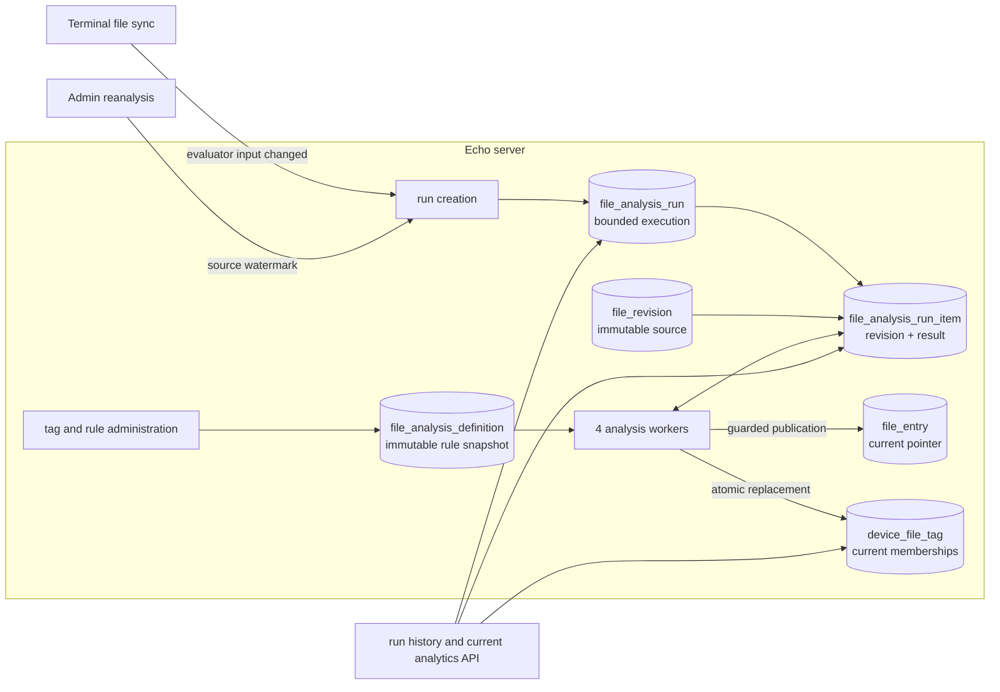
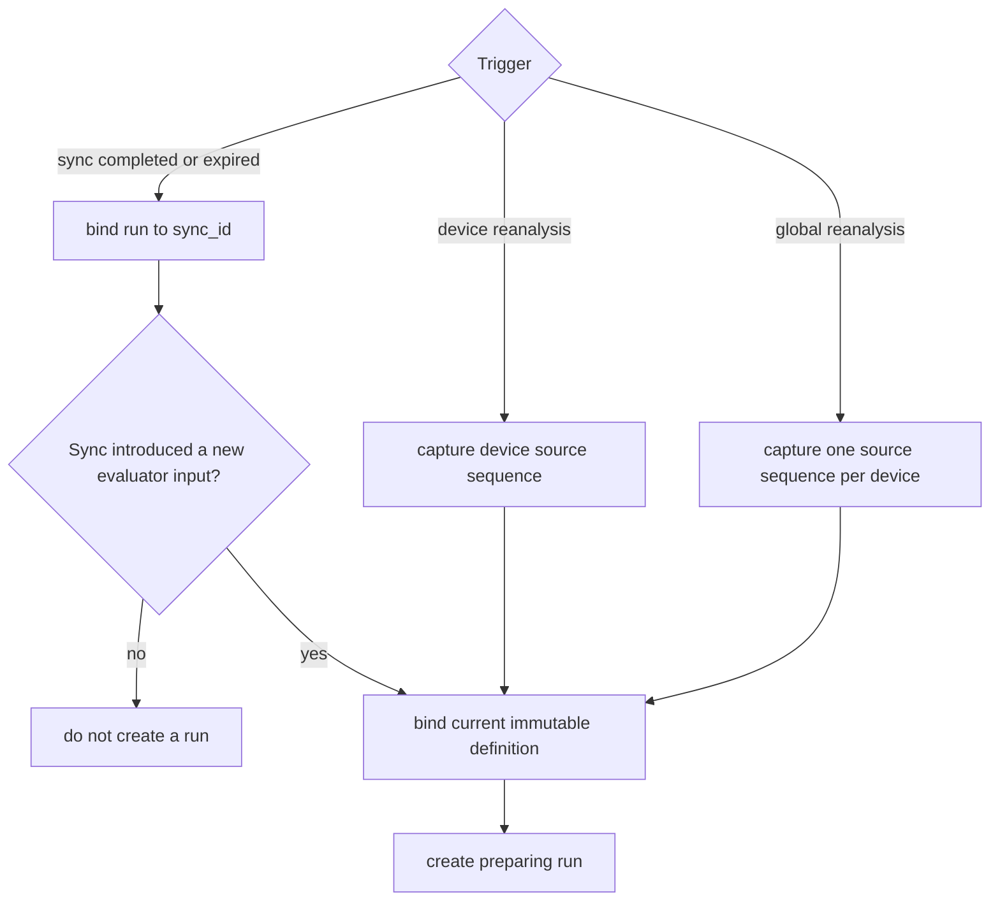
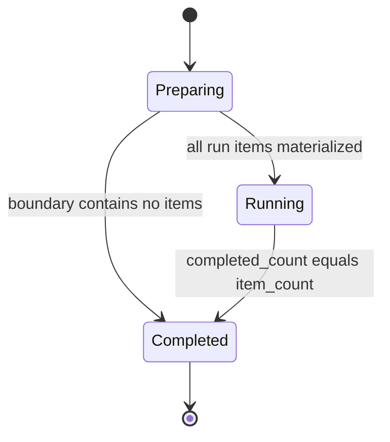
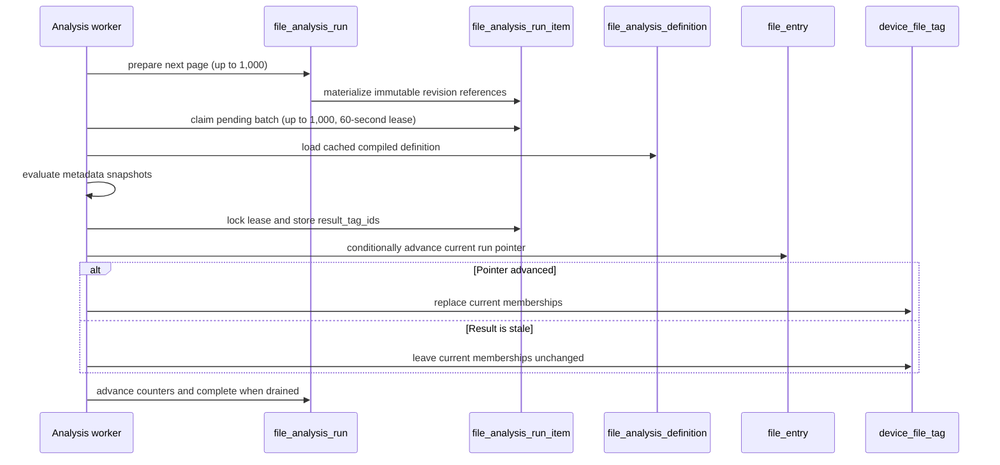
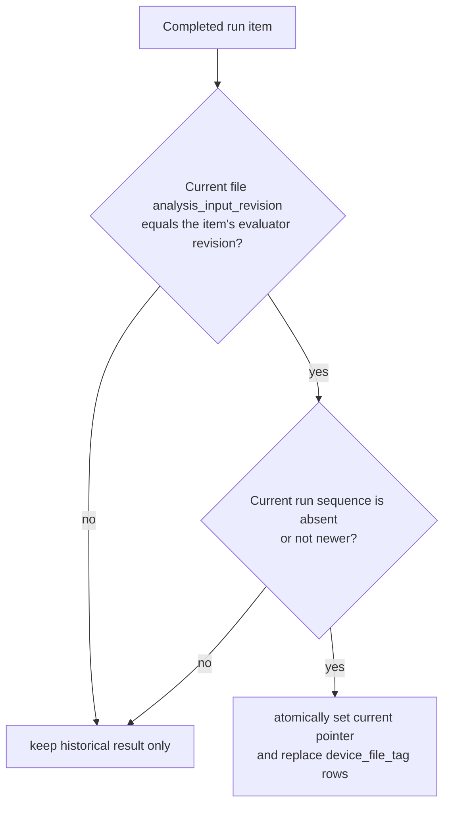

# File analysis

## Model

File analysis classifies immutable metadata revisions rather than mutable
`file_entry` rows. A run fixes both the file boundary and the rule definition;
its item results remain historical even when they are no longer the current
result for a file.



| Record | Responsibility |
| --- | --- |
| `file_analysis_definition` | Immutable canonical rule snapshot with analyzer and DSL versions |
| `file_analysis_run` | Device, cause, source boundary, definition, monotonic run sequence, and counters |
| `file_analysis_run_item` | Exact metadata revision, lease, immutable tag result, and completion time |
| `file_entry.current_analysis_run_id` | Pointer to the current published result for that file |
| `device_file_tag` | Materialized tag memberships for the current pointer |

## Run creation



A synchronization run selects evaluator-changing revisions accepted by that
session. A manual run selects immutable revisions within the captured
per-device source watermark. Files arriving after a manual watermark belong to
a later run.

A terminal synchronization creates at most one run. Repeating completion with
the same batch count returns that run instead of creating another one.

## Definitions and rules

Tag mutations are serialized with definition publication. A new
`file_analysis_definition` is published only when the effective canonical rule
set changes; renaming a tag or saving semantically identical rules does not
advance the definition.

The DSL is a typed expression tree:

| Node | Shape |
| --- | --- |
| conjunction | `{ "op": "all", "children": [...] }` |
| disjunction | `{ "op": "any", "children": [...] }` |
| negation | `{ "op": "not", "child": {...} }` |
| predicate | `{ "op": "match", "field": ..., "matcher": ..., "values": [...] }` |

Fields are `file_name`, `directory_path`, `full_path`, and `extension`.
Matchers are `equals`, `contains`, `contains_token`, and `regex`. Evaluation is
case-insensitive and Unicode-normalized. `file_name` excludes the final suffix;
`extension` excludes a leading dot and falls back to the file-name suffix.

```json
{
  "op": "all",
  "children": [
    {
      "op": "match",
      "field": "directory_path",
      "matcher": "contains_token",
      "values": ["reports"]
    },
    {
      "op": "match",
      "field": "extension",
      "matcher": "equals",
      "values": ["docx", "pdf"]
    }
  ]
}
```

Rules are limited to depth 16, 256 nodes, and 64 values per predicate. Literals
are limited to 1,024 characters and regular expressions to 512. Rule-test
requests persist at most 100 ordered fixtures and never publish a definition,
create a run, or change current file tags.

## Run lifecycle



Preparation materializes run items in pages of at most 1,000. The public run
states are `preparing`, `running`, and `completed`.



The item state exposed by the API is derived from persisted fields:

- `pending`: no active lease and no result;
- `processing`: an unexpired lease exists;
- `completed`: `result_tag_ids` and `completed_at` are stored.

Infrastructure errors release the claimed batch when possible; otherwise its
lease expires and another worker reclaims it. There is no terminal failed item
or failed run state. A run remains nonterminal until every item completes.

## Current-result publication

A completed historical item becomes current only when both guards hold:



This permits a result to publish after a newer MIME, timestamp, or source-state
revision because those fields do not affect evaluation. A path, file-name, or
extension change advances `analysis_input_revision`, so a result for the old
input cannot overwrite current tags. Likewise, an older overlapping run cannot
overwrite a newer run that finished first.

## Read semantics

The current analytics summary and tag-filtered file navigation read
`file_entry.current_analysis_run_id` and `device_file_tag`. Run endpoints read
immutable `file_analysis_run` and `file_analysis_run_item` records, so they can
return the exact definition, source boundary, metadata snapshot, state, and tag
result of an individual execution.

Archived tags are excluded from current public tag reads. Historical run items
retain their stored tag IDs.

## Operational boundaries

| Parameter | Value |
| --- | --- |
| Worker count | 4 |
| Preparation page | 1,000 items |
| Claim batch | 1,000 items |
| Lease | 60 seconds |
| Infrastructure-error backoff | 2 seconds |
| Operational monitor interval | 60 seconds |
| Stuck-run warning threshold | 15 minutes |

## Authority

The evaluator is implemented in `wdintel-rs/src/devices/analytics/rules.rs`;
run orchestration and publication are in `queue.rs` and `worker.rs`; API
mapping is in `bl.rs` and `types.rs`. Current migrations, entities, code, and
focused analytics tests are authoritative.
