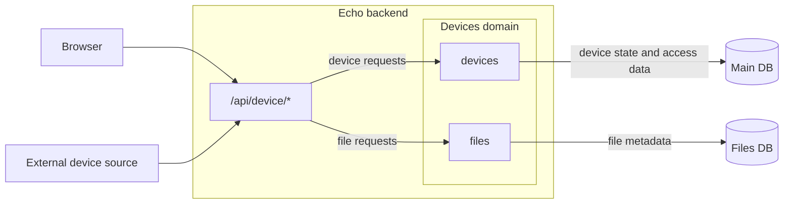
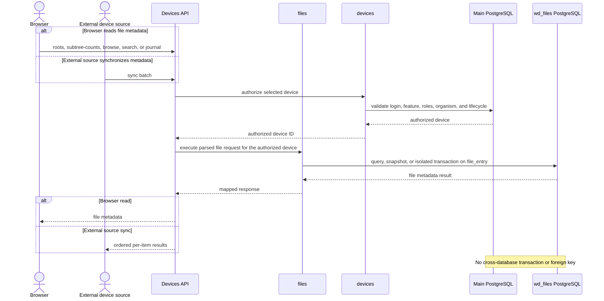
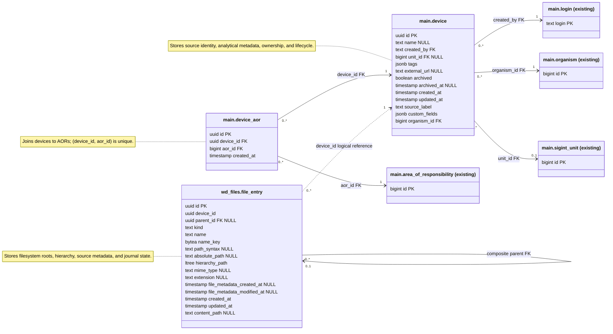

# 2026-07-29: Devices module

## Description

Echo now has a Devices module for registering technical sources, maintaining
analytical metadata, and synchronizing file metadata.

## Architecture

The `devices` domain follows the same module layout as the established backend
domains:

- `devices::devices` owns device routes in `mod.rs`, business logic in `bl.rs`,
  main-database access in `query.rs`, wire and domain types in `types.rs`, and
  its tests in `tests.rs`;
- `devices::files` owns file routes in `mod.rs`, business logic in `bl.rs`,
  file-registry access through `query.rs`, file types in `types.rs`, and its
  tests in `tests.rs`;
- the shared `devices::access` module validates the current login, Devices
  feature flag, roles, organism scope, device lifecycle, and permitted field
  groups for both subdomains;
- the root `types.rs` contains only wire helpers shared by both subdomains, and
  the root `tests.rs` covers shared access, schema, and route contracts.

The files business logic keeps cohesive filesystem helpers in `cursor.rs`,
`path.rs`, `metadata.rs`, `validation.rs`, `sync_pipeline.rs`, and `ltree.rs`.
Its `query.rs` remains the database boundary; the modules under `query/` only
split the file-registry queries into manageable logical groups. The code uses
ordinary functions rather than empty service, repository, parser, or codec
method-holder structures.

The `API` component in the diagrams is the HTTP boundary; its route handlers
remain in the `mod.rs` of the corresponding `devices` or `files` subdomain.



The module reuses authentication and login validation from `users`, reads the
organism tree for visibility, and uses the existing SIGINT AOR and unit models
for analytical classification. Device-authorized `/api/device/aors` and
`/api/device/units` routes expose those reference values without broadening the
permissions of the legacy SIGINT endpoints. The `file_registry` module owns the
second connection, generated entities, provisioning, and migrations;
`devices::files` owns the file metadata behavior built on top of it.

Elm remains responsible for routing and authenticated page composition. It
mounts React through the `devices-page` and `device-details-page` custom
elements. React consumes the generated bindings through the typed Devices API
service; role-based UI controls improve usability, while the backend repeats
all authorization checks.

File-registry requests deliberately cross the databases in two ordered steps,
without a cross-database transaction:



## Storage boundaries

Device and file metadata are intentionally stored in separate PostgreSQL
databases:

- the main Echo database stores `device`, `device_aor`, ownership, lifecycle,
  and analytical relations;
- the independent `wd_files` database stores the `file_entry` hierarchy and
  file synchronization history.

Main-database query functions accept a `DatabaseConnection`, while
file-registry query functions accept `FileRegistryDb`; each stays inside its
subdomain's `query.rs` boundary. There are no cross-database foreign keys or
transactions. A file-registry request first validates the device and actor
against the main database, then performs the isolated file-registry operation.

Both databases have independent migration histories. Main migrations do not
create `wd_files`; its schema migrations run automatically during backend
startup after the database has been provisioned.

## Database model (SQL UML)

The Devices feature owns `device` and `device_aor` in the main database, and
`file_entry` in `wd_files`. The `main.` and `wd_files.` prefixes below identify
the target database rather than PostgreSQL schemas. Existing main-database
tables are included only as relationship targets.



Solid arrows are SQL foreign keys within one database. The self-reference on
`file_entry` is the composite foreign key `(device_id, parent_id)` to
`(device_id, id)`. The dotted `file_entry.device_id` relationship identifies
the owning device but intentionally has no cross-database foreign key or
cascade.

## Deployment

Provision the file-registry database before the first restart of the server or
background worker. Configure these values in `deploy/config.toml`, or in the
TOML file selected through `ECHO_CONFIG_PATH`:

```toml
pg_wdfile_host = "postgres-host"
pg_wdfile_port = 5432
pg_wdfile_user = "wd"
pg_wdfile_password = "..."
pg_wdfile_dbname = "wd_files"
```

Create the database once on the deployment host with the installed backend
binary. Live mode reads `/etc/echo/config.toml`:

```sh
sudo /usr/bin/wdintel-rs --mode=live oneoff-create-file-registry-database
```

Set `ECHO_CONFIG_PATH` when the live configuration is stored elsewhere. The
configured PostgreSQL user needs `CREATEDB` for this provisioning command and
normal DDL permissions for the automatic `wdfiles-migration` startup
migrations. If operations provisions `wd_files` manually instead, the configured
user still needs connection and DDL rights before Echo is restarted.

Test environments use a paired file-registry database, normally
`wd_files_test`, selected with `TEST_WDFILE_DB_NAME`.

## Access and organism visibility

Backend authorization is the source of truth. The effective capabilities are:

| Role | Read | Source data and file sync | Analytical data |
| --- | :---: | :---: | :---: |
| `Cyber` | yes | no | no |
| `DeviceSource` | yes | yes | no |
| `DeviceAnalyst` | yes | yes | yes |
| `Admin` | yes | yes | yes |

Every device stores the organism of the user who created it. A user can see
devices owned by their own organism and by every non-deleted descendant at any
depth. Visibility does not flow upward or sideways: a child organism cannot see
its parent or siblings. The same predicate protects lists, details, updates,
statistics, and file-registry handoffs.

Archived devices remain available to read paths that explicitly include
archived records, including file metadata. Source and analytical writes require
an active device.

## Device ownership and lifecycle

Source-owned fields identify the technical source and its connection metadata.
Analytical fields hold the analyst-assigned name, unit, areas of responsibility,
and other classification. A source user cannot create or modify analytical
metadata. Analyst and administrator roles can maintain both groups when an
operation intentionally combines them.

Creation records both the creator login and creator organism. Updates use
field-level patches, validate the caller's capabilities before writing, and
apply combined source and analytical changes atomically in the main database.
Source labels are unique among active devices. Archived devices do not reserve
active-only uniqueness.

The backend contains lifecycle rules for active and archived devices, but the
public Devices API currently exposes neither archive nor restore endpoints.

## File hierarchy

`file_entry` uses stable UUID identifiers, a parent relation, and a PostgreSQL
`ltree` hierarchy path. Each device can have independent POSIX and Windows
roots. Exact absolute paths are retained as mutable source locations.
Byte-preserving name keys provide deterministic ordering and enforce
uniqueness only for roots and virtual sibling directories; file paths are not
unique and do not identify file objects.

Directories are virtual metadata derived from synchronized paths. Public sync
requests submit files, and the business logic creates or reuses their virtual
directory chains. An item without `file_id` inserts a file leaf with a new
UUIDv7; an item with a known `file_id` updates or moves that existing leaf.
Directory mutation is not a public API.

Synchronization is cumulative rather than snapshot replacement. Omitting a
previously synchronized file does not delete or hide it. The server uses
`file_id`, not the path, as synchronization identity: repeating an item with a
known `file_id` reapplies its location and technical metadata, while repeating
the same path without `file_id` creates a distinct file. Multiple files may
therefore have the same path and may coexist with a same-named virtual
directory.

A batch is processed as ordered independent items inside the synchronization
contract. The response preserves request order and can contain both accepted
and rejected results. Validation failures do not discard successful siblings.
Database failures that invalidate the transaction are classified explicitly so
clients can retry the affected input after rollback.

File counts are exact and computed dynamically. The journal uses an indexed
exact device count; tree expansion groups an indexed `ltree` subtree scan by
the requested roots or directories. Counts are loaded only for the journal or
the tree branch being viewed.

## HTTP API

The implemented API consists of thirteen authenticated `POST` routes:

| Area | Route |
| --- | --- |
| Device list | `/api/device/list` |
| Unit statistics | `/api/device/unit-stats` |
| Device AOR references | `/api/device/aors` |
| Device unit references | `/api/device/units` |
| Device details | `/api/device/detail` |
| Device creation | `/api/device/create` |
| Device update | `/api/device/update` |
| File roots | `/api/device/files/roots` |
| Subtree counts | `/api/device/files/subtree-counts` |
| Direct-child browsing | `/api/device/files/browse` |
| Scoped search | `/api/device/files/search` |
| Synchronization journal | `/api/device/files/journal` |
| File metadata sync | `/api/device/files/sync` |

Requests use the normal Echo authenticated session. JSON payloads are decoded
strictly; malformed shapes and unsupported fields fail instead of being
silently ignored. Generated backend and frontend DTOs define the current wire
format.

Sync clients must distinguish request-level HTTP errors from ordered per-item
results. They must retain the returned `file_id` for every accepted creation
and use it for subsequent updates or moves. An item without `file_id` is a
non-idempotent create, including a retry after an ambiguous transport outcome;
the server neither deduplicates files by path nor exposes an idempotency-key
protocol. Clients should inspect roots, browse, search, and journal state
before retrying an outcome they could not confirm.

## Frontend

The user-facing module provides:

- `/devices` for organism-scoped listing, filtering, creation, and editing;
- `/devices/:id` for analytical details, file-tree browsing, subtree counts,
  search, and synchronization journal inspection.

Elm route wrappers host React custom elements. React uses the generated API
bindings and the same backend authorization model; frontend visibility is not a
security boundary.
