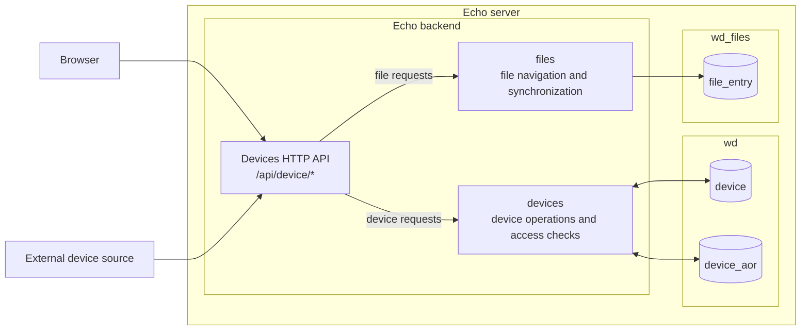
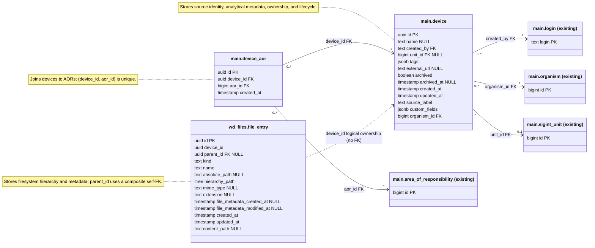

# 2026-07-29: Devices module

## Description

Echo has a Devices module for registering technical sources, maintaining
analytical metadata, and synchronizing file metadata through an optional,
separately configured file registry.

## Architecture

The `devices` domain follows the same module layout as the established backend
domains.



When `[file_registry]` is configured, file requests cross the databases in two
ordered steps without a cross-database transaction:

## Database model




Solid arrows are SQL foreign keys in the main database. Within `wd_files`,
`file_entry` uses the composite foreign key `(device_id, parent_id)` to
`(device_id, id)` for its parent/child hierarchy. The dotted arrow represents
logical device ownership through `file_entry.device_id`; it intentionally has
no cross-database foreign key or cascade.

## Deployment

The file-registry database is optional. To enable device file operations,
configure it in `deploy/config.toml`, or in the TOML file selected through
`ECHO_CONFIG_PATH`:

```toml
[file_registry]
pg_host = "postgres-host"
pg_port = 5432
pg_user = "wd"
pg_password = "..."
pg_dbname = "wd_files"
```

The section itself is the opt-in switch. When it is absent and Devices is
disabled, Echo logs a warning. When Devices is enabled, Echo logs an actionable
error explaining how to add and provision `[file_registry]`. Neither message
blocks startup, but the six device-file routes remain unavailable.

The section's presence restores fail-fast database behavior: operators must
provision the configured database before restarting Echo, and connection or
migration failures block startup. After adding the section, create the database
once with the installed backend binary:

```sh
sudo /usr/bin/wdintel-rs --mode=live oneoff-create-file-registry-database
```


## Access and organism visibility

Backend authorization is the source of truth. The effective capabilities are:

| Role | Read | Source data and file sync | Analytical data |
| --- | :---: | :---: | :---: |
| `Cyber` | yes | no | no |
| `DeviceSource` | yes | yes | yes |
| `Admin` | yes | yes | yes |

Every device stores the organism of the user who created it. A user can see
devices owned by their own organism and by every non-deleted descendant at any
depth. Visibility does not flow upward or sideways: a child organism cannot see
its parent or siblings. The same predicate protects lists, details, updates,
statistics, and file-registry handoffs.

Archived devices remain available to read paths that explicitly include
archived records, including file metadata. Source and analytical writes require
an active device.

## File hierarchy

`file_entry` uses stable UUID identifiers, a parent relation, and a PostgreSQL
`ltree` hierarchy path. Each device can have independent POSIX and Windows
roots. Exact absolute paths are retained as mutable source locations.
Byte-preserving name keys provide deterministic ordering and enforce
uniqueness only for roots and virtual sibling directories; file paths are not
unique and do not identify file objects.

Directories are virtual metadata derived from synchronized paths. Public sync
requests submit files, and the business logic creates or reuses their virtual
directory chains. An item without `file_id` inserts a file leaf with a new
UUIDv7; an item with a known `file_id` updates or moves that existing leaf.
Directory mutation is not a public API.

Synchronization is cumulative rather than snapshot replacement. Omitting a
previously synchronized file does not delete or hide it. The server uses
`file_id`, not the path, as synchronization identity: repeating an item with a
known `file_id` reapplies its location and technical metadata, while repeating
the same path without `file_id` creates a distinct file. Multiple files may
therefore have the same path and may coexist with a same-named virtual
directory.

A batch is processed as ordered independent items inside the synchronization
contract. The response preserves request order and can contain both accepted
and rejected results. Validation failures do not discard successful siblings.
Database failures that invalidate the transaction are classified explicitly so
clients can retry the affected input after rollback.

File counts are exact and computed dynamically. The journal uses an indexed
exact device count; tree expansion groups an indexed `ltree` subtree scan by
the requested roots or directories. Counts are loaded only for the journal or
the tree branch being viewed.

## HTTP API

The implemented API consists of thirteen authenticated `POST` routes:

| Area | Route |
| --- | --- |
| Device list | `/api/device/list` |
| Unit statistics | `/api/device/unit-stats` |
| Device AOR references | `/api/device/aors` |
| Device unit references | `/api/device/units` |
| Device details | `/api/device/detail` |
| Device creation | `/api/device/create` |
| Device update | `/api/device/update` |
| File roots | `/api/device/files/roots` |
| Subtree counts | `/api/device/files/subtree-counts` |
| Direct-child browsing | `/api/device/files/browse` |
| Scoped search | `/api/device/files/search` |
| Synchronization journal | `/api/device/files/journal` |
| File metadata sync | `/api/device/files/sync` |

Requests use the normal Echo authenticated session. JSON payloads are decoded
strictly; malformed shapes and unsupported fields fail instead of being
silently ignored. Generated backend and frontend DTOs define the current wire
format.

The seven device routes depend only on the main database. The six device-file
routes additionally require `[file_registry]`; when it is absent, an otherwise
authorized file request receives HTTP 503 with `Retry-After`, while the device
registry remains available.

Sync clients must distinguish request-level HTTP errors from ordered per-item
results. They must retain the returned `file_id` for every accepted creation
and use it for subsequent updates or moves. An item without `file_id` is a
non-idempotent create, including a retry after an ambiguous transport outcome;
the server neither deduplicates files by path nor exposes an idempotency-key
protocol. Clients should inspect roots, browse, search, and journal state
before retrying an outcome they could not confirm.

