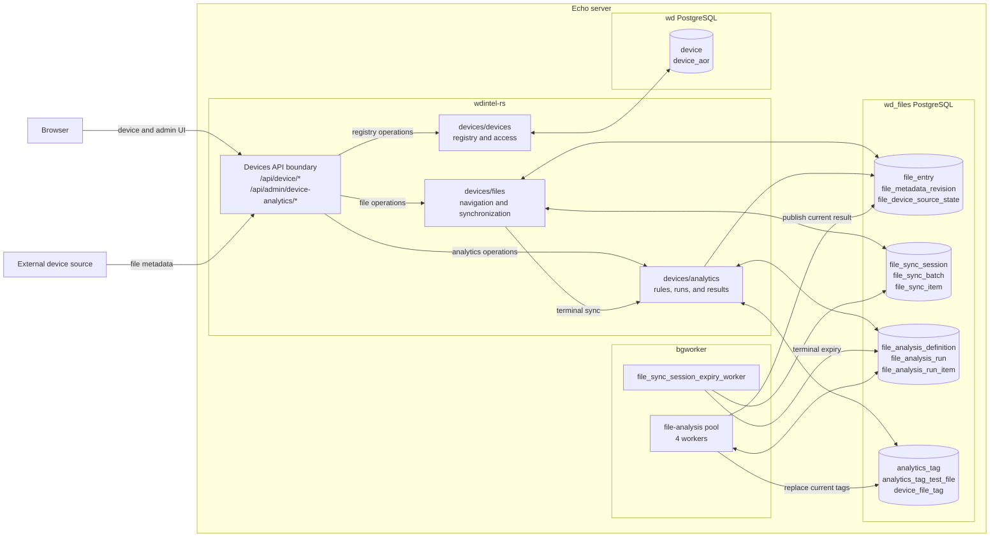

# 2026-07-29: Devices module

## Description

The Devices module registers technical sources in Echo, projects their file
metadata into an optional file-registry database, and classifies files with
administrator-defined analytics tags. The registry, synchronization history,
analysis runs, and current analytical result remain queryable through one
authenticated API.

## Architecture



The main `wd` database owns device identity, organism ownership, AORs, and
units. `wd_files` owns the file projection and every synchronization and
analysis artifact. Authorization is checked against `wd` before file-backed
operations continue in `wd_files`;

| Area | Current model |
| --- | --- |
| Device registry | Organism-scoped devices with source and analytical fields |
| File registry | Cumulative current projection keyed by device and normalized absolute Windows path |
| Synchronization | Automatic calls and resumable explicit sessions with persisted per-item outcomes |
| Analysis | Immutable rule definitions, bounded runs, immutable run items, and a guarded current-result pointer |
| Navigation | Root, tree, search, journal, tag-filtered, and run-history reads |

## Functional records

- [File metadata synchronization](SYNC.md) describes identity, session,
  revision, retry, and analysis-handoff behavior.
- [File analysis](ANALYSIS.md) describes rule snapshots, bounded runs, workers,
  publication, and concurrent-run behavior.

## Access and visibility

| Capability | `Cyber` | `DeviceSource` | `Admin` |
| --- | :---: | :---: | :---: |
| Registry read, create, and source fields | yes | yes | yes |
| Analytical device fields and reference lists | no | yes | yes |
| File navigation, synchronization, and analytics reads | yes | yes | yes |
| Tag administration and manual reanalysis | no | no | yes |

A device is visible to its creating organism and that organism's non-deleted
descendants. Visibility does not flow to parents or siblings. The same scope is
applied before details, file operations, summaries, and analysis-run reads.
Archived devices remain readable when the route explicitly supports them.
Registry-field updates and file synchronization require an active device;
administrators may schedule reanalysis for a visible archived device.

## Deployment

The seven registry routes use only `wd`. The remaining twenty-seven file and
analytics routes require the following optional configuration:

```toml
[file_registry]
pg_host = "postgres-host"
pg_port = 5432
pg_user = "wd"
pg_password = "..."
pg_dbname = "wd_files"
```

When the section is absent, file-backed routes return HTTP `503` with
`Retry-After: 60`; registry routes remain available. When it is present,
connection and migration failures block startup. Provision the database once
with the installed backend binary:

```sh
sudo /usr/bin/wdintel-rs --mode=live oneoff-create-file-registry-database
```

The production bgworker starts the synchronization-expiry worker and the
four-worker analysis pool whenever `wd_files` is configured.

## Authority

This archive describes the implemented Devices design. Current Rust code,
`wd_files` migrations, generated SeaORM entities, generated frontend DTOs, and
focused tests are authoritative when they differ from this record.
