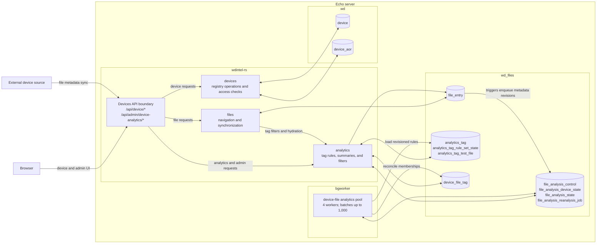
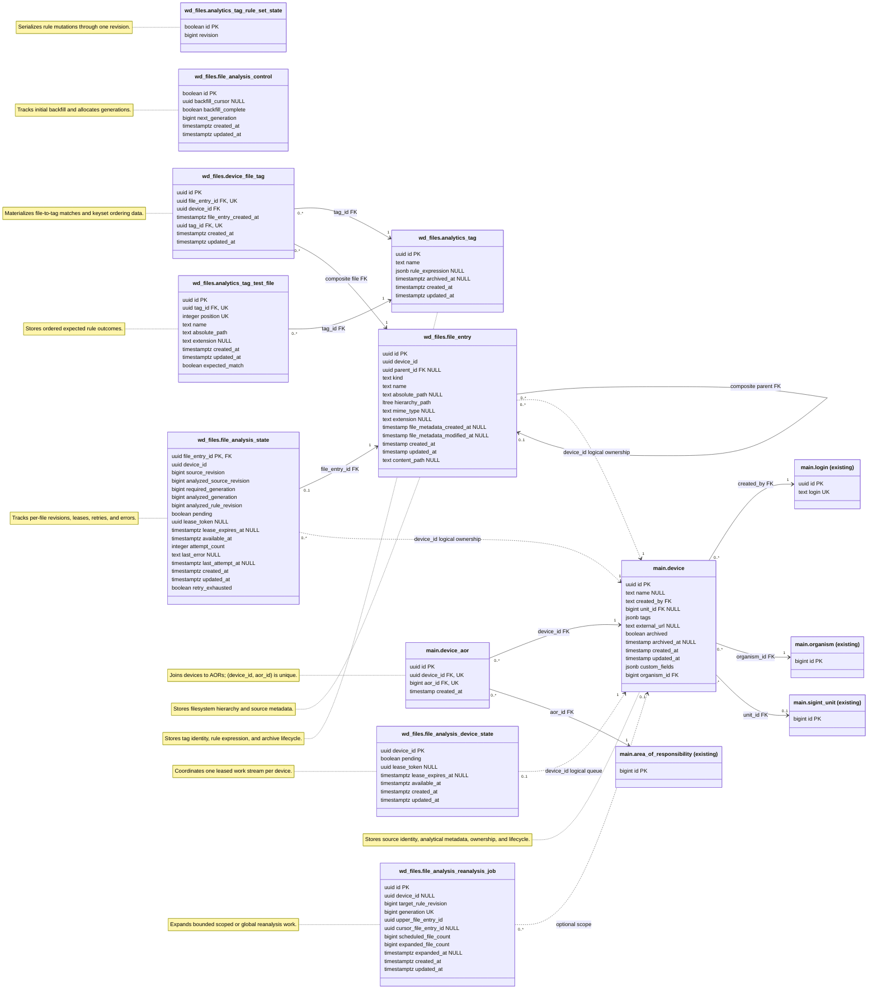
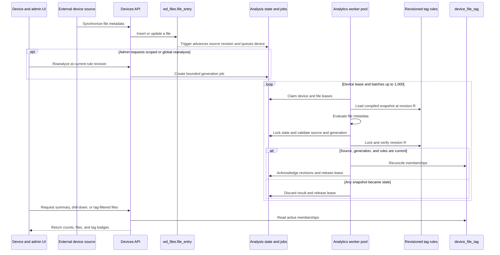

# 2026-07-29: Devices module

## Description

Echo has a Devices module for registering technical sources, maintaining
analytical metadata, and synchronizing file metadata through an optional,
separately configured file registry. Synchronized files are classified into
administrable analytics tags, exposed through tag-aware navigation and
per-device summaries, and processed by a durable background workflow.

## Architecture

The `devices` domain is split into device registry, file registry, and file
analytics subdomains. HTTP handlers form one conceptual API boundary; business
orchestration and persistence remain inside their respective subdomains.



When `[file_registry]` is configured, file-backed requests first authorize the
device and organism visibility in `wd`, then operate in `wd_files`. There is no
cross-database transaction. All file-analysis configuration, work state, and
results are isolated in `wd_files`; `wd` retains device identity, ownership,
and AOR relationships.

## Database model

The branch adds eight generated SeaORM entities under
`wdintel-rs/src/file_registry/entities`, each backed by a new `wd_files` table:

| Entity and table               | Responsibility                                                         |
| ------------------------------ | ---------------------------------------------------------------------- |
| `analytics_tag`                | User-managed tag identity, optional rule expression, and archive state |
| `analytics_tag_rule_set_state` | Singleton revision used for consistent rule snapshots                  |
| `analytics_tag_test_file`      | Ordered positive and negative fixtures retained by the rule tester     |
| `device_file_tag`              | Materialized many-to-many assignments between files and analytics tags |
| `file_analysis_control`        | Singleton initial-backfill cursor and generation allocator             |
| `file_analysis_device_state`   | Per-device queue state and lease                                       |
| `file_analysis_state`          | Per-file source, rule, generation, retry, error, and lease state       |
| `file_analysis_reanalysis_job` | Bounded global or device-scoped reanalysis expansion                   |



Solid arrows are SQL foreign keys within one PostgreSQL database. The dotted
arrows represent logical ownership through UUIDs and intentionally do not
create cross-database constraints or cascades.

Within `wd_files`, `file_entry` uses the composite foreign key
`(device_id, parent_id)` to `(device_id, id)` for its hierarchy.
`device_file_tag` uses `(device_id, file_entry_id)` to reference the same
composite file identity, and `(file_entry_id, tag_id)` is unique.
`analytics_tag_test_file` is unique by `(tag_id, position)`, while tag names
are unique by a case-insensitive trimmed expression index.

The boolean primary keys in `analytics_tag_rule_set_state` and
`file_analysis_control` are constrained to `true`, enforcing one row in each
table. Reanalysis upper bounds and cursors, and the initial backfill cursor,
are deliberately soft file UUID references: they are durable scan positions,
not ownership relationships.

## Device file analysis

Only file metadata participates: file name, directory or full path, and
extension. PostgreSQL triggers advance `source_revision` after a file insert
or a relevant metadata change, while an incremental cursor backfills files
that predate the analysis tables.

The four workers lease one device and then file batches of at most 1,000. A
batch is committed only while its source revision, required generation, and
compiled rule-set revision remain current; tag membership reconciliation and
state acknowledgement occur in the same transaction. Expired leases are
recoverable, failed work is retried up to ten attempts, and newer metadata or
reanalysis resets exhausted work.

Rule-affecting changes advance the singleton rule revision but do not
implicitly rewrite historical assignments. Explicit global or device-scoped
reanalysis captures a bounded file set under a new generation and expands it
incrementally.



## Tag rules and user interfaces

Rules are typed boolean expression trees with `all`, `any`, `not`, and `match`
nodes. Match nodes target `file_name`, `directory_path`, `full_path`, or
`extension`, using equality, substring, token, or regular-expression matching.
The rule tester persists up to 100 ordered fixtures with an expected match and
reports the actual and expected result without changing live assignments.

A DML-only migration seeds twelve tags with fixed UUIDs and initial rules:
`Втрати`, `Доповіді`, `Озброєння`, `Штатки`, `Бойові документи`,
`Військовий файл`, `Карти командира`, `Плани противника`,
`Профільні програми`, `Робота з радіо`, `Маршрути, палітри`, and
`Паролі, доступи`. The seed uses `ON CONFLICT DO NOTHING`, increments the
rule-set revision only when it inserts at least one tag, and has a
non-destructive rollback because seeded rows immediately become user-managed.

The admin route `/admin/device-analytics` is titled `Аналіз пристроїв`. Its
initial `Основні налаштування` tab is intentionally empty; the lazy
`Теги пристроїв` tab contains tag create/rename, archive/restore, rule editing,
rule testing, and global reanalysis. Device details expose analysis progress,
tag summaries, paginated file drill-down, and admin-only device reanalysis.
File tree, search, and journal views expose active tag badges and
`any`/`all`/untagged filters.

## Deployment

The file-registry database is optional for the Echo installation as a whole,
but it is required for file operations and device-file analytics. Configure it
in `deploy/config.toml`, or in the TOML file selected through
`ECHO_CONFIG_PATH`:

```toml
[file_registry]
pg_host = "postgres-host"
pg_port = 5432
pg_user = "wd"
pg_password = "..."
pg_dbname = "wd_files"
```

The section itself is the opt-in switch. When it is absent and Devices is
disabled, Echo logs a warning. When Devices is enabled, Echo logs an actionable
error explaining how to add and provision `[file_registry]`. Neither message
blocks startup. When Devices is enabled without the file registry, the seven
main-database device routes remain available, while the six file routes and
thirteen analytics routes are unavailable.

The section's presence restores fail-fast database behavior: operators must
provision the configured database before restarting Echo, and connection or
migration failures block startup. After adding the section, create the database
once with the installed backend binary:

```sh
sudo /usr/bin/wdintel-rs --mode=live oneoff-create-file-registry-database
```

The standard `wd_files` migrations create the analytics tables, triggers,
indexes, singleton rows, and default tags. When the file registry is available,
the production bgworker starts the four-worker analytics pool; its incremental
backfill schedules pre-existing files without a separate operator command.
Historical files require an explicit admin reanalysis after later rule changes.

## Access and organism visibility

Backend authorization is the source of truth. The effective capabilities are:

| Role           | Read | Create, source data, and file sync | Analytical device fields | File analytics read | Tag/rule administration and reanalysis |
| -------------- | :--: | :--------------------------------: | :----------------------: | :-----------------: | :------------------------------------: |
| `Cyber`        | yes  |                yes                 |            no            |         yes         |                   no                   |
| `DeviceSource` | yes  |                yes                 |           yes            |         yes         |                   no                   |
| `Admin`        | yes  |                yes                 |           yes            |         yes         |                  yes                   |

Every device stores the organism of the user who created it. A user can see
devices owned by their own organism and by every non-deleted descendant at any
depth. Visibility does not flow upward or sideways: a child organism cannot see
its parent or siblings. The same predicate protects lists, details, updates,
statistics, file-registry handoffs, analytics summaries, and file drill-downs.

Archived devices remain available to read paths that explicitly include
archived records, including file metadata and analytics. Source and analytical
writes require an active device. All `/api/admin/device-analytics/*` routes
independently require the `Admin` role.

## File hierarchy

`file_entry` uses stable UUID identifiers, a parent relation, and a PostgreSQL
`ltree` hierarchy path. Each device can have independent POSIX and Windows
roots. Exact absolute paths are retained as mutable source locations.
Byte-preserving name keys provide deterministic ordering and enforce
uniqueness only for roots and virtual sibling directories; file paths are not
unique and do not identify file objects.

Directories are virtual metadata derived from synchronized paths. Public sync
requests submit files, and the business logic creates or reuses their virtual
directory chains. An item without `file_id` inserts a file leaf with a new
UUIDv7; an item with a known `file_id` updates or moves that existing leaf.
Directory mutation is not a public API.

Synchronization is cumulative rather than snapshot replacement. Omitting a
previously synchronized file does not delete or hide it. The server uses
`file_id`, not the path, as synchronization identity: repeating an item with a
known `file_id` reapplies its location and technical metadata, while repeating
the same path without `file_id` creates a distinct file. Multiple files may
therefore have the same path and may coexist with a same-named virtual
directory.

A batch is processed as ordered independent items inside the synchronization
contract. The response preserves request order and can contain both accepted
and rejected results. Validation failures do not discard successful siblings.
Database failures that invalidate the transaction are classified explicitly so
clients can retry the affected input after rollback.

File counts are exact and computed dynamically. The journal uses an indexed
exact device count; tree expansion groups an indexed `ltree` subtree scan by
the requested roots or directories. Counts are loaded only for the journal or
the tree branch being viewed.

Browse, scoped search, and journal requests can filter by any selected tag, all
selected tags, or files without an active tag. Tag-aware tree browsing retains
a directory when its subtree contains a matching file. Returned file rows are
hydrated with active tag identities; archived tags are excluded from filtering
and display without deleting their historical assignments.

## HTTP API

The implemented API consists of twenty-six authenticated `POST` routes:

| Area                     | Route                                                   |
| ------------------------ | ------------------------------------------------------- |
| Device list              | `/api/device/list`                                      |
| Unit statistics          | `/api/device/unit-stats`                                |
| Device AOR references    | `/api/device/aors`                                      |
| Device unit references   | `/api/device/units`                                     |
| Device details           | `/api/device/detail`                                    |
| Device creation          | `/api/device/create`                                    |
| Device update            | `/api/device/update`                                    |
| File roots               | `/api/device/files/roots`                               |
| Subtree counts           | `/api/device/files/subtree-counts`                      |
| Direct-child browsing    | `/api/device/files/browse`                              |
| Scoped search            | `/api/device/files/search`                              |
| Synchronization journal  | `/api/device/files/journal`                             |
| File metadata sync       | `/api/device/files/sync`                                |
| Active analytics tags    | `/api/device/analytics/tags`                            |
| Device analytics summary | `/api/device/analytics/summary`                         |
| Tagged-file drill-down   | `/api/device/analytics/files`                           |
| Admin tag list           | `/api/admin/device-analytics/tags/list`                 |
| Admin tag creation       | `/api/admin/device-analytics/tags/create`               |
| Admin tag rename         | `/api/admin/device-analytics/tags/update`               |
| Admin tag archive        | `/api/admin/device-analytics/tags/archive`              |
| Admin tag restore        | `/api/admin/device-analytics/tags/restore`              |
| Admin rule save          | `/api/admin/device-analytics/tags/rule/save`            |
| Admin rule test fixtures | `/api/admin/device-analytics/tags/rule/test-files/list` |
| Admin rule test          | `/api/admin/device-analytics/tags/rule/test`            |
| Global reanalysis        | `/api/admin/device-analytics/reanalyze/all`             |
| Device reanalysis        | `/api/admin/device-analytics/reanalyze/device`          |

Requests use the normal Echo authenticated session. JSON payloads are decoded
strictly; malformed shapes and unsupported fields fail instead of being
silently ignored. Generated backend, Elm, and TypeScript DTOs define the
current wire format.

The seven device routes depend only on the main database. The six device-file
and thirteen analytics routes additionally require `[file_registry]`; when it
is absent, an otherwise authorized request receives HTTP 503 with
`Retry-After`, while the device registry remains available.

Browse, search, and journal accept optional `tag_ids`, `tag_match` (`any` or
`all`), and `untagged` fields. Only active tag IDs are accepted; `untagged` is
mutually exclusive with explicit IDs. Existing endpoint paths and pagination
contracts remain unchanged.

Sync clients must distinguish request-level HTTP errors from ordered per-item
results. They must retain the returned `file_id` for every accepted creation
and use it for subsequent updates or moves. An item without `file_id` is a
non-idempotent create, including a retry after an ambiguous transport outcome;
the server neither deduplicates files by path nor exposes an idempotency-key
protocol. Clients should inspect roots, browse, search, and journal state
before retrying an outcome they could not confirm.

## Authority

This archive records the implemented design of the branch. Current Rust code,
`wd_files` migrations, generated SeaORM entities, generated frontend DTOs, and
tests are authoritative if they differ from this historical description.
