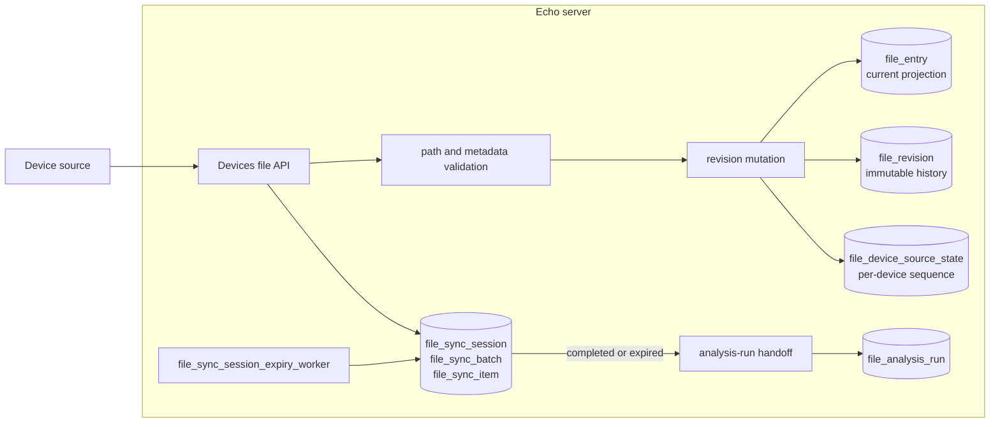
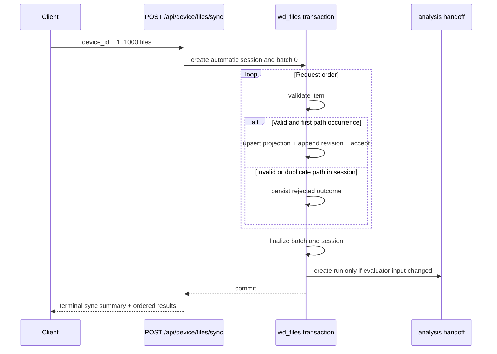
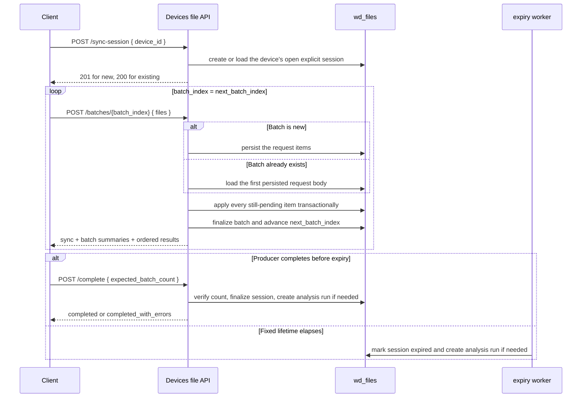
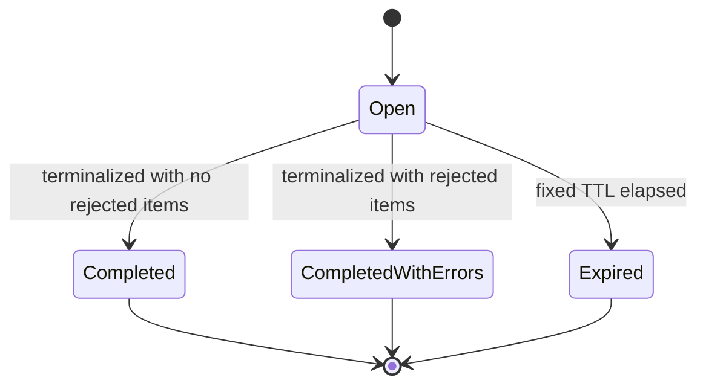
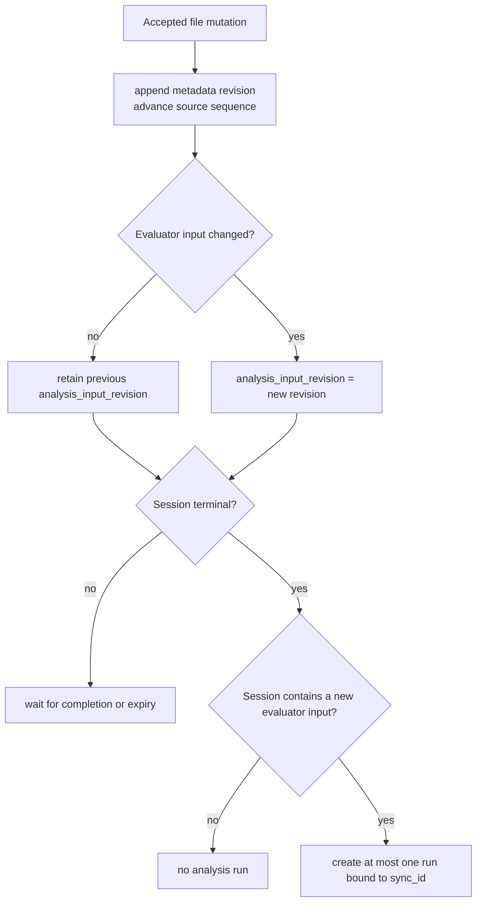

# File metadata synchronization

## Contract

| Input | Behavior |
| --- | --- |
| Path | Trims outer whitespace and uppercases the drive letter |
| Unsupported path | Rejects relative, POSIX, device, extended-length, empty-component, `.` and `..` paths |
| Existing normalized path | Updates the same server-owned file |

Every accepted item, atomically:

1. updates `file_entry`, the current projection;
2. appends one immutable `file_revision`;
3. increments the file revision and the device-wide source sequence;
4. records the terminal item outcome.

An accepted metadata revision clears current content even when bytes are
unchanged. The source may explicitly republish an earlier verified object via
the [content reuse API](../../docs/device-file-content-reuse.md), with the
original upload UUID, exact size and SHA-256. A separate immutable binding
records the new revision; replay of an old binding cannot overwrite newer
metadata. Normal TUS publication remains available for changed bytes.

## Flow

One device can have only one open synchronization session. An automatic call
therefore conflicts with an open explicit session, and starting an explicit
session while another explicit session is open returns that existing session.

## Automatic synchronization

`POST /api/device/files/sync` is the bounded one-shot mode. The session, batch,
item outcomes, file mutations, immutable revisions, terminal session state, and
optional analysis run commit in one `wd_files` transaction.

A deterministic item error is a partial success and does not discard accepted
siblings. An infrastructure failure rolls back the entire automatic call.

## Explicit synchronization

Explicit sessions support restart-safe producers. They have a fixed three-hour
lifetime from creation and accept batches strictly in ascending zero-based
order.

The first body persisted for `(sync_id, batch_index)` is authoritative. A replay
of that batch resumes or returns its persisted work; a different body on the
replay does not replace it. Completion is idempotent only when
`expected_batch_count` equals the already finalized count.

`POST /api/device/files/sync-session/{sync_id}/items` pages persisted terminal
outcomes by `(batch_index, item_index)`. It is the recovery source after a lost
HTTP response. Expiry preserves terminal outcomes and does not invent outcomes
for items that were never applied.

## Session and batch states

| Object | States |
| --- | --- |
| Session | `open`, `completed`, `completed_with_errors`, `expired` |
| Batch | `processing`, `applied`, `applied_with_errors` |
| Item | pending internally, then `accepted` (`created` or `updated`) or `rejected` |

## Analysis handoff

File revisions and analysis-input revisions are deliberately separate. MIME
type, timestamps, and source state still create a metadata revision, but they
do not require classification again.

Evaluator input consists of the file name without its final suffix, directory
path, full path, and extension. [File analysis](ANALYSIS.md) describes how the
run snapshots and publishes those results.

## Failure and retry semantics

| Outcome | HTTP behavior | Retry rule |
| --- | --- | --- |
| Item validation failure | `200`, item is `rejected` with `validation` and field errors | Do not retry unchanged input |
| Path already accepted in the same session | `200`, later item is `rejected` with `duplicate_path_in_session` | Send the path in a later session if needed |
| Invalid top-level batch or query | `400` | Correct the request |
| Session/order conflict | `409` with stable `code` and `message` | Read session state, then resume the expected operation |
| File registry unavailable | `503` with `Retry-After: 60` | Retry after configuration or service recovery |
| Infrastructure or uncertain commit | `500` | Automatic mode has no replay identity, so a retry is a new mutation if the first call committed; explicit callers first read status and outcomes, then replay the same batch identity |

Explicit conflict codes are `active_session`, `wrong_next_batch`,
`terminal_session`, `complete_mismatch`, and `batch_processing`.

## Limits

| Boundary | Limit |
| --- | --- |
| Files per automatic call or explicit batch | `1..1000` |
| Open explicit lifetime | 3 hours, not extended by activity |
| Outcome page | default 100, maximum 100 |
| Expiry claim | up to 100 sessions per tick |
| Expiry idle poll | 60 seconds |

Path and metadata size limits are enforced at item validation and reported in
`field_errors`; the wire shapes are listed in [HTTP API](API.md).

## Authority

The synchronization implementation is in
`wdintel-rs/src/devices/files/sync/`, with wire types in
`wdintel-rs/src/devices/files/types.rs` and schema in `wdfiles-migration` plus
`wdintel-rs/src/file_registry/entities`. Current code, migrations, generated
DTOs, and focused synchronization tests are authoritative.
