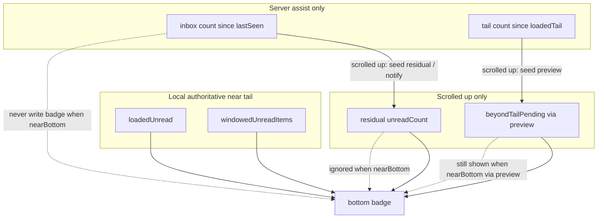

# Duty Neo scroll & unread behavior

Status: **implemented** (windowed scroll + local-authoritative unread / near-bottom residual fix).

Short summary: [`docs/duty/README.md`](../../docs/duty/README.md).

This document describes how Duty Neo feed scrolling works **now**, and how the unread badge is owned relative to that scroll model.

Primary code:

- [`useWindowedFeedScroll.ts`](../../wdintel-web/src/ts/react/routes/rer-duty-neo/useWindowedFeedScroll.ts)
- [`FeedColumnContent.tsx`](../../wdintel-web/src/ts/react/routes/rer-duty-neo/FeedColumnContent.tsx)
- [`index.tsx`](../../wdintel-web/src/ts/react/routes/rer-duty-neo/index.tsx) (`onReachedBottom` / follow / near-bottom refs)
- [`useRerDutyDirectionalLoads.ts`](../../wdintel-web/src/ts/react/routes/rer-duty-neo/useRerDutyDirectionalLoads.ts)
- [`utils.ts`](../../wdintel-web/src/ts/react/routes/rer-duty-neo/utils.ts) (window limit + badge formula)

---

## Part 1 — How scroll works now

### Windowed list

- Each column keeps at most **`DUTY_FEED_MESSAGE_WINDOW_LIMIT` (40)** messages in DOM/state.
- **Load older** prepends, then end-trims if over limit.
- **Load newer** appends, then start-trims if over limit.
- Start-trim of _previously loaded_ unread rows marks those ids read; rows that arrived in the same oversized batch and were trimmed immediately stay in `windowedUnreadItems`.
- Scroller uses CSS class `rer-duty-feed-scroll` with **`overflow-anchor: none`** so the browser does not fight programmatic / restore logic.

### Distance zones

`distanceToBottom = scrollHeight - clientHeight - scrollTop`.

| Zone                | Threshold (Duty Neo)                                                                                                                                                                                       | Meaning                                                                                  |
| ------------------- | ---------------------------------------------------------------------------------------------------------------------------------------------------------------------------------------------------------- | ---------------------------------------------------------------------------------------- |
| **Physical bottom** | `distance ≤ 0.5px`                                                                                                                                                                                         | Pixel-flush with the live end; required for auto-follow scroll after newer load          |
| **At bottom**       | `distance ≤ 25px` (`DUTY_FEED_AT_BOTTOM_THRESHOLD_PX`)                                                                                                                                                     | Tight “settled at end” for read marking / at-bottom callbacks                            |
| **Near bottom**     | `distance ≤ 640px` (`LOAD_NEWER_BUFFER_PX`); when unread prefetch is still needed, expands up to `min(2×viewport, 2×buffer)` (≤ ~1280px with Duty buffers) — **not** “last N tall messages” | Prefetch newer; badge treats this as “at the live tail” for residual/preview suppression |
| **Near top**        | `scrollTop ≤ 160px` (`LOAD_OLDER_BUFFER_PX`)                                                                                                                                                               | Prefetch older                                                                           |

Default hook buffers differ (`320` / `160`); Duty Neo overrides via `FeedColumnContent`.

### Follow tail / watch mode

- **Watch mode** (UI): column intends to live-follow when auto-scroll prefs allow (`watchModeByFeedId`, default on).
- **Follow generation**: `beginFollowTail` / `ensureFollowTail` / `cancelFollowTail` — each cancel or re-begin bumps generation so in-flight newer loads cannot scroll or mark-all-read after the user left the tail.
- Poll / near-bottom newer load sets `scrollToEndAfterLoad` only when:
  - auto-scroll not disabled, and
  - **physically** at bottom, and
  - follow generation still valid.
- Leaving the bottom (`onLeftBottom` / scroll away) cancels follow and turns watch mode off for that feed.

### Reaching the bottom

`onReachedBottom({ hasSeenNotAtBottom })` (from physical-bottom entry):

1. Compute **pending tail** without residual poll stock: local loaded/trimmed unread, or `tailAvailability ∈ {available, checking, loading}`.
2. If `hasSeenNotAtBottom && hasPendingTail` → **`preservePendingTail`**: cancel follow, keep watch off, still `loadFeedNewerMessages` **without** follow so catch-up can clear the badge.
3. Else → `ensureFollowTail` + enable watch (unless auto-scroll disabled).
4. Always mark visible through the loaded tail with `handleVisibleMessageIds(lastId, { atBottom: true })`.
5. Return value: follow allowed only when **not** preserving pending (`follow:blocked` in debug when pending).

### Loading while scrolling

- Near **top** → `onLoadOlder` (armed once per approach; re-armed when leaving the zone).
- Near **bottom** → `onLoadNewer` (same arming); re-armed when `lastItemId` changes so a new tail can load again.
- Anchor snapshot is captured when a directional load is armed so append/prepend can restore viewport.

### Scroll jump prevention (anchor restore)

When items change while **not** at the physical bottom and **not** following, restore uses a snapshot taken before the load:

1. **Visible anchors** — prefer currently visible message ids; apply `scrollTop += (currentOffset - expectedOffset)`.
2. **Common mounted id** — any id still present from the snapshot’s offset map.
3. **Prefix-height** — if start-trim removed a prefix before the first current id, subtract that removed height from the old `scrollTop`.

Programmatic restore sets `isRestoringAnchorRef` so the synthetic scroll does not look like a user leave-bottom.

While **following** (watch + physical bottom), item/list growth triggers `scrollToBottom('auto')`.

While **physically at bottom with watch off** (pending catch-up), also `scrollToBottom` (“stick-bottom”) so the user stays near the live edge and newer pages keep loading — do **not** preserve-anchor in a way that throws them thousands of px up.

After any items change, re-run scroll zone evaluation so near-bottom can arm another newer load. Poll also pages (up to 20) while `nearBottom` remains true.

Initial mount uses a short bottom-settle RAF loop so late layout does not leave a gap above the end.

### Arrow down

1. `beginFollowTail` + smooth/auto `scrollToEnd`.
2. Enable watch mode (if auto-scroll allowed).
3. Inbox count as fetch gate only.
4. Load newer with follow when quantity > 0.
5. **`catchUpFeedUnreadToTail`** — clear badge/trimmed, mark loaded read, pin read cursor / exhausted to loaded tail (also on quantity 0).

While any newer `get-inbox` is in flight (including background catch-up with `showLoading: false`), the down-arrow FAB shows a spinner. If a beyond-tail unread badge is visible, it **stays** during the fetch so the count means “pending on server / still loading,” not “already on screen.”

---

## Part 2 — Unread badge behavioral spec

### Goal

The bottom arrow badge means: **messages in this feed the user has not yet caught up to**, not “server rows after a lagging read cursor.”

### Non-goals / hard constraints

- **Do not** compute unread as `loadedTailId - cursorId`. IDs are monotonic but **not dense under the feed filter** (gaps are normal). Inbox `quantity` is filtered count after `since_id`, not an ID delta.
- **Do not** drop inbox/tail count entirely — still needed to know whether anything exists **beyond the loaded window** and to gate `load newer`.
- Watch mode / follow-tail / auto-scroll prefs stay as today; this section only defines **how the number is owned and updated**.

### Definitions

| Term                    | Meaning                                                                                                               |
| ----------------------- | --------------------------------------------------------------------------------------------------------------------- |
| **Last seen**           | Highest message (by feed order) the user has marked read via viewport / at-bottom catch-up / watch-mode mark-all-read |
| **Loaded unread**       | Items currently in the window with `id ∉ readIds`                                                                     |
| **Trimmed unread**      | `windowedUnreadItems` — unread that left the window upward when newer pages were appended                             |
| **Beyond-tail pending** | Confirmed count of matching messages newer than `loadedTail` (matching tail preview when scrolled up)                 |
| **Residual stock**      | `feed.unreadCount` above loaded+trimmed — poll-seeded cache used **only when scrolled up**                            |
| **Watch mode**          | Column following the live tail (arrow click or settled at bottom without pending catch-up)                            |
| **Badge**               | Number on the down-arrow FAB                                                                                          |

### Source-of-truth split



### Badge formula

[`feedIndicatorUnreadCount`](../../wdintel-web/src/ts/react/routes/rer-duty-neo/utils.ts):

```text
# always
base = loadedUnread + trimmedUnread

# scrolled up (not nearBottom)
badge = base + (matchingPreview ? preview.count : residualBeyondTail)

# nearBottom
badge = base + (matchingPreview ? preview.count : 0)
# includeBeyondTailResidual = false; matching preview still counts
```

where `residualBeyondTail = max(0, unreadCount - loadedUnread - trimmedUnread)`.

Near-bottom must **not** show residual poll stock (lagging inbox-since-cursor). It **must** still show a matching tail preview / tailCount-since-loadedTail — that is real mail beyond the window.

### Modes and transitions

#### A. Watch mode (following)

- User is at the live tail; newer appends mark-all-read (existing follow rules).
- **`badge = 0`**, trimmed empty, residual cleared on catch-up.
- Inbox/tail polls may still run to decide whether to fetch; they **must not raise the badge** while near-bottom / follow is valid.

#### B. Reading history (not watch mode, not near bottom)

- Inbox count may `Math.max` into `unreadCount` (residual seed).
- Tail preview may set confirmed beyond-tail for the indicator.
- Viewport read decrements loaded/trimmed only.
- Notify deltas from inbox count baselines while scrolled up.

#### C. Near bottom / catch-up bounce

- Poll **never** writes residual `unreadCount` from inbox quantity into the badge path.
- Badge = loaded + trimmed + **matching preview** (no residual).
- While near-bottom, poll keeps preview fresh (cursor-aligned quantity or tailCount) and **pages newer** until the loaded-unread runway after last-seen reaches **`DUTY_FEED_UNREAD_PREFETCH_MIN` (10)**, the tail is exhausted, or the user leaves near-bottom.
- Scroll near-bottom arming uses the same runway gate (`unreadPrefetchNeeded`); watch/follow with mark-all-read keeps runway at 0 so live tail still drains until exhausted.
- Empty newer fetch: recompute `unreadCount` from the **committed** feed in the `setMessageFeeds` updater. Mark exhausted; advance cursor toward `loadedTail`.
- `preservePendingTail` / follow-block must **not** treat residual poll stock as pending. Pending = local loaded/trimmed unread, matching preview, or tailAvailability in `available|checking|loading`.

#### D. Arrow down (explicit catch-up → watch)

See Part 1 “Arrow down”. Badge hard-reset is part of `catchUpFeedUnreadToTail`.

### What inbox / tail count is for

| Use                                                       | Allowed? |
| --------------------------------------------------------- | -------- |
| Gate arrow / poll “should we load newer?”                 | Yes      |
| Seed residual / preview when **not** near bottom          | Yes      |
| Delta for `notifyDutyNewMessages` while scrolled up       | Yes      |
| Directly assign / `Math.max` into badge while near bottom | **No**   |
| Appear in near-bottom badge via residual stock            | **No**   |
| Appear in near-bottom badge via matching tail preview     | **Yes**  |
| Block watch-mode entry solely via residual stock          | **No**   |

`tailCount(since: loadedTail)` stays the authority for “is there mail beyond the window?” when near-bottom + exhausted.

### Last-seen / cursor

- Advances from local read evidence (viewport, at-bottom clear, watch/arrow catch-up, empty-newer reconcile).
- Used as `since_id` for inbox count.
- If every loaded item is read and no blocking trimmed unread ≤ tail, **force cursor = loadedTail**.
- Cursor lag vs loadedTail can still make inbox `quantity` look “non-zero”; that must not affect the near-bottom badge.

### Acceptance scenarios

1. **At / near bottom, all loaded read, nothing newer** → badge 0; lagging-cursor inbox `quantity > 0` must not resurrect the badge.
2. **Scrolled up; 5 newer on server** → badge/preview shows 5; stays 5 until catch-up.
3. **Near bottom loads 3 newer without watch** → badge becomes 3 (loaded unread); reading them decrements to 0.
4. **Arrow click with backlog** → load + follow + catch-up → badge 0; watch on.
5. **Arrow click with quantity 0** → toast “no new”; badge 0; cursor = loadedTail.
6. **Window trim while catching up** → previous-window trimmed rows marked read on newer append; oversized newly-fetched-then-trimmed stay trimmed-unread until cleared.
7. **Filter gaps** → never ID subtraction.
8. **Bounce at bottom with concurrent mark-read + empty newer** → empty-newer must not restore residual; badge stays 0 when lowest message is visible and read.
9. **Residual alone must not `follow:blocked`** when loaded+trimmed are 0 and tail is not known-available.
10. **Near-bottom newer append without follow** → viewport does not jump; anchor restore keeps the message under the user’s eyes.
11. **Watch + physical bottom + newer append** → `scrollToBottom`; mark-all-read; badge 0.
12. **Near-bottom unread prefetch** → while near-bottom without follow, keep loading newer until ≥10 loaded-unread after last-seen (or until the server has no more); do not stop after only 1–2 if more remain.

### Implementation map (shipped)

- [`useWindowedFeedScroll.ts`](../../wdintel-web/src/ts/react/routes/rer-duty-neo/useWindowedFeedScroll.ts) — zones, load arming, anchor restore, follow scroll
- [`FeedColumnContent.tsx`](../../wdintel-web/src/ts/react/routes/rer-duty-neo/FeedColumnContent.tsx) — Duty buffers (640 / 160 / 25)
- [`utils.ts`](../../wdintel-web/src/ts/react/routes/rer-duty-neo/utils.ts) — window limit; `feedIndicatorUnreadCount(..., { includeBeyondTailResidual })`
- [`index.tsx`](../../wdintel-web/src/ts/react/routes/rer-duty-neo/index.tsx) — near-bottom drops residual only (matching preview kept); `hasPendingTail` ignores residual; reach-bottom follow policy
- [`useRerDutyFeedState.ts`](../../wdintel-web/src/ts/react/routes/rer-duty-neo/useRerDutyFeedState.ts) — no near-bottom poll inflate; cursor force to loadedTail; `catchUpFeedUnreadToTail`
- [`useRerDutyDirectionalLoads.ts`](../../wdintel-web/src/ts/react/routes/rer-duty-neo/useRerDutyDirectionalLoads.ts) — empty newer reconciles from committed feed state; trim read rules; `NewerLoadResult` for callers
- [`useRerDutyFeedInteractionActions.ts`](../../wdintel-web/src/ts/react/routes/rer-duty-neo/useRerDutyFeedInteractionActions.ts) — arrow catch-up only after successful newer load

### Out of scope

- Persisting last-seen to the backend.
- Changing notification UX beyond server deltas when scrolled up.
- Reworking watch-mode entry beyond residual-not-blocking + arrow catch-up.
- Replacing the fixed 40-item window with virtualization.
