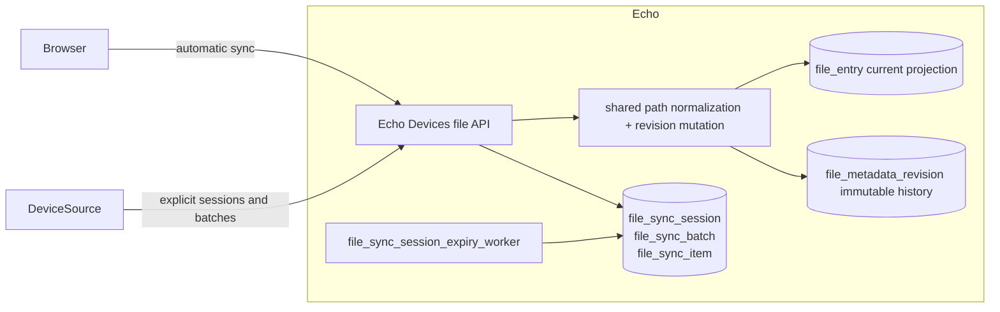

# 2026-08-13: Batched file metadata synchronization

- Date: `2026-08-13`
- Status: `active`
- Components: `wdintel-rs`, `wdfiles-migration`, `wdintel-web`, `still-bo`, `still-bo-file-registry-migration`
- Supersedes: [Devices module file sync](../2026-07-29-devices/README.md#http-api); the paired Still record supersedes `still/archive/2026-07-27-still-echo-device-file-sync/README.md`
- Initial reset: normal Echo and Still schema/data migrations

## Summary

Echo now treats `(device_id, normalized_absolute_path)` as the only external
file identity. Clients never submit a file ID or revision. Echo generates UUIDv7
values for files and sync sessions and appends exactly one immutable metadata
revision for every accepted creation or update. `file_entry` is the current
projection and is committed atomically with its matching revision.

Interactive callers use the automatic one-shot endpoint. Still uses explicit
persisted sessions with ordered batches, durable request payloads, per-item
outcomes, result pagination, completion, and restart-safe resume. Item-level
validation and business conflicts are deterministic partial successes;
infrastructure failure rolls back the batch so the identical batch can be
retried.

## Architecture

The automatic and explicit modes share normalization, root locking, conflict
rules, mutation, and outcome encoding. An automatic call executes in one
bounded file-registry transaction. An explicit batch first persists its request
items, processes only the next batch index in bounded committed chunks, and
finalizes after every item has a terminal outcome. Each accepted file mutation
and its outcome commit atomically. One device can have only one open session,
and one normalized path can be accepted only once in that session. File
analysis waits until an explicit session is terminal instead of competing with
its file mutations.

## HTTP contract

| Method | Route | Purpose |
| --- | --- | --- |
| `POST` | `/api/device/files/sync` | Automatic one-shot synchronization |
| `POST` | `/api/device/files/sync-session` | Start an explicit session |
| `POST` | `/api/device/files/sync-session/{sync_id}` | Read session status and summary |
| `POST` | `/api/device/files/sync-session/{sync_id}/batches/{batch_index}` | Apply the next persisted batch |
| `POST` | `/api/device/files/sync-session/{sync_id}/complete` | Complete after the declared batch count |
| `POST` | `/api/device/files/sync-session/{sync_id}/items` | Page terminal outcomes for recovery |

File items contain `absolute_path`, full-replacement nullable metadata, and an
optional all-or-none `source_file_state`. The response contains server-owned
`sync`, `batch`, and ordered `results`. Immediate automatic and batch results
identify the submitted item by `index`; paginated recovery results use
`batch_index` and `item_index`. Accepted outcomes expose `file_id` and
`revision`; rejected outcomes expose a stable code plus field errors. Retrying
an already applied explicit batch is idempotent only when the persisted payload
is byte-identical; a different payload or batch order is a conflict.

Browse, search, and journal rows expose the current file revision, sync ID, and
source state. Existing root, aggregate, ordering, and cursor behavior remains
unchanged.

## Still durability and recovery

Still stores each explicit Echo session, batch payload, and item outcome in its
file-registry PostgreSQL database. It writes the payload before the HTTP call
and never advances to another batch identity after an uncertain transport
outcome. On restart it reads Echo session status/results and reconciles already
terminal items before resuming the same next batch.

Accepted Echo IDs and revisions are local projections, not request identity.
Still acknowledges an upstream sequence only after terminal reconciliation.
Rejected deterministic items retain a bounded sanitized error. Infrastructure
failures remain due without manufacturing item outcomes. Expired Echo sessions
preserve already terminal results; Still recovers those results, discards the
expired local session, and opens a new session for rows that remain
unacknowledged.

## Schema and invariants

`wd_files` adds:

- `file_sync_session`, including automatic/explicit mode, expected and next
  batch counts, status, summary counters, expiry, and terminal timestamps;
- `file_sync_batch`, including persisted request payload, status, attempts, and
  applied/retry timestamps;
- `file_sync_item`, including input snapshot, normalized path, terminal outcome,
  server file/revision, field errors, and uniqueness guards;
- `file_metadata_revision`, the immutable accepted metadata/source snapshot;
- current revision, sync, and source-state columns on `file_entry`.

Database constraints enforce valid mode/status/time combinations, one open
session per device, one accepted occurrence of a normalized path per session,
current-path uniqueness per device, immutable revisions, and a deferred
`file_entry.current_revision_id` pointer so projection and revision are
committed together.

The expiry worker uses bounded `FOR UPDATE SKIP LOCKED` claims. It expires only
sessions whose lease is stale, converts abandoned processing batches back to a
recoverable state, and does not invent outcomes for unprocessed items.

## Initial migration reset

The first deployment is deliberately not backward compatible. The Echo
migration truncates file entries, tags, analysis work, and all sync/revision
tables while preserving tag/rule configuration and one clean
`file_analysis_control` row.

The Still file-registry migration preserves every legacy file and staged-change
row. It replaces the old Echo sync columns with empty batched-sync projections
and clears source scan checkpoints while preserving source identities; device
mappings remain in Still's primary database. A normal Django data migration
disables the global Echo integration without clearing its configuration.

These migrations run through the ordinary package deployment paths. No extra
deployment helper or one-off reset command is required. After compatible Echo
and Still packages are installed, an administrator explicitly re-enables the
integration only when synchronization may resume.

## Source map

| Concern | Source |
| --- | --- |
| Echo migration | `wdfiles-migration/src/m20260813_120128_batched_file_metadata_sync.rs` |
| Echo wire/API orchestration | `wdintel-rs/src/devices/files/mod.rs`, `wdintel-rs/src/devices/files/sync/` |
| Echo entities | `wdintel-rs/src/file_registry/entities/file_sync_*`, `file_metadata_revision.rs`, `file_entry.rs` |
| Expiry worker | `wdintel-rs/src/devices/files/sync/worker.rs`, `wdintel-rs/src/server/mod.rs` |
| Read projections | `wdintel-rs/src/devices/files/query/`, `wdintel-rs/src/devices/files/types.rs` |
| React caller | `wdintel-web/src/ts/react/services/api/devices.ts`, `wdintel-web/src/ts/react/routes/device-files/` |
| Still migration/state | Still repository: `still-bo/file-registry-migration/src/m20260813_000001_batched_echo_file_sync.rs`, `still-bo/src/file_registry/entities/file_registry_echo_sync_*` |
| Still client/worker | Still repository: `still-bo/src/echo_sync/client.rs`, `still-bo/src/echo_sync/worker.rs`, `still-bo/src/file_registry/sync.rs` |
| Operator diagnostics | Still repository: `still-bo-dj/core/echo_registry.py`, `still-bo-dj/core/templates/admin/core/commonmachine/echo_file_diagnostics.html` |
| Initial Still integration gate | Still repository: `still-bo-dj/core/migrations/0184_disable_echo_integration.py` |

## Authority

This archive records the implemented replacement design and operational
invariants. Current migrations, Rust code, generated frontend bindings, and
focused functional tests are authoritative if they differ from this summary.
