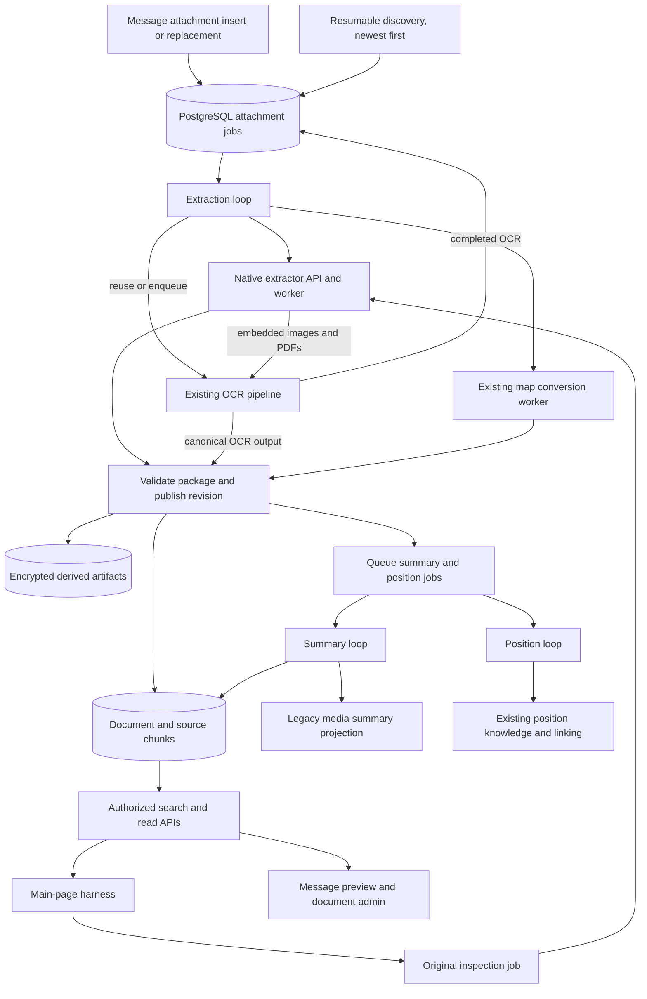

# #3064 Message attachment search: architecture

Recorded on 2026-10-05 for [#3064](https://github.com/echoua/echo/issues/3064)
and [PR #3662](https://github.com/echoua/echo/pull/3662), targeting `main`.
This describes the implemented architecture. Operational instructions live in
the [attachment component README](../../wdintel-rs/src/attachments/README.md).

## Scope and design

The indexed source is `signal_message_media`: attachments belonging to messages.
The Device file registry (`wd_files`) remains independent. Originals stay in
the existing encrypted object storage. Derived text, summaries and coordinates
let message search and the main-page harness answer content questions without
downloading and parsing every original during a request.

Each extracted section retains plain text, Markdown, sanitized HTML, an archive
member path and a source locator. Markdown is the harness representation; HTML
is available to consumers that need it. Neither representation replaces the
original. PostgreSQL full-text indexes and the existing `pg_trgm` extension
serve lexical search; no vector database or embedding service was added.

Extraction, summary, position and inspection loops are separate asynchronous
workers inside the existing Rust background-worker process. The Python native
extractor has its own API and worker processes, spool and durable queue. A slow
summary does not block extraction or make already published text unsearchable.

## Storage and publication

The [migration](../../echo-migration/src/m20261005_050621_attachment_documents.rs)
adds these PostgreSQL records:

| Record | Responsibility |
| --- | --- |
| `attachment_settings` | Stage switches, summary/position engines and persistent discovery cursor. |
| `attachment_document` | One record per media ID; current generation/revision, stage states, coverage, warnings, summary and artifact reference. |
| `attachment_chunk` | Ordered source sections with member/locator, text, Markdown, HTML, summary, coordinates and search indexes. |
| `attachment_job` | Stage, generation, lease, retry state, payload and result. |
| `ai_position_mention.attachment_chunk_id` | Connects grounded mentions to their source chunk and existing position knowledge. |

The four attachment tables and position tables are excluded from analytics.
Text searches therefore use PostgreSQL, including message lists and their
counts/statistics, so an analytics replica cannot silently omit attachment
matches. Searches without text retain the existing analytics eligibility rules.

Original media keeps its existing storage key. Derived packages use
`attachments/<instance-hash>/<media-id>/<revision>` in the existing encrypted
storage. The native extractor returns an `attachment_document_v1` package with
hashed entries; Rust checks its bounds and hashes before publishing its chunks.

Two identifiers have different jobs:

- **Generation** invalidates work when a source changes or an administrator
  requests reprocessing. Workers must still own the lease and current generation
  before publishing; a stale job cannot replace newer content.
- **Revision** identifies published content. Section reads can pin it across
  pages and detect replacement instead of mixing two extractions.

Source replacement invalidates old chunks, OCR and legacy summaries. Explicit
reprocessing retains the last readable revision until a replacement succeeds.
Completed OCR queues a new extraction generation so document indexing reuses
that output. Chunk deletion also removes its attached position mentions.

## Scheduling and enrichment

Media triggers enqueue new uploads immediately. Historical discovery walks
descending media IDs in batches of 50 and persists its cursor; jobs prefer newer
creation times. `backfill_complete` means discovery has finished, while queued
processing may still remain. Claims use `FOR UPDATE SKIP LOCKED`, 15-minute
leases and at most eight error attempts with backoff. Waiting for asynchronous
extraction or service capacity does not consume error retries.

Extraction publishes searchable sections before enrichment. Adjacent short
sections are packed, while long text is split into roughly 12,000-character
chunks with 1,000-character overlap. Every chunk receives a summary; bounded
reduction batches combine those summaries into the document summary. The final
summary is also projected into `media_summary` for existing message cards.

Coordinates are parsed from original chunk text. Position extraction likewise
reads original text, including OCR, using its independently selected engine and
the existing grounding and position-linking pipeline. Mentions preserve message
time and group/AOR scopes. The old summary-based position path skips indexed
documents. Position feedback requeues this stage without re-extracting the file.

## Native extraction boundary

| Input | Processing |
| --- | --- |
| DOCX, XLSX/XLSM, PPTX | Native structural parsing with paragraph/table, sheet/row/cell and slide/shape/note locators. |
| DOC/RTF/ODT, XLS/ODS, PPT/ODP | Sandboxed LibreOffice conversion followed by structural parsing. |
| Text/Markdown, CSV, JSON, XML/HTML | Text or structured section extraction; HTML is sanitized before publication. |
| ZIP/RAR/7z | Bounded member traversal with paths preserved, including nested archives. |
| Images and PDFs | Existing OCR output for message attachments; embedded files are submitted to OCR by the native worker. |
| Supported standalone map formats | Existing KMZ conversion path; nested XML map members remain text extraction. |

Formula text and cached spreadsheet values are retained; formulas, macros and
external spreadsheet links are not evaluated. Native parser children receive
no service credentials, have memory/CPU/wall-time limits and cannot create
IPv4/IPv6 sockets. LibreOffice additionally runs in a bubblewrap filesystem and
namespace sandbox with isolated writable directories.

Limits include 250 MiB input, 1 GiB expanded data, 1,000 archive members, two
archive levels, 20 million extracted characters and one million table cells.
Unsupported members, OCR failures and limits remain visible as warnings and
incomplete coverage. These states must not be interpreted as evidence that a
document contains no relevant information.

## Search, harness and UI

General message search matches the body, attachment filename and indexed
contents while preserving existing frequency, UID, quoted and negative search
syntax. A filename can match before its content finishes indexing. Dedicated
attachment search supports groups, message IDs, format, optional dates and seek
pagination; it has no implicit date cutoff.

The main-page harness uses progressively more expensive access:

| Harness tool | API and purpose |
| --- | --- |
| `attachment_search` | `/api/attachments/search`: find names/content with snippets, summaries and coverage. |
| `attachment_get` | `/api/attachments/get`: inspect document metadata and summary first. |
| `attachment_read` | `/api/attachments/read`: read up to eight source sections with revision and continuation ordinal. |
| `attachment_inspect` | `/api/attachments/inspect-original`: queue fresh processing of an original, optionally selecting a member/locator. |
| `attachment_inspection_status` | `/api/attachments/inspection-status`: poll the authorized result. |

All endpoints are POST requests. Current message/group permissions and
deletion/archive state are checked on reads, including inspection results.
Harness tools preserve explicit or inherited date/group scope, parent-message
citations, filenames and source locators. Context fitting keeps Markdown and
continuation metadata while removing redundant representations. Document text
is untrusted evidence; tools provide no arbitrary shell, URL or filesystem access.

Original inspection is asynchronous and bounded. Selecting `page N` of a PDF
extracts that page before OCR and preserves its original page number. Office and
archive inspections currently parse the source again and filter the resulting
sections; `table`, `image` and `ocr` are focused extraction requests, not separate
general-purpose analysis engines. Results return up to eight sections and report
truncation. The pending inspection queue is capped at 32 jobs.

The shared message-card content dialog shows summary, warnings, source sections,
revision-pinned pagination and the original link. `/admin/ai/documents` exposes
queue/state inspection, search, retries, stage switches and separate summary and
position engine choices. Indexing defaults off; its switch pauses every stage.
Summary and position switches can also pause their own queues independently.

## Rollout and ownership

Deploy the extractor, the Echo migration/application and harness release
`2026.10.05.2`, then enable indexing and the desired enrichment stages. Ship
analytics exclusions before migration through the normal deployment procedure.
Pause indexing for application rollback and preserve the derived schema for a
forward fix; a down migration destroys this index and its chunk-specific mentions.

The staging topology uses an isolated native extractor on `echo-cbr-staging`:
`echo-native-extractor-api.service` and `echo-native-extractor-worker.service`,
with its API on loopback port 18080. Rust selects that API through
`ATTACHMENT_EXTRACTOR_URL`. Embedded OCR delegates to the existing OCR API through
`ECHO_NATIVE_OCR_BASE_URL` and `ECHO_NATIVE_OCR_TOKEN`. The harness namespace is
upgraded independently; other namespaces keep their selected release.

Staging verification covered Office/archive upload, filename/content search,
summaries, coordinates, document and OCR positions, original spreadsheet/PDF
inspection, document preview and a main-page answer citing attachment content.
Historical processing was enabled; discovery completion is separate from job
completion. This is a rollout snapshot, not a claim that every retained file has
finished indexing.

Main implementation and operating references:

- [Rust workers, storage, API and search](../../wdintel-rs/src/attachments/).
- [Native document parsers](../../echo-document-extractor/src/echo_document_extractor/documents.py)
  and [extractor operations](../../echo-document-extractor/README.md).
- [Harness tools](../../echo-ai-agent/runner/attachments.ts) and
  [namespace upgrades](../../echo-ai-agent/CONTROL_PANEL.md).
- [Position grounding and scopes](../../wdintel-rs/src/ai_position/README.md).
- [Document admin UI](../../wdintel-web/src/ts/react/routes/admin-documents/).
- [Rollout and recovery](../../wdintel-rs/src/attachments/README.md#rollout-and-recovery).
