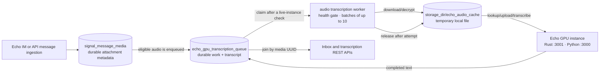

# Echo GPU audio transcription

Echo can transcribe audio attachments through one or more external Echo GPU
instances. This integration is optional and is controlled by the
`enable_audio_transcription` system setting.

## Setup

1. Open **Admin → System settings**, enable **Audio transcription**, and save
   the settings. The **Admin → Echo GPU Servers** page appears only after the
   saved setting is enabled.
2. Make the Echo server able to reach the Echo GPU host. In deployed
   environments this normally means sharing the GPU machine through a
   Tailscale invite and accepting the share from the Echo server's tailnet.
   The required network direction is Echo to Echo GPU; verify that the Echo
   server resolves the configured host and can reach the Rust service on port
   `3001` and the Python service on port `3000`.
3. Open **Admin → Echo GPU Servers** and add the instance name, Tailscale
   hostname, ports, and ordering. New instances are active by default.
4. Use the instance health check on that page. Both the Rust and Python probes
   must be healthy for background transcription.

Saving an instance reloads the API process's instance list and requests a
restart of `wdintel-rs-bgworker.service`.

Audio transcription also requires working S3-compatible media storage. The
worker loads the durable attachment from that storage before creating its
temporary local copy.

## Runtime flow

The detailed flow is:

1. Message ingestion stores or reconciles its media rows. When transcription
   is enabled, each audio attachment no larger than 100 MiB is enqueued by its
   `signal_message_media.id`. Enqueueing is idempotent.
2. At the beginning of a worker iteration, the client checks for due work and
   reloads the active GPU configuration. It probes instances until both the
   Rust and Python services are healthy.
3. If no GPU instance is live, the iteration does not claim work. Therefore it
   does not increment an attempt, download the attachment, or create a cache
   file. Echo waits 5 seconds before checking again.
4. A live iteration processes up to 10 due items. A full batch is followed by
   a 100 ms pause; an empty or drained batch is followed by a 5 second pause.
5. For each claimed item, Echo downloads and, when necessary, decrypts the
   attachment into `storage_dir/echo_audio_cache`. If `storage_dir` is empty,
   the cache path is `/var/tmp/echo_audio_cache`.
6. `echo-gpu-client` tries the configured instances in order, reuses an
   existing GPU-side upload by checksum when possible, uploads when necessary,
   and requests transcription.
7. On success, the transcript is stored in
   `echo_gpu_transcription_queue.transcribed_value`. It is not copied into the
   `signal_message_media` row.
8. The local materialized file is removed after every normal attempt outcome:
   completion, retry, or terminal failure. Files left by a process crash are
   removed when the transcription worker initializes again.

Retryable failures use persisted exponential backoff and stop after eight
attempts. Work also has a 24-hour total-age limit. Finished queue rows are
retained indefinitely because they contain the only durable copy of completed
transcriptions. Orphaned rows are still removed when their source attachment
or message no longer exists.

## Maintenance commands

- `oneoff-backfill-audio-transcriber` scans attachments created at or after
  `--since-ts` and queues eligible audio that has no queue row. Existing queued,
  processing, completed, and terminal rows are left unchanged.
- `oneoff-requeue-audio-transcriber` resets one terminal queue row to queued so
  it can retry from the beginning.
- `oneoff-retranscribe-audio-transcriber` resets one completed queue row to
  queued and clears its existing transcription so it is generated again.

## REST API exposure

Completed transcripts are joined to media by the media UUID:

- `POST /api/rer-importer/get-inbox-map` includes the text as
  `message.media[].transcription` in returned inbox details.
- `POST /api/transcriber/messages/{message_id}` returns completed
  `{ media_id, text }` entries for one accessible message.

Pending, retrying, and terminal items do not produce transcription text.
Disabling the system setting stops new enqueueing and worker processing and
suppresses transcription enrichment in inbox responses.

