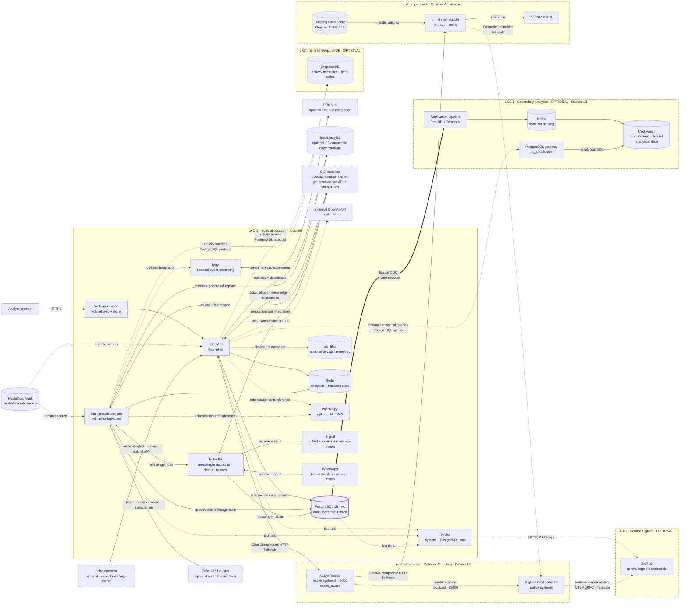
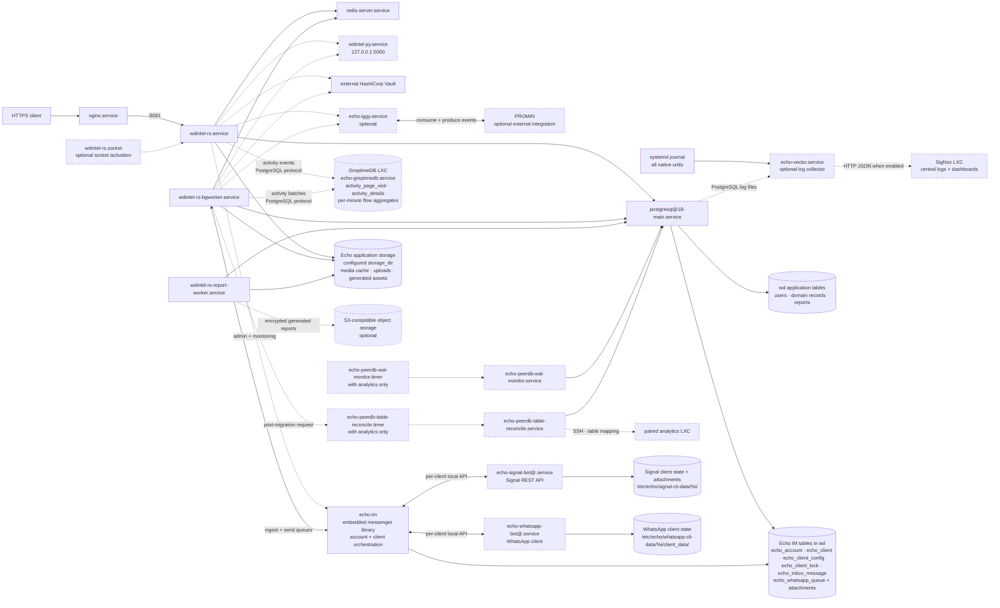
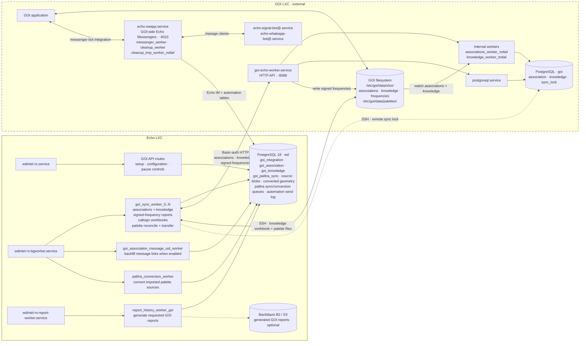
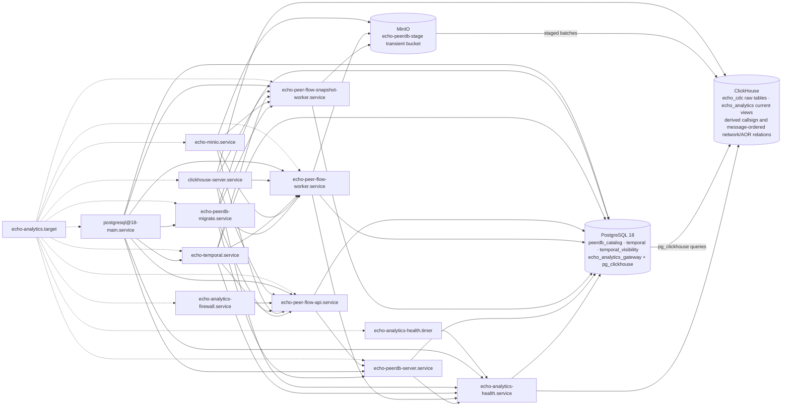

# Echo architecture

Echo is a SIGINT analytical web application deployed as one application
container per installation. PostgreSQL 18 stores authoritative data in two
required databases: the main `wd` database and the independent `wd_files`
device file registry. They use separate connections and may share one
PostgreSQL instance. An installation may also have one paired analytics
container that maintains a derived ClickHouse copy for expensive counters and
reports.

The analytics container is optional: omitting the `[analytics]` section from
Echo configuration leaves the application on its existing PostgreSQL path.
Failure to connect to analytics at startup does not prevent Echo from starting,
and supported analytical requests retry through PostgreSQL when analytics is
stale, unavailable, or too slow.
Those requests include RER result/facet counts and lists, long-range messenger
activity timelines, report-history list scans, and replicated-data report
queries; operational writes and live queue/progress state remain on PostgreSQL.

## Deployment topology

The operator creates and sizes the LXC containers in Proxmox or Incus. Echo's
deployment tooling installs application packages and native systemd services;
it does not create containers and does not run Docker or Podman inside them.
The application and analytics stacks run in separate operating-system
containers; the analytics services are never installed inside the Echo LXC.
The paired containers should communicate over a private Proxmox network in
production. Tailscale is also supported and is used by the development pair.

The diagram focuses on the core web, worker, messenger, storage, observability,
and analytics paths. Other instance-specific integrations are configured
independently.

The `wd_files` database is optional and configured independently under
`[file_registry]`. Without that section, the backend skips its connection and
migrations and continues running; device file operations are
unavailable. When configured, operators must
provision the database before restart, and startup applies its schema migrations
automatically. See [File registry database](../deploy/README.md#file-registry-database)
for configuration and provisioning.

See [Echo GPU audio transcription](ECHO_GPU_TRANSCRIPTION.md) for its
configuration, network requirements, queue, cache, retry, and REST API flow.

## AI engine integration

Admins configure OpenAI-compatible engines in `/admin/system-settings-neo`.
`/admin/ai-callsigns` provides prompt testing and an optional sequential
bgworker that replaces regular parsed callsigns with the AI result.
See [Echo vLLM](../echo-vllm/README.md) for the `echo-gpu-spark` worker and
[Echo vLLM Router](../echo-vllm-router/README.md) for routing, observability,
deployment, verification, and rollback commands. Echo uses the router as its
normal OpenAI-compatible endpoint; direct Spark access is retained only as a
fallback.

## Inbox callsign storage

Parsed inbox callsigns are stored as ordered, source-specific rows in
`sigint_inbox_item_callsign`. Active `primary` and `alg2` rows are the
authoritative representation; the legacy JSONB columns remain dual-written as
a compatibility fallback until a later cleanup rollout. Callsign replacement,
soft deletion, reactivation, ordering, and login attribution are committed in
the same PostgreSQL transaction as the inbox-item change.

Historical rows are populated online with
`oneoff-backfill-inbox-item-callsigns`. The command processes short,
restartable keyset batches so the API and background workers can continue
using the database during backfill.

## Echo LXC systemd graph

## Bgworkers

In a packaged live deployment, the API process owns only request-adjacent
workers and the optional Vault secret worker. Long-running application and GOI
workers belong to the bgworker process; report-history workers run in the
separately memory-capped report-worker process. Solid arrows show tasks that
are always spawned; dotted arrows show tasks gated by configuration or used
only during startup. Each process also starts its own `worker_metrics_logger`.

```mermaid
flowchart TB
    api["wdintel-rs.service"]
    bg["wdintel-rs-bgworker.service"]
    reports["wdintel-rs-report-worker.service"]

    api --> api_workers["Request-adjacent workers<br/>session_activity_worker<br/>messenger_media_cache_cleanup_worker<br/>messenger_media_thumbnail_worker"]
    api -.-> api_vault_worker["secret_worker<br/>when Vault is configured"]
    bg -.-> bg_vault_worker["secret_worker<br/>when Vault is configured"]

    bg --> core_workers["Core workers<br/>healthcheck_worker<br/>worker_calculate_group_stats<br/>iggy_integration_worker<br/>aor_assignments_worker<br/>operator_inbox_worker<br/>rer_duty_historical_interceptions_worker<br/>unit_tag_queue_worker"]
    bg --> messenger_workers["Messenger workers<br/>messenger_receive_worker<br/>process_queue_nofail<br/>echo_im_cleanup"]
    bg --> network_workers["Network workers<br/>recent_inbox_network_worker<br/>old_inbox_network_worker<br/>inbox_network_daily_consistency_worker"]
    bg --> palitra_workers["Palitra worker<br/>palitra_highlight_worker"]
    bg --> goi_workers["GOI workers<br/>goi_sync_worker_0..N<br/>goi_association_message_uid_worker<br/>palitra_conversion_worker"]

    bg -.-> configured_workers["Configuration-gated workers<br/>analytics_health_log_worker · analytics gateway<br/>activity_details_worker · GreptimeDB<br/>cleanup_networks_worker<br/>fill_comp_freq_worker<br/>inactive_users_worker<br/>location_v2_worker<br/>suggest_message_tags_worker<br/>refresh_models_worker · AI models<br/>cleanup_tmp_worker · in-memory tmp"]
    bg -.-> startup_workers["Startup task<br/>signal_cli_verbose_logger"]

    reports --> report_workers_a["Report-history workers<br/>report_history_worker_tags<br/>report_history_worker_interception<br/>report_history_worker_babak<br/>report_history_worker_mouse<br/>report_history_worker_pelengs<br/>report_history_worker_senders<br/>report_history_worker_posts<br/>report_history_worker_naushnom<br/>report_history_worker_reo<br/>report_history_worker_digest"]
    reports --> report_workers_b["Report-history workers<br/>report_history_worker_rer_report<br/>report_history_worker_sposob<br/>report_history_worker_posts_docx<br/>report_history_worker_active_networks<br/>report_history_worker_network_frequencies<br/>report_history_worker_report_125<br/>report_history_worker_report_1213<br/>report_history_worker_summary_table"]
    reports --> report_workers_c["Report-history workers<br/>report_history_worker_kmz<br/>report_history_worker_geojson<br/>report_history_worker_etalonka<br/>report_history_worker_etalonka_1<br/>report_history_worker_goi<br/>report_history_worker_unknown<br/>report_history_timeout_worker"]

    classDef optional stroke-dasharray:6 4
    class api_vault_worker,bg_vault_worker,configured_workers,startup_workers optional
```

`worker_calculate_group_stats` also owns historical group-stat recalculation.

Report generation is isolated in `wdintel-rs-report-worker.service`. At most
four reports run concurrently across the per-kind queues. The unit has a fixed
12 GiB memory-high threshold and 16 GiB hard limit; an OOM kills and immediately
restarts only report processing, leaving ingestion and other background work
running in `wdintel-rs-bgworker.service`.

Changes to a group's AOR assignments enqueue the affected activity window in
the PostgreSQL `group_stats_recalculation_task` table. Pending windows are
coalesced globally because each recalculation rebuilds global statistics. The
worker claims one task at a time, rebuilds at most one day, and requeues any
remaining window. Changes arriving after a task starts are stored in a
follow-up task; failed work is requeued, stale tasks can be reclaimed, and
completed rows are removed on the next pass. The regular recent-stat refresh
still runs after each historical chunk in the same worker iteration.

See the [Redis group-statistics note](../archive/2026-07-29-redis-group-stats/README.md) for derived-statistics storage and retention.

## GOI integration

GOI integration is optional and configured per GOI instance in Echo. The
diagram shows a full integration; a link-only integration omits the API and SSH
sync paths. The HTTP API uses Basic authentication, while workbook and palette
operations use SSH. See [GOI messenger setup](content/goi-messengers.md) for
the user-facing Signal and WhatsApp connection flow.

Fresh `main` consolidates GOI background work in
`wdintel-rs-bgworker.service`: the `goi_sync_worker_0..N` pool replaces the old
folder, association, and palette-sync loops, while the message-UID and palette
conversion workers run beside it. `wdintel-rs.service` exposes GOI request
routes but does not start GOI background workers in live mode. Debug/test
server mode can still run the general worker set for local development, with
the GOI pool disabled.

`echo-swapp.service` always starts `messenger_worker`, `cleanup_worker` (Echo IM
and automation cleanup), and `cleanup_tmp_worker_nofail` on the GOI LXC; none
is configuration-gated. The service uses the Echo PostgreSQL database as its
system of record.
Cross-automation send reservations, outbound queue rows, and delivery records
commit atomically. `echo_automation_send_log` retains route-level
deduplication state for 30 days; the cleanup worker hard-deletes older rows.

Each full GOI integration is scoped to its owner organism. Signed-frequency
reports and worker-managed callsign rows include only live networks whose
non-deleted AOR overlaps a non-deleted AOR selected for that organism; an
organism without selected AORs receives no networks through these exports.
Association and knowledge sync attempts are limited to once per minute.
Knowledge failures delay the next attempt for ten minutes, while
signed-frequency and callsign-workbook exports run at ten-minute intervals.
Knowledge and signed-frequency XLSX uploads are written to
`_sync_<original_filename>` beside the live workbook, then atomically renamed
over it so GOI readers cannot observe a partially written file. Byte-identical
uploads are skipped. Worker-managed callsigns use their stable Echo ID for
upserts, while workbook row positions are ignored when detecting content
changes.

The GOI knowledge table is an active snapshot of the knowledge workbook.
`knowledge_worker_nofail` hard-deletes rows missing from the current snapshot,
and the API returns only the remaining rows. On the next successful snapshot
pull, Echo marks missing `goi_knowledge` rows deleted and retains them until
the configured cleanup period expires.

## ORBIT unit import

See [Working with ORBIT data](ORBIT.md) for the complete operator and developer
guide.

ORBIT ingestion is split into normalization, database synchronization, and
database-only linking. The `oneoff-prepare-orbit-import --path <export.json>`
command validates the source, normalizes dictionary references to stable UUIDs,
writes one Apache Parquet file per dictionary plus `orbit_units.parquet`, and
packages them as a timestamped ZIP. Live mode keeps snapshots under
`orbit-import/` in the
`ai_models_config.s3_config` bucket; debug and test modes keep them under
`<storage_dir>/orbit-import/`. A new snapshot reuses dictionary UUIDs from the
latest previous snapshot and retains old dictionary entries.

`wdintel-rs --mode=live tui-import-orbit-units` downloads and unpacks the latest
snapshot, synchronizes every root and ancestor to PostgreSQL parent-first, and
then matches using only rows from the latest recorded database sync. The
`orbit_sync` table records the archive MD5 and sync timestamp; an unchanged MD5
skips data synchronization after explicit operator confirmation. Stale deletion
decisions remain interactive. Manual lookup by exact SIGINT full name also reads
ORBIT roots and parent chains only from PostgreSQL.
After synchronization, matched ORBIT roots are linked to their active Echo
SIGINT units for access-controlled display in the RER unit list and details
page. `orbit_unit_sigint_unit` permits multiple ORBIT links per SIGINT unit.
Matching requires root identity plus parent evidence for hierarchical SIGINT
units, compares both operational and generative ORBIT paths, ignores configured
SIGINT-only name fragments, selects the shortest equally close hierarchy
extension unless a deeper parent is evidenced, normalizes numbered army
abbreviations by army number, and skips divergent parent-path ties. Retained
ORBIT roots are rendered as separate cards.

The seven ORBIT tables are authoritative operational data in PostgreSQL and are
excluded from PeerDB replication. See the
[ORBIT import runbook](../deploy/2026-07-29-orbit-dictionaries/README.md) for
snapshot preparation, matching, review, quit, and stale-row semantics.

## Optional analytics LXC systemd graph

`echo-analytics.target` groups the native services below. Dotted arrows show
target membership; solid arrows show principal startup dependencies rather
than every systemd `Wants` and `After` relationship.

## Deployment and operations

- [Echo installation](INSTALL_ZIP.md)
- [PostgreSQL setup and recovery](POSTGRESQL.md)
- [Optional ClickHouse/PeerDB deployment and runbook](../deploy/clickhouse/README.md)
- [Analytics implementation decision record](../archive/2026-07-21-peerdb-clickhouse/README.md)
- [Monitoring](MONITORING.md)

Analytics artifacts are produced on the dedicated Debian 13 builder
`echo-build-deb13-main`; runtime containers contain no compiler. Secrets are
stored as separate Bitwarden Secure Notes and rendered to root-owned
environment files by deployment commands. Each participating Echo instance
receives its own analytics container, credentials, publication, replication
slot, ClickHouse data, and recovery lifecycle.

GOI deployments build the `echo-swapp` and messenger Debian artifacts on the
builder configured by `goi_builder` in `goi/justfile`, using its
`~/workspace/echo` checkout. The operator workstation only transfers the
artifacts to the target GOI instance, so deployments can be started from macOS.

When configured and fresh, ClickHouse serves the expensive analysis count,
facet lists and dedicated facet counts plus the replicated-data scans used by
the interception, sender, posts, REO, digest, RER, Sposob, 1.2.5, and 1.2.13
reports. Every analytical facet resolves one message-ID scope from its
authoritative time range. The same lower/upper bounds must constrain every
large message and message-link relation. Group/sender access must be one
bounded, flat message-group join unless the joined group relation itself
supplies the facet dimension. Open ranges retain only the safe lower bound,
and an empty scope returns an empty result without querying the large
relations. Time and access predicates remain authoritative; ID bounds are
only ClickHouse pruning hints.

PostgreSQL remains responsible for transactions, authoritative catalog and
comment lookups, mutable caches, PostGIS processing, repeatable-read report
snapshots, and analysis filters whose ClickHouse shape is not a single flat
query. Each analytical operation falls back as a whole, preventing mixed
partial results.
