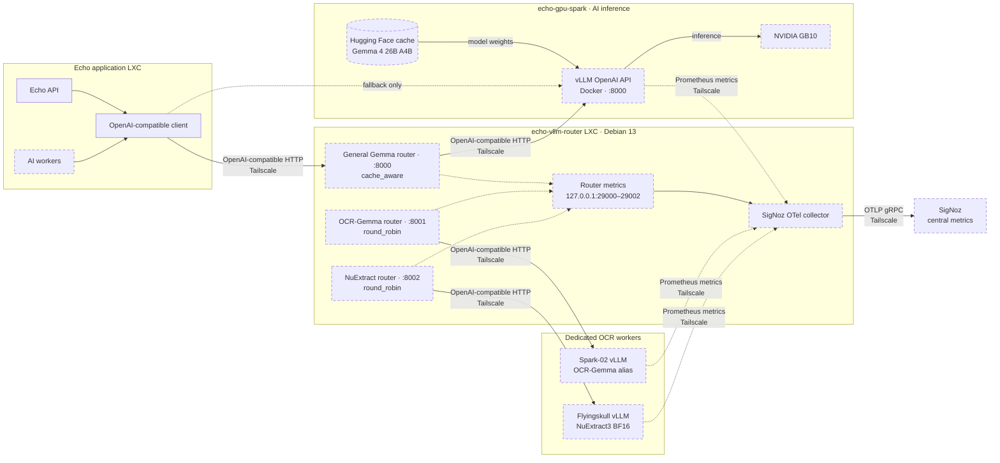
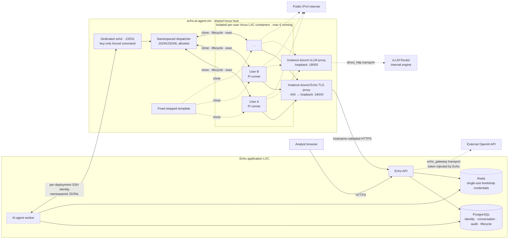
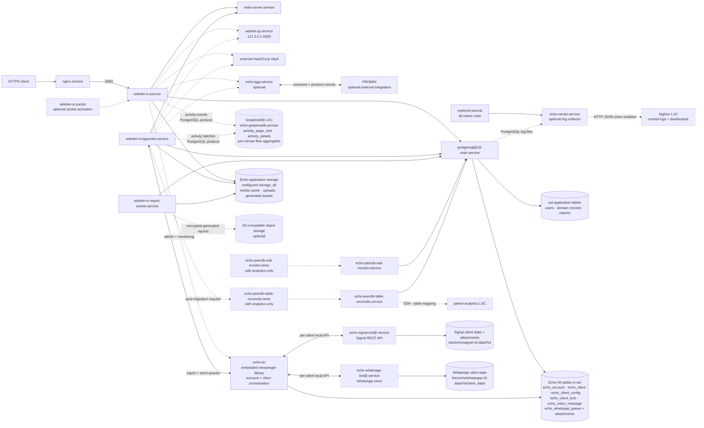
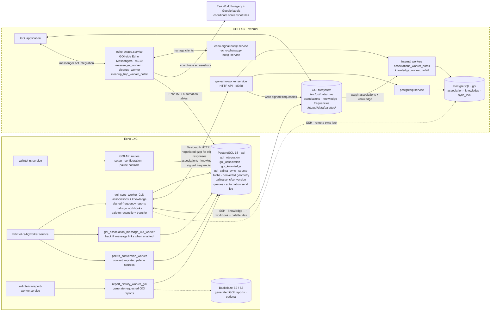
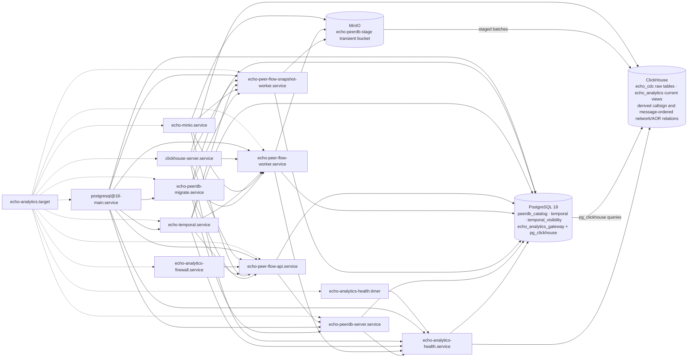

# Echo architecture

Echo is a SIGINT analytical web application deployed as one application
container per installation. PostgreSQL 18 stores authoritative data in two
required databases: the main `wd` database and the independent `wd_files`
device file registry. They use separate connections and may share one
PostgreSQL instance. An installation may also have one paired analytics
container that maintains a derived ClickHouse copy for expensive counters and
reports.

The analytics container is optional: omitting the `[analytics]` section from
Echo configuration leaves the application on its existing PostgreSQL path.
Failure to connect to analytics at startup does not prevent Echo from starting,
and supported analytical requests retry through PostgreSQL when analytics is
stale, unavailable, or too slow.
Those requests include RER result/facet counts and lists, long-range messenger
activity timelines, report-history list scans, and replicated-data report
queries; operational writes and live queue/progress state remain on PostgreSQL.

## Deployment topology

The operator creates and sizes the LXC containers in Proxmox or Incus. Echo's
deployment tooling installs application packages and native systemd services;
it does not create containers and does not run Docker or Podman inside them.
The application and analytics stacks run in separate operating-system
containers; the analytics services are never installed inside the Echo LXC.
The paired containers should communicate over a private Proxmox network in
production. Tailscale is also supported and is used by the development pair.

```mermaid
flowchart LR
    browser["Analyst browser"]
    vault[("HashiCorp Vault<br/>central secrets service")]
    promin["PROMIN<br/>optional external integration"]
    backblaze[("Backblaze B2<br/>optional S3-compatible object storage")]
    echo_operator["echo-operator<br/>optional external message source"]
    goi["GOI instance<br/>optional external system<br/>goi-echo-worker API + shared files"]
    echo_gpu["Echo GPU cluster<br/>optional audio transcription"]
    openai_engine["External OpenAI API<br/>optional"]

    subgraph echo_lxc["LXC 1 · Echo application · required"]
        direction LR
        web["Web application<br/>wdintel-web + nginx"]
        api["Echo API<br/>wdintel-rs"]
        bg["Background workers<br/>wdintel-rs-bgworker"]
        postgres[("PostgreSQL 18 · wd<br/>main system of record")]
        file_registry[("wd_files<br/>optional device file registry")]
        redis[("Redis<br/>sessions + transient state")]
        nlp["wdintel-py<br/>optional NLP API"]
        iggy["Iggy<br/>optional event streaming"]
        echo_im["Echo IM<br/>messenger accounts · clients · queues"]
        signal["Signal<br/>linked accounts + message media"]
        whatsapp["WhatsApp<br/>linked clients + message media"]
        vector["Vector<br/>system + PostgreSQL logs"]

        web --> api
        api -->|transactions and queries| postgres
        api -.->|device file metadata| file_registry
        bg -->|queues and message state| postgres
        bg -.->|pending device file metadata| file_registry
        api --> redis
        bg --> redis
        api -.->|tokenization and inference| nlp
        bg -.->|tokenization and inference| nlp
        bg -.->|optional integration| iggy
        bg <-->|messenger jobs| echo_im
        echo_im -->|messenger tables| postgres
        echo_im <-->|receive + send| signal
        echo_im <-->|receive + send| whatsapp
        api -.->|journald| vector
        bg -.->|journald| vector
        postgres -.->|log files| vector
    end

    subgraph greptime_lxc["LXC · Shared GreptimeDB · OPTIONAL"]
        greptime[("GreptimeDB<br/>activity telemetry + time-series")]
    end

    subgraph signoz_lxc["LXC · Shared SigNoz · OPTIONAL"]
        signoz["SigNoz<br/>central logs + dashboards"]
    end

    subgraph vllm_router_lxc["echo-vllm-router · Optional AI routing · Debian 13"]
        direction TB
        vllm_router["General Gemma router<br/>native systemd · :8000<br/>cache_aware"]
        vllm_ocr_router["OCR-Gemma router<br/>native systemd · :8001<br/>round_robin"]
        vllm_nuextract_router["NuExtract router<br/>native systemd · :8002<br/>round_robin"]
        vllm_otel["SigNoz OTel collector<br/>native systemd"]
        vllm_router -.->|router metrics<br/>loopback :29000| vllm_otel
        vllm_ocr_router -.->|router metrics<br/>loopback :29001| vllm_otel
        vllm_nuextract_router -.->|router metrics<br/>loopback :29002| vllm_otel
    end

    subgraph extractor_lxc["echo-gpu Incus · ct-echo-document-extractor · Debian 13"]
        direction TB
        extractor_api["Authenticated async API<br/>Tailscale 100.93.77.92:8000"]
        extractor_worker["Two concurrent jobs<br/>serial Paddle · leases + heartbeats"]
        extractor_queue[("SQLite WAL<br/>durable job queue")]
        extractor_spool[("Private disk spool<br/>inputs + canonical ZIPs")]
        extractor_paddle["PP-OCRv5 + PP-StructureV3<br/>RTX 4090 · offline immutable models"]
        extractor_otel["Pinned SigNoz OTel collector"]

        extractor_api --> extractor_queue
        extractor_api --> extractor_spool
        extractor_worker --> extractor_queue
        extractor_worker --> extractor_spool
        extractor_worker --> extractor_paddle
        extractor_api -.->|metrics · 127.0.0.1:29000| extractor_otel
        extractor_worker -.->|metrics · 127.0.0.1:29001| extractor_otel
    end

    subgraph analytics_lxc["LXC 2 · Secondary analytics · OPTIONAL · Debian 13"]
        direction LR
        replication["Replication pipeline<br/>PeerDB + Temporal"]
        staging[("MinIO<br/>transient staging")]
        clickhouse[("ClickHouse<br/>raw · current · derived analytical data")]
        gateway["PostgreSQL gateway<br/>pg_clickhouse"]

        replication --> staging --> clickhouse
        gateway -->|analytical SQL| clickhouse
    end

    subgraph vllm_spark["echo-gpu-spark · Optional AI inference"]
        direction TB
        hf_cache[("Hugging Face cache<br/>Gemma 4 26B A4B")]
        vllm["vLLM OpenAI API<br/>Docker · :8000"]
        gb10["NVIDIA GB10"]

        hf_cache -->|model weights| vllm
        vllm -->|inference| gb10
    end

    subgraph vllm_spark02["echo-gpu-spark-02 · Optional OCR inference"]
        ocr_hf_cache[("Pinned Gemma 4 weights")]
        ocr_vllm["vLLM OCR-Gemma API<br/>Docker · Tailscale :8000"]
        ocr_gb10["NVIDIA GB10"]

        ocr_hf_cache --> ocr_vllm -->|inference| ocr_gb10
    end

    subgraph vllm_flyingskull["echo-gpu-flyingskull · Optional OCR inference"]
        nuextract_cache[("Pinned NuExtract3 weights")]
        nuextract_vllm["vLLM NuExtract3 API<br/>dedicated Incus service · Tailscale :8000"]
        rtx4070["NVIDIA RTX 4070 Ti SUPER"]

        nuextract_cache --> nuextract_vllm -->|inference| rtx4070
    end

    browser -->|HTTPS| web
    vault -.->|runtime secrets| api
    vault -.->|runtime secrets| bg
    postgres ==>|logical CDC<br/>private network| replication
    api -.->|optional analytical queries<br/>PostgreSQL syntax| gateway
    api -.->|activity events<br/>PostgreSQL protocol| greptime
    bg -.->|activity batches<br/>PostgreSQL protocol| greptime
    vector -.->|HTTP JSON logs| signoz
    vllm_otel -.->|router + worker metrics<br/>OTLP gRPC · Tailscale| signoz
    iggy <-->|consume + produce events| promin
    api <-->|uploads + downloads| backblaze
    bg <-->|media + generated reports| backblaze
    echo_operator -->|authenticated message submit API| api
    api <-->|associations · knowledge · frequencies| goi
    bg <-->|palitra + folder sync| goi
    echo_im <-->|messenger bot integration| goi
    bg <-->|health · audio upload · transcription| echo_gpu
    bg <-->|authenticated jobs · canonical packages| extractor_api
    api -.->|Chat Completions HTTPS| openai_engine
    api <-->|Chat Completions HTTP<br/>Tailscale| vllm_router
    vllm_router -->|OpenAI-compatible HTTP<br/>Tailscale| vllm
    vllm_ocr_router -->|OpenAI-compatible HTTP<br/>Tailscale| ocr_vllm
    vllm_nuextract_router -->|OpenAI-compatible HTTP<br/>Tailscale| nuextract_vllm
    extractor_worker -->|OCR-Gemma requests| vllm_ocr_router
    extractor_worker -->|NuExtract3 requests| vllm_nuextract_router
    extractor_otel -->|metrics + journald<br/>OTLP gRPC · Tailscale| signoz
    vllm -.->|Prometheus metrics<br/>Tailscale| vllm_otel
    ocr_vllm -.->|Prometheus metrics<br/>Tailscale| vllm_otel
    nuextract_vllm -.->|Prometheus metrics<br/>Tailscale| vllm_otel

    style echo_lxc stroke-width:2px
    style analytics_lxc stroke-width:2px,stroke-dasharray:8 5
    style greptime_lxc stroke-width:2px,stroke-dasharray:8 5
    style signoz_lxc stroke-width:2px,stroke-dasharray:8 5
    style vllm_router_lxc stroke-width:2px,stroke-dasharray:8 5
    style extractor_lxc stroke-width:2px,stroke-dasharray:8 5
    style vllm_spark stroke-width:2px,stroke-dasharray:8 5
    style vllm_spark02 stroke-width:2px,stroke-dasharray:8 5
    style vllm_flyingskull stroke-width:2px,stroke-dasharray:8 5
    classDef canonical stroke-width:3px
    classDef optional stroke-dasharray:6 4
    class postgres canonical
    class file_registry,nlp,iggy,signal,whatsapp,vector,greptime,signoz,promin,backblaze,echo_operator,goi,echo_gpu,openai_engine,vllm_router,vllm_ocr_router,vllm_nuextract_router,vllm_otel,extractor_api,extractor_worker,extractor_queue,extractor_spool,extractor_paddle,extractor_otel,vllm,hf_cache,gb10,ocr_hf_cache,ocr_vllm,ocr_gb10,nuextract_cache,nuextract_vllm,rtx4070 optional
```



The diagram focuses on the core web, worker, messenger, storage, observability,
OCR, and analytics paths. Other instance-specific integrations are configured
independently.

The `wd_files` database is optional and configured independently under
`[file_registry]`. Without that section, the backend skips its connection and
migrations and continues running; device file operations are
unavailable. When configured, operators must
provision the database before restart, and startup applies its schema migrations
automatically. See [File registry database](../deploy/README.md#file-registry-database)
for configuration and provisioning.

The `device_file_analytics_worker` runs in `wdintel-rs-bgworker`, reads pending
file metadata from `wd_files`, and writes derived tag assignments to `wd`.
It classifies only normalized file names, paths, and extensions; it does not
read or transfer file content.

See [Echo GPU audio transcription](ECHO_GPU_TRANSCRIPTION.md) for its
configuration, network requirements, queue, cache, retry, and REST API flow.
Completed queue rows remain in PostgreSQL as the durable transcript store;
only rows orphaned from their source message or attachment are removed.

## AI architecture

Admins configure OpenAI-compatible engines in `/admin/system-settings-neo`.
`/admin/ai-callsigns` provides prompt testing and an optional sequential
bgworker that replaces regular parsed callsigns with the AI result.
Tracked AI evaluation prompts, tools, and notes live under `ai-eval/`. Raw
production-derived corpora stay in dated, gitignored `ai-eval/*/raw/`
directories and are synchronized separately to Backblaze B2; see
[`ai-eval/README.md`](../ai-eval/README.md).
See [Echo vLLM](../echo-vllm/README.md) for the `echo-gpu-spark` worker and
[Echo vLLM Router](../echo-vllm-router/README.md) for routing, observability,
deployment, verification, and rollback commands. Echo uses the router as its
normal OpenAI-compatible endpoint; direct Spark access is retained only as a
fallback. The same router host owns isolated OCR-Gemma and NuExtract3 endpoints
consumed by `ct-echo-document-extractor`. Its authenticated API, durable queue,
offline Paddle runtime, package storage, deployment, telemetry, and rollback
are documented in
[`echo-document-extractor/README.md`](../echo-document-extractor/README.md).
It is a separate native-systemd deployment in a GPU-backed Incus container on
`echo-gpu` and does not share process or storage ownership with an Echo instance
or a vLLM router. The original powered-off Proxmox CT is retained as the
host-level rollback copy. Its small Debian package carries source and the
frozen lock only; production Python environments are cached by lock hash and
immutable Paddle model sets are pulled from Backblaze with the repository's
read-only LFS key, verified by SHA-256, and activated atomically.

### OCR application integration

Each Echo instance can opt into the shared extractor with a unique identity:

```toml
[ocr]
base_url = "http://100.93.77.92:8000"
instance_id = "echo-staging"
gateway_url = "http://<this-instance-tailscale-ip>:8081"
max_in_flight_jobs = 2
```

The bearer credential is read only from `ECHO_OCR_TOKEN` in the systemd
environment. On deployed hosts it belongs in `/etc/echo/ocr.env`, owned by
root with mode `0600`; it must not be stored in `config.toml` or Git. Both Echo
systemd units load this optional environment file. Dynamic OCR requests are
forwarded through the Echo gateway and require a separate staging-only
`ECHO_OCR_GATEWAY_SIGNING_KEY` of at least 32 bytes in the same protected
environment file. The gateway grant contains only the selected engine, media
generation, instance identity, and expiry; engine tokens never enter the
extractor manifest, logs, or result package.

`gateway_url` must be the Tailscale-reachable address of the same Echo instance
that created the job. Do not copy the staging value to another host: the
gateway validates the grant against that instance's database and signing key.

Admins mark AI engines independently as **Використовувати для обробки
позивних** and **Використовувати для OCR**. The OCR page accepts several
enabled OCR engines and one required main engine. Automatic jobs use only the
main engine; the media **…** menu offers one **Обробити повторно через X** item
for each selected engine. OCR jobs snapshot the engine name and model for
status and provenance. OCR-Gemma uses its existing vLLM-specific vision
parameters, while other selected engines use the portable OpenAI-compatible
vision request.

The `wdintel-rs-bgworker` OCR worker is disabled by default and controlled from
the admin page at **ШІ → OCR**. When enabled, it discovers supported PDF, JPEG,
and PNG messenger media created during the last seven days. PostgreSQL stores
durable per-media queue, retry, progress, and quality state. The per-instance
remote-job limit is configurable from one through four and is two on the CBR
instances. Extractor dependency outages postpone work,
while other infrastructure failures use bounded exponential retry.

The worker validates the canonical ZIP and every manifest digest, embeds only
validated PNG assets, and sanitizes extracted HTML with Rust before encrypting
it with StrongBox and storing it in the configured B2/S3 bucket. The API
sanitizes the HTML again before serving it with a restrictive CSP. Authorized
users can open the eye action beside media information for split-screen or
full-pane preview; admins can review recent jobs and readiness under
**ШІ → OCR**. In the full media preview, admins can use the **…** menu to
restart terminal PDF, JPEG, or PNG jobs. This clears the previous summary and
coordinates and submits a new OCR generation through the chosen engine. A
summary is an optional independent downstream worker and is not required for
OCR reprocessing. Deleting source media also deletes the OCR object recorded
with its completed job, even if OCR configuration changes later.

The same admin page contains the default-off **Стислий опис документів**
setting. It requires an enabled AI engine and affects only future media. For
version one, each newly completed PDF, JPEG, or PNG OCR result with accepted or
degraded quality is converted from sanitized HTML to normalized plain text.
Existing media are not enqueued automatically. The input is capped at 60,000
characters while retaining its beginning and end. Filenames, message metadata,
media identifiers, and image bytes are never sent to the AI engine.

The independent `media_summary_worker` performs one inference at a time and
stores a neutral Ukrainian summary plus titled coordinates directly against
`signal_message_media`. The same strict response supports СК-42, УСК-2000,
WGS-84, and MGRS; unlabeled complete seven-digit X/Y pairs are interpreted as
СК-42, while incomplete coordinates and four-digit squares are ignored. The
OCR table structure is retained in the AI input so each point can inherit its
object title, related description, and planned means from the same table
column. The worker validates systems, formats, ranges, context lengths,
duplicates, and the 50-point limit without calculating missing values. It has
its own leases and bounded exponential retries, so model outages never change
OCR state or block OCR viewing. The selected engine is captured when a summary
is enqueued. Source text is cleared after completion or terminal failure; its
digest and original character count remain for provenance.

Users see the result as escaped plain text beneath each document and beneath the
original preview pane, including queued, running, retry, and failure states.
Completed preview results with coordinates split into equal summary and grouped
coordinate columns, stacked on narrow screens. Message cards lazily request
only coordinates for completed media, append every successfully converted
document point after existing message/Palitra points, deduplicate markers, and
retain the extracted title, description, and planned means on the active map
point. A failed request does not hide points from other documents and can be
retried. Existing completed summaries keep their stored coordinate data; use
the admin reprocessing action to populate the richer point context because
there is no automatic regeneration or backfill.

OCR exports are generated on demand from the latest sanitized HTML stored for
the completed job. DOCX table traversal stops at nested table boundaries so the
same rendered content is not copied into the document more than once.

The staged rollout uses OCR-Gemma (`http://100.105.172.96:8001/v1`,
`echo/ocr-gemma-4-26B-A4B-it`) and the existing Luna engine
(`https://api.openai.com/v1`, `gpt-5.6-luna`), with OCR-Gemma as main; do not
add Sol. OCR worker state, engine capability catalog, and media-summary
settings remain excluded from PeerDB/ClickHouse, while `media_summary`,
including extracted coordinates, is replicated for analytical queries from its
initial schema. Verify one fresh attachment through each selected engine and
retain the existing `max_figures: 0` regression check before wider rollout.

### vLLM inference architecture



### Per-user AI agent harness

The optional agent harness runs outside the Echo LXC on
`echo-ai-agent-vm`. Echo stores linked identities, conversations, ordered audit
events, lifecycle state, and security reviews in PostgreSQL. Redis stores only
single-use bootstrap credentials and other transient request state. Each
effective `Rer` user receives a disabled, passwordless linked `ApiAgent`
identity and an isolated Incus container cloned from a fixed template.



Multiple Echo deployments share the VM. Each reaches the host through its own
SSH key, Unix identity, namespace mapping, and isolated runtime home; the
server-side forced command accepts only the namespaced JSON/JSONL operation
allowlist. The six-container capacity is enforced globally across namespaces.
Agent containers have no route to Echo, vLLM, Tailscale, private, link-local,
or host networks. Their only service access uses Incus instance-bound proxy
devices:
TLS for the configured Echo public hostname, backed by an HTTPS upstream whose
certificate matches that hostname, and loopback port `18000` for a selected
internal OpenAI-compatible engine. Echo validates the TLS/SNI route with
`/api/ping` before it is used. An exact `https://api.openai.com/v1` engine uses
the same Echo TLS route as a capability gateway: only the capability enters the
container, while Echo injects the stored OpenAI token and streams the fixed Chat
Completions route. Internet egress remains available.

Requests use one-time, hashed Redis bootstrap tokens to obtain a short-lived
agent session inside the container. Every agent API call carries its request
correlation header and is checked against the centrally maintained read-only
route registry. Mutating or unknown routes and recursive calls to harness APIs
are rejected and audited. Credentials are revoked on every terminal path.
Raw hidden reasoning is neither accepted into the event stream nor persisted.

The bgworker serializes requests per human user, resumes queued work after a
restart, interrupts orphaned running work without replaying it, stops idle
containers after five minutes, and destroys stopped instances after seven
days while retaining canonical Echo history. Completed requests are reviewed
asynchronously; review failures remain explicit and retryable. Suspicious
reviews send only redacted metadata to Mattermost.

Reusable host operations and security boundaries are documented in
[AI agent harness](../echo-ai-agent/README.md). The initial deployment record
is [2026-08-03 AI agent harness](../archive/2026-08-03-ai-agent-harness/README.md).

## Inbox callsign storage

Parsed inbox callsigns are stored as ordered, source-specific rows in
`sigint_inbox_item_callsign`. Active `primary` and `alg2` rows are the sole
authoritative representation. Callsign replacement,
soft deletion, reactivation, ordering, and login attribution are committed in
the same PostgreSQL transaction as the inbox-item change.

Before applying the cleanup migration that removes the legacy JSONB columns,
verify that the historical backfill has completed and that normalized row
counts match the source data.

On ClickHouse-enabled instances, run derived-schema reconciliation after
PeerDB has mirrored `sigint_inbox_item_callsign`; the callsign relation reads
only normalized rows.

## Echo LXC systemd graph



Iggy inbox-topic events retain the JSON `[inbox_item_id, message]` shape used
by the inbox API. The message object is enriched with
`sigint_callsign_ids`, `sigint_unit_ids`, `sigint_signal_ids`, and
`sigint_network_freq_ids`; frequency IDs are resolved against the
interception timestamp and the frequency's active period.

## Bgworkers

In a packaged live deployment, the API process owns only request-adjacent
workers and the optional Vault secret worker. Long-running application and GOI
workers belong to the bgworker process; report-history workers run in the
separately memory-capped report-worker process. Solid arrows show tasks that
are always spawned; dotted arrows show tasks gated by configuration or used
only during startup. Each process also starts its own `worker_metrics_logger`.
The API source-PostgreSQL pool is capped at 50 connections. All long-running
bgworkers, including per-datasource messenger workers, share one 20-connection
source pool; report workers use a separate 20-connection pool, while one-off
commands retain the 30-connection default.

```mermaid
flowchart TB
    api["wdintel-rs.service"]
    bg["wdintel-rs-bgworker.service"]
    reports["wdintel-rs-report-worker.service"]

    api --> api_workers["Request-adjacent workers<br/>session_activity_worker<br/>messenger_media_cache_cleanup_worker<br/>messenger_media_thumbnail_worker"]
    api -.-> api_vault_worker["secret_worker<br/>when Vault is configured"]
    bg -.-> bg_vault_worker["secret_worker<br/>when Vault is configured"]

    bg --> core_workers["Core workers<br/>healthcheck_worker<br/>worker_calculate_group_stats<br/>iggy_integration_worker<br/>aor_assignments_worker<br/>operator_inbox_worker<br/>rer_duty_historical_interceptions_worker<br/>unit_tag_queue_worker<br/>failed_inbox_unit_worker"]
    bg --> messenger_workers["Messenger workers<br/>messenger_receive_worker<br/>process_queue_nofail<br/>echo_im_cleanup"]
    bg --> network_workers["Network workers<br/>recent_inbox_network_worker<br/>old_inbox_network_worker<br/>inbox_network_daily_consistency_worker"]
    bg --> palitra_workers["Palitra worker<br/>palitra_highlight_worker"]
    bg --> goi_workers["GOI workers<br/>goi_sync_worker_0..N<br/>goi_association_message_uid_worker<br/>palitra_conversion_worker"]
    bg -.-> ocr_worker["OCR worker<br/>default-off · recent messenger documents<br/>extractor jobs · sanitized B2 result"]
    bg -.-> media_summary_worker["Media summary worker<br/>default-off enqueue · one inference<br/>neutral Ukrainian summary"]

    bg -.-> configured_workers["Configuration-gated workers<br/>analytics_health_log_worker · analytics gateway<br/>activity_details_worker · GreptimeDB<br/>cleanup_networks_worker<br/>fill_comp_freq_worker<br/>inactive_users_worker<br/>location_v2_worker<br/>suggest_message_tags_worker<br/>refresh_models_worker · AI models<br/>cleanup_tmp_worker · in-memory tmp"]
    bg -.-> startup_workers["Startup task<br/>signal_cli_verbose_logger"]

    reports --> report_workers_a["Report-history workers<br/>report_history_worker_tags<br/>report_history_worker_interception<br/>report_history_worker_babak<br/>report_history_worker_mouse<br/>report_history_worker_pelengs<br/>report_history_worker_senders<br/>report_history_worker_posts<br/>report_history_worker_naushnom<br/>report_history_worker_reo<br/>report_history_worker_digest"]
    reports --> report_workers_b["Report-history workers<br/>report_history_worker_rer_report<br/>report_history_worker_sposob<br/>report_history_worker_posts_docx<br/>report_history_worker_active_networks<br/>report_history_worker_network_frequencies<br/>report_history_worker_report_125<br/>report_history_worker_report_1213<br/>report_history_worker_summary_table"]
    reports --> report_workers_c["Report-history workers<br/>report_history_worker_kmz<br/>report_history_worker_geojson<br/>report_history_worker_etalonka<br/>report_history_worker_etalonka_1<br/>report_history_worker_goi<br/>report_history_worker_unknown<br/>report_history_timeout_worker"]

    classDef optional stroke-dasharray:6 4
    class api_vault_worker,bg_vault_worker,ocr_worker,media_summary_worker,configured_workers,startup_workers optional
```



`worker_calculate_group_stats` also owns historical group-stat recalculation.

`failed_inbox_unit_worker` owns verification of unresolved-unit rows marked
pending by label changes or admin resolution. Every 10 seconds it claims a
bounded batch with `FOR UPDATE SKIP LOCKED`, reruns the canonical inbox-unit
resolver against each item's current `unit_v2` or raw `unit`, and independently
persists links or unresolved rows for every parsed unit text. One inbox item can
therefore have multiple `parsed` `sigint_inbox_item_unit` links and multiple
unresolved-unit rows. Resolved failures are hard-deleted; failures that remain
unresolved are reactivated for admin review. Network-derived links use the same
table with `network` kind and are rebuilt as the distinct unit union during the
existing inbox-network recalculation flow. Errors are logged and retried
without stopping the worker; deleted rows older than 30 days are removed before
each verification batch.

Report generation is isolated in `wdintel-rs-report-worker.service`. At most
four reports run concurrently across the per-kind queues. The unit has a fixed
12 GiB memory-high threshold and 16 GiB hard limit; an OOM kills and immediately
restarts only report processing, leaving ingestion and other background work
running in `wdintel-rs-bgworker.service`.

Changes to a group's AOR assignments enqueue the affected activity window in
the PostgreSQL `group_stats_recalculation_task` table. Pending windows are
coalesced globally because each recalculation rebuilds global statistics. The
worker claims one task at a time, rebuilds at most one day, and requeues any
remaining window. Changes arriving after a task starts are stored in a
follow-up task; failed work is requeued, stale tasks can be reclaimed, and
completed rows are removed on the next pass. The regular recent-stat refresh
still runs after each historical chunk in the same worker iteration.

The group-statistics worker also owns linked-unit Redis aggregates under the
`echo:group-stats:v3` prefix. `5m:unit-id:<timestamp>` stores per-group-batch
counts and distinct-message sketches keyed by `sigint_unit.id` for 16 days;
`day:unit-id:<date>` stores their local-day aggregates for 367 days. Both
`parsed` and `network` links are included once per message and unit, inactive
units remain included, and deleted units are excluded. Missing or corrupt unit
buckets are incomplete and are rebuilt from PostgreSQL with the corresponding
group-statistics bucket. Unit merges, label-driven reparsing, and queued
network-unit recalculations enqueue the affected historical statistics ranges.

See the [Redis group-statistics note](../archive/2026-07-29-redis-group-stats/README.md) for derived-statistics storage and retention.

## GOI integration

GOI integration is optional and configured per GOI instance in Echo. The
diagram shows a full integration; a link-only integration omits the API and SSH
sync paths. The HTTP API uses Basic authentication. Echo advertises gzip support,
and `goi-echo-worker` compresses eligible API responses when the client accepts
gzip. ZIP and XLSX downloads retain identity encoding because their formats are
already compressed. Workbook and palette operations use SSH. See
[GOI messenger setup](content/goi-messengers.md) for the user-facing Signal and
WhatsApp connection flow.



Fresh `main` consolidates GOI background work in
`wdintel-rs-bgworker.service`: the `goi_sync_worker_0..N` pool replaces the old
folder, association, and palette-sync loops, while the message-UID and palette
conversion workers run beside it. `wdintel-rs.service` exposes GOI request
routes but does not start GOI background workers in live mode. Debug/test
server mode can still run the general worker set for local development, with
the GOI pool disabled.

`echo-swapp.service` always starts `messenger_worker`, `cleanup_worker` (Echo IM
and automation cleanup), and `cleanup_tmp_worker_nofail` on the GOI LXC; none
is configuration-gated. The service uses the Echo PostgreSQL database as its
system of record. At startup it reconciles the automation columns it requires,
so GOI-only deployments do not depend on the central Echo migrator. Automations
can render extracted coordinates over Esri World Imagery with Google labels and
attach the PNG to the forwarded text in the same outbound message.
Account replacement is serialized with messenger and automation workers;
changing a messenger kind or phone stops dependent automations, rotates the
client credential directory, and requires relinking. Before stopping clients,
`echo-swapp` records a relink journal in PostgreSQL; startup uses it to finish
or roll back an interrupted replacement.
Cross-automation send reservations, outbound queue rows, and delivery records
commit atomically. `echo_automation_send_log` retains route-level
deduplication state for 30 days; the cleanup worker hard-deletes older rows.

Each full GOI integration is scoped to its owner organism. Signed-frequency
reports and worker-managed callsign rows include only live networks whose
non-deleted AOR overlaps a non-deleted AOR selected for that organism; an
organism without selected AORs receives no networks through these exports.
Association and knowledge sync attempts are limited to once per minute.
Knowledge failures delay the next attempt for ten minutes, while
signed-frequency and callsign-workbook exports run at ten-minute intervals.
Knowledge and signed-frequency XLSX uploads are written to
`_sync_<original_filename>` beside the live workbook, then atomically renamed
over it so GOI readers cannot observe a partially written file. Byte-identical
uploads are skipped. Worker-managed callsigns use their stable Echo ID for
upserts, while workbook row positions are ignored when detecting content
changes.

The GOI knowledge table is an active snapshot of the knowledge workbook.
`knowledge_worker_nofail` hard-deletes rows missing from the current snapshot,
and the API returns only the remaining rows. On the next successful snapshot
pull, Echo marks missing `goi_knowledge` rows deleted and retains them until
the configured cleanup period expires.

## ORBIT unit import

See [Working with ORBIT data](ORBIT.md) for the complete operator and developer
guide.

ORBIT ingestion is split into normalization, database synchronization, and
database-only linking. The `oneoff-prepare-orbit-import --path <export.json>`
command validates the source, normalizes dictionary references to stable UUIDs,
writes one Apache Parquet file per dictionary plus `orbit_units.parquet`, and
packages them as a timestamped ZIP. Live mode keeps snapshots under
`orbit-import/` in the
`ai_models_config.s3_config` bucket; debug and test modes keep them under
`<storage_dir>/orbit-import/`. A new snapshot reuses dictionary UUIDs from the
latest previous snapshot and retains old dictionary entries.

`wdintel-rs --mode=live tui-import-orbit-units` downloads and unpacks the latest
snapshot, synchronizes every root and ancestor to PostgreSQL parent-first, and
then matches using only rows from the latest recorded database sync. The
`orbit_sync` table records the archive MD5 and sync timestamp; an unchanged MD5
skips data synchronization after explicit operator confirmation. Stale deletion
decisions remain interactive. After an operator types `REIMPORT`, the third
main-menu action atomically erases all seven ORBIT tables and imports the latest
snapshot as a first synchronization; failures roll back the full reimport.
Manual lookup by exact SIGINT full name also reads ORBIT roots and parent chains
only from PostgreSQL.
After synchronization, matched ORBIT roots are linked to their active Echo
SIGINT units for access-controlled display in the RER unit list and details
page. Missing operational and generative ancestors imported as SIGINT units are
active. `orbit_unit_sigint_unit` permits multiple ORBIT links per SIGINT unit.
Matching requires root identity plus parent evidence for hierarchical SIGINT
units, compares both operational and generative ORBIT paths, ignores configured
SIGINT-only name fragments, selects the shortest equally close hierarchy
extension unless a deeper parent is evidenced, normalizes numbered army
abbreviations by army number, and skips divergent parent-path ties. Retained
ORBIT roots are rendered as separate cards.

The seven ORBIT tables are authoritative operational data in PostgreSQL and are
excluded from PeerDB replication. See the
[ORBIT import runbook](../deploy/2026-07-29-orbit-dictionaries/README.md) for
snapshot preparation, matching, review, quit, and stale-row semantics.

## Optional analytics LXC systemd graph

`echo-analytics.target` groups the native services below. Dotted arrows show
target membership; solid arrows show principal startup dependencies rather
than every systemd `Wants` and `After` relationship.



## Deployment and operations

- [Echo installation](INSTALL_ZIP.md)
- [PostgreSQL setup and recovery](POSTGRESQL.md)
- [Optional ClickHouse/PeerDB deployment and runbook](../deploy/clickhouse/README.md)
- [Analytics implementation decision record](../archive/2026-07-21-peerdb-clickhouse/README.md)
- [Monitoring](MONITORING.md)

### APT publication

All repositories upload Debian packages to `echo-ci`, then invoke the
`echo-install-utils publish-deb` command installed there. Only that command
may mutate Aptly state. It serializes publications, reads signing credentials
from the server-owned publisher configuration, preserves the configured
shared-repository aggregation, and verifies signed index hashes before
returning success. Build runners do not receive APT signing credentials and
must not call Aptly directly.

Analytics artifacts are produced on the dedicated Debian 13 builder
`echo-build-deb13-main`; runtime containers contain no compiler. Secrets are
stored as separate Bitwarden Secure Notes and rendered to root-owned
environment files by deployment commands. Each participating Echo instance
receives its own analytics container, credentials, publication, replication
slot, ClickHouse data, and recovery lifecycle.

ClickHouse's local diagnostic tables are operational metadata rather than part
of the raw, current-state, or derived application datasets. Provisioning and
the day-two maintenance command keep server and `text_log` verbosity at
`information`, retain `text_log` for 3 days, `query_log` for 7 days, and
`trace_log` plus `processors_profile_log` for 1 day. The maintenance boundary
permits a ClickHouse-only restart and truncation of those four system tables;
it does not mutate CDC data, application storage, or ZFS snapshots.

GOI deployments build the `echo-swapp` and messenger Debian artifacts on the
builder configured by `goi_builder` in `goi/justfile`, using its
`~/workspace/echo` checkout. The operator workstation only transfers the
artifacts to the target GOI instance, so deployments can be started from macOS.

When configured and fresh, ClickHouse serves the expensive analysis count,
facet lists and dedicated facet counts plus the replicated-data scans used by
the interception, sender, posts, REO, digest, RER, Sposob, 1.2.5, and 1.2.13
reports. Every analytical facet resolves one message-ID scope from its
authoritative time range. The same lower/upper bounds must constrain every
large message and message-link relation. Group/sender access must be one
bounded, flat message-group join unless the joined group relation itself
supplies the facet dimension. Open ranges retain only the safe lower bound,
and an empty scope returns an empty result without querying the large
relations. Time and access predicates remain authoritative; ID bounds are
only ClickHouse pruning hints.

The RER analysis message list requires fresher results than analytical
counters and facets. Requests whose selected range ends in the live analytics
overlap use PostgreSQL directly when the range is shorter than 25 hours. Longer
live ranges merge ClickHouse candidates with a PostgreSQL fresh tail before
authoritative PostgreSQL hydration and pagination. Closed historical ranges
continue to use ClickHouse with whole-query PostgreSQL fallback.

RER Duty requests on both `/rer-duty` and `/rer-duty-neo` bypass analytics when
their cursor message was ingested into source PostgreSQL during the last hour.
The route uses source `signal_message.created_at`, not the interception
timestamp, so recently imported messages with old timestamps remain fresh.
Initial/latest loads and recent date-only polls also use source PostgreSQL.
Historical `before_id_noninclusive` context remains eligible for ClickHouse;
open-ended requests after an older cursor merge ClickHouse candidates with a
PostgreSQL fresh tail before authoritative PostgreSQL hydration. An analytics
or tail failure still retries the complete source query.

PostgreSQL remains responsible for transactions, authoritative catalog and
comment lookups, mutable caches, PostGIS processing, repeatable-read report
snapshots, and analysis filters whose ClickHouse shape is not a single flat
query. Each analytical operation falls back as a whole, preventing mixed
partial results.
