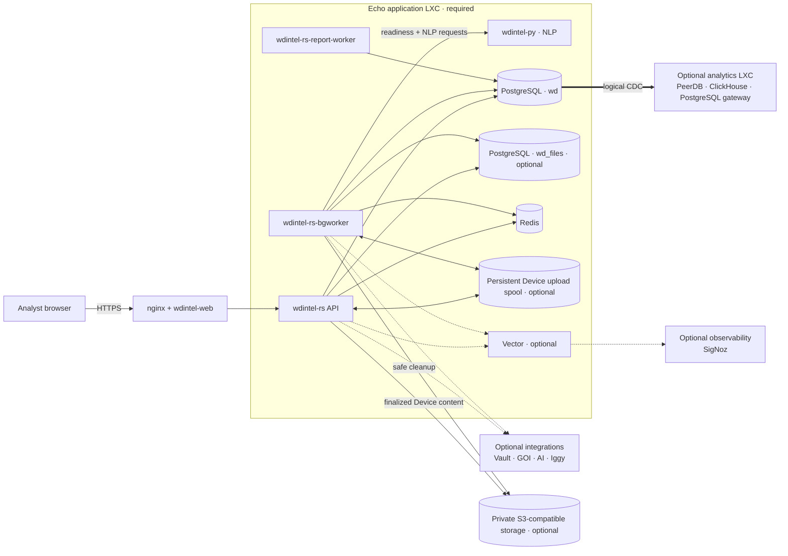

# Echo architecture

Echo is a SIGINT analytical web application deployed as one application
container per installation. PostgreSQL 18 is the system of record, Redis owns
sessions, TOTP login challenges, and other transient coordination, and
separate API, background-worker, and report-worker processes isolate
interactive traffic from long-running work.

Quick intelligence-report suggestions are a synchronous, optional API path
that makes exactly one structured vLLM request. It reads only the selected
message and already-completed transcription/summary records. Historical style
examples come only from preceding accessible human `intel_product` links and
`sigint_comment` rows. The feature is disabled by default and does not persist
or log source text or prompts. Validated suggestions and bounded model replies
are retained in the administrator review journal. See
[Quick intelligence-report suggestions](AI_INTELLIGENCE_REPORT_SUGGESTIONS.md)
for access boundaries, limits, telemetry, evaluation, and rollout.

## Core topology



ClickHouse diagnostic storage uses an explicit 1–7 day retention policy for
both analytics and SigNoz, including archived system logs. See the
[maintenance runbook](../deploy/clickhouse/README.md#bounded-clickhouse-diagnostic-logs)
for provisioning, expiry, and upgrade checks.

The application container uses native systemd services; deployment tooling
does not create its LXC container. Optional analytics runs in a separate
container and stores only derived data. PostgreSQL remains authoritative, and
supported analytical reads fall back to PostgreSQL when analytics is stale or
unavailable. The optional `wd_files` database stores device file metadata
and content publication pointers independently from the main `wd` database.

Web duplicate-unit merges run as detached tasks in the API process. Reference
categories are moved in bounded, committed batches; the final transaction
rechecks references, reconciles the survivor and parent activity, and marks the
duplicate deleted. On API restart, unfinished merge tasks are marked failed
unless that final transaction committed. An interrupted merge can be submitted
again with the original survivor, or its verified successor after a completed
survivor merge; already moved references follow that completed chain.
Registrations serialize both units and reject an unfinished merge chain until
the earlier merge completes, so rejected starts do not pin a duplicate.
Each committed ORBIT-link batch reconciles duplicate and inconsistency state,
and failed or recovered tasks publish a unit-change event for other clients.

Analytics control scripts and units are deployed as one content-addressed
release to both the application and its paired analytics container. Source
operations refuse to cross a release mismatch. A dedicated serialized
analytics reconciler owns schema repair, while the frequent health service is
read-only apart from its replication heartbeat and only reports drift.

Gateway extension hotfixes use a checksummed extension-only artifact. The
installer holds the reconciliation lock, saves the previous library and
configuration hashes, and stops gateway PostgreSQL before replacing its
library. Inbox diagnostics record the final operation outcome and duration,
including complete PostgreSQL fallback after candidate revalidation.

## Device file content storage

Device clients send resumable content through the API. In-progress bytes live
in `<storage_dir>/device-file-content-spool`; finalized immutable content lives
in the configured private S3-compatible bucket, while `wd_files` remains the
authoritative metadata and publication store. The API and background worker
must use the same persistent spool and the same stable S3 endpoint, bucket, and
StrongBox key. Invalid or missing Device upload storage configuration disables
only the new content-upload routes (503) and logs the cause; existing Echo and
FileSync services still start. An empty S3 endpoint uses the storage provider's
default endpoint.

The first version supports one application host, one HTTP API process, and one
logical Device content cleanup worker. The worker runs in
`wdintel-rs-bgworker`, uses a PostgreSQL advisory lock for singleton ownership,
and removes expired or terminal spool data plus unreferenced objects. Multi-host
or multi-API-process topology is not supported.

Sources can [reuse verified content across metadata revisions](device-file-content-reuse.md)
when the exact byte count and SHA-256 match an earlier completed upload of the
same file. Reuse publishes a separate immutable revision binding without
another transfer; it does not change FileSync invalidation semantics.

SIGINT TUS and multipart fallback uploads use
`<storage_dir>/file_upload_tus`. Per-upload UUID file locks serialize writes,
consumption, and cleanup across local processes. Lock files remain after cleanup
to avoid replacing an inode while another process still holds it. Admission
checks declared bytes (the 2 GiB maximum when unknown) against actual available
disk space with a 512 MiB free-space floor. Legacy uploads have no aggregate
byte or file-count quota, and unwritten pending uploads do not reserve space
that would prevent an old client from switching to multipart fallback. Pending uploads
expire after four hours and completed unconsumed uploads after eight hours.
The `sigint_file_upload_cleanup` background worker scans every minute and skips
busy uploads; consumption removes data and its sidecar together. API and
background workers must share this persistent storage directory. Empty login
directories are removed during consumption, cleanup and admission; legacy
directories are pruned in short locked batches. Upload creation and
completion retain their file locks until filesystem work finishes, including
when the requesting task is cancelled.

Shared multipart imports default to 200 MiB and 64 fields; text fields are
limited to 80 KiB. Multipart reads fail after 30 seconds without progress,
including truncated field headers and boundaries. A process-wide admission
limit permits two buffered multipart requests at a time and queues additional
requests before reading their bodies; cancellation removes a waiting request.
Admission remains held through the response body and detached Alpine, Delta,
and Terminal conversion work; SIGINT fallback streams to its spool with a
per-file size limit and does not consume this buffer limit.

Alpine converter upload, polling and result download share a one-hour overall
deadline. The optional `alpine_conversion_timeout_seconds` setting accepts
1–604800 seconds for deployments with longer conversions; missing values use
3600 seconds, while zero and out-of-range values fail before contacting the
converter. Status requests have a 30-second timeout and polls are ten seconds
apart. Three consecutive request-send failures or HTTP 5xx/408/429 responses
finish the job with an error; a valid pending status resets this failure count.
Other HTTP errors, invalid response bodies, missing or duplicate requested
receipts, and failed conversions terminate immediately. Response-body read or
JSON decode errors are terminal as well. Failures populate the background job's
error and release its multipart admission when the task finishes. Admission
remains held while conversion buffers are alive; source and result logs contain
byte counts instead of file payloads.

New SIGINT inbox attachments whose extensions are supported by the AlpineQuest
converter create one `signal_message_media_conversion_job` row per file. Each
row links the source media and message and records the source MD5. A singleton
worker converts jobs sequentially, verifies the stored source against that MD5,
and keeps the encrypted KMZ result in object storage without adding another
message attachment. Authorized attachment preview and download routes reuse the
original media access check; deleting an attachment through direct submit also
removes its stored conversion result on a best-effort basis.

Consumers with smaller
existing limits retain them; OCR gateway images remain limited to 16 MiB. ZIP
extraction rejects unsafe paths before extraction. Legacy importers preserve
their accepted archive sizes and entry counts; callers with pre-existing
archive limits retain both declared and streamed-output checks. Delta and KML
conversion preserve the original source-name document priority and download
names independently of the safe temporary upload filename. Download headers
retain the legacy `filename` parameter alongside UTF-8 `filename*` when needed.

Encryption and Device SHA work run on blocking workers. Shared encryption
admits at most two operations per process, including object write and
verification; additional operations wait for capacity. The permit stays
with detached CPU work when a request is cancelled. Device finalization also
retains its own admission permit. Device completion admits up to 16 waiting
requests for at most one second before taking any spool or database lock;
source preparation remains limited to two active finalizers by default.
Authorization and target state are rechecked after the spool lock is acquired;
authorization is also rechecked before refreshing an upload after a busy result.
StrongBox still buffers its source,
ciphertext, and serialized envelope: budget at least three times the source
size per active encrypted operation, plus storage buffers and other requests.
Large plaintext Device files remain streamed in 8 MiB chunks.

Unit attachment cancellation before COMMIT schedules best-effort cleanup of its
unpublished object.
Once submitted, its owned COMMIT task finishes even if the request is cancelled.
Unit and Palitra uploads retain the new object when COMMIT returns an error:
a missing acknowledgement cannot safely prove rollback. Such uncertain objects
are retained for investigation; no unreferenced-object janitor is implied.

Terminal PDF converters use separate working directories for each subprocess.
Their temporary files and admission remain owned until conversion finishes,
including after request cancellation. Without the optional OpenCV feature,
Terminal preserves the original PNG images instead of cropping them; conversion
and image read failures are returned to the caller.

## Messenger processing

`echo-messengers` is an independently deployable workspace package and systemd
service. Its source, package metadata, and build/deploy commands live beside
`goi/` rather than under it. GOI deployments delegate to the messenger
justfile and retire the legacy `echo-swapp` service before starting the renamed
service.

`echo-messengers` also owns the chat-administration HTTP/UI surface, Redis
unread-state worker, durable webhook dispatcher, and outbound chat attachment
storage at `/var/lib/echo-messengers/chat-attachments`. PostgreSQL remains the
source of truth; Redis failure degrades unread operations without taking chat
history or messenger management offline. Per-client 30-day retention is
applied through Echo IM and restarts only that client's worker. Chat ingestion
and webhook delivery run in independent worker loops.

Messenger receipt and processing are separate. Receipt persists snapshots in
PostgreSQL even while NLP is unavailable. The queue processor waits for
`wdintel-py` readiness, then catches up automatically; failed rows use durable
backoff so they cannot block newer messages.

## Background worker ownership

`wdintel-rs-bgworker` owns `inbox_settlement_worker`. Inbox parsing and edits
reconcile its PostgreSQL queue in the same transaction as `location_v2`;
workers claim rows with `FOR UPDATE SKIP LOCKED` and rank settlement candidates
against the active Battle Line or the item's AOR segments. Battle Line uploads
apply only to newly queued data, while AOR changes retain their existing
behavior of requeueing affected links. Attempted misses remain available for
administrator review.

`wdintel-rs-bgworker` also owns `ai_settlement_worker`. When enabled by an
administrator, new or reparsed inbox messages are queued for header-based AI
location extraction. The worker preserves every existing `location_v2` value,
appends only missing settlements, and reconciles the settlement-link queue in
the same transaction. It is disabled by default.

The combined group-stat and network-recalculation worker owns the
PostgreSQL-only `network_recalculation_task` queue. It switches between network
recalculation passes and group-stat calculations so they cannot update
frequency `last_seen_dt` concurrently. It also calculates the per-login last
interception in a network AOR outside API requests. Pending work is deduplicated
per frequency, calculation kind, and login where the result depends on data
visibility. Per-login work clears only its claimed request. Frequency
`last_seen_dt` work serializes per network, locks frequency rows in stable
order, captures up to 500 same-network requests in a short transaction, and
then recalculates them in one grouped history scan. Committing the capture
before the scan keeps new queue inserts from waiting on the pending-task unique
index. The worker removes only the captured batch, while work queued after the
capture remains pending. It starts up to 500 queue work units per pass and stops
starting new work after 50 seconds. It queues a final reconciliation after
inbox-network invalidations update message assignments; broad group/AOR
invalidations fan out to frequencies processed during that pass, and AOR
invalidations also include non-deleted frequencies on networks currently linked
to that AOR.
The per-login AOR cache is scoped to the login's current visible group keys,
expires after 10 minutes, and is not served while inbox-network invalidation or
recalculation is pending. Expired entries are evicted alongside the pre-existing
network cleanup in the separate network maintenance worker. The cache and its
queue are excluded from the optional analytics replica.

The separate `network_last_activity_worker` refreshes
`sigint_network.last_active_at` every five minutes in bounded network-ID batches
from the global frequency `last_seen_dt` values. It also reads network links
created in the previous 20 minutes, so new interceptions are reflected while a
frequency recalculation is pending without writing the frequency cache. A
composite network-link index, one-minute timeout per batch, and changed-row-only
updates keep this work outside API requests. Activity is independent of the
requesting login's message visibility.
Link changes enqueue frequency recalculation, and invalidating a cached latest
message enqueues recalculation so the next valid interception can be found.

The optional `wdintel-rs --mode=live oneoff-backfill-network-last-activity`
command fills only networks with a null `last_active_at` from their newest
network-link `created_at`. Networks without links remain null. It processes
networks in ID order, reports a resume cursor, and accepts `--after-id` with a
network ID when resuming an interrupted run. The periodic worker subsequently
revalidates these seeds against valid interception timestamps.

## Statistics storage

`wdintel-rs-bgworker` derives recent and daily group statistics from
PostgreSQL into Redis. Legacy location facets remain text values split from
`sigint_inbox_item.location_v2`; settlement facets are stored separately as
canonical IDs from `sigint_inbox_item_settlement.settlement_id`. The
`oneoff-calculate-historic-stats` command can rebuild only settlement buckets
with `--only settlement`.

Group-stat invalidations first enter the PostgreSQL
`group_stats_recalculation_task` intake queue. The same worker compacts batches
into one `group_stats_recalculation_day` row per affected Kyiv calendar day;
each successful day calculation removes its row only if no newer invalidation
arrived during the calculation. Today and the preceding local date are
eligible at any hour; older days are processed outside the network history
worker's configured night shift. During that period the worker alternates
priority between recent and historical days. Both operational tables are
excluded from analytics. The dirty-day migration clears the entire
pre-existing intake queue, including requests less than a day old. After
deployment, run `sudo systemctl stop wdintel-rs-bgworker`, then
`sudo /usr/bin/wdintel-rs --mode=live oneoff-calculate-historic-stats`, then
`sudo systemctl start wdintel-rs-bgworker`. The oneoff rebuilds all statistics
families for the supported 366-day retention window. Stopping this service
pauses all of its background jobs for the duration of the oneoff. Inbox changes
received while the worker is stopped remain in the intake queue and are
compacted after restart. If the oneoff fails, restart the worker for new work;
stop it again and rerun the oneoff before treating historical statistics as
complete.

## Credentials authentication storage

Password login 2FA is owned by the `wdintel-rs` API process. Durable TOTP
seeds live in PostgreSQL table `login_totp` (`login_id` → `login`,
StrongBox-encrypted `totp_secret` ciphertext). Encryption uses top-level
`totp_strongbox_key` in `config.toml` (dedicated key; do not reuse S3
`s3_config.strongbox_key`). That table is PeerDB-excluded and must not appear
in the analytics replica: second-factor seeds are an operational credential
boundary, not analytical data. The replicated `login` row never stores the
seed; APIs expose only `totp_enabled`. Admin clear, password change, and
disabling password auth bump `login.totp_epoch` and invalidate Redis
challenges so in-flight OTP prompts cannot continue. Confirm locks the
`login` row (`FOR UPDATE`) through enroll (if any) and session issuance,
rechecking `password_auth_enabled` and the epoch under that lock so an
admin invalidation cannot race a claimed challenge into a new session.

Pending enroll/verify state is Redis-only on the same Redis service as
sessions (not the group-stats logical database): challenge payloads under
`2fa:challenge:*` (enroll `pending_secret` is also StrongBox ciphertext), a
per-login active pointer, and a per-login failed-attempt counter with TTL. A
session cookie is issued only after a successful confirm (or immediately for
unattended `Api` / `ApiAgent` password logins, or logins with the `No2FA`
role). Admin clear deletes the `login_totp` row and invalidates Redis
challenges.

Implementation detail:
[archive/2026-08-30-totp-2fa/README.md](../archive/2026-08-30-totp-2fa/README.md).

### Initial Battle Line import from Delta KML

The stored Delta KML and Battle Line are independent modules. The latest Delta
KML is available as a separately toggleable layer on the analysis map, but
later Delta uploads do not update Battle Line. To inspect the approved initial
source without changing data, run:

```sh
sudo /usr/bin/wdintel-rs --mode=live oneoff-import-battle-line-from-delta-kml --source-id 5 --dry-run
```

Remove `--dry-run` to create BattleLine v0 when no active version exists. If an
active Battle Line prevents the import, the oneoff logs why it was skipped and
suggests `--force`. Supplying `--force` always imports the Delta source as a new
version and retires the active version, including when the same Delta source was
imported previously. Neither the oneoff nor later admin uploads requeue
historical settlement links.

## Application deployment maintenance interval

`just deploy` and `just deploy-from-local` stop and runtime-mask the API
socket, API service, background worker, and report worker before installing the
application package. The masks prevent package maintainer scripts from
starting a new binary before its database migrations finish. A successful
deployment removes the masks and starts the required units after migration.

If deployment fails during this interval, cleanup stops the application units
and removes the runtime masks. Fix the reported failure and rerun the
deployment. Start the units manually only after verifying that the installed
binary and database schema are compatible.

## Focused documentation

- [Deployment and server operations](../deploy/server.md)
- [Optional analytics stack](../deploy/clickhouse/README.md)
- [Monitoring](MONITORING.md)
- [AI routing](../echo-vllm-router/README.md) and [document extraction](../echo-document-extractor/README.md)
- [GOI](../goi/README.md), [messengers](MESSENGERS.md), and [ORBIT](ORBIT.md)

The previous accumulated architecture and rollout notes are preserved in the
[architecture notes archive](../archive/2026-08-18-architecture-notes.md).

SIGINT multipart fallback uses an inactivity timeout: transfers may last longer
than ten minutes while bytes continue to arrive. Success, failure, and
cancellation clear the watchdog.
