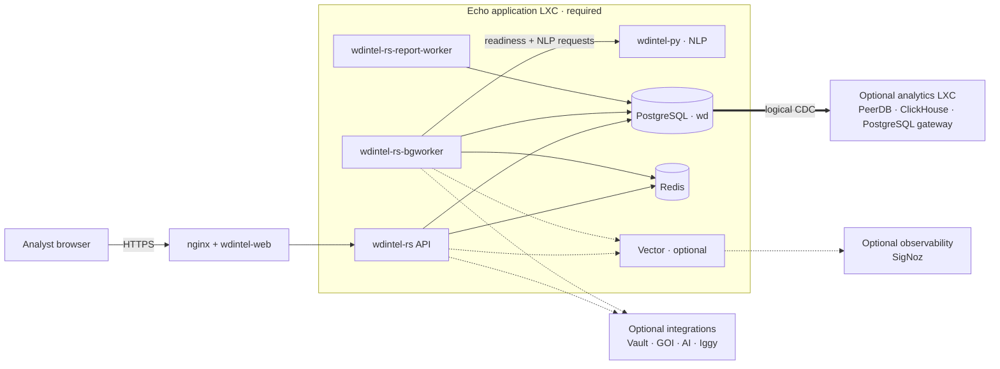

# Echo architecture

Echo is a SIGINT analytical web application deployed as one application
container per installation. PostgreSQL 18 is the system of record, Redis owns
sessions, TOTP login challenges, and other transient coordination, and
separate API, background-worker, and report-worker processes isolate
interactive traffic from long-running work.

Quick intelligence-report suggestions are a synchronous, optional API path
that makes exactly one structured vLLM request. It reads only the selected
message and already-completed transcription/summary records. Historical style
examples come only from preceding accessible human `intel_product` links and
`sigint_comment` rows. The feature is disabled by default and does not persist
or log source text or prompts. Validated suggestions and bounded model replies
are retained in the administrator review journal. See
[Quick intelligence-report suggestions](AI_INTELLIGENCE_REPORT_SUGGESTIONS.md)
for access boundaries, limits, telemetry, evaluation, and rollout.

## Core topology



The application container uses native systemd services; deployment tooling
does not create its LXC container. Optional analytics runs in a separate
container and stores only derived data. PostgreSQL remains authoritative, and
supported analytical reads fall back to PostgreSQL when analytics is stale or
unavailable. The optional `wd_files` database stores device file metadata
independently from the main `wd` database.

Analytics control scripts and units are deployed as one content-addressed
release to both the application and its paired analytics container. Source
operations refuse to cross a release mismatch. A dedicated serialized
analytics reconciler owns schema repair, while the frequent health service is
read-only apart from its replication heartbeat and only reports drift.

## Messenger processing

`echo-messengers` is an independently deployable workspace package and systemd
service. Its source, package metadata, and build/deploy commands live beside
`goi/` rather than under it. GOI deployments delegate to the messenger
justfile and retire the legacy `echo-swapp` service before starting the renamed
service.

`echo-messengers` also owns the chat-administration HTTP/UI surface, Redis
unread-state worker, durable webhook dispatcher, and outbound chat attachment
storage at `/var/lib/echo-messengers/chat-attachments`. PostgreSQL remains the
source of truth; Redis failure degrades unread operations without taking chat
history or messenger management offline. Per-client 30-day retention is
applied through Echo IM and restarts only that client's worker. Chat ingestion
and webhook delivery run in independent worker loops.

Messenger receipt and processing are separate. Receipt persists snapshots in
PostgreSQL even while NLP is unavailable. The queue processor waits for
`wdintel-py` readiness, then catches up automatically; failed rows use durable
backoff so they cannot block newer messages.

## Background worker ownership

`wdintel-rs-bgworker` owns `inbox_settlement_worker`. Inbox parsing and edits
reconcile its PostgreSQL queue in the same transaction as `location_v2`;
workers claim rows with `FOR UPDATE SKIP LOCKED` and rank settlement candidates
against the active Battle Line or the item's AOR segments. Battle Line uploads
apply only to newly queued data, while AOR changes retain their existing
behavior of requeueing affected links. Attempted misses remain available for
administrator review.

`wdintel-rs-bgworker` also owns `ai_settlement_worker`. When enabled by an
administrator, new or reparsed inbox messages are queued for header-based AI
location extraction. The worker preserves every existing `location_v2` value,
appends only missing settlements, and reconciles the settlement-link queue in
the same transaction. It is disabled by default.

## Statistics storage

`wdintel-rs-bgworker` derives recent and daily group statistics from
PostgreSQL into Redis. Legacy location facets remain text values split from
`sigint_inbox_item.location_v2`; settlement facets are stored separately as
canonical IDs from `sigint_inbox_item_settlement.settlement_id`. The
`oneoff-calculate-historic-stats` command can rebuild only settlement buckets
with `--only settlement`.

## Credentials authentication storage

Password login 2FA is owned by the `wdintel-rs` API process. Durable TOTP
seeds live in PostgreSQL table `login_totp` (`login_id` → `login`,
StrongBox-encrypted `totp_secret` ciphertext). Encryption uses top-level
`totp_strongbox_key` in `config.toml` (dedicated key; do not reuse S3
`s3_config.strongbox_key`). That table is PeerDB-excluded and must not appear
in the analytics replica: second-factor seeds are an operational credential
boundary, not analytical data. The replicated `login` row never stores the
seed; APIs expose only `totp_enabled`. Admin clear, password change, and
disabling password auth bump `login.totp_epoch` and invalidate Redis
challenges so in-flight OTP prompts cannot continue. Confirm locks the
`login` row (`FOR UPDATE`) through enroll (if any) and session issuance,
rechecking `password_auth_enabled` and the epoch under that lock so an
admin invalidation cannot race a claimed challenge into a new session.

Pending enroll/verify state is Redis-only on the same Redis service as
sessions (not the group-stats logical database): challenge payloads under
`2fa:challenge:*` (enroll `pending_secret` is also StrongBox ciphertext), a
per-login active pointer, and a per-login failed-attempt counter with TTL. A
session cookie is issued only after a successful confirm (or immediately for
unattended `Api` / `ApiAgent` password logins, or logins with the `No2FA`
role). Admin clear deletes the `login_totp` row and invalidates Redis
challenges.

Implementation detail:
[archive/2026-08-30-totp-2fa/README.md](../archive/2026-08-30-totp-2fa/README.md).

### Initial Battle Line import from Delta KML

The stored Delta KML and Battle Line are independent modules. The latest Delta
KML is available as a separately toggleable layer on the analysis map, but
later Delta uploads do not update Battle Line. To inspect the approved initial
source without changing data, run:

```sh
sudo /usr/bin/wdintel-rs --mode=live oneoff-import-battle-line-from-delta-kml --source-id 5 --dry-run
```

Remove `--dry-run` to create BattleLine v0 when no active version exists. If an
active Battle Line prevents the import, the oneoff logs why it was skipped and
suggests `--force`. Supplying `--force` always imports the Delta source as a new
version and retires the active version, including when the same Delta source was
imported previously. Neither the oneoff nor later admin uploads requeue
historical settlement links.

## Application deployment maintenance interval

`just deploy` and `just deploy-from-local` stop and runtime-mask the API
socket, API service, background worker, and report worker before installing the
application package. The masks prevent package maintainer scripts from
starting a new binary before its database migrations finish. A successful
deployment removes the masks and starts the required units after migration.

If deployment fails during this interval, cleanup stops the application units
and removes the runtime masks. Fix the reported failure and rerun the
deployment. Start the units manually only after verifying that the installed
binary and database schema are compatible.

## Focused documentation

- [Deployment and server operations](../deploy/server.md)
- [Optional analytics stack](../deploy/clickhouse/README.md)
- [Monitoring](MONITORING.md)
- [AI routing](../echo-vllm-router/README.md) and [document extraction](../echo-document-extractor/README.md)
- [GOI](../goi/README.md), [messengers](MESSENGERS.md), and [ORBIT](ORBIT.md)

The previous accumulated architecture and rollout notes are preserved in the
[architecture notes archive](../archive/2026-08-18-architecture-notes.md).
