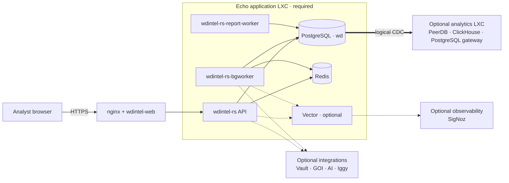

# Echo architecture

Echo is a SIGINT analytical web application deployed as one application
container per installation. PostgreSQL 18 is the system of record, Redis owns
sessions and transient coordination, and separate API, background-worker, and
report-worker processes isolate interactive traffic from long-running work.

The analytics container is optional: omitting the `[analytics]` section from
Echo configuration leaves the application on its existing PostgreSQL path.
Failure to connect to analytics at startup does not prevent Echo from starting,
and supported analytical requests retry through PostgreSQL when analytics is
stale, unavailable, or too slow.
Those requests include RER result/facet counts and lists, long-range messenger
activity timelines, report-history list scans, and replicated-data report
queries; operational writes and live queue/progress state remain on PostgreSQL.

## Shared signal media and copy relationships

Signal message media rows contain a logical `storage_key` identifying the
physical object in the configured S3-compatible storage. Copying a message
creates a new media row that reuses this key, so unchanged attachments are not
uploaded again. Cleanup must delete an object only after no
`signal_message_media` row references its key; code that derives an object key
from the media-row UUID can orphan shared objects or delete the wrong object.

Copy lineage is stored in PostgreSQL in the `intel_prod` table. Each row links
the saved copy's `signal_message_id` to one source message, allowing one copy
to be based on several messages. The `relation_kind` column distinguishes
report lineage from linked comments so the two relationships are not exposed
through each other's APIs. Existing `sigint_comment` rows remain a migration
fallback until `oneoff-migrate-sigint-comments` completes. On
analytics-enabled installations, `intel_prod` is a replicated snapshot table;
changes to its schema and to replicated comment/media tables require the
documented PeerDB mirror-resync procedure before analytics is considered
healthy.

## Deployment topology

The operator creates and sizes the LXC containers in Proxmox or Incus. Echo's
deployment tooling installs application packages and native systemd services;
it does not create containers and does not run Docker or Podman inside them.
The application and analytics stacks run in separate operating-system
containers; the analytics services are never installed inside the Echo LXC.
The paired containers should communicate over a private Proxmox network in
production. Tailscale is also supported and is used by the development pair.

## Core topology

The application container uses native systemd services; deployment tooling
does not create its LXC container. Optional analytics runs in a separate
container and stores only derived data. PostgreSQL remains authoritative, and
supported analytical reads fall back to PostgreSQL when analytics is stale or
unavailable. The optional `wd_files` database stores device file metadata
independently from the main `wd` database.

## Focused documentation

- [Deployment and server operations](../deploy/server.md)
- [Optional analytics stack](../deploy/clickhouse/README.md)
- [Monitoring](MONITORING.md)
- [AI routing](../echo-vllm-router/README.md) and [document extraction](../echo-document-extractor/README.md)
- [GOI](../goi/README.md), [messengers](MESSENGERS.md), and [ORBIT](ORBIT.md)

The previous accumulated architecture and rollout notes are preserved in the
[architecture notes archive](../archive/2026-08-18-architecture-notes.md).
