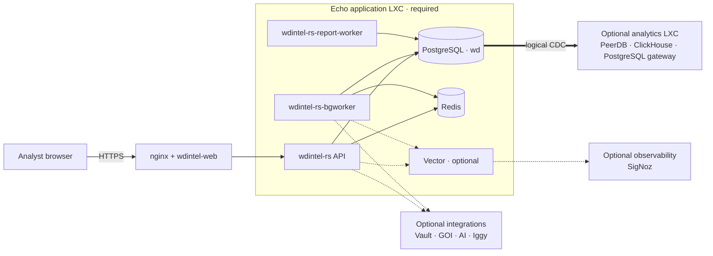

# Echo architecture

Echo is a SIGINT analytical web application deployed as one application
container per installation. PostgreSQL 18 is the system of record, Redis owns
sessions and transient coordination, and separate API, background-worker, and
report-worker processes isolate interactive traffic from long-running work.

## Core topology

The application container uses native systemd services; deployment tooling
does not create its LXC container. Optional analytics runs in a separate
container and stores only derived data. PostgreSQL remains authoritative, and
supported analytical reads fall back to PostgreSQL when analytics is stale or
unavailable. The optional `wd_files` database stores device file metadata
independently from the main `wd` database.

## Background worker ownership

`wdintel-rs-bgworker` owns `inbox_settlement_worker`. Inbox parsing and edits
reconcile its PostgreSQL queue in the same transaction as `location_v2`;
workers claim rows with `FOR UPDATE SKIP LOCKED` and rank settlement candidates
against the active Battle Line or the item's AOR segments. Battle Line and AOR
changes requeue affected links, while attempted misses remain available for
administrator review.

## Focused documentation

- [Deployment and server operations](../deploy/server.md)
- [Optional analytics stack](../deploy/clickhouse/README.md)
- [Monitoring](MONITORING.md)
- [AI routing](../echo-vllm-router/README.md) and [document extraction](../echo-document-extractor/README.md)
- [GOI](../goi/README.md), [messengers](MESSENGERS.md), and [ORBIT](ORBIT.md)

The previous accumulated architecture and rollout notes are preserved in the
[architecture notes archive](../archive/2026-08-18-architecture-notes.md).
