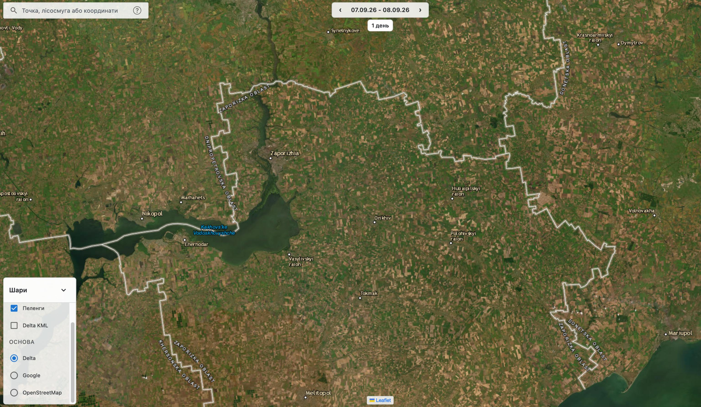
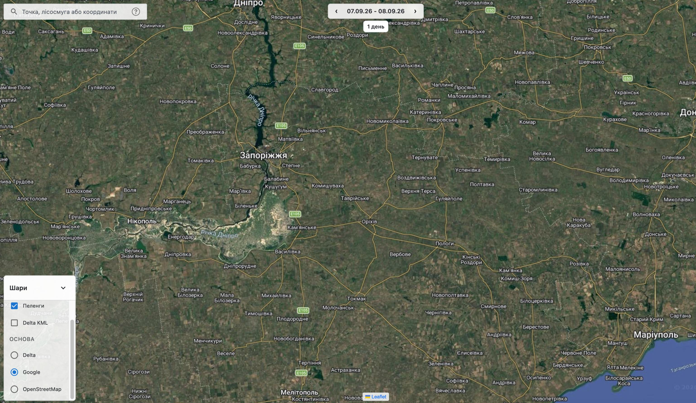
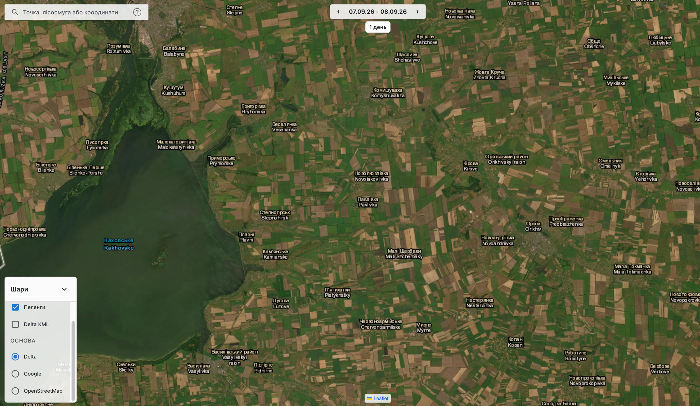
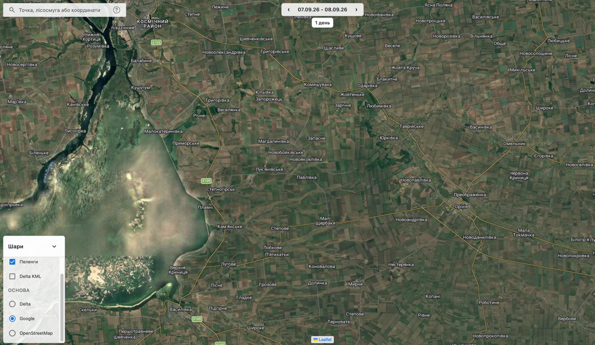
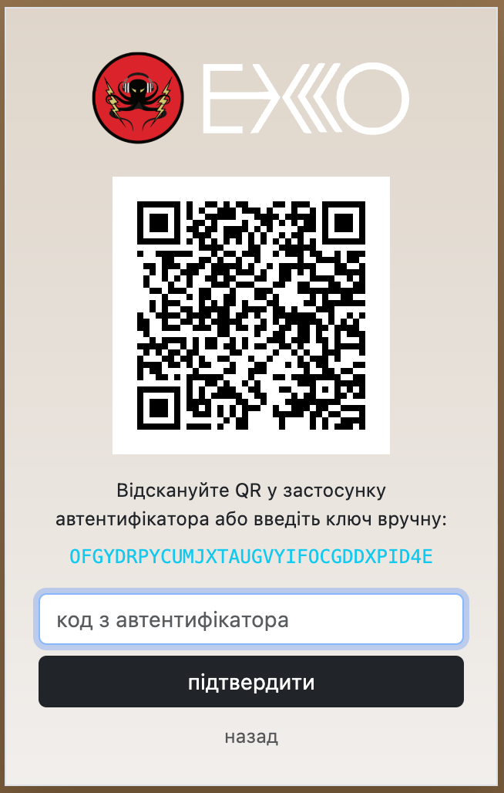

# Реліз 2026-09-07 

**Оновлено стандартну підкладку карти - тепер за замовчуванням відображається підкладка Delta замість Google.** 
 
 
 
 

- **Додано 2FA (двофакторну аутентифікацію) на сторінці авторизації** 
 
Карта та палітри: у списку пеленгів тепер відображається відстань до ЛБЗ. 

Оперативний та Аналіз 

- У картках повідомлень виправлено відображення тегів і їх згортання. Також тепер можна налаштувати скорочення довгих текстів. 
- Виправлено помилки, через які окремі повідомлення не вдавалося коректно редагувати. 
- Тепер до картки повідомлення можна завантажувати аудіофайли. 
- Виправлено відображення оброблених файлів і вкладень. 
- Для повідомлень тепер коректно відображається автор або відправник. 
- Стрічка повідомлень стала плавнішою. 

Підрозділи та ORBIT 
- Виправлено узгодження назв підрозділів із системою ORBIT, прибрано дублікати та нерозпізнані підрозділи. 

Інше 
- Змінено інтерфейс розділу **«Мережі»**: класичну сторінку зі списком мереж прибрано. *У випадку пропозицій щодо додавання елементів інтерфейсу заохочуємо звертатися в технічну підтримку.* 
- Виправлено помилки для підвищення швидкодії та стабільності.
