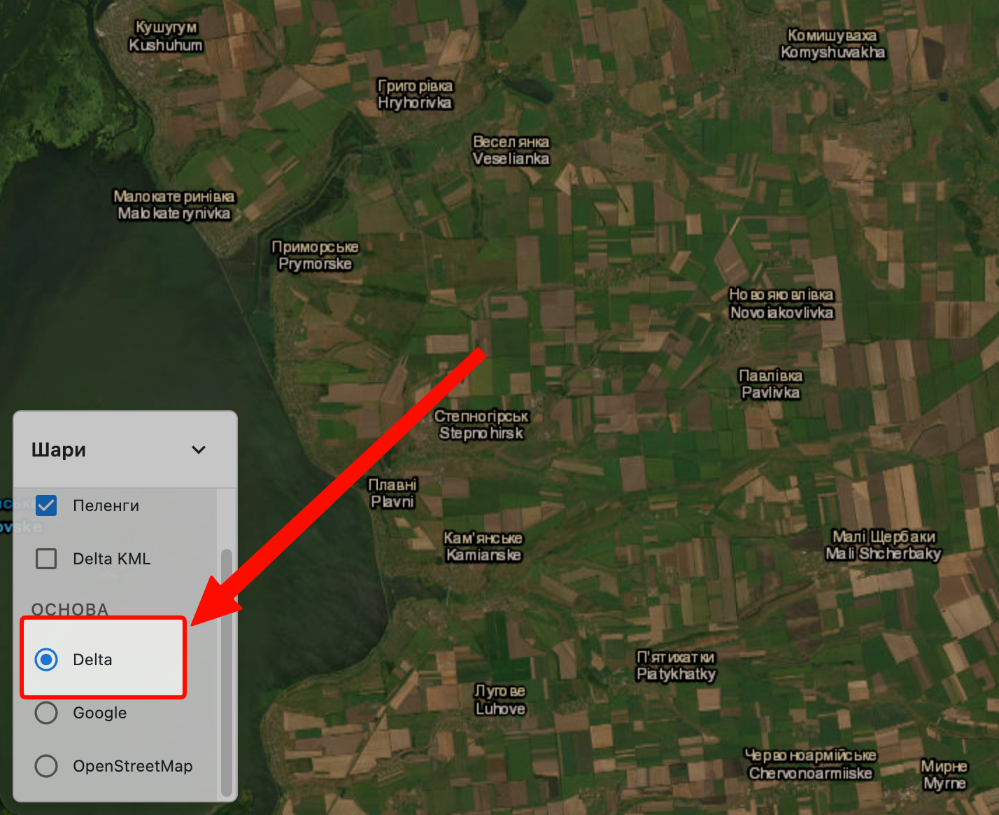
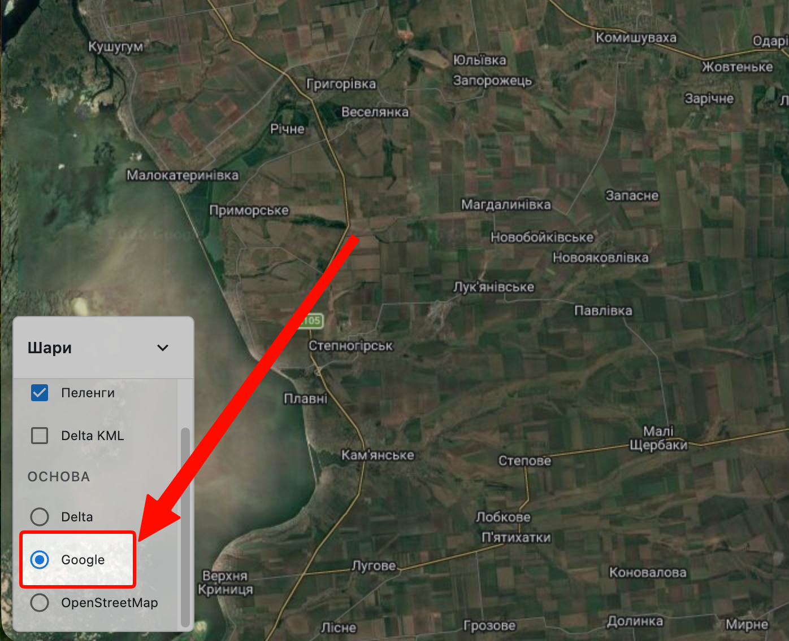
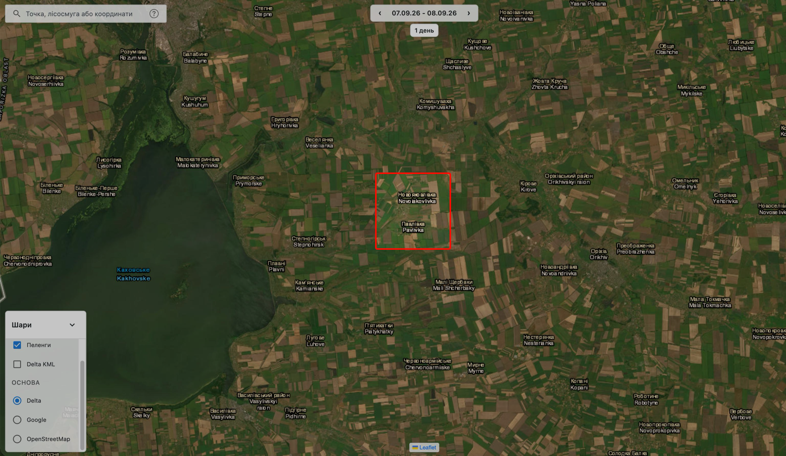
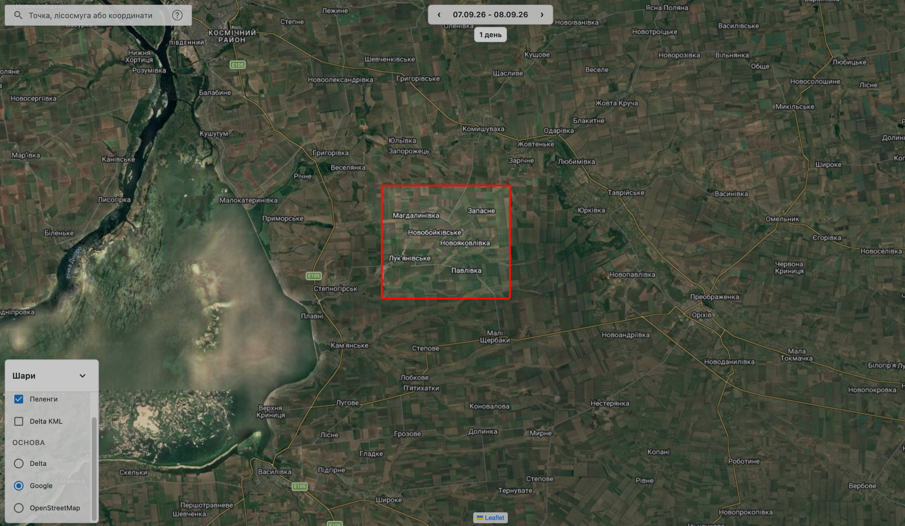
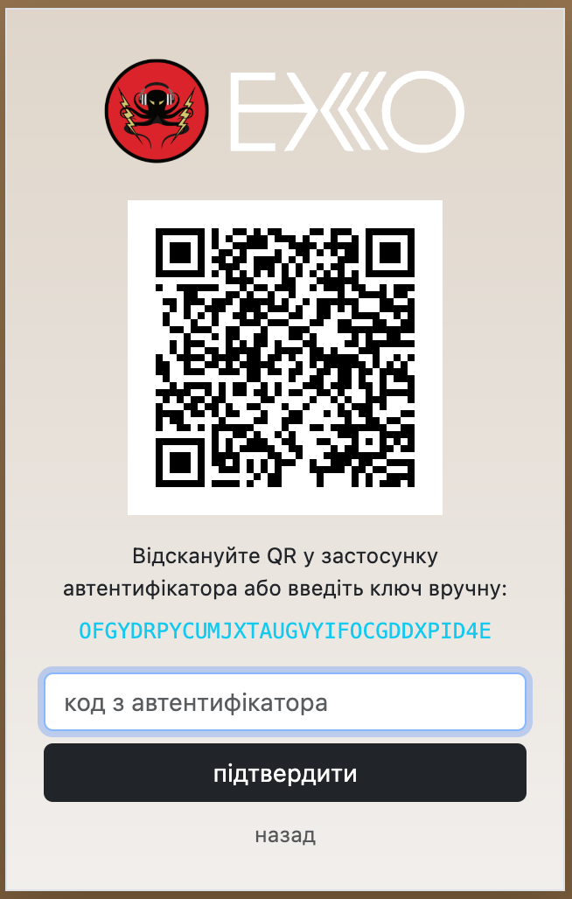
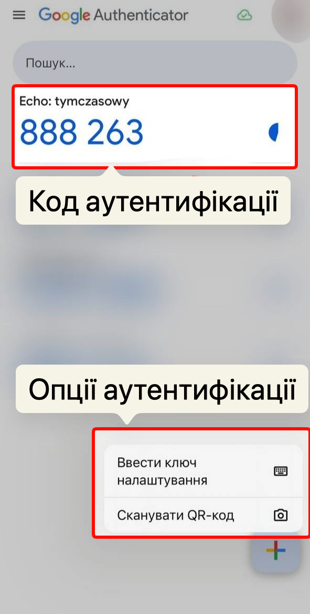

# Реліз 2026-09-08 

## Оновлено стандартну підкладку карти - тепер за замовчуванням відображається підкладка Delta замість Google Maps.

*У меню "Шари" доступний вибір з трьох опцій, за замовчуванням обрано підкладку Delta.* 

*На підкладці Delta назви населених пунктів за замовчуванням зазначені англійською, при наближенні назви дублюються українською.*
  
 
*На підкладці Google Maps назви населених пунктів зазначені ЛИШЕ українською.*  

## Додано 2FA (двофакторну автентифікацію) на сторінці авторизації 
 

1. Встановіть на телефон застосунок-автентифікатор з офіційного магазину, наприклад Microsoft Authenticator, Google Authenticator, Authy або Duo Mobile.
2. У застосунку виберіть додавання облікового запису та відскануйте QR-код на сторінці ЕХО. Якщо не вдається відсканувати QR-код, введіть ключ вручну.
3. Введіть 6-значний код із застосунку-автентифікатора. Не надсилайте QR-код або ключ іншим людям.

## Карта та палітри
У списку пеленгів тепер відображається відстань до ЛБЗ. 

## Оперативний та Аналіз 

- У картках повідомлень виправлено відображення тегів і їх згортання. Також тепер можна налаштувати скорочення довгих текстів. 
- Виправлено помилки, через які окремі повідомлення не вдавалося коректно редагувати. 
- Тепер до картки повідомлення можна завантажувати аудіофайли. 
- Виправлено відображення оброблених файлів і вкладень. 
- Для повідомлень тепер коректно відображається автор або відправник. 
- Стрічка повідомлень стала плавнішою. 

## Підрозділи та ORBIT

- Виправлено узгодження назв підрозділів із системою ORBIT, прибрано дублікати та нерозпізнані підрозділи. 

## Інше 

- Змінено інтерфейс розділу **«Мережі»**: класичну сторінку зі списком мереж прибрано. *У випадку пропозицій щодо додавання елементів інтерфейсу заохочуємо звертатися в технічну підтримку.* 
- Багфікси для підвищення швидкодії та стабільності.
