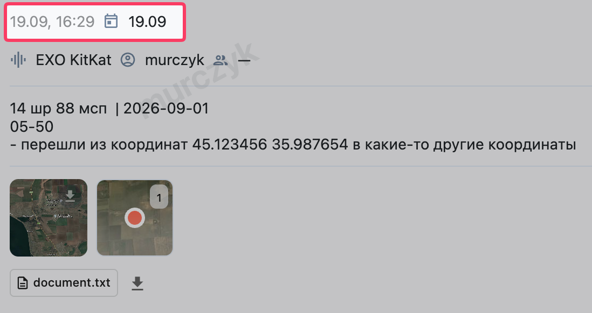
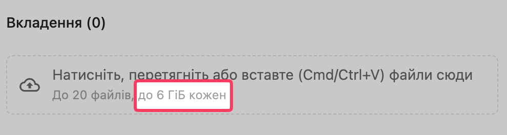
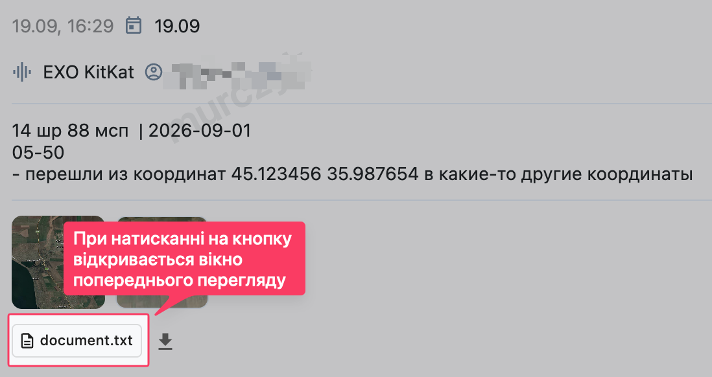
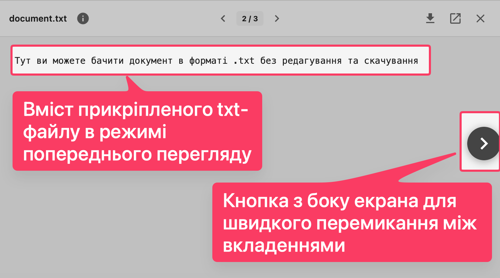
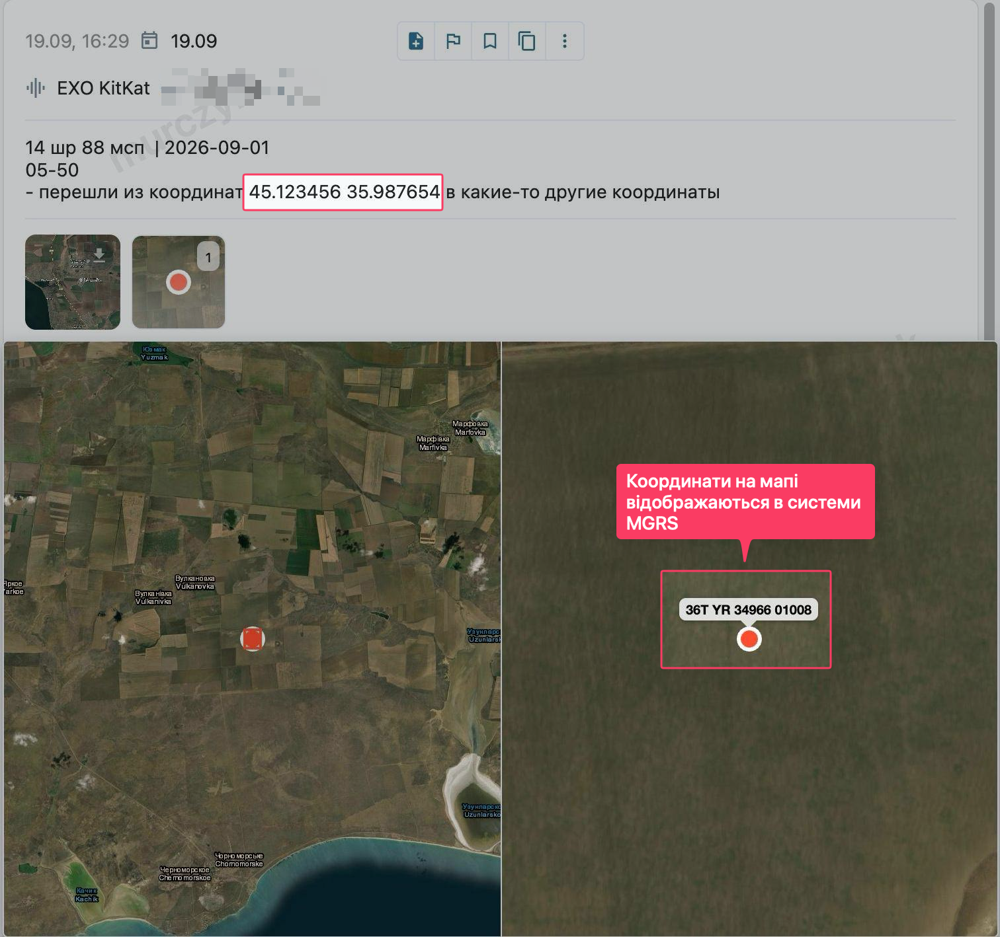

# Реліз 2026-09-19

## Оперативний та Аналіз

* Окремо відображаються дата створення повідомлення та дата події. Час можна очистити, невідомий час не показується в інтерфейсі та звітах.

* Максимальний розмір одного вкладення збільшено до 6 ГБ.

* Повідомлення можна сортувати за датою створення.
* Посилання на інші повідомлення показують попередній перегляд.
* Розвіддонесення можна створювати під час перегляду документа.

## Вкладення та файли

* Додано перегляд аудіо, TXT, PDF і DOCX без редагування та скачування, а також попередній перегляд файлів із геоданими.
* Між вкладеннями можна швидко перемикатися за допомогою кнопок з боків екрана.

## Карта та мережі

* На мапі додано координати MGRS та можливість їх копіювати.

## Інше

* Система враховує видалення та виправлення позивних, зроблені користувачами.
* Багфікси для підвищення швидкодії та стабільності.
