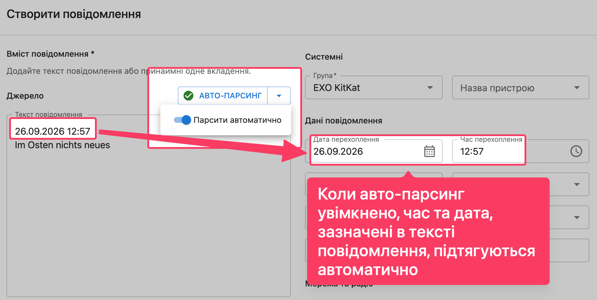
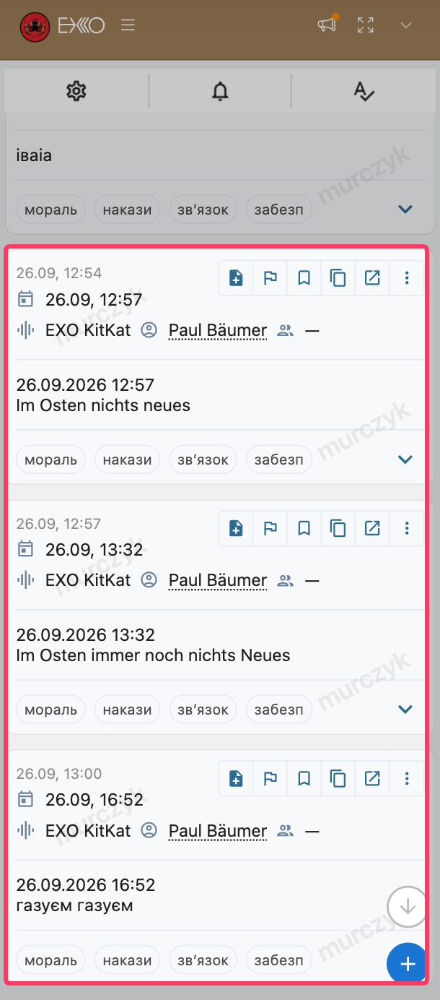
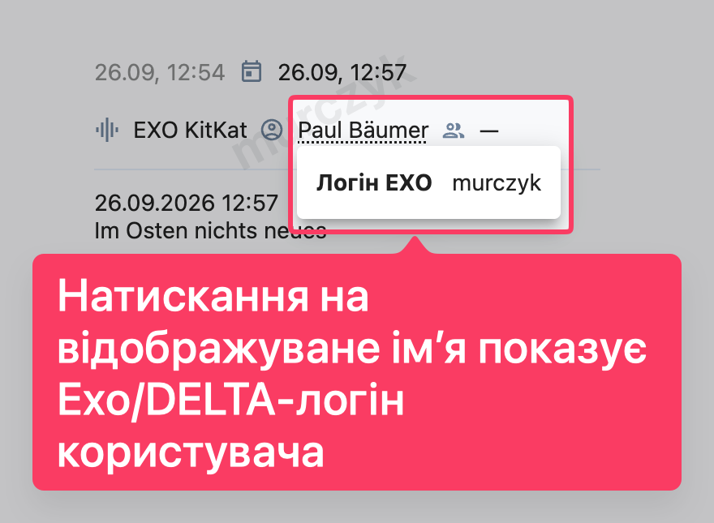

# Реліз 2026-09-26

## Оперативний та Аналіз

* Додано налаштування автоматичного розпарсингу тексту повідомлення.

* Покращено відображення повідомлень на мобільних пристроях.

* В Оперативному повідомлення тепер завжди впорядковуються за датою створення. Вибирати спосіб сортування за датою можна в Аналізі.

## Профіль

* У профілі можна вказати власне відображуване ім’я, а натискання на ім’я автора показує його логін в ЕХО та логін у Delta.

## Частоти

* Прискорено перегляд позивних. Попередній перегляд зберігає пріоритет пов’язаних підрозділів та оновлюється після змін у мережі.

## Інше

* Багфікси для підвищення швидкодії та стабільності.
