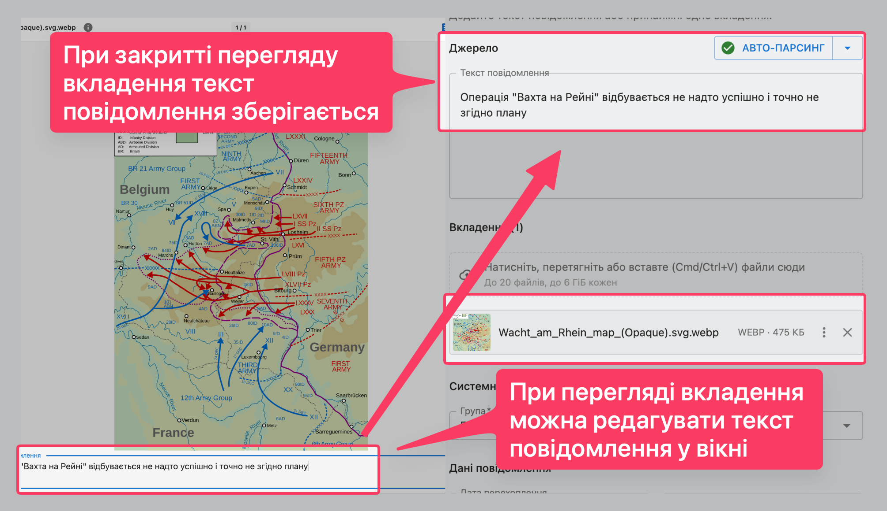
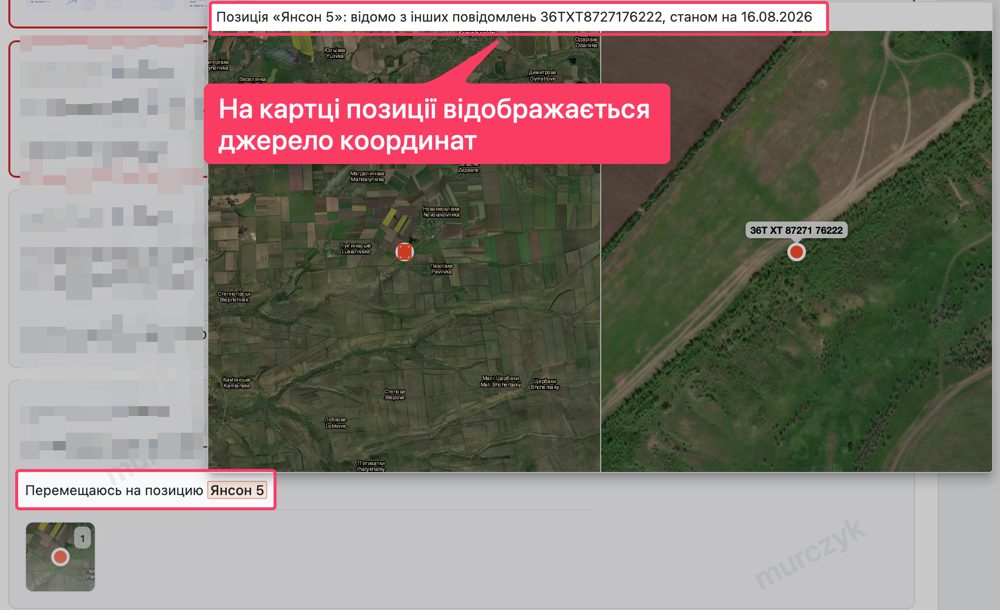

# Реліз 2026-10-07

## Оперативний та Аналіз

- Вкладення тепер можна перейменовувати.
- Додано перегляд файлів форматів ZIP, KML і KMZ безпосередньо в повідомленнях.
- Під час створення або редагування повідомлення можна одночасно писати текст і переглядати вкладення.

- Створення та редагування повідомлень і розвіддонесень перенесено у вбудовану праву панель. Стрічка повідомлень залишається доступною, а на вузьких екранах використовується повноекранний режим.

## Мапа та позиції

- На картці позиції відображається джерело координат. При наведенні на посилання можна переглянути пов’язане повідомлення.

- Джерела та попередній перегляд враховують доступ до групи — повідомлення з недоступних груп не розкриваються.

## Інше

- Оновлено логотип.

- Багфікси для підвищення швидкодії та стабільності.

## Пошук та обробка даних за допомогою ШІ

*Функції ШІ доступні лише на обмеженому переліку серверів.*

- ШІ-агент отримав розширені можливості для роботи з документами та позиціями. Система шукає інформацію за назвами вкладень, текстом документів і результатами OCR, створює підсумки, знаходить координати та зіставляє їх із позиціями.
- Новий інструмент ШІ-агента дозволяє шукати позиції за назвою або координатами в заданому радіусі. У результатах спочатку показується відоме розташування, потім згадки з координатами та інші пов’язані повідомлення.
- ШІ розпізнає різні варіанти написання назв позицій, підсвічує їх у повідомленнях і зберігає координати, безпосередньо пов’язані з ними.
- Пошук враховує доступ користувача до груп, а дані приватних груп не розкриваються стороннім користувачам.
- У ШІ-чаті оновлено мапу: вона стала компактнішою, отримала лічильник точок і кнопки керування шарами. Картка вибраного запису відкривається безпосередньо на мапі.
- Адміністратори можуть керувати обробкою документів і позицій у розділі **«ШІ»**, фільтрувати знайдені згадки, позначати помилкові результати та повторно обробляти джерела.