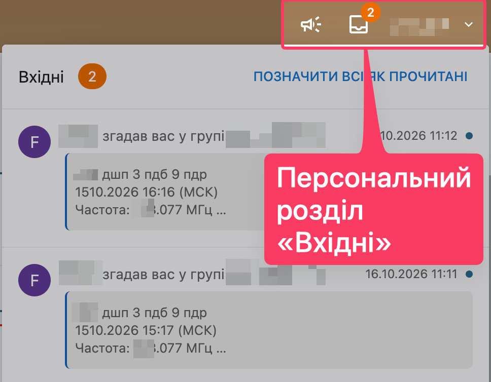

# Реліз 2026-10-18

## Вхідні та важливі повідомлення

- Важливе повідомлення можна надіслати всім учасникам доступної групи.
- Додано персональний розділ **«Вхідні»** з історією повідомлень, лічильником непрочитаного та швидким переходом до повідомлення.

- Повідомленням можна поділитися за допомогою прямого посилання. Воно відкриє повідомлення у відповідному розділі.

## Пошук в Аналізі

- Додано три режими пошуку:
  - гнучкий пошук;
  - точний збіг цілих слів;
  - пошук за частиною слова без урахування великих і малих літер.
- Гнучкий пошук використовується за замовчуванням. Поруч із полем пошуку доступна довідка з прикладами.

## Пристрої та файли

- Розширено перегляд документів, таблиць, зображень, аудіо, відео та мап.
- ZIP-архіви відкриваються як папки, у яких можна переглядати вкладені файли.

## Підрозділи

- Пошук показує також неактивні дочірні підрозділи.
- Якщо знайдено один точний збіг, підрозділ вибирається автоматично.
- Автори повідомлень можуть додавати нові підрозділи безпосередньо під час роботи з повідомленням.
- Додано окремі **«Види та роди ЗС»** із фільтруванням, сортуванням і можливістю вибору під час редагування підрозділу.

## Мапа та позиції

- Позиції без координат більше не підсвічуються в повідомленнях.
- Для позиції на мапі відображаються пояснення, рівень достовірності та повідомлення-джерела.
- Покращено розпізнавання позицій: система краще відрізняє їх від загальних назв, числівників, сторін світу та назв БпЛА.

## Інше

- Покращено інтерфейс збереження зображень у редакторі.
- Багфікси для підвищення швидкодії та стабільності.