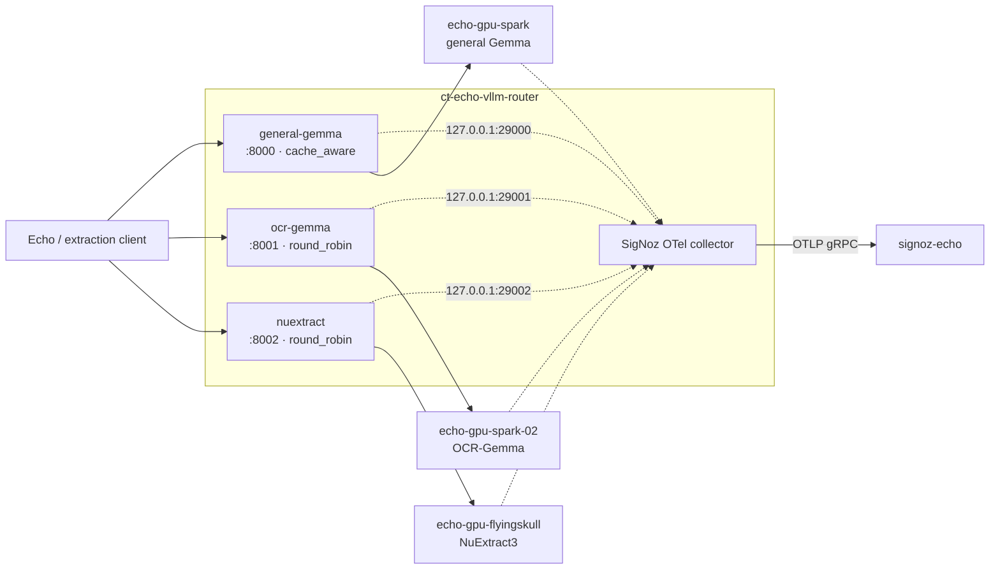

# Echo vLLM Router

This package deploys pinned vLLM Router `v0.1.15` processes and the SigNoz
OpenTelemetry Collector `v0.144.6` on `ct-echo-vllm-router`. Each homogeneous
model pool has its own native systemd router process, queue, health state,
retry/circuit-breaker state, API listener, and loopback metrics listener. The
router host does not run model containers.



The existing general Gemma service and endpoint remain
`echo-vllm-router.service` and `100.105.172.96:8000/v1`. OCR pools use template
instances and share the immutable `/opt/echo-vllm-router/current` release.

## Network and model map

Runtime configuration uses IP addresses. DNS names are documentation only.

| Pool | Router API | Router metrics | Service | Expected model | Initial worker |
| --- | --- | --- | --- | --- | --- |
| `general-gemma` | `100.105.172.96:8000` | `127.0.0.1:29000` | `echo-vllm-router.service` | `google/gemma-4-26B-A4B-it` | `100.92.119.117:8000` (`echo-gpu-spark`) |
| `ocr-gemma` | `100.105.172.96:8001` | `127.0.0.1:29001` | `echo-vllm-router@ocr-gemma.service` | `echo/ocr-gemma-4-26B-A4B-it` | `100.95.57.33:8000` (`echo-gpu-spark-02`) |
| `nuextract` | `100.105.172.96:8002` | `127.0.0.1:29002` | `echo-vllm-router@nuextract.service` | `numind/NuExtract3` | `100.113.47.83:8000` (`echo-nuextract3`) |

SigNoz OTLP is `100.71.235.10:4317`. Only Tailscale addresses expose router
and worker APIs; router metrics remain loopback-only. Transport is tokenless
private Tailscale HTTP, with no additional TLS termination on the router.

## Prerequisites

The router target must be the `ct-echo-vllm-router` Debian 13 `amd64` systemd
host with Tailscale IP `100.105.172.96`, passwordless `sudo`, Python 3.13, and
outbound HTTPS. Install its prerequisites with:

```bash
cd echo-vllm-router
just setup
```

The operator workstation needs Bash, `curl`, `just`, OpenSSH, Python with
`pip`, `scp`, `sha256sum`, and `tar`. It must reach the Eagle Atria Tailscale
network. Deploy the production workers first using
[`workers/README.md`](workers/README.md). Flyingskull capacity is an explicit
rollout gate because NuExtract3 nearly fills its 16 GiB GPU and cannot coexist
with the previous production workload.

## Preflight, deploy, and verification

Preflight is read-only. It checks router host identity and platform, worker TCP
reachability, `/health`, `/metrics`, exact `/v1/models` contents, unique worker
URLs across pools, unused or service-owned ports, and SigNoz reachability.

```bash
cd echo-vllm-router
just preflight
just deploy
just verify
CLIENT_HOST=echo-cbr just verify-client
CLIENT_HOST=echo-cbr just smoke
```

`just deploy` downloads and verifies the pinned wheelhouse and collector,
installs an immutable virtual environment, validates all configuration and
units, and changes only affected services. An unchanged second deployment
does not restart any router pool or the collector. `just smoke` retains the
general text request and sends representative inline PNG requests to both OCR
pools.

Use `CLIENT_HOST=local` to run smoke requests locally. Select one pool for
client checks or operational commands with `POOL=general`, `POOL=ocr-gemma`,
or `POOL=nuextract`; the default is all pools.

```bash
POOL=ocr-gemma CLIENT_HOST=local just smoke
POOL=nuextract just status
POOL=nuextract just logs
POOL=nuextract just restart
POOL=nuextract just stop
POOL=nuextract just start
```

Stopping one OCR instance never stops the collector, another pool, or the
existing general Gemma endpoint.

## Client endpoints

The document-extractor split-GPU profile uses only stable router endpoints:

| Adapter | Base URL | Model |
| --- | --- | --- |
| Gemma OCR | `http://100.105.172.96:8001/v1` | `echo/ocr-gemma-4-26B-A4B-it` |
| NuExtract3 | `http://100.105.172.96:8002/v1` | `numind/NuExtract3` |

Deployment of `echo-document-extractor` as a shared service is intentionally
separate from this package. These scripts do not deploy it or configure an
Echo instance to use it.

The existing Echo AI engine continues to use the general pool:

| Field | Value |
| --- | --- |
| Назва | `Gemma 4 26B — vLLM router` |
| Base URL | `http://100.105.172.96:8000/v1` |
| Модель | `google/gemma-4-26B-A4B-it` |
| Токен | Leave empty |
| Увімкнений | Yes |

To onboard another Echo instance, share/grant the router node into that
instance's tailnet, then run both checks from the Echo host before editing any
settings:

```bash
CLIENT_HOST=<echo-ssh-alias> POOL=general just verify-client
CLIENT_HOST=<echo-ssh-alias> POOL=general just smoke
```

Edit the existing AI engine rather than adding one so its ID and callsign-worker
association are preserved. Apply and verify the edit in staging before making
the identical production edit. `echo-cbr`, `echo-kharkiv2`, `echo-siversk`,
`echo-zp2`, `echo-pivnich`, and `echo-skhid` were verified clients as of
2026-08-08. General Echo traffic rolls back by restoring the same engine's Base
URL to Spark's CBR-tailnet-visible endpoint `http://100.92.119.116:8000/v1`.

## Metrics verification

The single collector has separate Prometheus receivers and pipelines for each
router and initial worker. All inference metrics carry `echo.vllm.role`,
`echo.vllm.pool`, `host.name`, and an explicit router or worker identity.

| Series | `service.name` | `service.instance.id` | `echo.vllm.pool` | Identity attribute |
| --- | --- | --- | --- | --- |
| General router | `vllm-router` | `ct-echo-vllm-router` | `general-gemma` | `echo.vllm.router=ct-echo-vllm-router` |
| General worker | `vllm-worker` | `echo-gpu-spark` | `general-gemma` | `echo.vllm.worker=echo-gpu-spark` |
| OCR-Gemma router | `vllm-router` | `ct-echo-vllm-router/ocr-gemma` | `ocr-gemma` | `echo.vllm.router=ct-echo-vllm-router` |
| OCR-Gemma worker | `vllm-worker` | `echo-gpu-spark-02` | `ocr-gemma` | `echo.vllm.worker=echo-gpu-spark-02` |
| NuExtract router | `vllm-router` | `ct-echo-vllm-router/nuextract` | `nuextract` | `echo.vllm.router=ct-echo-vllm-router` |
| NuExtract worker | `vllm-worker` | `echo-nuextract3` | `nuextract` | `echo.vllm.worker=echo-nuextract3` |

Allow at least two 15-second scrapes, then confirm `vllm_router_*` and `vllm:*`
series for every `echo.vllm.pool` in SigNoz Metrics Explorer. Collector name
normalization may replace Prometheus colons with dots or underscores.

## Add workers to a pool

Every URL in one pool must expose exactly that pool's model ID. Verify its
health, model, and metrics endpoints from `ct-echo-vllm-router`, then:

1. Add the URL, separated by one space, to that pool's
   `ROUTER_WORKER_URLS`.
2. Add a dedicated worker receiver, resource processor, and metrics pipeline
   to `config/otel-collector.yaml` so worker identity remains unambiguous.
3. Run `just preflight`, `just deploy`, the client verification, and smoke.

The bundle rejects a worker URL that appears more than once, including across
different pools. Single-worker OCR pools use `round_robin` because the pinned
router rejects `power_of_two` unless at least two workers are configured.
Switch a pool to `power_of_two` when adding its second distinct homogeneous
worker.

## Rollout and rollback

Roll out in this order:

1. Start and verify both production workers, including the Flyingskull capacity
   decision.
2. Run router preflight, deploy all instances, and verify exact models and
   image requests.
3. Stop one OCR worker at a time and confirm only its own pool degrades while
   `:8000` remains healthy; restore it immediately.
4. Confirm all six labeled metric streams in SigNoz.
5. Allow the separately deployed extraction service to consume the stable
   endpoints.

To roll back one OCR pool, point its future client temporarily at the direct
production worker URL or disable that client, then run `POOL=<pool> just stop`.
Do not change or stop `echo-vllm-router.service`. Restore a previous router
package revision with `just deploy`; the pinned release becomes `current`
again. Worker rollback instructions are in `workers/README.md`.

To remove all routing services only after traffic has moved away:

```bash
just stop
ssh echo-vllm-router \
  'sudo systemctl disable echo-vllm-router.service echo-vllm-router@ocr-gemma.service echo-vllm-router@nuextract.service echo-vllm-router-otel.service'
```

Retain `/opt/echo-vllm-router`, `/etc/echo-vllm-router`, production worker
containers, and model caches until the rollback soak completes.

## Upgrade and troubleshooting

Router and collector upgrade inputs remain pinned in `versions.env`. Update
the router version, tag, commit, wheel filename/hash, fully hashed Python lock,
and lock checksum. For the collector, update its version, archive checksum, and
extracted binary checksum. The immutable virtual environment is installed at
`/opt/echo-vllm-router/releases/<version>-<lock-hash>` and selected through the
atomic `current` symlink. Run the complete preflight and verification sequence
after every upgrade.

- A worker preflight failure means the router is not changed; compare the
  worker's entire model set with its pool configuration.
- A port collision is accepted only when the matching systemd pool is active.
- If one pool restart-loops, use `POOL=<pool> just logs` and leave the other
  instances running.
- If metrics are absent, verify the target from the router host, allow two
  scrape intervals, and filter SigNoz by `echo.vllm.pool` and worker identity.
- Any remote listener on ports `29000` through `29002` is a configuration
  error; all three must bind exactly to loopback.
