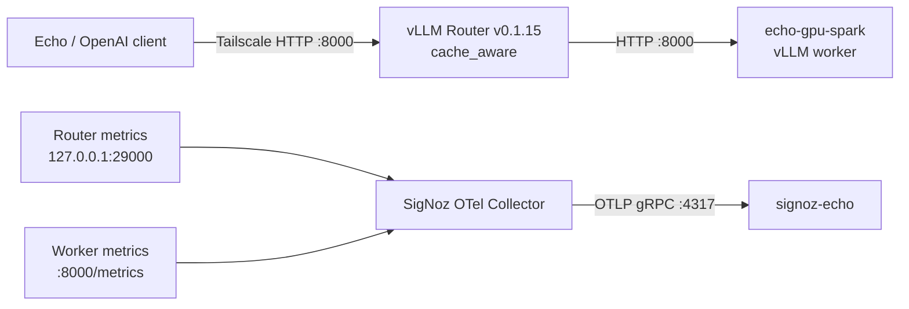

# Echo vLLM Router

This package deploys vLLM Router `v0.1.15` and the SigNoz OpenTelemetry
Collector `v0.144.6` as native systemd services on `echo-vllm-router`. The
router initially forwards every request to `echo-gpu-spark` with the
`cache_aware` policy. Tailscale provides transport encryption; the private
router has no additional token or TLS termination.



The router service runs as `echo-vllm-router`; the collector runs as
`echo-vllm-router-otel`. Executables are under `/opt/echo-vllm-router`, runtime
configuration is under `/etc/echo-vllm-router`, and the collector's generated
configuration copy is under `/var/lib/echo-vllm-router-otel`.

## Network map

Runtime configuration uses IP addresses. DNS names are documentation only.

| Role | Tailscale IP and port | DNS name |
| --- | --- | --- |
| Router API | `100.105.172.96:8000` | `ct-echo-vllm-router.eagle-atria.ts.net` |
| Router metrics | `127.0.0.1:29000` | Loopback only |
| Initial worker | `100.92.119.117:8000` | `echo-gpu-spark.eagle-atria.ts.net` |
| SigNoz OTLP | `100.71.235.10:4317` | `signoz-echo.eagle-atria.ts.net` |

Only the router's Tailscale address exposes port 8000. Router metrics remain
on loopback; worker metrics are scraped directly over Tailscale. The OTel
collector's own metrics endpoint is disabled.

## Prerequisites

The target must be the `ct-echo-vllm-router` Debian 13 `amd64` host with
systemd, Tailscale IP `100.105.172.96`, passwordless `sudo`, Python 3.13, and
outbound HTTPS. Install the target prerequisites before deployment:

```bash
cd echo-vllm-router
just setup
```

The operator workstation needs Bash, `curl`, `just`, OpenSSH, Python with
`pip`, `scp`, `sha256sum`, and `tar`. It must resolve the SSH aliases
`echo-vllm-router`, `echo-cbr`, and `echo-gpu-spark` and reach the Eagle Atria
Tailscale network.

Preflight is read-only. It verifies host identity, OS and architecture,
Tailscale addresses, required commands, unused or service-owned ports, worker
health/model/metrics, and SigNoz OTLP connectivity.

```bash
cd echo-vllm-router
just setup
just preflight
```

## Deploy and verify

Deployment downloads the Python 3.13 x86-64 wheelhouse declared in
`requirements.lock` and the pinned collector archive. Every file is checked
before the remote installer can alter a service. The installer creates the
unprivileged users, builds an immutable virtual-environment release, updates
configuration and units only when content changes, validates both units,
enables both services, and runs target-side verification.

```bash
cd echo-vllm-router
just deploy
just verify
just verify-client
just smoke
```

`just verify-client` and `just smoke` run from `echo-cbr` by default. Override
either SSH alias when validating another client:

```bash
CLIENT_HOST=echo-cbr just verify-client
CLIENT_HOST=echo-cbr just smoke
CLIENT_HOST=local just smoke
```

## Add an Echo client

Share/grant the router node into the Echo deployment's tailnet, then verify the
route from that Echo host rather than from the operator workstation:

```bash
cd echo-vllm-router
CLIENT_HOST=<echo-ssh-alias> just verify-client
CLIENT_HOST=<echo-ssh-alias> just smoke
```

Only after both checks pass, configure one enabled tokenless Echo AI engine
with Base URL `http://100.105.172.96:8000/v1` and model
`google/gemma-4-26B-A4B-it`. The engine can then be selected for the AI-agent
default/reviewer roles and the callsign worker. `echo-cbr`, `echo-kharkiv2`,
`echo-siversk`, `echo-zp2`, and `echo-pivnich` are verified clients as of
2026-08-08.

The checks cover both enabled/active units, the pinned installed version and
collector checksum, exact listeners, `/health`, `/v1/models`, router metrics,
and a minimal Chat Completions request. Do not stop the live Spark backend as
part of verification.

Operational commands are:

```bash
just status
just logs
just restart
just stop
just start
```

Set `HOST=<ssh-alias>` to override the router SSH target.

## Metrics verification

The collector exports two independent metrics pipelines. Their identifying
resource attributes are:

| Series | `service.name` | `service.instance.id` | `host.name` | `echo.vllm.role` |
| --- | --- | --- | --- | --- |
| `vllm_router_*` | `vllm-router` | `ct-echo-vllm-router` | `ct-echo-vllm-router` | `router` |
| `vllm:*` | `vllm-worker` | `echo-gpu-spark` | `echo-gpu-spark` | `worker` |

After deployment, allow at least two 15-second scrape intervals. In SigNoz
Metrics Explorer, confirm `vllm_router_active_workers` exists with the router
attributes and a worker series such as `vllm:num_requests_running` exists with
the worker attributes. Prometheus-to-OTLP name normalization in the installed
collector may display colons as dots or underscores; use the resource
attributes to distinguish the pipelines. Dashboards are not managed here.

## Echo migration

The deployment scripts never edit an Echo database or application settings.
After router, client, inference, and metrics verification, edit the existing
AI engine in staging at `/admin/system-settings-neo#ai`; do not add a new
engine. Editing preserves its ID and callsign-worker association.

| Field | Value |
| --- | --- |
| Назва | `Gemma 4 26B — vLLM router` |
| Base URL | `http://100.105.172.96:8000/v1` |
| Модель | `google/gemma-4-26B-A4B-it` |
| Токен | Leave empty |
| Увімкнений | Yes |

Run a staging request successfully before applying the identical edit to
`echo-cbr`. SSH access to `echo-cbr-staging` must be restored, or an operator
must perform and record the staging UI check manually. Production rollback is
an edit of the same engine back to Spark's CBR-tailnet-visible Base URL:
`http://100.92.119.116:8000/v1`.

## Add workers

Every regular worker must serve the same model ID. Verify its `/health`,
`/v1/models`, and `/metrics` endpoints from `echo-vllm-router`, then make both
changes below:

1. Add its URL, separated by one space, to `ROUTER_WORKER_URLS` in
   `config/router.env`.
2. Add its `host:port` as another target under
   `prometheus/worker` in `config/otel-collector.yaml` and adjust the worker
   resource attributes if separate per-worker attribution is required.

Run `just preflight`, `just deploy`, `just verify-client`, and `just smoke`.
The wrapper passes every URL as a distinct `--worker-urls` argument. If
per-worker SigNoz identity is required, define one Prometheus receiver,
resource processor, and metrics pipeline per worker rather than sharing the
initial worker pipeline.

## Upgrade

Update the router version, tag, commit, wheel filename/hash, fully hashed
Python lock, and lock checksum in `versions.env`. For the collector, update its
version plus archive and extracted-binary checksums. Confirm upstream release
artifacts independently, then run:

```bash
just preflight
just deploy
just verify-client
just smoke
```

The virtual environment is installed at
`/opt/echo-vllm-router/releases/<version>-<lock-hash>` and activated through
the atomic `current` symlink. The collector binary is rewritten only when its
installed checksum differs from the pinned checksum.

## Rollback

Application traffic rollback does not require stopping Spark: edit the same
Echo AI engine Base URL back to `http://100.92.119.116:8000/v1` and verify a
request. To roll back a router package upgrade, restore the previous repository
revision and run `just deploy`; its pinned release becomes `current` again.

To remove the routing services after traffic has been moved away:

```bash
cd echo-vllm-router
just stop
ssh echo-vllm-router \
  'sudo systemctl disable echo-vllm-router.service echo-vllm-router-otel.service'
```

Retain `/opt/echo-vllm-router` and `/etc/echo-vllm-router` until the rollback
soak completes. Removing those paths and service users is a separate,
destructive decommissioning action and is not performed by this package.

## Troubleshooting

- Preflight reports missing target prerequisites: run `just setup`, then rerun
  preflight.
- Router restart-loops: run `just logs`; confirm the worker is healthy from the
  router host and that every `ROUTER_WORKER_URLS` entry includes a scheme and
  port.
- `/health` works but the model is absent: compare the worker's `/v1/models`
  response with `google/gemma-4-26B-A4B-it`.
- Client cannot reach port 8000: confirm the router listener is exactly
  `100.105.172.96:8000`, Tailscale sharing/ACLs allow that client, and run
  `CLIENT_HOST=<alias> just verify-client`.
- Collector is active but metrics are absent: confirm
  `100.71.235.10:4317` is reachable, inspect `just logs`, allow two scrape
  intervals, and filter by the resource attributes above.
- Port 29000 is remotely reachable: stop and investigate immediately; the
  expected listener is exactly `127.0.0.1:29000`.
