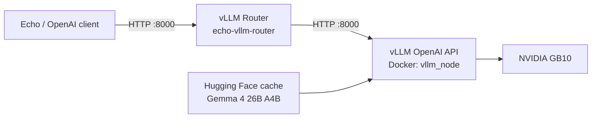

# Echo vLLM worker



## Launch

```bash
ssh echo-gpu-spark
cd ~/workspace/dgx-spark-vllm/spark-vllm-docker-latest
./run-recipe.sh gemma4-26b-a4b --solo -d
docker logs -f vllm_node
```

## Verify

```bash
ssh echo-gpu-spark 'curl -fsS http://localhost:8000/health'
ssh echo-gpu-spark 'curl -fsS http://localhost:8000/v1/models'
```

For router deployment, client verification, inference smoke tests, metrics,
and rollback, see [Echo vLLM Router](../echo-vllm-router/README.md).

## Echo configuration example

Open `/admin/system-settings-neo#ai` and edit the existing engine. Do not add a
new engine, because editing preserves its ID and callsign-worker association.

| Field | Value |
| --- | --- |
| Назва | `Gemma 4 26B — vLLM router` |
| Base URL | `http://100.105.172.96:8000/v1` |
| Модель | `google/gemma-4-26B-A4B-it` |
| Токен | Leave empty |
| Увімкнений | Yes |

Echo appends `/chat/completions` to the Base URL automatically.

Apply the edit in staging and verify a request before making the same edit in
`echo-cbr`. Direct Spark access is fallback-only; restore the existing engine
Base URL to `http://100.92.119.116:8000/v1` to roll back production traffic.

## Stop

```bash
ssh echo-gpu-spark \
  'cd ~/workspace/dgx-spark-vllm/spark-vllm-docker-latest && ./launch-cluster.sh --solo stop'
```
