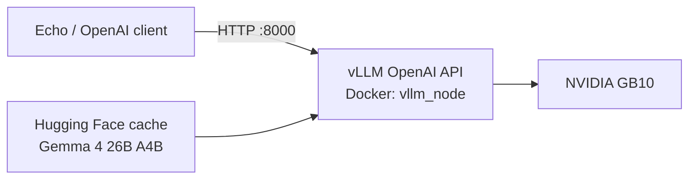

# Echo vLLM



## Launch

```bash
ssh echo-gpu-spark
cd ~/workspace/dgx-spark-vllm/spark-vllm-docker-latest
./run-recipe.sh gemma4-26b-a4b --solo -d
docker logs -f vllm_node
```

## Verify

```bash
ssh echo-gpu-spark 'curl -fsS http://localhost:8000/health'
ssh echo-gpu-spark 'curl -fsS http://localhost:8000/v1/models'
```

## Echo configuration example

Open `/admin/system-settings-neo#ai`, click **Додати**, and configure the
engine as follows:

| Field | Value |
| --- | --- |
| Назва | `Gemma 4 26B — echo-gpu-spark` |
| Base URL | `http://echo-gpu-spark.eagle-atria.ts.net:8000/v1` |
| Модель | `google/gemma-4-26B-A4B-it` |
| Токен | Leave empty |
| Увімкнений | Yes |

Echo appends `/chat/completions` to the Base URL automatically.

## Stop

```bash
ssh echo-gpu-spark \
  'cd ~/workspace/dgx-spark-vllm/spark-vllm-docker-latest && ./launch-cluster.sh --solo stop'
```
