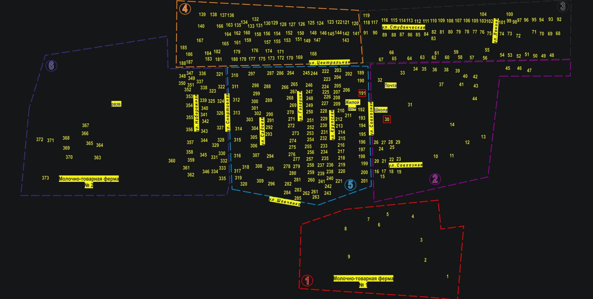
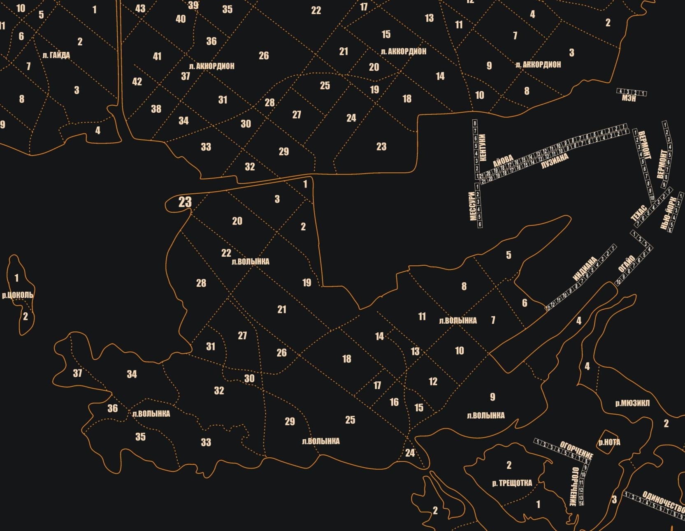
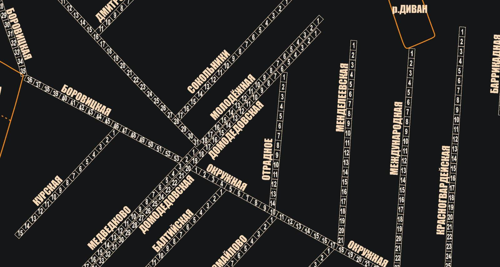
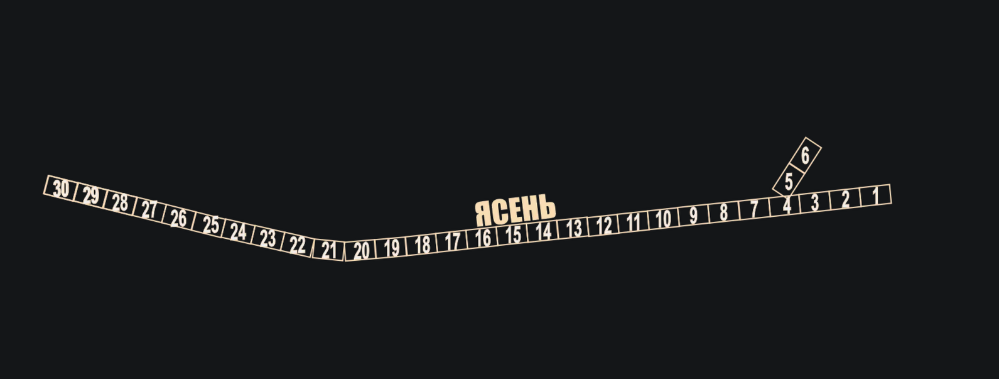

## Installation

1. Install gdal (OS-specific)

2. Install [uv](https://docs.astral.sh/) package and project manager:
```
curl -LsSf https://astral.sh/uv/install.sh | sh
```

3. Install python dependencies and environment:
```
uv sync
```

3. Install pre-commit
```bash
pre-commit install
```


## Scripts

### pgd2geotiff

Recursively converts directory of `.pgd` files to `.geotiff`:

```bash
uv run python pgd2geotiff.py path/to/src/dir path/to/dst/dir
```

or

```bash
source .venv/bin/activate
python pgd2geotiff.py ...
```

Optionally add `--skip_existing=False` to skip files already converted.
See logs and errors at `logs/` directory.


## План

### Текст і цифри

Спробувати звичайний OCR що повертає разом з текстом і прямокутники (bounding box) де знаходиться текст (на кшталт easyocr) що 

### Тип A: Великі кольорів зони


#### Ідея
Розрізнити за кольором

#### Проблема
- Потенційно ці зони можуть бути одного кольору
- На мапі будуть інші об'єкти того ж кольору

### Тип B



TODO

### Тип C



#### Ідея
Маючи результати з OCR провести пряму лінію з 3 і більше послідовних чисел і об'єднати в єдину колекцію. Далі [угорським алгоритмом](https://en.wikipedia.org/wiki/Hungarian_algorithm) об'єднати отримані колекції з відповідною назвою

#### Проблеми
Коли ці міні-зони не утворюють пряму лінію. Ідей для рішення у мене поки нема.

