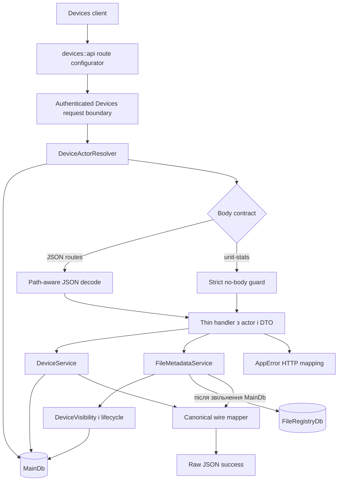
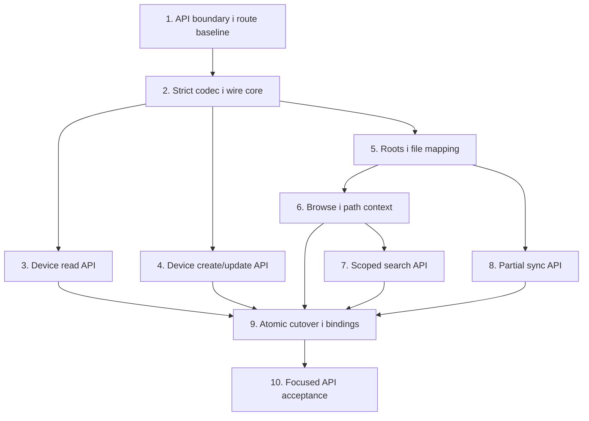

# План реалізації API «Пристрої»: етап 1

- **Статус:** Виконано
- **Версія:** 1.0
- **Дата:** 2026-07-24
- **Технічна специфікація:** [`TECHNICAL_SPEC_STAGE_1.md`](./TECHNICAL_SPEC_STAGE_1.md), версія 0.14
- **Функціональний дизайн:** [`DEVICES.md`](./DEVICES.md), версія 0.13
- **Внутрішня бекенд-логіка:** [`BACKEND_LOGIC_IMPLEMENTATION_PLAN.md`](./BACKEND_LOGIC_IMPLEMENTATION_PLAN.md), версія 0.1

## 1. Призначення документа

Цей документ визначає послідовний план реалізації HTTP API першого етапу «Пристроїв» поверх завершених `DeviceService` і `FileMetadataService`. Основний пріоритет — зробити transport layer тонким, строгим і повністю відповідним нормативному wire-контракту: рівно дев’ять `POST` routes, точні request/response DTO, рольові й lifecycle результати, ієрархічні filesystem reads та ordered partial sync.

План не повторює доменні алгоритми або нормативні правила з технічної специфікації. Він розкладає API cutover на робочі етапи, визначає межі transport modules, мінімальні доповнення прикладного шару, порядок видалення legacy-контракту та focused verification. Якщо цей план суперечить `TECHNICAL_SPEC_STAGE_1.md` або `DEVICES.md`, пріоритет мають ці два документи.

Кожен етап має завершуватися робочим станом репозиторію. До фінального cutover production server продовжує реєструвати чинний контракт, а нові handlers перевіряються через окрему Devices route configuration у focused Actix tests. Заміна production routes, видалення legacy DTO та перемикання generated bindings виконуються одним атомарним етапом без aliases і mixed contract.

## 2. Вихідний стан і зафіксовані передумови

На початок цього плану:

- міграції `main.device` і `wd_files.public.file_entry`, typed `MainDb` та `FileRegistryDb` уже реалізовані;
- етап 13 внутрішнього backend-плану прийнятий у Devices/filesystem scope;
- `DeviceActorResolver`, `DeviceVisibility`, `DeviceService`, `FileMetadataService`, strict source path parser, cursor codec, filesystem repository, sync, retry та reconciliation уже працюють і мають focused acceptance coverage;
- усі production reads/writes `file_entry` інкапсульовані в `devices/filesystem/`;
- production server зараз реєструє вісім Devices routes: `/list`, `/detail`, `/unit-stats`, `/create`, `/update`, `/archive`, `/restore` і `/files/list`;
- п’ять чинних шляхів збігаються з майбутніми нормативними шляхами, але їхні DTO і response mapping є legacy: timestamps у `_ms`, AOR/unit розкладені на паралельні поля, `name` не відображає нормативну nullable-семантику, присутні tags та offset file list;
- чинні handlers викликають `ensure_device_reader` / `ensure_device_editor`, `devices::query` і `devices::bl`, а не є transport adapters для завершених service boundaries;
- routes `/files/roots`, `/files/browse`, `/files/search` і `/files/sync` ще не зареєстровані;
- `devices::types` і `wdintel-rs/src/elm.rs` досі експортують legacy DTO у generated `wdintel-web/src/Bindings.elm`;
- `server::configure_routes` реєструє кожен Devices handler окремо поряд із routes інших підсистем;
- глобальний `JsonConfig` уже задає `SERVER_JSON_PAYLOAD_MAX_BYTES`, але стандартний `web::Json` не забезпечує весь нормативний Devices contract для exact nested field paths, canonical UUID і unknown-field errors;
- `DeviceService` має create/update/detail operations, але нормативні list і unit-stats query shapes ще потрібно надати через цей самий service boundary;
- filesystem read service уже повертає roots, browse, breadcrumbs і search, але browse response потрібно доповнити batch-derived `path_components` незалежно від `include_breadcrumbs`.

Останні два пункти є вузькими API prerequisites у готовому прикладному шарі. Вони не дозволяють виконувати SQL, path parsing або доменні правила в HTTP handlers.

Цей план не містить міграцій, schema changes, нових pools, нового механізму автентифікації або повторної реалізації внутрішньої filesystem-логіки.

## 3. Межі плану

### 3.1. У межах

- один Devices-owned route configurator для production і contract tests;
- рівно дев’ять нормативних `POST` routes першого етапу;
- strict request DTO з `snake_case`, `deny_unknown_fields` на кожному structural level та presence-aware patch fields;
- Devices-scoped auth-first request boundary і path-aware JSON extractor без зміни JSON-поведінки інших backend modules;
- перевірка `Content-Type`, чинного global payload limit і повної відсутності body для `/api/device/unit-stats`;
- canonical lowercase hyphenated UUID decode/encode;
- RFC 3339 request timestamps з explicit timezone та response timestamps у UTC `Z`;
- transport-to-domain conversion без повторення domain validation;
- domain-to-wire mapping усіх device, root, breadcrumb, tree entry, file і sync result structures;
- normative list і unit-stats operations через `DeviceService`;
- гарантований batch path context для browse/search entries через filesystem service;
- mapping `AppError` у чинні HTTP status/body contracts;
- ordered `200` union для semantic per-item sync results і всіх п’яти `FileSyncErrorKind`;
- атомарне видалення archive/restore/files-list routes, legacy DTO, handlers і непотрібних adapters;
- оновлення backend generation registry та generated `Bindings.elm` через `just gen-front`;
- focused route, codec, contract і PostgreSQL HTTP integration tests лише для Devices/filesystem;
- regression запуск чинних `devices::service::tests` і `devices::filesystem` suites.

### 3.2. Поза межами

- frontend API client, Elm/React callsites, state management, forms, tables, file panel і browser verification;
- нові frontend pages або зміна existing `/devices` і `/devices/:id` layouts;
- handwritten frontend DTO, encoder або decoder;
- AOR/unit dictionary endpoints та їхні permissions;
- database schema, migrations, entities, indexes, pools, provisioning або startup migration order;
- нові domain algorithms для parser, hierarchy mutation, retry, reconciliation або concurrency;
- дублювання чинних internal acceptance tests на HTTP-рівні, якщо wire behavior ними не змінюється;
- archive/restore, file hide/restore, content, S3, file analytics і first-class directory mutations;
- compatibility aliases, deprecated routes, versioned copies або тимчасове приймання старого й нового payload одночасно;
- `wdintel-py`, `rer_importer` та інші backend-підсистеми, не пов’язані з Devices/filesystem;
- повний `just test-be` як критерій цього плану.

Generated bindings входять до цього плану як єдине backend-defined джерело wire types. Адаптація frontend consumers є окремим планом, але route/binding cutover не можна розгортати незалежно: фінальний API cutover виконується лише в тому самому integration boundary, де готовий frontend consumer нового контракту.

## 4. Архітектурні принципи

1. **Рівно один публічний контракт.** Production router після cutover має дев’ять нормативних routes і жодного legacy alias.
2. **Handler є adapter, а не service.** Він отримує свіжий `DeviceActor` і decoded input із request boundary, будує domain command, викликає `DeviceService` або `FileMetadataService` і мапить результат.
3. **Один власник route registration.** `server` підключає Devices одним configurator call; той самий configurator використовують exact route tests.
4. **Автентифікація перед payload decode.** Для зареєстрованого route request boundary спочатку формує actor із current `Identity`; unauthenticated request повертає `401` до читання або розкриття помилок body.
5. **Структурна й доменна валідація розділені.** JSON shape, type, unknown field і canonical UUID перевіряє transport boundary; field semantics, ролі, visibility, lifecycle, path parsing і batch rules лишаються у готових services.
6. **Presence перевіряється до значення.** Update DTO зберігає різницю між omitted, `null` і value; `file_id` у sync розрізняє absent create та invalid explicit `null`.
7. **Wire format canonical і повний.** Response не пропускає fields, використовує `null`, `[]` або `{}` за контрактом, canonical UUID та UTC `Z`.
8. **Один mapper на спільний wire type.** `DeviceDetails`, `DeviceFileRoot`, `DeviceFileTreeEntry` і `DeviceFile` не збираються незалежно в кількох handlers.
9. **Internal representation не витікає.** `ltree`, `name_key`, repository sort keys, content state, tags, importance та інша позаетапна аналітика не входять у DTO.
10. **Sync має дві error boundaries.** Invalid envelope повертає top-level `AppError`; після envelope validation кожна input position має один ordered accepted/rejected result зі статусом HTTP `200`.
11. **No-body route справді не має body.** `/unit-stats` відхиляє навіть `{}` і не покладається лише на відсутність extractor argument у handler signature.
12. **Global transport behavior не змінюється випадково.** Devices extractor поважає чинний payload limit, але не замінює `JsonConfig` для інших routes.
13. **Generated types мають одне джерело.** Нормативні Rust DTO реєструються в `elm.rs`; `Bindings.elm` не редагується вручну й не містить legacy Devices contract після cutover.
14. **Clean cutover.** Старі DTO, handlers, route registrations, aliases, re-exports і unused legacy query/bl paths видаляються, а не позначаються deprecated.
15. **Focused verification.** API tests захищають transport behavior; внутрішні database/concurrency tests повторно запускаються, але не копіюються без нового observable contract.

## 5. Цільова схема взаємодії



Handler не має прямого доступу до repositories, SeaORM entities, raw database connections або cursor/path helpers. `Env` використовується лише для отримання typed service dependencies; вибір цільової бази не виконується за transport input.

## 6. Цільова структура API-модуля

| Шлях | Єдина відповідальність |
| ---- | ---------------------- |
| `devices/api/mod.rs` | Композиція API-модуля та єдиний configurator рівно дев’яти routes. |
| `devices/api/request.rs` | Auth-first composition: формує свіжий actor, а потім запускає JSON decode або no-body guard лише для matched route. |
| `devices/api/json.rs` | Devices-scoped payload/content-type checks, path-aware decode, canonical UUID helpers і pure no-body validation. |
| `devices/api/types/mod.rs` | Re-export лише нормативних common/device/files wire types. |
| `devices/api/types/common.rs` | UUID/date-time wire primitives, `FieldError`, AOR/unit summaries та shared enums. |
| `devices/api/types/device.rs` | Device list/detail/create/update/unit-stats request і response DTO. |
| `devices/api/types/files.rs` | Roots/browse/search/sync DTO та ordered result union. |
| `devices/api/mapping/mod.rs` | Спільні mapping entry points без handler або database logic. |
| `devices/api/mapping/device.rs` | Domain device state/list/stat у `DeviceListItem` і `DeviceDetails`. |
| `devices/api/mapping/files.rs` | Roots, breadcrumbs, tree entries, files і sync outcomes у wire responses. |
| `devices/api/device.rs` | П’ять thin device handlers: list, unit-stats, detail, create, update. |
| `devices/api/files.rs` | Чотири thin filesystem handlers: roots, browse, search, sync. |
| `devices/api/tests.rs` або `devices/api/tests/` | Codec, route matrix, contract та HTTP/database integration tests. |
| `devices/service/read.rs` | Вузьке доповнення list/unit-stats application operations; жодних wire types. |
| `devices/filesystem/service.rs` | Вузьке доповнення browse path-context result; жодних wire types. |
| `wdintel-rs/src/elm.rs` | Єдиний generation registry нормативних API DTO після cutover. |

Нормативні DTO можуть мати ті самі Rust type names, що й legacy DTO, доки вони ізольовані в `devices::api::types`. Обидва набори не реєструються в Elm generator одночасно. Фінальний етап одним кроком перемикає generation registry та видаляє legacy types.

Не потрібно створювати transport traits або mock service hierarchy. Pure decode/mapping перевіряється без бази, а повна orchestration — через чинні concrete services і focused PostgreSQL integration tests.

## 7. Цільові API-операції

| Route | Transport input | Прикладна операція | Особливий transport contract |
| ----- | --------------- | ------------------ | ----------------------------- |
| `/api/device/list` | `ListDevicesReq` | `DeviceService::list` | Offset pagination, ordered multi-sort, `total`, `has_more`, status counts. |
| `/api/device/unit-stats` | no-body guard | `DeviceService::unit_stats` | Відхиляє будь-який body; active visible devices only. |
| `/api/device/detail` | `DeviceDetailReq` | `DeviceService::read` | `include_archived` визначає read scope. |
| `/api/device/create` | `CreateDeviceReq` | `DeviceService::create` | Лише source fields; analytical/system fields є unknown. |
| `/api/device/update` | `UpdateDeviceReq` | `DeviceService::update` | Presence-aware mixed source/analytical patch. |
| `/api/device/files/roots` | `ListDeviceFileRootsReq` | `FileMetadataService::list_roots` | Active й archived visible reads; canonical root mapping. |
| `/api/device/files/browse` | `BrowseDeviceFilesReq` | `FileMetadataService::browse` | Direct children, optional breadcrumbs, mandatory entry path context і keyset cursor. |
| `/api/device/files/search` | `SearchDeviceFilesReq` | `FileMetadataService::search` | Scoped filters, batch path context і keyset cursor. |
| `/api/device/files/sync` | `SyncDeviceFilesReq` | `FileMetadataService::sync` | Top-level envelope errors та ordered per-item `200` union. |

Handlers не викликають `devices::query`, `devices::bl`, `FilesystemRepository`, `SourcePathParser` або `FileCursorCodec` напряму.

Для matched route transport boundary спочатку формує свіжий `DeviceActor` із current `Identity` і лише після успішної автентифікації читає payload. Actor та decoded DTO передаються handler разом. Excluded або unknown route не запускає цей boundary, тому його звичайний `404` не перетворюється на `401`.

### 7.1. Структурний decode

Transport boundary до виклику service відповідає лише за такі помилки:

- відсутній або неправильний `Content-Type` для JSON routes;
- перевищений `SERVER_JSON_PAYLOAD_MAX_BYTES`;
- malformed JSON;
- wrong JSON type;
- missing required property;
- unknown property на будь-якому structural level;
- noncanonical UUID у device, entry або file identifier;
- explicit `null` там, де DTO дозволяє лише omitted або value;
- будь-який body для `/api/device/unit-stats`.

Ці помилки стають `AppError::Form` з точним шляхом на кшталт `device_id`, `files[2].file_id` або `files[2].unexpected_field`. Для syntax error без визначеного field та для порушення no-body/content-type contract використовується стабільний request-level path `body`.

`serde_path_to_error` додається як пряма dependency, а не використовується випадково через transitive dependency. Extractor має повертати той самий безпечний AppError wire format, не розкривати Rust type names і не змінювати extractor configuration інших routes.

### 7.2. Семантична валідація

Після structural decode adapter передає values у domain commands:

- list filters, sort conflicts, limits і offsets перевіряє device application layer;
- create/update normalization, field capabilities, visibility та lifecycle перевіряє `DeviceService`;
- browse/search limits, cursor scope, filters і time range перевіряє `FileMetadataService`/filesystem domain;
- sync envelope bounds і device lifecycle перевіряються до file writes;
- invalid path syntax, duplicate `file_id`, empty/oversized item values та invalid item timestamp стають per-item sync rejection.

Через partial semantics sync item timestamps декодуються структурно як nullable/optional strings і парсяться під час item preprocessing. JSON number/object замість string є top-level structural error, але invalid RFC 3339 string є ordered item validation error. Search time filters є envelope fields і можуть повертати top-level `Form`.

## 8. Загальний критерій завершення кожного етапу

Перед переходом до наступного етапу мають одночасно виконуватися такі умови:

- немає placeholder, stub, no-op, compatibility alias або тимчасового fallback;
- production route set не змінюється до етапу атомарного cutover;
- завершений target handler/codec/mapper має focused test на observable HTTP або serialization contract;
- handler не містить role matrix, SQL, transaction, path parsing, cursor validation, retry або batch orchestration;
- domain types не імпортують Actix, serde wire wrappers або generated frontend types;
- response mapper не пропускає нормативні fields і не повертає internal fields;
- Rust-код відформатований, `wdintel-rs` компілюється без нових warnings і Clippy чистий для змінених targets;
- database behavior, якщо додавалася application query shape, перевірене на PostgreSQL, а не лише mock;
- schema, migrations і unrelated backend modules не змінюються;
- наступний етап не використовується як виправдання незавершеної поведінки поточного.

## 9. Етапи реалізації

### Етап 1. Межа API-модуля та baseline route registration

#### Мета

Створити одного власника Devices routes і зафіксувати вихідну HTTP-поведінку без зміни production contract.

#### Роботи

1. Додати `devices/api/` як transport-only module, який залежить від application services, але не навпаки.
2. Винести реєстрацію всіх чинних Devices routes із загального `server::configure_routes` у один Devices-owned configurator.
3. Підключити цей configurator у production server одним викликом; на цьому етапі він усе ще реєструє чинні вісім handlers.
4. Створити reusable Actix test app setup, який використовує той самий Devices configurator, payload limit і identity/session middleware, потрібні production contract.
5. Зафіксувати baseline для п’яти retained route paths, archive/restore та `/files/list`, щоб механічне перенесення registration не змінювало status або response.
6. Визначити окрему target registration composition усередині API-модуля для поступової перевірки нових handlers, але не підключати її до production до етапу 9.

#### Ключові рішення

- Загальний `server` не знає окремих назв Devices handlers.
- Target handlers не отримують тимчасових URL; вони тестуються з остаточними route paths в окремо сконфігурованому test app.
- До cutover production не реєструє два handlers для одного path.

#### Перевірка

- усі вісім чинних routes після перенесення registration мають ті самі observable statuses;
- один Devices configurator використовується і production, і tests;
- немає duplicate route registration;
- нові filesystem routes ще не доступні у production.

#### Робочий стан після етапу

Production contract не змінився, але всі наступні API-зміни мають ізольовану module boundary та спільний route-test harness.

### Етап 2. Strict JSON codec, wire primitives і спільна error boundary

#### Мета

Побудувати один transport foundation для всіх дев’яти routes до реалізації endpoint-specific adapters.

#### Роботи

1. Додати пряму dependency `serde_path_to_error` у `wdintel-rs`.
2. Реалізувати Devices-scoped JSON codec, який:
   - вимагає JSON `Content-Type`;
   - використовує чинний `SERVER_JSON_PAYLOAD_MAX_BYTES`;
   - зберігає exact nested path для deserialize error;
   - перетворює malformed JSON, wrong type, missing/unknown field і invalid canonical UUID у `AppError::Form`;
   - не повертає internal Rust/serde details клієнту.
3. Реалізувати authenticated `DeviceApiJson<T>` request boundary, який:
   - спочатку отримує current `Identity` і формує свіжий `DeviceActor`;
   - не читає payload, якщо actor resolution повернув `401`;
   - після успішної автентифікації запускає Devices JSON codec;
   - передає handler actor і decoded DTO одним transport value.
4. Реалізувати `DeviceApiNoBody` boundary для `/unit-stats`: після actor resolution він перевіряє фактичний payload, а не лише `Content-Length`.
5. Визначити wire UUID і date-time conversion:
   - input UUID приймається лише в canonical lowercase hyphenated form;
   - output UUID завжди canonical;
   - input timestamp вимагає RFC 3339 explicit timezone;
   - output timestamp нормалізується до UTC `Z`.
6. Визначити presence-aware transport fields:
   - omitted/value для optional nonnullable patch fields;
   - omitted/null/value для nullable patch fields;
   - absent/value з explicit-null rejection для sync `file_id`.
7. Додати `deny_unknown_fields` до кожної request struct, включно з nested sync items; keys лише всередині `custom_fields` лишаються динамічними.
8. Визначити shared response types і serialization rules для nullable scalars, arrays та objects без `skip_serializing_if`.
9. Централізувати перетворення transport decode errors у чинний `AppError` wire format; domain `AppError` продовжує використовувати глобальний HTTP renderer.

#### Ключові рішення

- Canonical UUID перевіряється під час structural decode, а не повторно в кожному handler.
- Actor resolution передує payload decode, але structural decode передує field capability й domain validation; forbidden field не ігнорується після успішної автентифікації.
- Sync item RFC 3339 parsing не виконується serde-deserializer-ом, щоб invalid string став per-item rejection, а не відхилив увесь batch.
- No-body/content-type/syntax errors використовують request-level path `body`; reachable nested errors використовують exact property path.
- Extractor не змінює global `JsonConfig` і не зачіпає unrelated routes.

#### Перевірка

- unauthenticated malformed JSON і unauthenticated nonempty unit-stats body повертають `401` без decode details;
- malformed JSON, wrong type, missing field і nested unknown field authenticated request повертають `400 Form` з нормативними paths;
- uppercase, braced, simple або otherwise noncanonical UUID відхиляються;
- update розрізняє omitted, `null` і value для кожної групи fields;
- sync розрізняє absent `file_id` та invalid `file_id: null`;
- timestamp offset input round-trip-иться у response як UTC `Z`;
- authenticated `/unit-stats` відхиляє `{}`, whitespace/nonempty bytes і chunked body;
- payload over limit відхиляється без виклику handler;
- unrelated route зі стандартним `web::Json` не змінює поведінку.

#### Робочий стан після етапу

API-модуль має завершений strict codec і canonical wire primitives, які можна повторно використати в усіх target handlers без production cutover.

### Етап 3. Device read API: list, unit stats і detail

#### Мета

Реалізувати три нормативні read routes через actor/visibility/service path і завершити відсутні application query shapes.

#### Роботи

1. Додати до внутрішніх service types transport-independent list command, fixed sort criteria, page result, status counts і unit-stat result.
2. Реалізувати `DeviceService::list` через `MainDb` та спільний visibility predicate:
   - literal `filter_text` за source label, nullable name і canonical UUID;
   - archived filter default `active_only`;
   - `needs_analytical_name`, AOR і unit filters із нормативною empty/duplicate semantics;
   - ordered multi-sort із conflict rejection і `id ASC` tie-breaker;
   - `total`, `has_more` та status counts, які ігнорують лише archived filter.
3. Реалізувати `DeviceService::unit_stats` для видимих active devices із non-null active unit, current unit name та чинним natural military order.
4. Не переносити legacy response rendering у service: service повертає domain values, а API mapper формує `DeviceListItem`, `DeviceUnitStatsRsp` і summaries.
5. Реалізувати target `/list`, `/unit-stats` і `/detail` handlers:
   - отримати свіжий actor і decoded request із authenticated request boundary;
   - конвертувати request у domain command;
   - викликати відповідну service operation;
   - повернути raw JSON object без envelope.
6. Для detail перетворити `include_archived` omitted/`null` на active-only scope, а `true` — на scope, що дозволяє archived read.
7. Видалити зі target responses tags, flattened AOR/unit fields і `_ms` timestamps.

#### Ключові рішення

- List і unit-stats SQL належать `DeviceService`/device repository path, а не API handler.
- `status_counts` і paginated list будуються для одного normalized filter set, щоб adapter не міг розсинхронізувати semantics.
- Unit-stats handler використовує strict no-body guard до actor/service call.

#### Перевірка

- default, active-only, archived-only і all list scopes;
- literal `%`/`_` filter text та canonical UUID substring;
- empty/duplicate AOR і unit filters та `needs_analytical_name` обох значень;
- default/multiple sorts, conflicting duplicate sort field і stable `id` tie-breaker;
- `total`, `has_more` і status counts на combined filters;
- unit stats виключає archived, unitless, deleted/inactive unit і zero-count rows та зберігає natural order;
- detail приховує archived за default і читає його лише з `include_archived: true`;
- unauthenticated/forbidden/not-found відповіді мають `401`/`403`/`404` без disclosure;
- serialized device DTO має всі нормативні fields, nullable values і UTC `Z`.

#### Робочий стан після етапу

Три target device read contracts повністю працюють у focused API app; production продовжує використовувати legacy registration до cutover.

### Етап 4. Device create та presence-aware atomic update API

#### Мета

Підключити normative create/update DTO до готових atomic `DeviceService` operations без повторення ролей або validation у handlers.

#### Роботи

1. Реалізувати `CreateDeviceReq` лише з `source_label`, optional nullable `external_url` і optional nonnullable `custom_fields`.
2. Зробити analytical, file і system fields unknown на structural decode незалежно від actor capability або значення `null`/`[]`.
3. Перетворити create DTO у `CreateDeviceCommand`, передаючи authenticated login лише зі свіжого actor context.
4. Реалізувати `UpdateDeviceReq` із точним presence state для source й analytical fields.
5. Перетворити presence-aware DTO у `UpdateDeviceCommand` без нормалізації в handler; empty patch і `custom_fields: {}` лишаються application validation.
6. Викликати `DeviceService::create` / `DeviceService::update` і мапити повернутий current state одним shared `DeviceDetails` mapper.
7. Не додавати files, archive state або позаетапні analytical fields у жоден request DTO.

#### Ключові рішення

- Request field presence зберігається до service capability checks.
- Mixed patch не ділиться на кілька service calls; одна заборонена або невалідна частина відхиляє всю операцію.
- Success завжди повертає повний `DeviceDetails`; API не реконструює state із request.

#### Перевірка

- create без source label, з `custom_fields: null`, null custom value або будь-яким analytical/system/file field повертає exact `Form` path;
- два окремі create requests створюють різні UUIDv7;
- create response має `name: null`, `aors: []`, `unit: null`, `archived: false` і server timestamps;
- source-only, analytical-only і mixed updates перевіряють відповідні capabilities;
- forbidden field із `null`, `[]` або unchanged value однаково повертає `403`;
- omitted/null/value semantics кожного update field відповідає специфікації;
- empty patch відхиляється, no-op normalized patch не змінює `updated_at`;
- invalid AOR/unit або archived target не лишає partial state;
- success response має sorted AOR summaries й current unit name.

#### Робочий стан після етапу

П’ять target device routes мають повний нормативний contract поверх одного actor/visibility/service path, без зміни production registration.

### Етап 5. Root listing і canonical file response mapping

#### Мета

Визначити спільне wire-представлення файлового реєстру та реалізувати перший filesystem read route.

#### Роботи

1. Реалізувати shared file mappers для:
   - `DeviceFileRoot`;
   - `FileBreadcrumb`;
   - `DeviceFileTreeEntry`;
   - `DeviceFile`;
   - nullable file-only fields для directory.
2. Гарантувати, що file `entry_id === file_id`, directory має `file_id: null`, root має `parent_entry_id: null`, а response не містить `hierarchy_path` чи `name_key`.
3. Мапити root `path_syntax`, exact canonical name, IDs і timestamps без повторного parsing.
4. Реалізувати `/api/device/files/roots` як thin adapter до `FileMetadataService::list_roots`.
5. Зберегти читання active й archived visible device та `404` для unknown/invisible device.
6. Не перетворювати registry failure на `roots: []`.

#### Ключові рішення

- Root mapper використовується і roots response, і accepted sync result.
- API не виводить root із absolute path і не генерує жодного structural UUID.
- Internal DB failure використовує чинний safe `500` AppError mapping.

#### Перевірка

- zero-root, POSIX, drive, UNC і multi-root responses;
- нормативний root order та stable IDs;
- active й archived device reads;
- unknown/invisible device `404` без file query disclosure;
- registry failure є `500`, не empty success;
- serialized root містить рівно нормативні fields і UTC `Z`.

#### Робочий стан після етапу

Target API повертає canonical parentless roots і має один reusable mapper для всіх наступних filesystem responses.

### Етап 6. Direct-child browse, breadcrumbs і path context

#### Мета

Реалізувати нормативний folder browse contract, включно з `path_components` для кожного entry незалежно від breadcrumbs flag.

#### Роботи

1. Вузько доповнити filesystem browse application result batch-derived path context для returned page entries.
2. Використати наявний ancestor batch query; не виконувати N+1 і не виводити components у handler.
3. `include_breadcrumbs` впливає лише на `breadcrumbs`, а не на `entries[].path_components`.
4. Реалізувати default `include_breadcrumbs = true`, default/ranged `limit` і optional cursor conversion у browse command.
5. Реалізувати `/api/device/files/browse` через `FileMetadataService::browse` і shared tree-entry mapper.
6. Мапити `next_cursor` як nullable boundary token без decode/re-encode у handler.
7. Не додавати total, offset або subtree loading.

#### Ключові рішення

- Parent address є лише `(device_id, parent_entry_id)`; root/directory ownership і kind перевіряє service.
- Breadcrumbs містять root-to-current-parent, а child path components — root-relative components до самого child.
- Duplicate files із тим самим name/path лишаються окремими response rows за UUID.

#### Перевірка

- browse root і nested synthetic directory;
- directory-before-file, exact `name_key`, `entry_id` fixed order;
- duplicate files не зливаються й не губляться між pages;
- breadcrumbs true/default повертає root-to-parent, false повертає `[]`;
- `path_components` однакові при `include_breadcrumbs: true` і `false`;
- `limit + 1` continuation без mandatory count або deep offset;
- invalid/tampered/cross-scope cursor і parent іншого device повертають `Form`/`404` за taxonomy;
- registry failure не маскується empty page.

#### Робочий стан після етапу

Target browse route підтримує повну навігаційну сторінку, breadcrumbs і canonical path context без N+1 та без transport-level filesystem logic.

### Етап 7. Scoped search і technical filters API

#### Мета

Реалізувати нормативний scoped search contract поверх готового indexed filesystem search service.

#### Роботи

1. Реалізувати `SearchDeviceFilesReq` з optional nullable filters, fixed kinds enum, time range, limit і cursor.
2. Перетворити wire filters у `RawFileSearchFilters`, зберігаючи empty-array/no-filter semantics і exact field paths.
3. RFC 3339 time filters із explicit timezone нормалізувати до domain UTC values до service call; semantic error лишається top-level `Form`.
4. Викликати `FileMetadataService::search` і shared tree-entry mapper.
5. Повертати batch-derived `path_components` для кожного result і nullable `next_cursor`.
6. Не реалізовувати substring escaping, `ltree`, filter SQL або cursor scope у handler.

#### Ключові рішення

- Search використовує той самий entry order і cursor wire type, що browse.
- `name_query` та technical filters передаються як values; literal escaping належить filesystem query layer.
- Directory file-only fields і metadata лишаються `null` у response.

#### Перевірка

- empty filters повертають descendants, але не сам scope;
- `name_query` межі та literal `%`, `_`, `\` behavior;
- kind, MIME, extension і inclusive modified-time filters окремо та разом;
- metadata filters не match-ять directories;
- `from > to` повертає exact top-level `Form` paths;
- root/nested scope containment і чужий scope `404`;
- stable multipage order, tampered cursor та cursor після зміни scope/filter;
- path context завантажується batch і має root-relative порядок;
- response не містить internal hierarchy/search fields.

#### Робочий стан після етапу

Усі target filesystem read routes — roots, browse і search — реалізовані поверх готового service facade та спільного canonical mapping.

### Етап 8. Absolute-path partial sync API

#### Мета

Підключити strict nested sync DTO до завершеної batch orchestration і точно відобразити top-level та per-item error boundaries.

#### Роботи

1. Реалізувати `SyncDeviceFilesReq` і nested item DTO:
   - required canonical `device_id`;
   - required `path_syntax`;
   - required files array;
   - absent/value `file_id` з explicit-null structural rejection;
   - required string `absolute_path`;
   - optional nullable MIME, extension і timestamp strings.
2. Залишити path, metadata та timestamp value validation у item preprocessing; transport перевіряє лише JSON shape/types і canonical UUID.
3. Перетворити structurally valid items у `SyncFilesCommand`, зберігаючи input index і exact strings.
4. Викликати `FileMetadataService::sync` один раз для envelope; не ітерувати service calls у handler.
5. Реалізувати exhaustive mapping кожного `SyncFileItemOutcome`:
   - accepted `created`/`updated` із canonical root і file;
   - rejected `validation`, `not_found`, `conflict`, `dependency`, `internal`;
   - exact nonempty field paths лише для validation;
   - empty `field_errors` для решти kinds.
6. Зберегти один output result на кожну input position і той самий order.
7. Повертати HTTP `200` після успішної envelope validation навіть для all-rejected batch.
8. Не приймати root IDs, directory IDs, independent name або path components.

#### Ключові рішення

- Missing required item property, wrong JSON type, unknown property і noncanonical UUID відхиляють весь request до service call.
- Invalid path form, invalid RFC 3339 timestamp string, duplicate `file_id` і invalid item value є ordered item validation rejection.
- Adapter не повторює per-item transactions, retry, commit reconciliation або root derivation.
- Accepted response є єдиним transport confirmation commit і завжди формується з canonical service readback.

#### Перевірка

- invalid envelope: auth, capability, device UUID, path syntax, empty/oversized batch, unknown/invisible/archived device;
- nested structural errors мають paths `files[index].field` і не виконують жодного file write;
- missing `file_id` створює, explicit `null` дає structural `400`, present ID оновлює;
- POSIX, drive, UNC, multi-root, derived extension/MIME і exact absolute path;
- duplicate paths створюють distinct files, duplicate nonnull IDs відхиляють усі occurrences;
- same-/cross-root update зберігає file identity;
- omitted known IDs нічого не видаляють;
- mixed accepted/rejected і all-rejected batch повертають ordered HTTP `200` results;
- mapper contract tests покривають усі п’ять error kinds без дублювання внутрішніх fault/retry algorithms;
- accepted root/file response має всі нормативні fields, path components і UTC `Z`;
- response не містить protected internal state.

#### Робочий стан після етапу

Усі дев’ять target handlers і DTO завершені та перевірені в isolated API test app; production усе ще використовує legacy route set до атомарного cutover.

### Етап 9. Атомарний route cutover, legacy cleanup і generated bindings

#### Мета

Одним integration change зробити target contract єдиним production Devices API, не залишивши змішаного або deprecated surface.

#### Передумова

Frontend consumer нового контракту має бути готовий до того самого integration boundary. Якщо frontend adaptation ще не готова, production configurator і legacy generation registry не перемикаються, а етап 9 не вважається розпочатим.

#### Роботи

1. Замінити production Devices configurator на target registration рівно дев’яти routes.
2. Видалити registration і handlers `/api/device/archive`, `/api/device/restore` та `/api/device/files/list`.
3. Переконатися, що `/api/device/files/create`, `/api/device/files/roots/create`, hide/restore/content/analytics routes також не зареєстровані.
4. Видалити legacy request/response DTO, archive/restore/file-list types та старі Elm generator entries.
5. Перемкнути `wdintel-rs/src/elm.rs` на нормативні `devices::api::types` і виконати `just gen-front`.
6. Видалити obsolete `devices::query`, `devices::bl`, legacy access helpers або їхні окремі functions після перевірки всіх callsites; не лишати aliases/re-exports.
7. Прибрати temporary dual-registration/test composition, залишивши один production/test configurator.
8. Оновити exact route matrix test: дев’ять routes зареєстровані, усі excluded/legacy routes повертають звичайний `404`.
9. Виконати exact searches за старими route paths, DTO names, `_ms` Devices fields і direct legacy handler calls.

#### Ключові рішення

- Cutover не використовує compatibility window або server-side payload auto-detection.
- Generated bindings змінюються лише генератором і не зберігають старі Devices types «про запас».
- API backend і frontend client не розгортаються у mixed-version application process.

#### Перевірка

- unauthenticated request до кожного з дев’яти routes повертає `401`, що доводить registration;
- POST до кожного excluded/legacy path повертає `404`, а не `401`, `403` або compatibility response;
- retained paths приймають лише новий DTO й повертають лише новий response shape;
- у production router є один Devices configurator і немає окремих legacy `.service` registrations;
- `just gen-front` створює deterministic bindings без handwritten diff;
- generated bindings містять усі нормативні DTO та не містять archive/restore/files-list contract;
- exact search не знаходить stale production caller або alias.

#### Робочий стан після етапу

Production backend має один нормативний API surface першого етапу. У combined integration changeset frontend використовує ті самі generated types; окреме розгортання API cutover заборонене.

### Етап 10. Focused API acceptance

#### Мета

Підтвердити повноту transport scope, відсутність domain duplication і готовність API частини до спільного frontend acceptance.

#### Роботи

1. Створити disposable clone локальної main database для API integration tests; не використовувати production data.
2. Для filesystem tests використовувати тільки `wd_files_test` із:
   - `WDINTEL_SKIP_TEST_DB_INIT=1`;
   - `TEST_DB_NAME=<disposable_main_clone>`;
   - `TEST_WDFILE_DB_NAME=wd_files_test`.
3. Виконати focused `devices::api` codec, route, contract і HTTP/database integration suite.
4. Повторно виконати чинні `devices::service::tests` та `devices::filesystem` suites як regression прикладного шару.
5. Перевірити route matrix, structural decode matrix, role/lifecycle matrix, response field allowlist і всі дев’ять endpoint scenarios.
6. Виконати Rust formatting, compile та Clippy checks.
7. Перевірити deterministic generated bindings і передати contract delta frontend-плану.
8. Видалити disposable main database після завершення перевірок.

#### Перевірка

Focused acceptance має охопити:

- рівно дев’ять registered POST routes, відсутність non-POST Devices handlers і `404` усіх excluded paths;
- auth-first precedence для malformed/oversized/nonempty-body unauthenticated requests;
- Content-Type, payload limit, no-body unit-stats, malformed JSON, wrong types, unknown nested fields і canonical UUID;
- omission/null semantics create/update/search/sync;
- `401`, `403`, `404`, `400 Form`, `400 BL`, safe `500` і shutdown `503` mapping без internal disclosure;
- device list, unit stats, detail, create й atomic update contracts;
- roots, browse, breadcrumbs, search, path context і cursor contracts;
- sync structural/envelope/item boundaries, partial order, all five error kinds і accepted mapping;
- відсутність `ltree`, `name_key`, content та out-of-stage analytics у responses;
- відсутність HTTP/serde imports у domain/query/mutation modules;
- відсутність SQL, role matrix, path parser, cursor codec, transaction/retry logic у handlers.

Canonical commands:

```text
WDINTEL_SKIP_TEST_DB_INIT=1 \
TEST_DB_NAME=<disposable_main_clone> \
TEST_WDFILE_DB_NAME=wd_files_test \
cargo test -p wdintel-rs devices::api -- --nocapture

WDINTEL_SKIP_TEST_DB_INIT=1 \
TEST_DB_NAME=<disposable_main_clone> \
TEST_WDFILE_DB_NAME=wd_files_test \
cargo test -p wdintel-rs devices::service::tests -- --nocapture

WDINTEL_SKIP_TEST_DB_INIT=1 \
TEST_DB_NAME=<disposable_main_clone> \
TEST_WDFILE_DB_NAME=wd_files_test \
cargo test -p wdintel-rs devices::filesystem -- --nocapture

cargo fmt --all -- --check
cargo check --workspace
cargo clippy --workspace --all-targets -- -D warnings
```

Повний `just test-be`, `wdintel-py` та unrelated backend suites не є acceptance gate цього Devices API-плану. `just build-front` і browser scenarios є обов’язковими для combined feature acceptance, але належать окремому frontend implementation plan після адаптації consumers.

#### Фінальний критерій

План API завершений, коли:

- production router має рівно дев’ять нормативних Devices routes;
- усі handlers є thin adapters до `DeviceService` або `FileMetadataService`;
- strict decode повертає exact field paths і зберігає omission/null semantics;
- device і filesystem responses повністю відповідають wire types специфікації;
- sync зберігає top-level/per-item boundary та ordered partial results;
- legacy routes, DTO, generated types і code paths видалені без aliases;
- generated bindings відповідають єдиному backend contract;
- focused API, internal service/filesystem regression та Rust quality checks пройшли;
- API cutover інтегрований разом із frontend consumer і не створює mixed-version deployment.

#### Робочий стан після етапу

API першого етапу повністю реалізує секцію `API` технічної специфікації та готовий до спільної наскрізної frontend/browser перевірки без подальших backend contract changes.

## 10. Залежності між етапами



Етапи 3, 4 і 5 можна виконувати паралельно після завершення strict codec. Sync залежить від canonical root/file mapper етапу 5, але не залежить від browse/search. Search використовує той самий path-context contract, тому виконується після етапу 6. Етап 9 є єдиною точкою production route і generated-binding cutover та починається лише коли готові всі дев’ять handlers і frontend integration counterpart.

## 11. Трасування вимог до етапів

| Скоуп | Вимоги й нормативні секції | Основні етапи |
| ----- | --------------------------- | ------------- |
| Exact route surface, strict wire rules і error statuses | API «Нормативний набір маршрутів», «Загальні wire-правила», «Верхньорівневі помилки» | 1, 2, 9, 10 |
| Device list, status counts, unit stats і detail | `DEV-ID-001`, `DEV-ID-007`, `DEV-ACC-011`, `DEV-INT-010`; API `/list`, `/unit-stats`, `/detail` | 2, 3, 9, 10 |
| Device create і role-separated atomic update | `DEV-ID-012`, `DEV-ACC-012`, `DEV-INT-011`; API `/create`, `/update` | 2, 4, 9, 10 |
| Canonical roots і root listing | `DEV-FILE-020`, `DEV-FILE-021`, `DEV-INT-019`, `DEV-UX-010`; API `/files/roots` | 2, 5, 9, 10 |
| Direct-child browse, breadcrumbs і duplicate rows | `DEV-FILE-023`, `DEV-INT-020`, `DEV-UX-011`; API `/files/browse` | 5, 6, 9, 10 |
| Scoped search, technical filters і path context | `DEV-INT-021`, `DEV-UX-012`, `DEV-NFR-009`; API `/files/search` | 2, 6, 7, 9, 10 |
| Stable cursor pagination | `DEV-INT-022`, `DEV-NFR-005`; browse/search API | 2, 6, 7, 10 |
| Absolute paths, multi-root sync і derived hierarchy | `DEV-FILE-020`–`DEV-FILE-022`, `DEV-INT-005`; API `/files/sync` | 2, 5, 8, 9, 10 |
| Duplicate paths, stable ID move й accumulated semantics | `DEV-FILE-019`, `DEV-FILE-023`, `DEV-FILE-024`, `DEV-FILE-025`, `DEV-LC-007`, `DEV-INT-012` | 8, 10 |
| Ordered partial errors і visible failure taxonomy | `DEV-NFR-004`, `DEV-UX-005`, `DEV-UX-006`; sync/top-level error tables | 2, 8, 10 |
| Generated single contract і no legacy aliases | API acceptance criteria | 9, 10 |

## 12. Передача результату frontend-етапу

API plan не реалізує UI або client calls, але має передати frontend-плану завершений і незмінний contract:

- exact список дев’яти `POST` paths;
- generated request/response types для кожного route;
- omission/null semantics update і sync;
- canonical UUID і RFC 3339 UTC `Z` expectations;
- top-level status/error body matrix;
- ordered sync accepted/rejected union;
- cursor reset requirements при зміні scope/filter;
- повну відсутність archive/restore/files-list aliases.

Frontend implementation має в тому самому integration boundary:

- замінити всі legacy endpoint calls, serializers, response readers, tests, mocks і fixtures;
- використовувати лише generated `Bindings.elm`, без handwritten copies;
- зберегти visible errors і shared `401` logout behavior;
- прибрати `_ms`, flattened AOR/unit, tags і offset file-list assumptions;
- виконати `just build-front` та нормативні browser create/edit/roots/browse/search/sync scenarios.

До готовності цього counterpart production cutover етапу 9 не виконується. Backend compatibility aliases для полегшення frontend transition не додаються.
