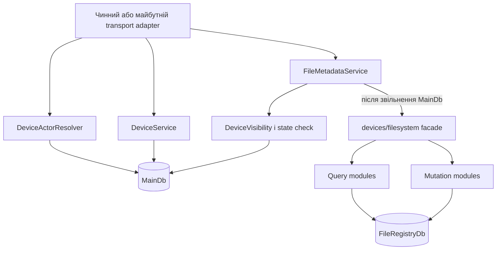
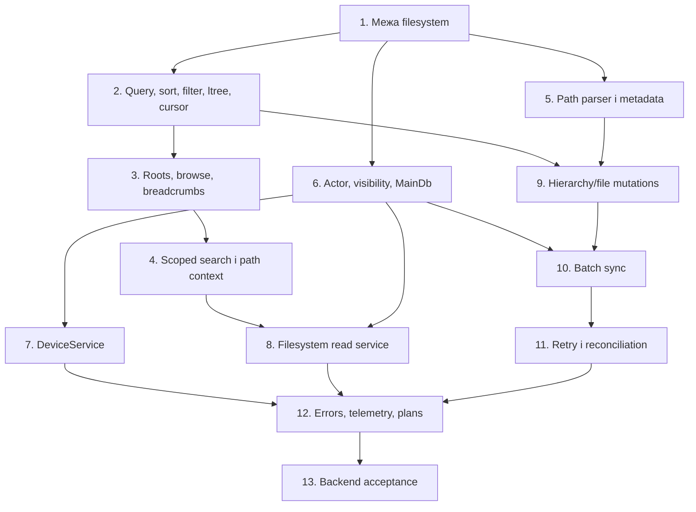

# План реалізації внутрішньої бекенд-логіки «Пристрої»: етап 1

- **Статус:** Чернетка
- **Версія:** 0.1
- **Дата:** 2026-07-21
- **Технічна специфікація:** [`TECHNICAL_SPEC_STAGE_1.md`](./TECHNICAL_SPEC_STAGE_1.md), версія 0.14
- **Функціональний дизайн:** [`DEVICES.md`](./DEVICES.md), версія 0.13

## 1. Призначення документа

Цей документ визначає послідовний план реалізації внутрішньої бекенд-логіки першого етапу «Пристроїв». Основний пріоритет — робота з `wd_files.public.file_entry`: ефективне читання, сортування, фільтрація, навігація через `ltree`, побудова файлової ієрархії та синхронізація технічних метаданих.

План не повторює нормативні правила з технічної специфікації. Він розкладає їх на незалежні етапи реалізації, визначає межі модулів, залежності, інваріанти та перевірки. Якщо цей план суперечить `TECHNICAL_SPEC_STAGE_1.md` або `DEVICES.md`, пріоритет мають ці два документи.

Кожен етап має завершуватися робочим станом репозиторію: код компілюється, чинна поведінка не регресує, завершений скоуп має перевірений спостережуваний результат, а наступний етап не потрібен для виправлення незавершеної реалізації попереднього.

## 2. Вихідний стан і зафіксовані передумови

На початок цього плану:

- модель `main.device` версії 0.14 уже реалізована;
- `wd_files.public.file_entry`, її обмеження, тригери, індекси, `ltree` і `pg_trgm` уже створені міграціями;
- generated entity `file_entry` уже має коректне SeaORM-перетворення `ltree` у текст під час читання та назад у `ltree` під час запису;
- legacy-таблиці та legacy-файлова логіка видалені;
- чинні файлові endpoints уже читають нову модель даних;
- окремий typed wrapper `FileRegistryDb` і чинні механізми двох підключень уже існують;
- окремого модуля `devices/filesystem/` ще немає;
- повні root/browse/search/cursor/parser/sync операції ще мають бути реалізовані.

Отже, цей план не містить міграцій, backfill, повторної генерації схеми, відновлення legacy-коду або нового механізму підключення до баз даних.

## 3. Межі плану

### 3.1. У межах

- внутрішні доменні структури файлового реєстру;
- окремий модуль `devices/filesystem/` і невеликі логічні підмодулі;
- typed repository boundary для `FileRegistryDb`;
- отримання root entries, direct children, breadcrumbs і scoped search;
- стабільне сортування, технічні фільтри й keyset pagination;
- безпечні parameterized `ltree` та literal name-search predicates;
- continuation cursor з boundary entry UUID;
- строгий розбір POSIX, Windows drive та UNC absolute paths;
- нормалізація й виведення технічних файлових метаданих;
- автоматичне створення root і synthetic directory chain;
- створення, оновлення та move файла зі збереженням `file_id`;
- видалення лише порожніх старих synthetic directories після move;
- batch sync із незалежною транзакцією та результатом для кожного елемента;
- прикладні правила ролей, видимості та життєвого стану;
- атомарна внутрішня логіка створення й редагування пристрою;
- доменна класифікація помилок, конкурентність, retry, reconciliation, журналювання та метрики;
- unit, database integration, concurrency, query-plan і regression verification внутрішньої логіки.

### 3.2. Поза межами

- створення або зміна HTTP routes;
- request/response JSON DTO, HTTP status mapping і router registration;
- Elm/TypeScript bindings та frontend;
- зміна чинного публічного контракту файлових endpoints;
- файловий контент, S3, content states, приховування, відновлення та ручний аналіз;
- архівування або відновлення пристрою;
- filesystem snapshots і неявне видалення файлів, відсутніх у batch;
- first-class directory create, rename, move або delete;
- hard links, symlinks, inode identity;
- зміна database schema, migrations, pools, provisioning або startup migration order.

Механічне перенесення наявного SQL читання `file_entry` під відповідальність `devices/filesystem/` допускається лише без зміни чинного route, DTO, сортування чи семантики відповіді. Реалізація нових API-контрактів roots/browse/search/sync залишається окремим наступним планом.

## 4. Архітектурні принципи

1. **Один власник файлової логіки.** Усі нові запити й зміни `file_entry` належать `devices/filesystem/`. Інші модулі не будують `ltree` predicates і не виконують файловий SQL самостійно.
2. **Typed межі баз даних.** Device repository приймає лише device-local `MainDb`, filesystem repository — лише `FileRegistryDb`. Raw pool або весь `Env` не передається у файлові query/mutation підмодулі.
3. **Без distributed transaction.** Перевірка користувача й пристрою в `main` завершується та звільняє connection до початку роботи з `wd_files`.
4. **Внутрішні типи не є wire DTO.** Domain commands, filters, pages і results не імпортують Actix, Elm bindings або transport-specific структури.
5. **`parent_id` — canonical adjacency, `hierarchy_path` — похідна проєкція.** Direct children читаються через B-tree; subtree й ancestors — через `ltree`.
6. **Людські імена не кодуються в `ltree`.** Labels формуються лише з immutable UUID; exact `name` і `name_key` зберігають файлову семантику окремо.
7. **Тільки parameterized values.** `ltree`, search patterns, filters і typed keyset predicates ніколи не інтерполюються в SQL-рядки.
8. **Фіксований індексований порядок.** Перший етап не підтримує довільне сортування за request column. Кожна операція має один нормативний порядок із UUID як остаточним tie-breaker.
9. **Keyset замість deep offset.** Browse і search читають `limit + 1`, не виконують mandatory count і не використовують deep `OFFSET`.
10. **Накопичувальна семантика.** Sync змінює лише явно адресований file item. Відсутність інших IDs у batch нічого не видаляє.
11. **Явний збій.** Недоступність `main` або `wd_files`, невизначений результат commit чи порушення інваріанта не маскуються під порожню успішну відповідь.
12. **Приватність за замовчуванням.** Exact paths, root names, components, file names і custom values не потрапляють у звичайні logs або metric labels.
13. **Без зайвих абстракцій.** Використовується concrete repository. Trait додається лише тоді, коли існує другий реальний backend або доведена потреба в тестовій заміні, яку неможливо покрити database integration tests.

## 5. Цільова схема взаємодії

Transport adapter на діаграмі позначає лише зовнішнього споживача внутрішньої логіки. Його реалізація не входить до цього плану.

## 6. Цільова структура `devices/filesystem/`

| Шлях | Єдина відповідальність |
| ---- | ---------------------- |
| `devices/filesystem/mod.rs` | Приватне компонування підмодулів і мінімальний внутрішній facade; без SQL та доменних алгоритмів. |
| `devices/filesystem/types.rs` | Domain identifiers, entry/root/breadcrumb representations, parsed paths, filters, fixed sort keys, pages, sync commands і results. |
| `devices/filesystem/error.rs` | Внутрішня класифікація validation, not-found, conflict, dependency, invariant, internal і commit-uncertain failures. |
| `devices/filesystem/repository.rs` | Concrete repository, який можна створити лише з `FileRegistryDb`; відкриття file connections/transactions і делегування у query/mutation modules. |
| `devices/filesystem/ltree.rs` | UUID labels, hierarchy-path composition, перевірка отриманого path і parameterized ancestor/descendant expressions. |
| `devices/filesystem/cursor.rs` | Текстове кодування/розбір boundary entry UUID і ліміт розміру cursor. |
| `devices/filesystem/path.rs` | Pure parser POSIX, Windows drive та UNC paths без доступу до локальної файлової системи. |
| `devices/filesystem/metadata.rs` | Валідація explicit MIME/extension, виведення extension/MIME та нормалізація file timestamps. |
| `devices/filesystem/validation.rs` | Межі batch, paths, components, filter arrays, name query, page limit і duplicate file IDs. |
| `devices/filesystem/service.rs` | Прикладна оркестрація файлових read operations після перевірки actor/device через `MainDb`. |
| `devices/filesystem/sync.rs` | Batch preprocessing, послідовна per-item оркестрація, retry, ordered results і commit reconciliation. |
| `devices/filesystem/query/roots.rs` | Root lookup/listing і нормативний root order. |
| `devices/filesystem/query/browse.rs` | Directory validation, direct-child retrieval і keyset continuation. |
| `devices/filesystem/query/search.rs` | Scoped subtree search, literal name predicate і technical filters. |
| `devices/filesystem/query/ancestors.rs` | Breadcrumbs та batch ancestor loading для `path_components`. |
| `devices/filesystem/mutation/hierarchy.rs` | Root upsert, root locking, synthetic directory chain upsert і bottom-up prune. |
| `devices/filesystem/mutation/file.rs` | Leaf create, locked update/move, canonical-state readback і reconciliation query. |

Підмодуль потрібно додатково ділити, якщо він отримує другу незалежну причину для змін. Водночас не слід створювати файл для однієї тривіальної функції: межа визначається доменною відповідальністю, а не формальною кількістю рядків.

## 7. Внутрішні операції, які має надати завершений бекенд

### 7.1. Пристрої

- сформувати свіжий `DeviceActor` із поточної `Identity` та ролей;
- знайти видимий пристрій у явно заданому active/archived scope;
- створити пристрій лише з джерельними технічними полями;
- атомарно застосувати source/analytical patch із перевіркою ролей за присутністю полів;
- прочитати список або деталі поточного стану без звернення до `wd_files`.

### 7.2. Файлова ієрархія: читання

- знайти entry тільки за парою `device_id` та `entry_id`;
- повернути всі parentless roots пристрою;
- повернути одну сторінку direct children заданої directory;
- повернути breadcrumbs від root до заданої directory;
- знайти descendants у заданому directory scope;
- застосувати kind, literal name, MIME, extension і modified-time filters;
- повернути `path_components` сторінки одним batch ancestor query;
- сформувати continuation cursor з boundary entry UUID.

### 7.3. Файлова ієрархія: зміни

- строго розібрати exact absolute path;
- знайти або створити canonical root;
- знайти або створити synthetic directory chain;
- створити file leaf із новим UUIDv7;
- оновити або перемістити існуючий file leaf зі збереженням його identity;
- після move прибрати лише порожні старі synthetic directories, ніколи не видаляючи root;
- перевірити canonical state після невизначеного commit;
- повернути ordered partial result для кожної позиції batch.

## 8. Загальний критерій завершення кожного етапу

Перед переходом до наступного етапу мають одночасно виконуватися такі умови:

- немає placeholder, stub, no-op або тимчасового fallback;
- завершений скоуп має focused verification на рівні, де спостерігається його реальна поведінка;
- Rust-код відформатований;
- `wdintel-rs` компілюється без нових warnings і проходить Clippy для змінених targets;
- database behavior, якщо воно змінювалося, перевірене на PostgreSQL із реальною `file_entry`, а не лише mock;
- чинні device/file endpoints не змінюють контракт або результат через внутрішній рефакторинг;
- не з’являється SQL до `file_entry` поза `devices/filesystem/`, крім тимчасового перенесення в межах одного етапу;
- документація наступного етапу не використовується як виправдання незавершеної поведінки поточного.

## 9. Етапи реалізації

### Етап 1. Межа модуля `devices/filesystem` і внутрішня доменна модель

#### Мета

Створити єдине місце володіння файловою логікою без зміни публічної поведінки системи.

#### Роботи

1. Додати `devices/filesystem/` і зареєструвати його в `devices` як внутрішній модуль.
2. Визначити domain types окремо від wire DTO:
   - `PathSyntax` і `FileEntryKind`;
   - root, directory, file і breadcrumb representations;
   - fixed root/entry sort tuples;
   - page request/result;
   - search filters;
   - parsed source path;
   - sync item command та ordered item result.
3. Визначити `FilesystemError` як внутрішню taxonomy без HTTP status або JSON shape.
4. Додати concrete `FilesystemRepository`, який створюється тільки з `FileRegistryDb`. Raw connection не має виходити за межі repository/query/mutation підмодулів.
5. Перенести наявний DB-level file listing під відповідальність нового модуля або замінити його делегуванням без зміни поточного route contract, offset/order чи response mapping.
6. Зафіксувати, що transport types мапляться у domain types лише на зовнішній межі та не імпортуються назад у filesystem.

#### Ключові рішення

- `entry_id` і `file_id` усередині модуля є UUID, але file identity використовується лише для `kind = file`.
- Internal entry representation не маскує directory під file і не покладається на nullable `file_id` для доменних розгалужень.
- Fixed sort tuples є окремими типами; cursor не містить tuple, а repository відновлює його лише у фактичному scoped query.
- Repository лишається concrete; mocking SeaORM query builder не вводиться.

#### Перевірка

- compile-time перевірка забороняє створити filesystem repository з main connection;
- чинний read-only файловий endpoint повертає ті самі rows, порядок і pagination metadata, що до перенесення;
- module dependency review підтверджує відсутність Actix/Elm imports у domain/query/mutation шарах.

#### Робочий стан після етапу

Система поводиться як до рефакторингу, але вся подальша файлова логіка має один визначений модуль і typed database boundary.

### Етап 2. Спільне ядро отримання, сортування, фільтрації та `ltree`

#### Мета

Одним із перших кроків реалізувати низькорівневі методи, потрібні для ефективної роботи з новою файловою схемою: scoped entry lookup, fixed ordering, filter composition, hierarchy predicates і keyset continuation.

#### Роботи

1. Реалізувати scoped lookup лише за `(device_id, entry_id)` з окремою вимогою `kind = directory`, коли entry використовується як navigation scope.
2. Реалізувати UUID-based `ltree` helpers:
   - побудова label з UUID;
   - побудова child path з parent path та власного label;
   - визначення ancestor/descendant relation через bound values;
   - перевірка, що read path узгоджений з expected entry labels там, де це потрібно для reconciliation.
3. Реалізувати два нормативні порядки:
   - roots: `path_syntax`, `name_key`, `id` за зростанням;
   - browse/search: directory перед file, потім `name_key`, потім `id` за зростанням.
4. Реалізувати keyset predicates строго після останнього sort tuple. UUID завжди є остаточним tie-breaker; locale collation для імен не використовується.
5. Реалізувати canonical search filter model:
   - `kinds`;
   - exact `mime_types`;
   - exact `extensions`;
   - inclusive `file_metadata_modified_from` і `file_metadata_modified_to`;
   - trimmed literal case-insensitive `name_query` довжиною 3–255 Unicode scalar values.
6. До 50 filter values кожної технічної групи дедуплікувати й canonical-sort до query build. `from > to` відхиляти до DB query.
7. Для literal search екранувати `%`, `_` і `\`; pattern передавати bound value з явним escape rule. Search text не інтерполювати в SQL.
8. Реалізувати page limit default 100, range 1–100 і читання `limit + 1`. Mandatory count та file offset у нових hierarchy methods не використовувати.
9. Реалізувати `FileCursorCodec`:
   - передавати boundary `entry_id` як текстовий UUID cursor;
   - максимальна довжина cursor representation — 4096 bytes із відхиленням malformed або oversized input;
   - у фактичному device/navigation/filter scope знайти boundary UUID і відновити окремий typed last sort tuple для strict-after predicate.

#### Ключові рішення

- Для equality/range filters використовується SeaORM query builder; для `ltree` і escaped `ILIKE` — лише parameterized custom expressions.
- Cursor не містить SQL, raw hierarchy path, людські path components або sort tuple; це лише boundary UUID. Зміна scope або filters на клієнті очищує cursor, а repository відхиляє boundary, якої немає в фактичному scope.
- Cursor не гарантує snapshot між сторінками. Він гарантує продовження після boundary у фактичному query за незмінного набору даних.
- Metadata filters не match-ять directories; якщо задано MIME, extension або modified range, directory rows природно виключаються.
- Цей шар формує query semantics, але не перевіряє роль користувача: authorization належить service boundary.

#### Перевірка

- runtime round-trip реального `ltree` read/write та ancestor/descendant predicates;
- однакові names із різними IDs проходять сторінками без втрат і повторів за незмінного набору;
- Unicode names sort-яться за `name_key`, а не locale;
- boundary UUID, якої немає у фактичному scope/filter query, відхиляється.
- canonicalized filter arrays дають один і той самий query behavior;
- malformed і oversized cursors відхиляються.
- query capture підтверджує bound values і відсутність value interpolation.

#### Робочий стан після етапу

У `filesystem` є завершене й перевірене ядро indexed reads, filtering, ordering і pagination, яке можна без дублювання використовувати roots, browse та search operations. Чинні endpoints продовжують працювати.

### Етап 3. Root listing, direct-child browse і breadcrumbs

#### Мета

Реалізувати повний внутрішній read path для навігації від кореня до будь-якої вкладеної directory без завантаження subtree.

#### Роботи

1. У `query/roots.rs` реалізувати список усіх parentless directory entries заданого device.
2. Root query має повертати порожній список лише коли device справді не має roots; database failure не перетворюється на порожній результат.
3. У `query/browse.rs`:
   - scoped lookup перевіряє, що `parent_entry_id` належить device;
   - scope обов’язково має `kind = directory`;
   - читаються лише rows із цим exact `parent_id`;
   - застосовуються entry fixed order, keyset predicate та `limit + 1`;
   - duplicate files і однойменні file/directory повертаються окремими entries.
4. У `query/ancestors.rs` реалізувати breadcrumbs через ancestor relation до current directory:
   - query додатково обмежується `device_id`;
   - результат sort-иться за зростанням hierarchy depth;
   - першим є root, останнім — current directory;
   - для root повертається один breadcrumb;
   - розрив chain або entry іншого device є invariant/not-found failure, а не частковим breadcrumb.
5. Mapping повертає лише доменні поля, потрібні для navigation; внутрішній `hierarchy_path` не виходить із repository boundary.

#### Перевірка

- zero-root, one-root і multi-root fixtures;
- root order для POSIX, drive та UNC roots;
- browse повертає лише direct children, directory перед file;
- duplicate file names і однойменна directory не зливаються;
- pagination boundary на однакових `name_key` використовує UUID tie-breaker;
- breadcrumbs для root і глибокої directory мають точний root-to-current порядок;
- file або entry іншого device не приймається як browse scope.

#### Робочий стан після етапу

Repository самодостатньо підтримує root listing і folder navigation з breadcrumbs, стабільними сторінками та без N+1. Зовнішні контракти ще не додаються.

### Етап 4. Scoped search, технічні фільтри та batch path context

#### Мета

Реалізувати пошук у великому subtree без виходу за scope, без повного завантаження й без окремого ancestor query для кожного result.

#### Роботи

1. У `query/search.rs` перевірити scope як directory того самого device та отримати його `hierarchy_path` один раз.
2. Вибрати лише descendants scope через `<@`, обов’язково виключити сам `scope_entry_id`.
3. Застосувати canonical filters з етапу 2:
   - optional kinds;
   - literal name substring;
   - MIME та extension sets;
   - inclusive modified-time range.
4. Використати той самий entry fixed order і cursor semantics, що у browse.
5. Після отримання сторінки одним batch query завантажити ancestors усіх returned entries:
   - обмежити кожен ancestor relation тим самим device;
   - згрупувати rows за result entry;
   - sort-ити за hierarchy depth;
   - сформувати `path_components` після root і включно з ім’ям самого result entry.
6. Не виконувати ancestor batch, якщо сторінка порожня.
7. Не повертати часткову сторінку, якщо ancestor context суперечить hierarchy invariant.

#### Перевірка

- search ніколи не повертає sibling або ancestor поза scope;
- empty filters повертають усіх descendants у fixed order;
- `%`, `_` і `\` шукаються як literals;
- filters MIME/extension/time не повертають directories;
- inclusive time boundaries перевірені окремо;
- duplicate paths із різними IDs присутні окремо;
- `path_components` точні для results різної глибини;
- кількість SQL round trips не зростає разом із кількістю entries на сторінці;
- cursor після зміни scope або filters відхиляється.

#### Робочий стан після етапу

Уся внутрішня read-side логіка файлової ієрархії завершена: roots, browse, breadcrumbs, scoped search, filters, path context і cursor pagination працюють на реальній схемі.

### Етап 5. Source path parser і технічні метадані

#### Мета

Побудувати pure, детермінований preprocessing для sync до відкриття file transaction.

#### Роботи

1. Реалізувати `SourcePathParser` у `path.rs` без звернення до filesystem backend host.
2. POSIX parser приймає лише один початковий `/`, щонайменше один file component і забороняє repeated/trailing separators.
3. Windows parser окремо підтримує:
   - fully qualified drive path;
   - UNC server/share path;
   - canonical uppercase drive root;
   - exact UNC server/share spelling.
4. Відхиляти mixed separators, relative, drive-relative, root-relative, device namespace, empty, `.`, `..`, NUL і root-only paths.
5. Зберігати `absolute_path` без trim, case folding або Unicode normalization.
6. Повернути canonical root, exact ordered relative components і file name як останній component.
7. Перевірити всі межі до DB:
   - absolute path: 1–16384 scalar values і до 65536 UTF-8 bytes;
   - component count: 1–256;
   - один component: 1–1024 scalar values;
   - сумарна довжина components: до 16384 scalar values.
8. Побудувати `name_key` як exact UTF-8 bytes `name`.
9. У `metadata.rs`:
   - explicit MIME та extension після trim мають довжину 1–255 scalar values і мають пріоритет над виведеними значеннями;
   - за відсутності extension вивести suffix після останньої крапки, крім leading/trailing dot cases;
   - за відсутності MIME використати `mime_guess` за extension/name;
   - unknown MIME/extension лишити `None`;
   - file timestamps привести до UTC internal representation.
10. Помилки пов’язати з exact batch field path, не з SQL constraint names.

#### Перевірка

- table-driven positive cases для POSIX, drive і UNC;
- negative cases для кожної забороненої path form та кожної межі;
- exact byte preservation для Unicode й різного регістру;
- canonical uppercase drive root без зміни stored absolute path;
- extension/MIME precedence і dot edge cases;
- parser tests не залежать від OS, locale або наявності реальних файлів.

#### Робочий стан після етапу

Будь-який file item можна повністю й детерміновано підготувати до запису, не відкриваючи транзакцію і не торкаючись локальної файлової системи.

### Етап 6. `DeviceActor`, capabilities, `DeviceVisibility` і typed `MainDb`

#### Мета

Уніфікувати authorization та visibility для device і filesystem services, не змішуючи їх із transport handlers.

#### Роботи

1. Додати device-local typed `MainDb` boundary поверх чинного main connection без глобального рефакторингу `Env`.
2. `DeviceActorResolver` на початку кожної операції читає current login/roles і створює свіжий actor із щонайменше:
   - `can_read`;
   - `can_write_source_data`;
   - `can_write_analytical_data`.
3. Зафіксувати capability mapping:
   - `Cyber` — read;
   - `DeviceSource` — read і source writes;
   - `DeviceAnalyst` — усі `DeviceSource` capabilities плюс analytical writes;
   - `Admin` — усі capabilities етапу.
4. Не приймати roles або capabilities від request/domain command і не кешувати actor між операціями.
5. `DeviceVisibility` стає єдиним способом знайти device для прикладної операції:
   - не розкриває існування invisible ID;
   - явно розрізняє дозволений read archived device і заборонений write archived device;
   - підтримує майбутню row-level policy без переписування services.
6. Field-group authorization виконується за присутністю поля до нормалізації, включно з `null`, empty array або no-op value.
7. Визначити helper, який завершує main query/transaction і звільняє connection до виклику filesystem repository.

#### Перевірка

- capability matrix для одиночних і комбінованих ролей;
- role revocation діє з наступної операції;
- invisible, missing та other-scope IDs мають однаковий зовнішній domain result;
- archived device читається, але source/analytical writes і sync блокуються;
- test instrumentation доводить, що main connection не утримується під час file query.

#### Робочий стан після етапу

Backend має одну внутрішню модель actor/visibility і typed межі обох баз. Чинні routes можуть продовжувати використовувати свої adapters без зміни контрактів.

### Етап 7. Завершення `DeviceService` для create/update/read

#### Мета

Привести внутрішню логіку пристрою до правил секції «Логіка (бекенд)» незалежно від файлового реєстру.

#### Роботи

1. Створення:
   - перевірити source capability;
   - domain command містить лише `source_label`, optional `external_url` і optional `custom_fields`; device ID, files, `name`, `aor_ids`, `unit_id` та системні поля відсутні за структурою;
   - `source_label` trim-иться, має бути непорожнім і не перевіряється на унікальність;
   - відсутній `external_url` зберігається як `NULL`; задане значення має бути абсолютним HTTP/HTTPS URL, а порожній рядок відхиляється;
   - відсутні `custom_fields` означають порожній object; keys trim-яться, collisions після normalization відхиляються, усі create values мають бути strings;
   - згенерувати UUIDv7;
   - створити один device row з `name = NULL`, `unit_id = NULL` і без AOR rows;
   - не звертатися до `wd_files`.
2. Update:
   - відхилити empty patch;
   - класифікувати source та analytical groups за присутністю полів;
   - перевірити capabilities до нормалізації заборонених groups;
   - пропущене поле не змінює state, але присутнє `null` або empty collection проходить правила саме цього поля;
   - `source_label` не можна очистити; `name: null` очищує analytical name, а empty trimmed name відхиляється;
   - `external_url: null` очищує URL, а non-null value проходить ту саму HTTP/HTTPS validation, що create;
   - `custom_fields` є object patch: string встановлює key, inner `null` видаляє key, outer `custom_fields: null` відхиляється, unrelated keys зберігаються;
   - `aor_ids` як присутній унікальний масив повністю замінює set, empty array очищує його, а `null` відхиляється;
   - `unit_id: null` очищує unit, а заданий ID має існувати;
   - у MainDb transaction знайти visible active device через row lock;
   - перевірити AOR/unit references під share locks;
   - після нормалізації визначити effective no-op;
   - не змінювати `updated_at` і AOR rows для no-op;
   - для реальної зміни атомарно застосувати всі передані groups і один раз оновити `updated_at`.
3. Read:
   - явно застосовувати active/archived filter;
   - читати AOR/unit current names без N+1;
   - повертати source та analytical fields окремо, не підміняючи відсутній `name` значенням `source_label` у domain state;
   - не торкатися file registry.
4. Зберегти всі string/count limits у центральних `DEVICE_*` constants і використовувати ті самі validators у create/update services.

#### Перевірка

- create не приймає analytical/system/file fields;
- повторний create без key створює інший device;
- source-only actor не змінює analytical fields;
- analytical actor успадковує source capabilities;
- mixed valid/forbidden patch відкочується повністю;
- invalid AOR/unit відкочує весь patch;
- custom-field collisions після key normalization відхиляються;
- effective no-op не змінює `updated_at`;
- device operations не відкривають file-registry connection.

#### Робочий стан після етапу

Create/update/read device logic повністю відповідає нормативним правилам і лишається незалежною від файлової бази.

### Етап 8. Прикладний read service для файлової ієрархії

#### Мета

Об’єднати authorization/visibility з готовим filesystem read repository без порушення межі двох баз.

#### Роботи

1. `FileMetadataService` або filesystem facade приймає actor context, typed `MainDb` і `FileRegistryDb`, але не transport request.
2. Для roots, browse і search виконувати однаковий порядок:
   - перевірити `can_read`;
   - знайти visible device у `MainDb`, дозволяючи active та archived;
   - завершити main operation і звільнити connection;
   - виконати відповідний repository read у `FileRegistryDb`.
3. Entry/scope lookup завжди поєднує device ID та entry ID.
4. Missing/invisible device або entry іншого device повертає privacy-safe not-found result.
5. Registry failure повертає dependency/internal failure, а не empty roots/page.
6. Internal service responses містять domain roots/pages/breadcrumbs/path context і cursor, але не transport envelopes.

#### Перевірка

- active й archived visible device мають однаковий read доступ до registry;
- invisible/missing device не спричиняє file query;
- file connection береться тільки після звільнення main connection;
- wrong-device scope не розкриває entry;
- registry outage є явною помилкою;
- service-level roots/browse/search scenarios працюють із реальною парою test databases.

#### Робочий стан після етапу

Внутрішні файлові read use cases готові для transport adapter, але нові routes і DTO не реалізовані.

### Етап 9. Mutation repository: roots, directory chains і file leaf

#### Мета

Реалізувати атомарні примітиви зміни ієрархії та leaf state до побудови batch orchestration.

#### Роботи

1. Генерувати file UUIDv7 і candidate structure UUIDv7 до транзакції, щоб safe retry повторно використовував ті самі IDs.
2. Root upsert:
   - identity — `(device_id, path_syntax, name_key)` для parentless directory;
   - insert із conflict-safe resolution;
   - existing root не отримує новий `updated_at` лише через lookup;
   - resolved row обов’язково блокується перед structural mutation.
3. Synthetic directory chain:
   - кожен component обробляється послідовно від root;
   - identity — `(device_id, parent_id, name_key)` для directory;
   - concurrent create узгоджується unique constraint і retry/readback;
   - `hierarchy_path` будується з parent path та UUID label;
   - file з тим самим name не перешкоджає directory.
4. File create:
   - leaf завжди має parent directory;
   - duplicate absolute paths/names дозволені;
   - `id`, `device_id`, `created_at` immutable;
   - root, directories і file commit-яться в одній item transaction.
5. File update/move:
   - optimistic read визначає current root;
   - target root спочатку забезпечується conflict-safe upsert;
   - distinct old/target roots блокуються одним ordered query у bytewise UUID order;
   - leaf блокується за `(file_id, device_id)`;
   - current root повторно перевіряється після leaf lock;
   - при зміні між optimistic read і lock вся item transaction повторюється;
   - атомарно замінюються parent, name/name_key, syntax, exact path, hierarchy path і весь current technical metadata state;
   - `file_id`, `device_id` і `created_at` не змінюються.
6. Bottom-up prune:
   - починається зі старого безпосереднього parent;
   - видаляє directory лише якщо вона порожня на момент locked delete/check;
   - зупиняється на першій непорожній directory або root;
   - root ніколи не видаляється.
7. Повторний update з тими самими values усе одно оновлює leaf `updated_at`, бо це новий прийнятий raw state.

#### Перевірка

- створення першого файла створює один root і потрібний chain;
- наступні files повторно використовують root/directories;
- duplicate files із тим самим path отримують різні IDs;
- same-root і cross-root/syntax move зберігає file ID;
- move видаляє лише empty old directories і зберігає root;
- concurrent root/directory upserts лишають один canonical structure row;
- concurrent cross-root moves ніколи не показують частково переписаний path;
- database constraints/triggers підтверджують derived hierarchy після кожного commit.

#### Робочий стан після етапу

Одна валідована file mutation може безпечно створити або змінити canonical tree в одній `FileRegistryDb` transaction. Batch semantics ще не додаються.

### Етап 10. Batch sync orchestration і ordered partial results

#### Мета

Зібрати parser, validation, authorization і mutation repository у завершену внутрішню sync operation.

#### Роботи

1. Envelope validation до будь-якого file write:
   - один canonical device UUID;
   - один `path_syntax` на batch;
   - 1–100 items;
   - source-write capability;
   - duplicate `file_id` detection.
2. Через `MainDb` одним query перевірити visible active device, завершити main operation і звільнити connection.
3. Розібрати й нормалізувати всі items незалежно до початку mutations. Зберегти input index, exact path, parsed root/components і локальну validation error.
4. Якщо один `file_id` повторюється, кожна його позиція отримує validation error; незалежні positions лишаються придатними до обробки.
5. Валідні унікальні items виконувати послідовно у request order, кожен у власній `FileRegistryDb` transaction.
6. Item без `file_id` створює новий file; item з ID оновлює лише file того самого device. Unknown або other-device ID не створює replacement row.
7. Omitted або `null` file-only metadata в update очищує попереднє значення відповідно до семантики повного поточного технічного стану.
8. Для кожної input position повернути рівно один ordered domain result:
   - accepted canonical file і derived root;
   - validation;
   - not found;
   - conflict після вичерпання bounded retry;
   - dependency/internal failure без infrastructure details.
9. Успішний item commit не відкочується через помилку іншого item.
10. Sync не змінює `main.device.updated_at`, не створює rows у `main` і не видаляє omitted files.

#### Перевірка

- multi-root batch із mixed valid/invalid items;
- accepted results стоять на тих самих input positions;
- duplicate IDs позначають усі повторені positions;
- failure одного item не відкочує попередній success;
- unknown/other-device key не розкриває ownership і не створює file;
- omitted known file лишається без змін;
- повторний known-ID update оновлює `updated_at`;
- main failure виконується до file writes;
- archived device відхиляє весь sync до item processing.

#### Робочий стан після етапу

Внутрішній backend підтримує повний source metadata sync із накопичувальною семантикою, автоматичною ієрархією та явним ordered partial result.

### Етап 11. Retry, commit uncertainty і reconciliation

#### Мета

Завершити correctness під конкурентними mutations і мережевими збоями, не повертати непідтверджений результат як success або rejection.

#### Роботи

1. Винести bounded item-transaction retry policy у sync layer; mutation functions не запускають приховані нескінченні retries.
2. Retry дозволяти лише для класифікованих transient conditions:
   - root changed між optimistic read і leaf lock;
   - safe serialization/deadlock race;
   - conflict-safe root/directory creation, коли transaction потрібно перечитати повністю.
3. Кожна повторна спроба використовує ті самі candidate UUIDs і повторно виконує всю item transaction.
4. Lock order завжди лишається old/target roots у bytewise UUID order, потім leaf. Не додавати альтернативного порядку в окремих mutation paths.
5. Якщо commit повертає невизначений результат:
   - не кодувати item як rejected;
   - відкрити нове file-registry connection;
   - звірити resolved root ID, file ID і весь expected canonical leaf state;
   - якщо exact state доведено, повернути accepted;
   - якщо довести commit неможливо, завершити всю operation dependency/internal failure, а не вигадувати per-item outcome.
6. Reconciliation не створює нові UUID, не повторює keyless create й не змінює rows.

#### Перевірка

- forced root-change race запускає bounded retry й завершується цілісним tree;
- deadlock/serialization fixtures не створюють duplicate roots/directories;
- retry exhaustion дає conflict тільки для відповідного item;
- simulated post-commit connection loss із canonical state дає confirmed success;
- невідповідний або недоступний state після unknown commit дає top-level failure;
- немає infinite retry або другого keyless create.

#### Робочий стан після етапу

Sync має визначену поведінку для конкурентних races і commit uncertainty та не повідомляє клієнтському шару неправдивий остаточний результат.

### Етап 12. Помилки, журналювання, метрики та query-plan hardening

#### Мета

Зробити завершену логіку придатною до експлуатації, не змінюючи її доменну семантику.

#### Роботи

1. Завершити єдину error taxonomy:
   - unauthenticated;
   - forbidden;
   - privacy-safe not found;
   - field validation із точним path;
   - conflict;
   - dependency unavailable;
   - invariant violation;
   - internal failure;
   - commit uncertainty.
2. На межі прикладного шару конвертувати infrastructure errors у taxonomy з project-standard context; SQL, credentials, pool names і stack details не виходять у domain result.
3. Додати structured logs для operation kind, login, device/root/entry/file UUID, `path_syntax`, scope kind, target database, duration, page size, returned count і cursor presence.
4. Для sync окремо рахувати accepted, validation, not-found, conflict, dependency, internal, retry і lock-wait.
5. Не журналювати exact path, root/name/components, search query, custom values або cursor secret/payload.
6. Розділити pool, timeout і failure metrics для `main` та `wd_files`.
7. На representative PostgreSQL fixture перевірити `EXPLAIN (ANALYZE, BUFFERS)` для:
   - root listing;
   - direct children;
   - ancestors;
   - selective subtree;
   - scoped trigram name search;
   - MIME, extension і modified filters.
8. Підтвердити використання передбачених B-tree, GiST, GIN і partial indexes. Змінювати query shape раніше, ніж параметри індексів; schema tuning відкривати лише як окремо погоджений scope, якщо наявних індексів недостатньо.
9. Додати representative cardinality/depth fixtures, які ловлять N+1, accidental sequential full-tree scan і deep-offset regression.

#### Перевірка

- registry outage не стає empty success;
- logs/metrics містять operational identifiers і не містять sensitive names/paths;
- error details не розкривають ownership або infrastructure;
- query plans відповідають індексам, визначеним технічною специфікацією;
- page cost залежить від page/filter selectivity, а не від повного розміру subtree;
- full backend regression не показує pool starvation між двома базами.

#### Робочий стан після етапу

Backend logic готова до production integration: збої явні, поведінка спостережувана, приватні значення захищені, а ключові query shapes перевірені на реальній PostgreSQL.

### Етап 13. Фінальне приймання внутрішньої логіки

#### Мета

Підтвердити повноту backend scope до початку окремого API-плану.

#### Роботи

1. Видалити дубльовані або обхідні filesystem queries поза `devices/filesystem/` після міграції всіх чинних внутрішніх callsites.
2. Перевірити напрямки залежностей:
   - transport може залежати від service facade;
   - service залежить від actor/visibility і repositories;
   - repositories залежать від typed DB wrappers та entities;
   - domain/query/mutation modules не залежать від transport.

#### Перевірка

- виконати наскрізні backend scenarios зі специфікації для create/update, parser, multi-root sync, duplicate paths, same-/cross-root move, prune, partial batch, concurrency, roots, browse, breadcrumbs, search і cursor;
- виконати `cargo fmt --all -- --check`, `cargo check --workspace` і `cargo clippy --workspace --all-targets -- -D warnings`;
- виконати focused unit/database/concurrency tests змінених modules, а після них повний `just test-be`;
- окремо smoke-test чинні endpoints, не додаючи нових routes і не змінюючи їхні DTO;
- звірити реалізовані operations із `DEV-FILE-019`–`DEV-FILE-025`, `DEV-INT-005`, `DEV-INT-012`, `DEV-INT-019`–`DEV-INT-022`, `DEV-NFR-004`, `DEV-NFR-005` і `DEV-NFR-009`.

#### Фінальний критерій

План внутрішньої логіки завершений, коли:

- create/update/read device rules працюють через один actor/visibility/service path;
- усі файлові DB operations інкапсульовані в `devices/filesystem/`;
- roots, direct children, breadcrumbs і scoped search працюють із fixed keyset order;
- filters і hierarchy predicates parameterized та index-backed;
- sync створює й переміщує files, підтримує derived tree, duplicate paths і accumulated semantics;
- per-item transactions, ordered locks, retry та reconciliation зберігають цілісність під concurrency/failure;
- current endpoints не регресували;
- нові API routes, DTO і frontend навмисно відсутні та можуть бути реалізовані окремим transport-only етапом поверх готових service operations.

#### Робочий стан після етапу

Внутрішній backend повністю реалізує секцію «Логіка (бекенд)» для першого етапу та надає стабільну прикладну межу для майбутньої реалізації API.

## 10. Залежності між етапами

Етапи 5 і 6 можна виконувати паралельно після етапу 1. Етап 7 не блокує query repository, а етапи 3–4 не блокують mutation repository після завершення спільного ядра етапу 2. Об’єднання відбувається лише в read service та sync orchestration.

## 11. Трасування вимог до етапів

| Скоуп | Вимоги | Основні етапи |
| ----- | ------ | ------------- |
| Device identity, source/analytical roles і atomic patch | `DEV-ID-001`, `DEV-ID-007`, `DEV-ID-012`, `DEV-ACC-011`, `DEV-ACC-012`, `DEV-INT-010`, `DEV-INT-011` | 6, 7 |
| Absolute paths, canonical roots і exact components | `DEV-FILE-020`, `DEV-FILE-021` | 5, 9, 10 |
| Derived synthetic hierarchy | `DEV-FILE-022` | 5, 9, 10 |
| Duplicate paths і file/directory same-name coexistence | `DEV-FILE-023` | 2, 3, 4, 9, 10 |
| Same-/cross-root move зі stable file ID | `DEV-FILE-019`, `DEV-FILE-024`, `DEV-INT-012` | 9, 10, 11 |
| Accumulated registry без implicit delete | `DEV-FILE-025` | 10 |
| Partial batch і explicit result | `DEV-INT-005`, `DEV-NFR-004` | 10, 11, 12 |
| Roots, browse і breadcrumbs | `DEV-INT-019`, `DEV-INT-020` | 2, 3, 8 |
| Scoped search і technical filters | `DEV-INT-021` | 2, 4, 8 |
| Stable cursor pagination | `DEV-INT-022`, `DEV-NFR-005` | 2, 3, 4 |
| Concurrent hierarchy integrity та indexed scale | `DEV-NFR-009` | 2, 4, 9, 11, 12 |

## 12. Передача результату майбутньому API-етапу

Після завершення цього плану API-реалізація повинна бути тонким adapter layer і не дублювати доменні правила. Вона має лише:

- декодувати transport input у готові domain commands;
- викликати `DeviceService` або filesystem service operation;
- перетворити domain result/error у погоджений wire contract;
- зареєструвати routes і виконати contract tests.

Path parsing, role checks, visibility, cursor validation, SQL, transaction management, partial-batch semantics і error classification повторно в handlers не реалізуються.