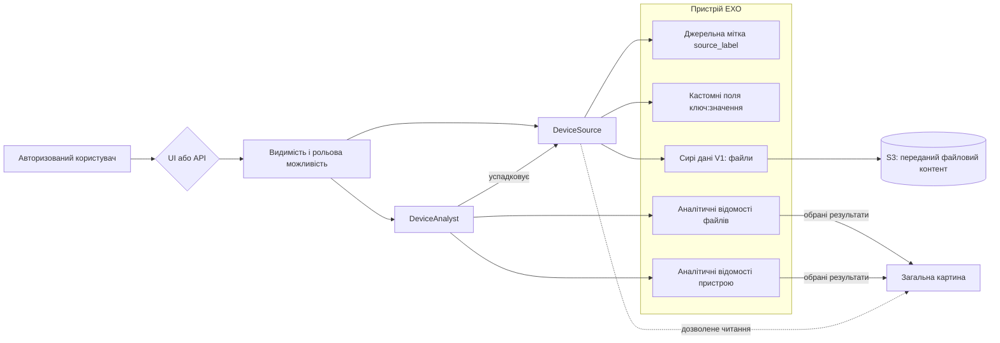
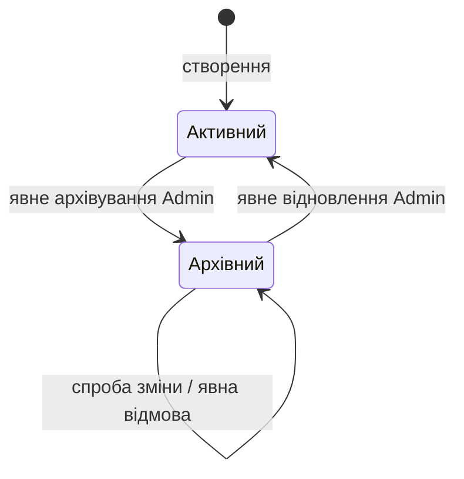

# Функціональний дизайн «Пристрої»

- **Статус:** Чернетка
- **Версія:** 0.10
- **Дата:** 2026-07-18

## Історія ревізій

| Версія | Дата       | Статус   | Зміни                                                                                          |
| ------ | ---------- | -------- | ---------------------------------------------------------------------------------------------- |
| 0.1    | 2026-07-16 | Чернетка | Початковий функціональний дизайн                                                               |
| 0.2    | 2026-07-16 | Чернетка | Визначено процес синхронізації через API                                                       |
| 0.3    | 2026-07-17 | Чернетка | Файли переведено на модель останнього стану; ключі надає ЕХО                                   |
| 0.4    | 2026-07-17 | Чернетка | Ключі пристроїв також створює ЕХО й повертає користувачу                                       |
| 0.5    | 2026-07-17 | Чернетка | Уніфіковано флоу змін, спрощено права, ручний аналіз і стани контенту                            |
| 0.6    | 2026-07-17 | Чернетка | Уніфіковано аналіз файла, визначено похідну загальну картину та розділено файлові відомості |
| 0.7    | 2026-07-17 | Чернетка | Додано кастомні поля, розділено права джерела й аналітика та уточнено роботу з сирими даними |
| 0.8    | 2026-07-17 | Чернетка | Додано позначки підтвердження виконання до кожної нормативної вимоги                       |
| 0.9    | 2026-07-18 | Чернетка | Відокремлено обов’язкову джерельну мітку від аналітичної назви пристрою                  |
| 0.10   | 2026-07-18 | Чернетка | Прибрано виняток `DeviceSource` для аналітичних відомостей і визначено тимчасове надання `DeviceAnalyst` |

## Правила ідентифікації вимог

Нормативні вимоги мають незмінні ідентифікатори за групами `DEV-GEN-*`, `DEV-ID-*`, `DEV-LC-*`, `DEV-FILE-*`, `DEV-AN-*`, `DEV-INT-*`, `DEV-ACC-*`, `DEV-UX-*` і `DEV-NFR-*`. У наступних ревізіях нова вимога отримує новий ідентифікатор; наявні ідентифікатори не перенумеровуються і не використовуються повторно.

У таблицях нормативних вимог прапорець `- [ ]` означає, що виконання вимоги ще не підтверджено за її критерієм приймання; `- [x]` означає, що виконання підтверджено.

## Призначення документа

Це продуктова функціональна специфікація реєстру «Пристрої». Вона визначає погоджену поведінку продукту, спільну мову, межі V1 та спостережувані критерії приймання для узгодження між зацікавленими сторонами й подальшого планування реалізації.

Документ не описує поточний стан коду і не задає технічну реалізацію. Тут навмисно немає шляхів викликів, контрактів передавання, структури бази даних, форматів повідомлень, способів адресації файлового контенту, назв програмних компонентів, способів оркестрації чи алгоритмів аналізу. Розбіжність між цією специфікацією та наявною реалізацією є окремим розривом для планування, а не підставою непомітно змінювати продуктову вимогу.

## Загальна ідея

**Пристрій ЕХО** — це логічна, постійно поповнювана колекція поточних технічних відомостей, сирих даних та аналітичних відомостей про один реальний пристрій. У V1 єдиним типом сирих даних є `Файли`.

Усі дії виконує один учасник — авторизований користувач ЕХО. Людина через UI та інтеграційний клієнт через API використовують один функціональний флоу, але дозволені зміни визначаються роллю: `DeviceSource` постачає сирі дані, а `DeviceAnalyst` виконує ручний аналіз.

Джерело не володіє створеним пристроєм і не формує його аналітичні відомості. Воно створює пристрій з обов’язковою джерельною міткою `source_label`, може читати дозволені аналітичні результати та додавати або змінювати сирі дані й супровідні технічні відомості. На першому етапі обліковому запису джерела, якому потрібно вносити аналітичні відомості, тимчасово надається роль `DeviceAnalyst`; це не розширює можливості ролі `DeviceSource`.

Колекція накопичує файли та інші майбутні об’єкти, але кожен пристрій, сирий стан файла й аналітичне поле має лише одне поточне значення. Нова зміна сирого файла не стирає створені аналітиком відомості цього файла.

| ID            | Нормативна вимога                                                                                                                                               | Спостережуваний критерій приймання                                                                                                                   | Виконано |
| ------------- | --------------------------------------------------------------------------------------------------------------------------------------------------------------- | ---------------------------------------------------------------------------------------------------------------------------------------------------- | -------- |
| `DEV-GEN-001` | Один пристрій ЕХО представляє накопичувальну колекцію даних, що стосуються одного реального пристрою.                                                           | Додавання нового файла не прибирає інші файли, а зміна наявного файла не створює інший пристрій.                                                     | - [ ] |
| `DEV-GEN-003` | ЕХО надає поточну загальну картину, сформовану з обраних поточних результатів ручного аналізу пристрою та його файлів.                                           | Загальна картина відображає лише обрані поточні результати й змінюється разом зі зміною вихідних аналітичних відомостей.                             | - [ ] |
| `DEV-GEN-005` | Поточна загальна картина й аналітичні відомості надаються через UI та API відповідно до прав доступу.                                                           | Авторизований користувач, включно з джерелом, отримує узгоджені дозволені поточні дані незалежно від каналу взаємодії.                              | - [ ] |
| `DEV-GEN-006` | Колекція підтримує незалежні типи сирих даних із власними атрибутами, станами, відображенням і дозволеними діями.                                               | Додавання нового типу сирих даних не змінює ідентичність пристрою та не вимагає трактувати його об’єкти як файли.                                   | - [ ] |
| `DEV-GEN-009` | У V1 підтримується тип сирих даних `Файли`, включно з файлами зі станами `контенту немає` та `контент передано`.                                                | Пристрій може містити файл без контенту, а пізніше прийняти новий сирий стан того самого файла з контентом за ключем, наданим ЕХО.                  | - [ ] |
| `DEV-GEN-011` | UI та API є двома каналами одного функціонального флоу й однаково застосовують рольові межі операцій.                                                            | Та сама дозволена операція з однаковими даними, роллю й видимістю має однаковий продуктовий результат і правила валідації в UI та API.              | - [ ] |
| `DEV-GEN-012` | Аналітичні відомості V1 створює й змінює користувач із роллю `DeviceAnalyst` як частину ручного аналізу пристрою або файла.                                     | Після дозволеного збереження нові аналітичні значення стають поточними; користувач без `DeviceAnalyst` не може створити або змінити жодне аналітичне поле. | - [ ] |
| `DEV-GEN-013` | Загальна картина є похідним представленням, а не окремою сутністю або набором незалежно редагованих і збережених полів.                                        | Загальна картина не має власного ключа чи прямої операції запису; UI та API формують її з поточних аналітичних відомостей.                           | - [ ] |
| `DEV-GEN-014` | Постачання технічних і сирих даних та створення аналітичних відомостей є різними рольовими можливостями одного функціонального флоу.                              | `DeviceSource` змінює `source_label` і сирі дані без зміни аналітичних відомостей, а `DeviceAnalyst` має ці можливості й додатково змінює аналітичні поля.   | - [ ] |

## Цілі та принципи

### Продуктові цілі

1. Зібрати поточні технічні відомості, сирі дані й результати ручного аналізу одного реального пристрою в одному контексті.
2. Надати однакову семантику дозволених операцій через UI й API.
3. Дозволити джерелам створювати пристрій з окремою джерельною міткою, поповнювати його файлами та супровідними технічними відомостями без втручання в результати аналізу.
4. Дозволити аналітикам переглядати пристрій і сирі дані та створювати й редагувати аналітичні відомості пристрою і файлів.
5. Підтримати файли з переданим контентом і без нього.
6. Надавати похідну поточну загальну картину з обраних результатів ручного аналізу.

### Принципи

- **Один учасник, різні рольові можливості.** Джерело й аналітик є авторизованими користувачами ЕХО, а не окремими моделями володіння пристроєм.
- **Джерело постачає технічні й сирі дані.** `DeviceSource` створює та змінює джерельну мітку, кастомні поля й сирі дані, але не створює й не змінює жодних аналітичних відомостей.
- **Аналітик формує висновки.** `DeviceAnalyst` має всі права `DeviceSource` та окреме право створювати й змінювати аналітичні відомості.
- **Поєднання ролей без винятків.** Обліковому запису джерела на першому етапі можна тимчасово надати `DeviceAnalyst`; аналітичні дії тоді дозволяє саме ця роль, а не спеціальний виняток для `DeviceSource`.
- **Розділені поточні стани.** Зміна технічних даних або контенту файла не стирає його аналітичних відомостей.
- **Окрема джерельна мітка.** Обов’язкова `source_label` є технічним позначенням пристрою, а не його аналітичною назвою, і не визначає ідентичність або власника.
- **Кастомні поля замість спеціальних атрибутів.** Hostname і SSH-порт не мають окремої продуктової семантики та можуть передаватися як звичайні пари `ключ:значення`.
- **Похідна загальна картина.** Загальна картина не зберігає окремих даних, а збирається з обраних поточних результатів аналізу пристрою та його файлів.
- **Ефективний доступ.** Для кожної зміни потрібні видимість конкретного пристрою та роль, яка дозволяє саме цю операцію.
- **Накопичення без неявного видалення.** Відсутність об’єкта в наступній операції не прибирає його з ЕХО.
- **Явний результат.** Помилка, частковий успіх, заборона й архівний стан не маскуються під успіх.

## Межі V1 і подальший розвиток

### У межах V1

- людина через UI та інтеграційний клієнт через API діють як один учасник — авторизований користувач ЕХО;
- `DeviceSource` створює пристрої з обов’язковою непорожньою `source_label`, передає й змінює сирі дані та супровідні технічні відомості, але не аналітичні відомості;
- `DeviceAnalyst` має всі можливості `DeviceSource` і створює та змінює аналітичні відомості пристрою й файлів;
- `DeviceSource` може читати дозволені аналітичні відомості пристрою;
- єдиний тип сирих даних — `Файли`;
- `source_label` є окремим технічним полем, а не кастомним полем або аналітичною назвою;
- Hostname і SSH-порт не є окремими полями пристрою та можуть зберігатися лише як кастомні поля;
- обліковому запису джерела, якому на першому етапі потрібно вносити аналітичні відомості, тимчасово надається роль `DeviceAnalyst`;
- файл має один із двох станів контенту: `контенту немає` або `контент передано`;
- зміна сирого стану файла замінює його технічні дані й контент, але зберігає аналітичні відомості;
- переданий файловий контент зберігається в S3;
- аналіз виконується вручну користувачем із роллю `DeviceAnalyst`;
- ЕХО показує та віддає похідну поточну загальну картину й поточні аналітичні відомості.

### Після V1

Коли аналітичні відомості вноситимуть окремі аналітики, тимчасово надану джерельному обліковому запису роль `DeviceAnalyst` можна відкликати без зміни контракту `DeviceSource` або даних пристрою. Створення пристрою без аналітичної назви визначено в `OD-007`: джерело передає `source_label`, а назву створює користувач із `DeviceAnalyst`.

Наступні ревізії також можуть додати нові типи сирих даних, нові аналітичні відомості й детальніші способи їх представлення. Кастомні поля лишаються супровідними технічними відомостями пристрою й не створюють нового типу сирих даних.

## Терміни

| Термін                          | Визначення                                                                                                                                                                                                    |
| ------------------------------- | ------------------------------------------------------------------------------------------------------------------------------------------------------------------------------------------------------------- |
| **Реальний пристрій**           | Фізичний або віртуальний пристрій у предметній області, якого стосуються зібрані дані.                                                                                                                        |
| **Пристрій ЕХО**                | Логічна накопичувальна колекція ЕХО про один реальний пристрій.                                                                                                                                               |
| **Авторизований користувач**    | Єдиний учасник функціонального флоу: людина або інтеграційний клієнт, автентифікований як користувач ЕХО.                                                                                                     |
| **Джерело сирих даних**         | Авторизований користувач із можливостями `DeviceSource`, який постачає технічні відомості та сирі дані, але не є власником пристрою й не формує аналітичних висновків.                                       |
| **Аналітик**                     | Авторизований користувач із роллю `DeviceAnalyst`, який переглядає пристрій і сирі дані та створює або змінює аналітичні відомості.                                                                          |
| **Канал взаємодії**             | UI або API, через який авторизований користувач виконує дозволені його роллю продуктові операції.                                                                                                             |
| **Сирі дані**                   | Дані, які джерело додає до пристрою без аналітичних висновків; у V1 це файли, їхні технічні дані та контент.                                                                                                  |
| **Кастомне поле пристрою**      | Поточна супровідна технічна пара `ключ:значення`, яку дозволений користувач передає під час створення або зміни пристрою та яку ЕХО зберігає й показує без спеціальної продуктової семантики.                  |
| **Джерельна мітка пристрою** | Обов’язкове непорожнє поточне технічне позначення `source_label`, яке `DeviceSource` передає під час створення й може змінювати надалі; не є аналітичною назвою, ідентичністю або ознакою власника.                                             |
| **Поточні відомості**           | Останні прийняті значення технічних або аналітичних полів пристрою чи файла.                                                                                                                                  |
| **Аналітичні відомості**        | Поточні значення, які створює або змінює аналітик як результат ручного аналізу пристрою або файла.                                                                                                            |
| **Аналітичні відомості пристрою** | Назва, підрозділ, AOR, важливість, опис та інші поточні висновки про пристрій; назва може бути відсутня до її створення користувачем із `DeviceAnalyst`.                                                                              |
| **Аналітичні відомості файла**  | Категорія, теги, коментарі та інші поточні висновки, які аналітик вносить лише для тих файлів, до яких вони застосовні.                                                                                       |
| **Загальна картина**            | Похідне продуктове представлення, зібране з обраних поточних результатів аналізу пристрою та його файлів; не є окремою сутністю або самостійно редагованим станом.                                           |
| **Тип сирих даних**             | Незалежний клас сирих об’єктів колекції зі своїми атрибутами, життєвим циклом, відображенням і діями.                                                                                                        |
| **Файл**                        | Об’єкт типу сирих даних `Файли`, ідентифікований ключем ЕХО та представлений поточним сирим станом і окремими поточними аналітичними відомостями.                                                            |
| **Технічні дані файла**         | Фактичні метадані й системні стани, властиві кожному або майже кожному файлу: ключ, шлях, назва, MIME-тип, розширення, файлові часові мітки, стан контенту та ознака оброблення аналітиком.                    |
| **Сирий стан файла**            | Остання прийнята сукупність технічних даних, стану контенту й, за наявності, бінарного контенту файла; не включає аналітичні відомості.                                                                       |
| **Контент файла**               | Бінарний вміст останнього прийнятого сирого стану файла; його наявність визначається одним із двох станів контенту.                                                                                           |
| **Стабільний ключ пристрою**    | Ідентифікатор пристрою, який ЕХО створює під час його створення, повертає користувачу й очікує в кожній наступній операції із цим пристроєм.                                                                 |
| **Ключ файла**                  | Ідентифікатор файла, який ЕХО створює під час створення файла, повертає користувачу й очікує в кожній наступній операції із цим файлом.                                                                      |
| **Архівний пристрій**           | Пристрій у стані лише для читання: поточні дані збережені, але зміни заблоковані до явного відновлення адміністратором.                                                                                      |

## Учасники та права

### Функціональні режими одного учасника

Джерело й аналітик не є різними власниками або каналами походження пристрою. Це авторизовані користувачі ЕХО з різними рольовими можливостями; один обліковий запис може мати кілька ролей.

| Режим                         | Відповідальність і межі                                                                                                                                                                          |
| ----------------------------- | ------------------------------------------------------------------------------------------------------------------------------------------------------------------------------------------------ |
| **Джерело сирих даних**       | Створює пристрій з `source_label`, додає або змінює джерельну мітку, кастомні поля та сирі файли, читає дозволені аналітичні відомості, але не створює й не змінює аналітичні відомості. |
| **Аналітик**                  | Переглядає пристрій і сирі файли, має всі можливості джерела та створює або змінює аналітичні відомості пристрою й файлів.                                                                      |

### Базова матриця ролей V1

| Роль             | Дозволені продуктові можливості                                                                                                                                                                                        |
| ---------------- | ---------------------------------------------------------------------------------------------------------------------------------------------------------------------------------------------------------------------- |
| `Cyber`          | Читання видимих пристроїв, їхніх `source_label`, кастомних полів, сирих даних, загальної картини й аналітичних відомостей.                                                                                                   |
| `DeviceSource`   | Читання видимих пристроїв та їхніх аналітичних відомостей; створення пристроїв з `source_label`; зміна джерельної мітки, кастомних полів, сирих файлів, їхніх технічних даних, контенту та файлового стану видимості.           |
| `DeviceAnalyst`  | Усі можливості `DeviceSource` та створення й зміна аналітичних відомостей видимих активних пристроїв і файлів, включно з назвою, AOR, підрозділом, описом, категоріями, тегами й коментарями.                         |
| `Admin`          | Усі можливості `Cyber`, `DeviceSource` і `DeviceAnalyst`, а також архівування та відновлення видимих пристроїв.                                                                                                      |

На першому етапі обліковому запису джерела, якому потрібно вносити аналітичні відомості, тимчасово надається роль `DeviceAnalyst`. За наявності цієї ролі аналітичні дії дозволяються за її звичайними правилами; роль `DeviceSource` сама по собі ніколи не дозволяє змінювати назву, AOR, підрозділ, опис, важливість, файлові категорії, теги, коментарі або інші аналітичні відомості.

Ефективне право на операцію є перетином видимості конкретного пристрою та рольової можливості для цієї операції. `DeviceAnalyst` успадковує можливості `DeviceSource`, але жодна з цих ролей сама по собі не розширює видимість. Архівування й відновлення пристрою виконує лише `Admin`.

Окреме право понад право читача для відкриття або отримання файлового контенту визначить `OD-006`. До цього рішення жодна роль не отримує нового неявного права на контент.

| ID            | Нормативна вимога                                                                                                                                                 | Спостережуваний критерій приймання                                                                                                                 | Виконано |
| ------------- | ----------------------------------------------------------------------------------------------------------------------------------------------------------------- | -------------------------------------------------------------------------------------------------------------------------------------------------- | -------- |
| `DEV-ACC-001` | Доступ до пристроїв і дій із ними вимагає автентифікованого користувача та перевірки видимості й рольової можливості.                                             | Неавтентифікований користувач не отримує даних або дій; автентифікований виконує лише дозволені для видимого пристрою операції.                   | - [ ] |
| `DEV-ACC-002` | Роль `Cyber` надає читання видимих пристроїв, їхніх технічних і сирих даних, загальної картини й аналітичних відомостей без права зміни.                         | Користувач із `Cyber` відкриває видимий пристрій, але не змінює `source_label`, кастомні поля, сирі дані або аналітичні відомості.                     | - [ ] |
| `DEV-ACC-004` | Роль `Admin` задовольняє права `Cyber`, `DeviceSource` і `DeviceAnalyst` та надає архівування й відновлення пристрою.                                              | `Admin` виконує кожну спеціалізовану операцію й окремо проходить перевірку життєвого циклу пристрою.                                               | - [ ] |
| `DEV-ACC-008` | Зміна наявного активного пристрою вимагає одночасно бачити його й мати рольову можливість саме для запитаної групи даних.                                         | Видимий файл змінює `DeviceSource`, аналітичне поле — `DeviceAnalyst`; відсутність видимості або потрібної ролі дає відмову без зміни.            | - [ ] |
| `DEV-ACC-009` | `DeviceAnalyst` має всі можливості `DeviceSource` та додаткове право змінювати аналітичні відомості видимого активного пристрою і його файлів.                    | Один `DeviceAnalyst` може послідовно змінити сирий стан файла й окремо його категорію, тоді як `DeviceSource` виконує лише першу зміну.           | - [ ] |
| `DEV-ACC-010` | UI та API застосовують однакову перевірку видимості й рольової можливості.                                                                                          | Однаковий користувач, роль, пристрій і операція отримують однаковий дозвіл або заборону в обох каналах.                                           | - [ ] |
| `DEV-ACC-011` | `DeviceSource` може створювати пристрої з `source_label`, змінювати джерельну мітку, кастомні поля й сирі дані, але не аналітичні відомості.                    | Створення з непорожньою `source_label` та зміна технічних або сирих даних приймаються, а спроба передати назву, AOR, підрозділ, опис, категорію, тег чи коментар відхиляється. | - [ ] |
| `DEV-ACC-012` | `DeviceAnalyst` може створювати й змінювати аналітичні відомості пристрою та файлів, включно з назвою, AOR, підрозділом, описом і майбутніми типами відомостей. | Аналітик зберігає кожне застосовне поле, а користувач без `DeviceAnalyst` отримує відмову для будь-якої аналітичної зміни.                                      | - [ ] |
| `DEV-ACC-013` | `DeviceSource` може читати дозволені аналітичні відомості й загальну картину видимого пристрою.                                                                  | Джерело отримує поточні аналітичні результати через UI або API, але саме право читання не дозволяє їх змінювати.                                 | - [ ] |
| `DEV-ACC-015` | Аналітичну назву пристрою може створювати й змінювати лише `DeviceAnalyst`; право `DeviceSource` на `source_label` не поширюється на назву.                         | Створення джерелом без назви успішне за наявності `source_label`, а спроба джерела передати чи змінити назву отримує відмову без зміни пристрою.             | - [ ] |
| `DEV-ACC-016` | Обліковому запису джерела на першому етапі можна тимчасово надати роль `DeviceAnalyst` замість створення винятків у можливостях `DeviceSource`.                    | З `DeviceAnalyst` обліковий запис змінює аналітичні відомості; після відкликання ролі аналітичний patch відхиляється, а дозволені можливості `DeviceSource` лишаються. | - [ ] |

## Концептуальна модель

Діаграма показує продуктові межі можливостей, а не окремих учасників або програмні компоненти. `DeviceAnalyst` успадковує можливості `DeviceSource`; джерело створює технічну `source_label` і може читати результати аналізу, але не створює аналітичну назву.

## Дані та життєвий цикл пристрою

### Групи відомостей

Поточні відомості пристрою охоплюють:

- **ідентичність:** стабільний ключ ЕХО;
- **супровідні технічні відомості:** обов’язкова джерельна мітка `source_label`, зовнішнє посилання та довільні кастомні поля `ключ:значення`;
- **сирі дані:** у V1 — файли з технічними даними й контентом;
- **аналітичні відомості пристрою:** назва, підрозділ, одна чи кілька AOR («смуг»), важливість, опис та інші майбутні відомості;
- **часові атрибути:** час створення й останнього оновлення;
- **життєвий цикл:** активний або архівний стан.

`source_label` є обов’язковим непорожнім технічним полем пристрою. Воно не є унікальним, не визначає джерело-власника та не використовується для адресації наступних операцій.

Hostname і SSH-порт не є окремими полями чи сутностями пристрою. Якщо джерело або інший дозволений користувач передає, наприклад, `hostname:node-1` чи `ssh_port:2222`, ЕХО зберігає та показує їх як звичайні кастомні поля без спеціальної валідації або поведінки.

Аналітична назва може бути відсутня після створення пристрою й до її внесення `DeviceAnalyst`; якщо назву задано, вона має бути непорожньою. Відсутність назви означає, що пристрій потребує аналітичної назви. Зовнішнє посилання необов’язкове. Підрозділ і AOR мають посилатися на чинні довідники ЕХО.

### Ідентичність пристрою

- Стабільний ключ ЕХО є єдиним полем ідентичності.
- До створення аналітичної назви пристрій відображається за `source_label`; джерельна мітка не є унікальною й не використовується для зіставлення операцій.
- Аналітична назва після її створення використовується як основний заголовок, але не є унікальною й не визначає ідентичність.
- Новий пристрій створюється без ключа; ЕХО створює глобально стабільний ключ і повертає його користувачу.
- Кожна наступна операція зміни наявного пристрою адресує його за наданим ЕХО ключем.
- Довільний або невідомий ключ не створює пристрій і не зіставляється за назвою, кастомним або іншим полем.

| ID           | Нормативна вимога                                                                                                                                                    | Спостережуваний критерій приймання                                                                                                                         | Виконано |
| ------------ | -------------------------------------------------------------------------------------------------------------------------------------------------------------------- | ---------------------------------------------------------------------------------------------------------------------------------------------------------- | -------- |
| `DEV-ID-001` | Аналітична назва пристрою може бути відсутня до її створення `DeviceAnalyst`; якщо назву задано, вона є непорожньою, однакові назви дозволені.                                           | Пристрій без назви існує й відображається за `source_label`; після внесення назви аналітиком вона стає основним заголовком, а порожнє значення відхиляється. | - [ ] |
| `DEV-ID-006` | Пристрій зберігає окремо стабільну ідентичність, супровідні технічні відомості, сирі дані, аналітичні відомості, часові атрибути й життєвий стан.                    | Кожна група доступна окремо, а зміна сирих даних не змінює ідентичність або аналітичні поля.                                                               | - [ ] |
| `DEV-ID-007` | `source_label` є обов’язковою й непорожньою; аналітична назва може бути відсутня, але не може бути порожнім рядком; посилання на довідники перевіряються.             | Відсутня або порожня `source_label`, порожня назва чи нечинний підрозділ або AOR отримують відмову; створення без назви приймається.                        | - [ ] |
| `DEV-ID-008` | Стабільний ключ пристрою створює ЕХО; він не залежить від каналу, користувача або джерела створення.                                                                 | Створення без ключа повертає новий ключ, а дозволена зміна з цим ключем через інший канал або іншим користувачем адресує той самий пристрій.               | - [ ] |
| `DEV-ID-009` | Основне представлення пристрою показує лише останні прийняті значення його поточних технічних і аналітичних полів.                                                  | Після двох дозволених змін одного поля видно друге значення; перше не повертається як паралельний чинний стан.                                            | - [ ] |
| `DEV-ID-010` | Дозволений користувач може під час створення або зміни пристрою передати кастомні поля як пари `ключ:значення`; ЕХО зберігає й показує їх через UI та API.          | Новий ключ з’являється у представленні пристрою, повторна передача того самого ключа замінює його поточне значення, а пропущені ключі лишаються без змін. | - [ ] |
| `DEV-ID-011` | Hostname і SSH-порт не мають окремих полів, валідації або продуктової поведінки; за потреби вони зберігаються як кастомні поля.                                    | Значення з ключами `hostname` і `ssh_port` показуються поруч з іншими парами `ключ:значення` та не створюють спеціальних атрибутів пристрою.              | - [ ] |
| `DEV-ID-012` | `source_label` є окремим поточним технічним полем, не є унікальною, не визначає ідентичність або власника й не належить до кастомних чи аналітичних полів.          | Однакові мітки дозволені для різних ключів; зміна `source_label` не змінює ключ або аналітичну назву, а API повертає ці значення окремо.                    | - [ ] |

### Правила внесення й оновлення

Створення та зміни мають однакову семантику в UI й API, але перевіряються за групою даних. `DeviceSource` або `DeviceAnalyst` створює пристрій з обов’язковою `source_label`, змінює джерельну мітку, кастомні поля й сирі дані. Усі аналітичні відомості, включно з назвою, AOR і підрозділом, створює та змінює лише користувач із `DeviceAnalyst`.

Оновлення полів пристрою є атомарним patch:

- пропущене звичайне поле не змінює поточне значення;
- передане значення замінює поточне;
- передана пара кастомного поля створює ключ або замінює його поточне значення, а непередані кастомні ключі не змінюються;
- `source_label` не можна пропустити під час створення або очистити під час зміни;
- відсутня аналітична назва дозволена, але переданий порожній рядок назви відхиляється;
- явне очищення прибирає лише необов’язкове значення;
- обов’язкове поле не можна очистити;
- поле, заборонене роллю, або невалідне значення відхиляє весь patch без часткової зміни.

Продукт зберігає лише поточні значення полів пристрою. Попередні значення не надаються як продуктова історія.

| ID           | Нормативна вимога                                                                                                                                 | Спостережуваний критерій приймання                                                                                                          | Виконано |
| ------------ | ------------------------------------------------------------------------------------------------------------------------------------------------- | ------------------------------------------------------------------------------------------------------------------------------------------- | -------- |
| `DEV-LC-009` | Будь-який користувач, який бачить активний пристрій і має потрібну рольову можливість, може змінити дозволену групу даних незалежно від автора.   | Інший `DeviceSource` змінює `source_label` або сирі дані, а `DeviceAnalyst` — аналітичні; користувач без видимості чи потрібної ролі нічого не змінює. | - [ ] |
| `DEV-LC-010` | Зміна полів пристрою атомарно формує нові поточні значення заявленої групи без доступної історії попередніх значень.                              | Валідний patch змінює лише заявлені поля; заборонене або невалідне поле не змінює нічого, а після успіху показано тільки поточні значення.  | - [ ] |

### Життєвий цикл

Пристрій має два продуктові стани:

- **активний** — дозволені читання та операції, на які користувач має видимість і відповідну рольову можливість;
- **архівний** — поточні дані збережені для читання, але зміни `source_label`, кастомних полів, сирих даних і аналітичних відомостей заблоковані.

Звичайна операція зміни не відновлює архівний пристрій. Архівувати й відновити видимий пристрій може лише `Admin`. Спроба запису до архівного пристрою завершується видимою відмовою без часткового прийняття.

Відсутність пристрою або файла в наступному батчі не видаляє та не архівує вже прийняті дані. Архівування пристрою й приховування файла є окремими явними діями.

| ID           | Нормативна вимога                                                                                                                               | Спостережуваний критерій приймання                                                                                                        | Виконано |
| ------------ | ----------------------------------------------------------------------------------------------------------------------------------------------- | ----------------------------------------------------------------------------------------------------------------------------------------- | -------- |
| `DEV-LC-004` | Пристрій перебуває в одному зі станів `активний` або `архівний`; архівування зберігає поточні дані для дозволеного читання.                     | Після архівування поточні технічні, сирі й аналітичні відомості можна прочитати за правом.                                                | - [ ] |
| `DEV-LC-005` | Архівний пристрій блокує зміни `source_label`, кастомних полів, сирих даних, контенту й аналітичних відомостей.                                                | Кожна така спроба отримує явну відмову; жодні поточні дані не змінюються.                                                                 | - [ ] |
| `DEV-LC-006` | Відновлення архівного пристрою є явною дією `Admin`, який бачить цей пристрій.                                                                   | Звичайна зміна лишає пристрій архівним і відхиляється; після дозволеного відновлення той самий пристрій стає активним.                   | - [ ] |
| `DEV-LC-007` | Відсутність у наступному батчі не видаляє, не приховує й не архівує вже прийнятий пристрій або файл.                                            | Після операції, що не містить раніше прийнятого об’єкта, його поточний стан не змінюється.                                                | - [ ] |
| `DEV-LC-008` | Явне архівування виконує `Admin`; воно не виводиться з відсутності пристрою в переданих даних.                                                  | Дозволене архівування змінює стан активного пристрою; без цієї дії пропущений у батчі пристрій лишається активним.                        | - [ ] |

## Тип сирих даних «Файли»

У V1 `Файли` є єдиним типом сирих даних пристрою. Файл є самостійним об’єктом колекції: його технічні дані корисні для ручного аналізу навіть тоді, коли контенту немає.

### Технічні дані й аналітичні відомості файла

Відомості файла поділяються на дві семантично й операційно окремі групи.

**Технічні дані** описують сам файл або його системний стан і очікуються для кожного чи майже кожного файла. До них належать:

- ключ файла, створений ЕХО;
- поточна назва, шлях або шляхи до файла, якщо вони відомі;
- MIME-тип і розширення, якщо вони відомі;
- дата й час створення та зміни у файловій системі пристрою, якщо вони відомі;
- стан контенту;
- системна ознака того, чи був файл оброблений аналітиком;
- час першого створення й останнього оновлення в ЕХО;
- стан видимості `активний` або `прихований`.

**Аналітичні відомості** є результатами ручного аналізу й заповнюються `DeviceAnalyst` лише для застосовного піднабору файлів. До них належать:

- категорія файла, яку визначив аналітик, наприклад `рапорт` або `штатка`;
- теги, які проставив аналітик;
- коментарі аналітика до файла;
- інші визначені аналітичні висновки.

Класифікація атрибута визначається його змістом: фактичний або системний атрибут, очікуваний для кожного чи майже кожного файла, є технічними даними; атрибут, який аналітик вносить як результат аналізу лише для застосовного піднабору файлів, є аналітичною відомістю. Сама ознака оброблення файла аналітиком є технічним системним станом, а внесені категорії, теги й коментарі — аналітичними відомостями.

Новий файл створює користувач із можливостями `DeviceSource` без ключа. ЕХО створює ключ, пов’язує його з файлом і повертає в результаті незалежно від використаного каналу. Наступна зміна сирого стану цього файла передає отриманий ключ.

| ID             | Нормативна вимога                                                                                                                                                                            | Спостережуваний критерій приймання                                                                                                                          | Виконано |
| -------------- | -------------------------------------------------------------------------------------------------------------------------------------------------------------------------------------------- | ----------------------------------------------------------------------------------------------------------------------------------------------------------- | -------- |
| `DEV-FILE-001` | Файл має окремо представлені поточний сирий стан і аналітичні відомості; відсутність аналітичних відомостей не робить сирий файл відсутнім.                                                 | UI та API повертають технічну й аналітичну групи окремо, а файл без категорії, тегів і коментарів лишається повноцінним сирим об’єктом.                    | - [ ] |
| `DEV-FILE-002` | ЕХО створює ключ кожного нового файла; той самий ключ використовується для всіх наступних сирих і аналітичних змін файла через UI або API.                                                 | Створення без ключа повертає ключ ЕХО; невідомий або належний іншому пристрою ключ відхиляється без створення чи зміни файла.                               | - [ ] |
| `DEV-FILE-018` | Атрибут файла є технічними даними, якщо фактично описує кожен чи майже кожен файл або його системний стан; результат, внесений аналітиком для піднабору, є аналітичною відомістю.          | Шлях, назва, MIME-тип, розширення, файлові часові мітки й ознака оброблення належать до технічної групи, а категорія, теги й коментарі — до аналітичної. | - [ ] |

### Стани контенту

| Стан                 | Значення                                                                                                                       |
| -------------------- | ------------------------------------------------------------------------------------------------------------------------------ |
| **контенту немає**   | Поточний сирий стан файла містить технічні дані, але не містить бінарного контенту; окремі аналітичні відомості можуть існувати. |
| **контент передано** | Бінарний контент поточного сирого стану повністю прийнятий, збережений у S3 і може бути отриманий за окремим правом.            |

Інших продуктових станів контенту у V1 немає. Стан `контент передано` встановлюється лише після повного прийняття та збереження бінарного вмісту. Помилка не змінює сирий стан файла й не зачіпає його аналітичні відомості. Технічний спосіб передавання може складатися з кількох кроків, але не створює проміжного продуктового стану.

Технічні дані файла видимі й доступні як підстава для ручного аналізу в обох станах. Контент зі станом `контент передано` зберігається в S3 та надається лише через захищену продуктову дію.

| ID             | Нормативна вимога                                                                                                                           | Спостережуваний критерій приймання                                                                                                              | Виконано |
| -------------- | ------------------------------------------------------------------------------------------------------------------------------------------- | ----------------------------------------------------------------------------------------------------------------------------------------------- | -------- |
| `DEV-FILE-004` | Технічні дані файла доступні для перегляду й ручного аналізу незалежно від стану контенту.                                                  | Файл зі станом `контенту немає` присутній у списку й може отримати аналітичні відомості лише на підставі своїх технічних даних.                 | - [ ] |
| `DEV-FILE-006` | Контент зі станом `контент передано` зберігається в S3 і надається тільки через захищену продуктову дію.                                   | Переданий контент можна отримати за наявності відповідного права; без права бінарний вміст не надається.                                        | - [ ] |
| `DEV-FILE-016` | Контент файла має рівно один зі станів `контенту немає` або `контент передано`.                                                             | Для кожного файла показано рівно один із двох станів; відсутність контенту однозначно відрізняється від повністю прийнятого контенту.           | - [ ] |
| `DEV-FILE-017` | Стан `контент передано` встановлюється лише разом з успішним прийняттям повного контенту; невдала операція не змінює сирий стан файла.     | Після помилки попередні технічні дані, контент і стан лишаються незмінними, а окремі аналітичні відомості не зачіпаються.                       | - [ ] |

### Новий сирий стан і окремі аналітичні зміни

Кожна валідна зміна з ключем наявного файла від користувача з можливостями `DeviceSource` описує новий повний сирий стан: усі технічні дані та один із двох станів контенту. Вона не приймає аналітичні поля й не створює іншого файла.

Новий сирий стан атомарно замінює попередні технічні дані й контент. Якщо прийнято `контенту немає`, попередній бінарний вміст більше не доступний. Якщо прийнято `контент передано`, новий вміст замінює попередній лише після успішного повного збереження. За помилки весь сирий елемент відхиляється.

Аналітичні відомості файла змінюються окремим patch, доступним `DeviceAnalyst`. Заміна сирого стану не очищує й не замінює категорію, теги, коментарі чи інші аналітичні відомості; аналітичний patch не змінює технічні дані або контент.

Попередні сирі стани й попередні значення аналітичних полів не надаються як продуктова історія. Однаковий контент у файлах із різними ключами є двома окремими файлами.

| ID             | Нормативна вимога                                                                                                                                                    | Спостережуваний критерій приймання                                                                                                             | Виконано |
| -------------- | -------------------------------------------------------------------------------------------------------------------------------------------------------------------- | ---------------------------------------------------------------------------------------------------------------------------------------------- | -------- |
| `DEV-FILE-007` | Кожна прийнята зміна з ключем наявного файла стає новим повним поточним сирим станом цього файла, навіть якщо значення не змінилися.                                 | Повтор із тим самим ключем не створює іншого файла й лишає доступним тільки останній прийнятий сирий стан.                                    | - [ ] |
| `DEV-FILE-008` | ЕХО зберігає для файла лише останній прийнятий сирий стан; він повністю замінює попередні технічні дані та контент, але не аналітичні відомості.                     | Після двох сирих змін доступні технічні дані й контент другої та незмінні аналітичні відомості файла.                                         | - [ ] |
| `DEV-FILE-009` | Попередній контент стає недоступним лише після успішного атомарного прийняття нового повного сирого стану файла.                                                    | Успішна заміна повертає новий сирий стан, а помилка лишає попередні технічні дані, контент і стан без змін.                                  | - [ ] |
| `DEV-FILE-011` | Однаковий контент у файлах із різними наданими ЕХО ключами лишається окремими файлами.                                                                               | Два окремі створення отримують різні ключі й дають два видимі файли незалежно від збігу контенту.                                             | - [ ] |
| `DEV-FILE-019` | Зміна сирого стану файла не створює, не змінює й не очищує його аналітичні відомості; їх змінює лише `DeviceAnalyst` окремою дією.                                 | Після заміни технічних даних і контенту попередні категорія, теги й коментарі лишаються поточними; спроба джерела передати їх відхиляється.   | - [ ] |

### Приховування та відновлення

Файл має стан видимості **активний** або **прихований**. Користувач із можливостями `DeviceSource` може явно приховати активний файл і відновити прихований. Це дія життєвого циклу сирих даних:

- контент прихованого файла не стирається;
- аналітичні відомості прихованого файла не стираються;
- звичайна зміна сирого стану не скасовує стан видимості;
- відсутність файла в наступному батчі не замінює явну дію приховування;
- в архівному пристрої приховування та відновлення заблоковані.

| ID             | Нормативна вимога                                                                                                                        | Спостережуваний критерій приймання                                                                                                      | Виконано |
| -------------- | ---------------------------------------------------------------------------------------------------------------------------------------- | --------------------------------------------------------------------------------------------------------------------------------------- | -------- |
| `DEV-FILE-012` | `DeviceSource`, `DeviceAnalyst` або `Admin` може явно приховати та відновити файл видимого активного пристрою; дія не змінює ключ.      | Після приховування файл доступний у режимі прихованих, а після відновлення повертається до активного списку з тим самим ключем.         | - [ ] |
| `DEV-FILE-013` | Приховування не стирає контент чи аналітичні відомості, а звичайна зміна або відсутність файла в батчі не скасовує стан видимості.       | Файл лишається прихованим після сирої зміни; відновлення можливе лише окремою дозволеною дією.                                          | - [ ] |
| `DEV-FILE-014` | Файлові дії заблоковані для архівного пристрою.                                                                                           | Спроба додати, змінити, приховати або відновити файл архівного пристрою отримує відмову без зміни файла чи пристрою.                    | - [ ] |

### Представлення користувачеві

Розділ `Файли` чітко розділяє технічні дані й аналітичні відомості. Користувач із `DeviceSource` бачить дії над сирим станом, а `DeviceAnalyst` — також дії створення й редагування категорій, тегів, коментарів та інших аналітичних відомостей. Дії з контентом показуються й виконуються лише за відповідним окремим правом.

| ID             | Нормативна вимога                                                                                                                                                     | Спостережуваний критерій приймання                                                                                                                         | Виконано |
| -------------- | --------------------------------------------------------------------------------------------------------------------------------------------------------------------- | ---------------------------------------------------------------------------------------------------------------------------------------------------------- | -------- |
| `DEV-FILE-015` | Представлення файлів окремо показує поточний сирий стан, аналітичні відомості, один із двох станів контенту й стан видимості та відображає дозволені роллю дії.       | Джерело бачить, але не редагує аналітичні значення; аналітик редагує їх окремо від технічних даних і контенту.                                            | - [ ] |

## Ручний аналіз і загальна картина

### Робота аналітика

Аналітик працює з видимим активним пристроєм у такій послідовності:

1. Переглядає поточні технічні відомості пристрою та наявні сирі дані; у V1 це список файлів, їхні технічні дані та доступний за окремим правом контент.
2. Створює або редагує аналітичні відомості сирих файлів: категорії, теги, коментарі та інші застосовні висновки.
3. Створює або редагує аналітичні відомості самого пристрою: назву, AOR («смуги»), підрозділ, важливість, опис та інші типи відомостей, додані в майбутньому.
4. Переглядає похідну загальну картину, сформовану з обраних поточних результатів аналізу.

Роль `DeviceAnalyst` також містить усі можливості `DeviceSource`, тому аналітик за потреби може додати або виправити сирі дані. Сирі й аналітичні зміни лишаються окремими операціями та не перезаписують одна одну.

Відсутність аналітичної назви є похідною ознакою того, що пристрій потребує аналітичної назви, а не окремим збереженим станом життєвого циклу. Після внесення непорожньої назви `DeviceAnalyst` ця ознака зникає, а `source_label` лишається технічним позначенням.

### Єдиний напрям ручного аналізу файла

Аналіз списку файлів, технічних даних і файлового контенту є одним напрямом аналізу файла, а не різними процесами чи типами результатів. Для файла зі станом `контенту немає` аналітик виконує цей аналіз лише за списком і доступними технічними даними. Для файла зі станом `контент передано` той самий аналіз може додатково враховувати його вміст.

Наявність контенту лише розширює доступні підстави для аналізу й не створює іншого набору аналітичних полів, стану або життєвого циклу. Результатами є ті самі категорія, теги, коментарі та інші визначені висновки.

Аналітичні відомості є поточними полями. Нова дозволена зміна `DeviceAnalyst` замінює попереднє значення відповідного поля; попередні значення не надаються як продуктова історія.

Якщо обліковий запис джерела на першому етапі тимчасово має `DeviceAnalyst`, він вносить аналітичні відомості за правилами цієї ролі. Це не створює перехідних аналітичних прав для `DeviceSource`.

| ID           | Нормативна вимога                                                                                                                                                         | Спостережуваний критерій приймання                                                                                                                         | Виконано |
| ------------ | ------------------------------------------------------------------------------------------------------------------------------------------------------------------------- | ---------------------------------------------------------------------------------------------------------------------------------------------------------- | -------- |
| `DEV-AN-001` | Ручний аналіз файла може використовувати список і технічні дані файла та, за наявності, його переданий контент.                                                          | Файл без контенту можна категоризувати за технічними даними, а для файла з переданим контентом той самий аналіз може додатково врахувати вміст.            | - [ ] |
| `DEV-AN-014` | `DeviceAnalyst` може додавати й змінювати категорії, теги, коментарі та інші аналітичні відомості файлів видимого активного пристрою.                                  | Дозволена аналітична зміна зберігає нові значення, не змінюючи сирого стану файла.                                                                          | - [ ] |
| `DEV-AN-015` | `DeviceAnalyst` може створювати й змінювати назву, підрозділ, AOR, важливість, опис та інші аналітичні відомості видимого активного пристрою.                          | Після внесення непорожньої назви вона стає основним заголовком, ознака потреби в назві зникає, а `source_label` і сирі дані не змінюються.                   | - [ ] |
| `DEV-AN-016` | Аналітичні відомості вимагають видимості пристрою та ролі `DeviceAnalyst`; роль `DeviceSource` не має винятків для окремих аналітичних полів.                  | Користувач із `DeviceAnalyst` змінює кожне застосовне поле, а користувач лише з `DeviceSource` отримує відмову для назви, AOR, підрозділу та будь-якої іншої аналітичної зміни. | - [ ] |
| `DEV-AN-017` | ЕХО надає лише поточні аналітичні відомості; нове значення замінює попереднє.                                                                                            | Після двох змін одного поля UI та API повертають друге значення й не надають перше як паралельний або історичний результат.                                | - [ ] |
| `DEV-AN-018` | Загальна картина відображає обрані поточні результати ручного аналізу пристрою та його файлів без вигадування відсутніх значень.                                       | Визначені й обрані результати показані, а відсутні аналітичні значення не підміняються вигаданими.                                                          | - [ ] |
| `DEV-AN-019` | Наявність або відсутність контенту не створює окремого напряму, набору результатів чи життєвого циклу аналізу файла.                                                   | Для обох станів контенту доступні одна дія аналізу й той самий набір аналітичних полів; без контенту підставами є лише список і технічні дані.             | - [ ] |
| `DEV-AN-020` | Робота аналітика охоплює перегляд пристрою й сирих даних, створення та редагування аналітичних відомостей файлів і пристрою та перегляд загальної картини.              | `DeviceAnalyst` послідовно виконує всі чотири етапи, а `DeviceSource` може читати результати й змінювати лише технічні та сирі дані.                        | - [ ] |

### Загальна картина

Загальна картина є похідним продуктовим представленням, а не окремою сутністю. ЕХО збирає її для показу в UI та отримання через API з обраних поточних результатів ручного аналізу пристрою й файлів цього пристрою.

Загальна картина не має власного ключа, окремої операції створення чи редагування, самостійного життєвого циклу або продуктової історії. Вона змінюється як наслідок зміни поточних аналітичних відомостей. Загальний опис пристрою є одним із можливих вихідних аналітичних полів, а не самою загальною картиною.

Таке представлення може, наприклад, показувати списки поточних файлів, для яких аналітик уже проставив категорію. Точний склад, порядок і групування результатів визначатимуться в `OD-004`, а шкала важливості — у `OD-005`.

## Єдиний потік змін через UI та API

### Спільний контекст

UI та API є рівноправними каналами одного функціонального флоу. Кожна операція спочатку автентифікує користувача, потім перевіряє видимість цільового пристрою, його стан і рольову можливість для запитаної групи даних.

API-клієнт автентифікується як звичайний користувач ЕХО з однією або кількома наданими ролями, зокрема `DeviceSource` чи `DeviceAnalyst`. Особа чи канал створення пристрою не обмежують наступні дозволені дії інших користувачів.

Джерело самостійно визначає час і склад постачання сирих даних. V1 не вимагає повного знімка, фіксованого розкладу або передавання всіх раніше відомих об’єктів. Відсутні в операції пристрої чи файли лишаються без змін.

### Послідовність операцій

1. **Перевірка доступу.** ЕХО перевіряє автентифікацію, видимість наявного пристрою, його активний стан і потрібну рольову можливість.
2. **Створення або оновлення пристрою джерелом.** Новий пристрій передається без ключа, без аналітичної назви та з обов’язковою `source_label`; ЕХО створює ключ і повертає його. `DeviceSource` може змінювати джерельну мітку й кастомні поля, але не аналітичні відомості.
3. **Створення або оновлення сирих файлів.** Файловий батч містить нові файли без ключів або нові повні сирі стани наявних файлів із ключами.
4. **Прийняття контенту.** Файловий елемент має стан `контенту немає` або повний бінарний вміст для стану `контент передано`; успіх фіксується лише після повного збереження.
5. **Ручний аналіз.** `DeviceAnalyst` переглядає пристрій і сирі файли та окремими змінами вносить аналітичні відомості файлів і пристрою.
6. **Отримання результатів.** Дозволений користувач, включно з `DeviceSource`, отримує поточні дані, аналітичні відомості й похідну загальну картину.

### Семантика оновлень

Patch пристрою змінює лише дозволені роллю поля. Передана `source_label` замінює поточну джерельну мітку, а пара кастомного поля створює ключ або замінює його значення; пропущені під час зміни значення не змінюються. Заборонене роллю або невалідне поле відхиляє всю операцію.

Сирий файловий елемент атомарно описує повний поточний сирий стан із технічних даних та одного стану контенту. Відсутній ключ створює новий файл, відомий ключ замінює сирий стан наявного файла, а невідомий або належний іншому пристрою ключ відхиляється. Невдале прийняття контенту відхиляє весь елемент.

Аналітичний patch файла або пристрою доступний `DeviceAnalyst`, змінює лише передані аналітичні поля й не змінює сирі дані. Спроба `DeviceSource` передати заборонене аналітичне поле відхиляється, а не ігнорується.

У файловому батчі кожен сирий елемент перевіряється незалежно. Валідні елементи приймаються, навіть якщо інші відхилено; результат кожного елемента є явним. Один батч не може містити більше однієї зміни того самого ключа файла.

### Порядок, повтори й видалення

ЕХО застосовує валідні зміни одного об’єкта й однієї групи даних у порядку їх отримання. Пізніше отримана сира зміна того самого ключа перемагає раніше отриману сиру зміну, а пізніший аналітичний patch — попереднє значення відповідного аналітичного поля.

Окремого ключа операції у V1 немає:

- повтор створення пристрою без ключа створює ще один пристрій з іншим ключем;
- повтор створення файла без ключа створює ще один файл з іншим ключем;
- повтор незміненого patch пристрою не змінює його поточні значення;
- повтор повного сирого стану з ключем файла знову застосовує цей стан до того самого файла й не змінює аналітичні відомості.

Якщо клієнт не отримав результату створення, перед повтором без ключа він має звірити поточний список. Відсутність об’єкта в наступному батчі нічого не видаляє. Архівний пристрій відхиляє всі звичайні зміни до явного відновлення `Admin`.

| ID            | Нормативна вимога                                                                                                                                                                  | Спостережуваний критерій приймання                                                                                                                          | Виконано |
| ------------- | ---------------------------------------------------------------------------------------------------------------------------------------------------------------------------------- | ----------------------------------------------------------------------------------------------------------------------------------------------------------- | -------- |
| `DEV-INT-002` | Джерело самостійно визначає час і склад зміни; повний знімок, фіксований розклад або конкретний delta-підхід не є вимогами V1.                                                     | Окрема валідна інкрементальна зміна приймається без вимоги передати всі раніше відомі об’єкти чи дотриматися розкладу.                                     | - [ ] |
| `DEV-INT-003` | Ключі нового пристрою та нового файла створює ЕХО, повертає користувачу й вимагає для наступних змін відповідного об’єкта.                                                         | Новий пристрій і файл без ключів отримують ключі ЕХО; наступні зміни з ними адресують ті самі об’єкти, а невідомий ключ відхиляється.                       | - [ ] |
| `DEV-INT-004` | Кожна прийнята сира зміна з ключем наявного файла є новим повним поточним сирим станом; ключ не робить її операційно ідемпотентною.                                               | Дві однакові сирі зміни з одним ключем не створюють другого файла, але кожна знову застосовує переданий сирий стан без зміни аналітичних відомостей.       | - [ ] |
| `DEV-INT-005` | Сирий файловий батч адресує один пристрій, допускає нові елементи без ключів, частковий успіх та окремий результат кожного елемента.                                              | Валідні елементи приймаються незалежно від невалідних; нові отримують різні ключі ЕХО, а повторений ключ у батчі відхиляється.                              | - [ ] |
| `DEV-INT-010` | Одна операція пристрою створює або оновлює рівно один пристрій; файли приймаються окремо після його створення.                                                                     | Створення без ключа й назви, але з непорожньою `source_label`, повертає ключ ЕХО; кілька пристроїв, початкові файли або відсутня мітка відхиляються.       | - [ ] |
| `DEV-INT-011` | Оновлення пристрою є атомарним patch із правилами «пропущено — без зміни», «значення — замінити», «заборонене роллю поле — відхилити весь patch».                                  | Валідний patch змінює тільки передані дозволені поля; очищення `source_label`, невалідне або заборонене поле не змінює нічого.                             | - [ ] |
| `DEV-INT-012` | Кожен сирий файловий елемент атомарно описує повний сирий стан: елемент без ключа створює файл, а елемент із відомим ключем замінює лише його сирий стан.                         | Створення додає файл із новим ключем; оновлення не змінює ключ або аналітичні відомості й лишає доступним тільки переданий сирий стан.                    | - [ ] |
| `DEV-INT-013` | Валідні зміни одного об’єкта й однієї групи даних застосовуються в порядку отримання ЕХО.                                                                                          | Друга сира зміна лишає поточним другий сирий стан, а другий аналітичний patch — друге значення відповідного поля.                                         | - [ ] |
| `DEV-INT-016` | UI та API використовують однакові операції, валідацію, перевірки ролей і семантику результатів.                                                                                   | Однакові вхідні дані, роль і видимість дають однаковий продуктовий результат у двох каналах.                                                               | - [ ] |
| `DEV-INT-017` | Сирий файловий елемент зі станом `контент передано` приймається лише разом із повністю збереженим контентом; проміжний продуктовий стан не створюється.                           | Успіх повертає файл із переданим контентом, а помилка лишає попередній сирий стан або не створює новий файл.                                               | - [ ] |
| `DEV-INT-018` | Операція користувача лише з `DeviceSource` не може містити жодних аналітичних відомостей, включно з назвою, AOR і підрозділом.                                      | Будь-яке аналітичне поле від джерела відхиляє операцію без часткової зміни; той самий валідний аналітичний patch приймається лише за наявності `DeviceAnalyst`. | - [ ] |

### Отримання поточних даних

Авторизований користувач може отримати через API окремі поточні `source_label` й аналітичну назву, кастомні поля, сирі дані, аналітичні відомості та загальну картину, які дозволені йому в UI. `DeviceSource` може отримувати аналітичні відомості видимого пристрою, але їх зміна вимагає окремо наданої ролі `DeviceAnalyst`.

Замінені сирі стани й аналітичні значення не повертаються. Право читання перевіряється окремо від права змінювати сиру або аналітичну групу, а право отримання бінарного контенту не виводиться лише з права бачити технічні дані файла.

| ID            | Нормативна вимога                                                                                                                                       | Спостережуваний критерій приймання                                                                                                            | Виконано |
| ------------- | ------------------------------------------------------------------------------------------------------------------------------------------------------- | --------------------------------------------------------------------------------------------------------------------------------------------- | -------- |
| `DEV-INT-007` | Авторизований користувач, включно з `DeviceSource`, може через API отримати поточні дозволені технічні дані, аналітичні відомості й загальну картину пристрою. | API окремо повертає `source_label` і відсутню або задану назву та надає той самий дозволений поточний стан, що й UI.                                  | - [ ] |
| `DEV-INT-008` | API не надає замінені сирі стани або аналітичні значення й не представляє загальну картину як окремий версійований ресурс.                              | Після зміни API повертає поточні дані й похідне представлення, не дозволяючи запросити замінені значення як продуктову версію.                | - [ ] |
| `DEV-INT-009` | API-клієнт використовує звичайну автентифікацію, видимість і ролі користувача ЕХО без окремої моделі володіння пристроєм.                              | Клієнт виконує лише дозволені його роллю операції незалежно від автора створення; без потрібної ролі або видимості отримує відмову.           | - [ ] |

## Користувацькі можливості

### Список пристроїв

Список підтримує:

- пошук за `source_label`, аналітичною назвою або стабільним ключем ЕХО;
- фільтри за станом активності, потребою в аналітичній назві, AOR, підрозділом, тегами, важливістю та наявністю файлів або контенту;
- сортування за відображуваним заголовком і часом останнього оновлення;
- пагінацію;
- окреме відображення активних та архівних пристроїв.

Оцінка важливості не є обов’язковим фільтром, доки не визначено її шкалу.

До створення аналітичної назви список показує `source_label` як основний заголовок із позначкою `Потребує аналітичної назви`. Після внесення назви вона стає основним заголовком, а `source_label` лишається видимою як другорядне технічне позначення. Однакові мітки розрізняються за стабільним ключем ЕХО.

| ID           | Нормативна вимога                                                                                                     | Спостережуваний критерій приймання                                                                                          | Виконано |
| ------------ | --------------------------------------------------------------------------------------------------------------------- | --------------------------------------------------------------------------------------------------------------------------- | -------- |
| `DEV-UX-001` | Список пристроїв підтримує пошук за `source_label`, назвою чи ключем, визначені фільтри й сортування та окреме відображення активних і архівних пристроїв. | Пошук знаходить запис за кожним із трьох значень, фільтр виділяє пристрої без назви, а інші операції повертають лише відповідні дозволені записи. | - [ ] |
| `DEV-UX-002` | Список має пагінацію, придатну для перегляду накопичувальної колекції без завантаження всіх записів одночасно.         | Користувач послідовно переходить між сторінками без пропуску або повторення записів за незмінних умов пошуку й сортування. | - [ ] |
| `DEV-UX-009` | Список використовує похідний заголовок: аналітичну назву, якщо вона є, інакше `source_label` з позначкою потреби в аналітичній назві; обидва значення не зливаються. | До аналізу основною є мітка, після внесення назви основною стає назва, мітка лишається другорядною, а ключ дозволяє розрізнити однакові значення. | - [ ] |

### Сторінка пристрою

Сторінка пристрою надає:

- стабільний ключ, поточну `source_label` та інші супровідні технічні відомості;
- усі поточні кастомні поля як пари `ключ:значення`;
- відсутню або задану аналітичну назву, інші поточні аналітичні відомості й похідну загальну картину;
- окремий розділ `Файли` з розділеними сирим станом і аналітичними відомостями;
- дії над сирими даними для `DeviceSource` і успадковуючих ролей;
- дії над аналітичними відомостями лише для `DeviceAnalyst` і `Admin`;
- архівування та відновлення лише для `Admin`.

Користувач лише з `DeviceSource` може змінювати `source_label` та бачить аналітичні результати без елементів їх редагування. Якщо цьому самому користувачу тимчасово надано `DeviceAnalyst`, UI показує аналітичні дії за правами цієї ролі. Hostname і SSH-порт, якщо передані, показуються у спільному переліку кастомних полів, а не окремими елементами сторінки.

| ID           | Нормативна вимога                                                                                                                                               | Спостережуваний критерій приймання                                                                                                                      | Виконано |
| ------------ | --------------------------------------------------------------------------------------------------------------------------------------------------------------- | ------------------------------------------------------------------------------------------------------------------------------------------------------- | -------- |
| `DEV-UX-003` | Сторінка пристрою показує `source_label`, технічні, сирі й аналітичні групи окремо та відображає дії відповідно до всіх ролей користувача.                         | `DeviceSource` змінює мітку й сирі дані без аналітичних дій, `DeviceAnalyst` має аналітичні дії, а `Admin` — додатково архівування й відновлення.              | - [ ] |
| `DEV-UX-004` | Тип сирих даних `Файли` має окреме відображення; новий тип у майбутньому отримує власне відображення й дії без зміни ідентичності пристрою.                     | Навігація V1 містить розділ `Файли`, а додавання іншого типу не перетворює його об’єкти на файли й не створює нового пристрою.                          | - [ ] |
| `DEV-UX-008` | UI показує всі поточні кастомні поля у форматі `ключ:значення` без спеціального представлення для Hostname або SSH-порту.                                      | Додані ключі з’являються в одному переліку, а зміна значення оновлює показану пару без створення окремого поля пристрою.                                | - [ ] |

### Порожні стани й помилки

UI явно показує порожній список, відсутність кастомних або аналітичних значень, потребу пристрою в аналітичній назві, завантаження, частковий успіх файлового батча, помилку та заборону доступу. API повертає еквівалентний однозначний результат.

Помилка передавання контенту є помилкою операції, а не третім станом контенту. Видимими також є помилки валідації, заборонене роллю поле, запис до архівного пристрою та перевірка видимості.

| ID           | Нормативна вимога                                                                                                            | Спостережуваний критерій приймання                                                                                             | Виконано |
| ------------ | ---------------------------------------------------------------------------------------------------------------------------- | ------------------------------------------------------------------------------------------------------------------------------ | -------- |
| `DEV-UX-005` | UI й API однозначно представляють порожній стан, відсутню аналітичну назву, завантаження, частковий успіх, помилку та заборону доступу.                | Користувач відрізняє потребу в назві від помилки й кожен інший стан від повного успіху та бачить результат кожного елемента файлового батча.              | - [ ] |
| `DEV-UX-006` | Помилки контенту, валідації, ролі, видимості й запису до архівного пристрою видимі та не маскуються під успіх.                | Кожна невдала дія повертає причину, а поточні дані після неї не змінюються всупереч повідомленому результату.                 | - [ ] |
| `DEV-UX-007` | Відсутність раніше прийнятого об’єкта в наступному батчі не подається як його видалення.                                      | Після батча пристрій або файл лишається в попередньому стані, а UI чи API не стверджує, що його видалено або архівовано.      | - [ ] |

## Вимоги до якості

Вимоги нижче визначають перевірні продуктові властивості без числових SLO, лімітів обсягу, строків зберігання або технічного способу їх досягнення.

| ID            | Нормативна вимога                                                                                                                                                    | Спостережуваний критерій приймання                                                                                                              | Виконано |
| ------------- | -------------------------------------------------------------------------------------------------------------------------------------------------------------------- | ----------------------------------------------------------------------------------------------------------------------------------------------- | -------- |
| `DEV-NFR-002` | Контроль доступу однаково захищає читання, сирі зміни, аналітичні зміни й життєвий цикл через UI та API.                                                            | Та сама особа з тією самою роллю й видимістю отримує узгоджений дозвіл або заборону в обох каналах; відмова не розкриває захищеного змісту.     | - [ ] |
| `DEV-NFR-003` | Створення пристрою або файла без ключа не є ідемпотентним; незмінений patch не змінює значень; повтор сирого стану файла з ключем знову застосовує цей стан.         | Два створення без ключа повертають різні об’єкти; повтор із ключем файла не створює другого файла й не змінює його аналітичних відомостей.     | - [ ] |
| `DEV-NFR-004` | Частковий збій сирого файлового батча не лишає неявно прийнятих даних: результат кожного елемента відомий, а новий файл отримує ключ ЕХО.                           | Клієнт розрізняє прийняті й неприйняті елементи; неприйнятий елемент не змінює даних, а прийнятий новий файл має повернений ключ.               | - [ ] |
| `DEV-NFR-005` | Постійно зростаючі колекції пристроїв і файлів лишаються доступними через пошук, фільтри, сортування й пагінацію без завантаження повного набору.                    | Користувач знаходить визначений запис і послідовно переглядає сторінки за стабільних умов запиту незалежно від розміру колекції.                | - [ ] |
| `DEV-NFR-007` | Файловий контент надається лише через захищену дію після перевірки права, включно з контентом архівних і прихованих файлів.                                           | Спроба без відповідного права не повертає контент; роль джерела або аналітика, стан видимості чи архівності самі не створюють права доступу.   | - [ ] |
| `DEV-NFR-008` | Нові типи сирих даних можуть додаватися з власними атрибутами, станами, відображенням і діями без зміни ідентичності та життєвого циклу пристрою.                 | Новий тип представлено окремо, а наявний пристрій і правила активного або архівного стану лишаються тими самими.                               | - [ ] |

## Сценарії та критерії приймання

Наведені нижче рівно десять сценаріїв фіксують погоджену поведінку V1. Кожен сценарій має передумову, основний результат, граничні стани та спостережуваний критерій.

### SC-01 — Створення пристрою з джерельною міткою

- **Передумова:** `DeviceSource` передає без ключа й без аналітичної назви непорожню `source_label:external-device-42` та кастомні поля `hostname:node-1` і `ssh_port:2222`.
- **Основний результат:** через UI або API ЕХО створює один активний пристрій, створює стабільний ключ, окремо зберігає джерельну мітку й кастомні поля та повертає поточне представлення з відсутньою назвою.
- **Помилки й межі:** відсутня або порожня `source_label`, передана джерелом назва, відсутність ролі, кілька пристроїв чи початкові файли дають відмову без часткового запису; Hostname і SSH-порт не отримують спеціальної семантики.
- **Критерій:** список показує `external-device-42` з позначкою `Потребує аналітичної назви`, API окремо повертає `source_label` і відсутню назву, а наступна дозволена зміна за ключем адресує той самий пристрій.
- **Вимоги:** `DEV-ID-001`, `DEV-ID-007`, `DEV-ID-008`, `DEV-ID-010`, `DEV-ID-011`, `DEV-ID-012`, `DEV-INT-003`, `DEV-INT-010`, `DEV-INT-018`, `DEV-ACC-011`, `DEV-ACC-015`, `DEV-UX-008`, `DEV-UX-009`, `DEV-NFR-003`.

### SC-02 — Тимчасова роль `DeviceAnalyst` для джерельного облікового запису

- **Передумова:** обліковий запис джерела, який не є автором видимого активного пристрою, має `DeviceSource` і на першому етапі тимчасово отримує `DeviceAnalyst`.
- **Основний результат:** через UI та API за однаковими правилами він змінює `source_label` і сирі дані, а окремим аналітичним patch — назву, AOR та підрозділ.
- **Помилки й межі:** без `DeviceAnalyst` або після її відкликання будь-який аналітичний patch отримує відмову; канал і автор створення не дають додаткових прав або обмежень.
- **Критерій:** аналітичні зміни приймаються лише доки роль `DeviceAnalyst` входить до ефективного набору ролей, а її відкликання не забирає дозволені можливості збереженої ролі `DeviceSource`.
- **Вимоги:** `DEV-GEN-011`, `DEV-GEN-014`, `DEV-LC-009`, `DEV-ACC-008`, `DEV-ACC-009`, `DEV-ACC-010`, `DEV-ACC-011`, `DEV-ACC-012`, `DEV-ACC-016`, `DEV-AN-016`, `DEV-INT-016`, `DEV-INT-018`, `DEV-UX-003`.

### SC-03 — Додавання сирих файлів із двома станами контенту

- **Передумова:** `DeviceSource` видимого активного пристрою передає батч із двох нових файлів без ключів: один зі станом `контенту немає`, інший із повним контентом для стану `контент передано`.
- **Основний результат:** ЕХО створює два різні ключі; перший файл видимий без контенту, а контент другого повністю збережений у S3.
- **Помилки й межі:** помилка прийняття контенту відхиляє відповідний сирий елемент без проміжного стану; валідний інший елемент приймається незалежно.
- **Критерій:** кожен успішний елемент має один із двох станів і повернений ключ; неприйнятий елемент не створює файла або не змінює наявний.
- **Вимоги:** `DEV-GEN-009`, `DEV-FILE-002`, `DEV-FILE-004`, `DEV-FILE-006`, `DEV-FILE-016`, `DEV-FILE-017`, `DEV-INT-005`, `DEV-INT-012`, `DEV-INT-017`, `DEV-NFR-004`.

### SC-04 — Заміна сирого стану зі збереженням аналізу

- **Передумова:** файл має ключ, стан `контент передано` та категорію, внесену `DeviceAnalyst`.
- **Основний результат:** `DeviceSource` замінює технічні дані й контент того самого файла; ключ і категорія лишаються незмінними.
- **Помилки й межі:** передана джерелом категорія відхиляє операцію; невдала заміна лишає попередній сирий стан без змін; створення без ключа дає інший файл.
- **Критерій:** доступний лише останній успішний сирий стан, але окремі аналітичні відомості переживають його заміну й не можуть бути змінені джерелом.
- **Вимоги:** `DEV-GEN-001`, `DEV-FILE-007`, `DEV-FILE-008`, `DEV-FILE-009`, `DEV-FILE-019`, `DEV-INT-004`, `DEV-INT-012`, `DEV-INT-018`.

### SC-05 — Робота аналітика з файлами

- **Передумова:** `DeviceAnalyst` бачить активний пристрій із файлом без контенту й файлом із переданим контентом.
- **Основний результат:** аналітик переглядає список і технічні дані, за окремим правом відкриває доступний контент та додає категорію, теги або коментарі обом файлам у межах одного напряму аналізу.
- **Помилки й межі:** відсутність контенту не блокує аналіз; `DeviceSource` бачить збережені результати, але не може їх змінити; аналітичний patch не змінює сирі стани.
- **Критерій:** для обох файлів використано той самий набір аналітичних полів, а технічні дані й контент лишилися без змін.
- **Вимоги:** `DEV-FILE-001`, `DEV-FILE-004`, `DEV-FILE-018`, `DEV-FILE-019`, `DEV-AN-001`, `DEV-AN-014`, `DEV-AN-019`, `DEV-AN-020`, `DEV-ACC-012`, `DEV-ACC-013`.

### SC-06 — Аналіз пристрою та похідна загальна картина

- **Передумова:** `DeviceAnalyst` бачить активний пристрій без аналітичної назви, який у списку показано за `source_label`, і має достатні відомості для висновку.
- **Основний результат:** аналітик створює назву та змінює підрозділ, AOR, важливість і опис; назва стає основним заголовком, `source_label` лишається другорядним технічним позначенням, а ЕХО формує загальну картину.
- **Помилки й межі:** порожня назва, нечинний підрозділ або AOR відхиляють patch; загальну картину не можна змінити напряму; `source_label` і сирі дані не змінюються через аналітичний patch.
- **Критерій:** UI та API окремо повертають назву й `source_label`, список прибирає позначку потреби в назві, а похідне представлення не стає окремою сутністю або продуктовою версією.
- **Вимоги:** `DEV-GEN-003`, `DEV-GEN-013`, `DEV-ID-001`, `DEV-ID-007`, `DEV-ID-012`, `DEV-AN-015`, `DEV-AN-017`, `DEV-AN-018`, `DEV-AN-020`, `DEV-ACC-012`, `DEV-ACC-015`, `DEV-UX-009`.

### SC-07 — Розділення ролей і видимості

- **Передумова:** видимий пристрій мають `Cyber`, `DeviceSource`, `DeviceAnalyst` і `Admin`; ще один `DeviceAnalyst` не бачить пристрою.
- **Основний результат:** `Cyber` лише читає; `DeviceSource` змінює `source_label` і сирі дані, але не аналітичні відомості; `DeviceAnalyst` змінює технічні, сирі й аналітичні дані; `Admin` додатково може архівувати; невидимий аналітик нічого не змінює.
- **Помилки й межі:** заборонені операції отримують відмову без часткової зміни та без розкриття недоступного змісту.
- **Критерій:** UI та API однаково застосовують перетин видимості й рольової можливості для кожної групи даних.
- **Вимоги:** `DEV-GEN-014`, `DEV-ACC-001`, `DEV-ACC-002`, `DEV-ACC-004`, `DEV-ACC-008`, `DEV-ACC-009`, `DEV-ACC-010`, `DEV-ACC-011`, `DEV-ACC-012`, `DEV-ACC-015`, `DEV-AN-016`, `DEV-INT-018`, `DEV-NFR-002`.

### SC-08 — Джерело отримує аналітичні відомості

- **Передумова:** видимий пристрій має `source_label`, аналітичну назву, сирі дані, інші поточні аналітичні відомості й загальну картину; користувач має `DeviceSource`.
- **Основний результат:** через API джерело отримує окремі `source_label` і назву та той самий дозволений поточний стан і похідну загальну картину, що й у UI.
- **Помилки й межі:** право читання не дозволяє змінювати жодні аналітичні поля; замінені стани не повертаються; право бачити технічні дані не дає неявного права на контент.
- **Критерій:** джерело читає поточні аналітичні результати, але будь-яка спроба змінити їх без окремо наданої ролі `DeviceAnalyst` отримує відмову.
- **Вимоги:** `DEV-GEN-005`, `DEV-ACC-013`, `DEV-ACC-015`, `DEV-INT-007`, `DEV-INT-008`, `DEV-INT-009`, `DEV-INT-018`, `DEV-NFR-007`.

### SC-09 — Приховування й відновлення сирого файла

- **Передумова:** видимий активний пристрій має активний файл, а користувач має `DeviceSource`.
- **Основний результат:** явне приховування переміщує файл до прихованих без стирання контенту чи аналітичних відомостей; явне відновлення повертає той самий файл.
- **Помилки й межі:** користувач без потрібної ролі та будь-який користувач для архівного пристрою отримують відмову; відсутність файла в батчі не підміняє приховування.
- **Критерій:** після циклу приховування й відновлення ключ, сирий стан та аналітичні відомості незмінні.
- **Вимоги:** `DEV-FILE-012`, `DEV-FILE-013`, `DEV-FILE-014`, `DEV-ACC-008`, `DEV-ACC-011`.

### SC-10 — Архівування та відновлення пристрою адміністратором

- **Передумова:** активний пристрій видимий `Admin`.
- **Основний результат:** `Admin` архівує пристрій; звичайні сирі й аналітичні зміни отримують відмову; явне відновлення повертає той самий пристрій в активний стан.
- **Помилки й межі:** `DeviceSource` і `DeviceAnalyst` не архівують та не відновлюють пристрій; звичайна зміна не відновлює його; відмовлена дія нічого не змінює.
- **Критерій:** ідентичність і поточні дані зберігаються протягом циклу; запис заблокований в архівному стані й дозволений після відновлення.
- **Вимоги:** `DEV-LC-004`, `DEV-LC-005`, `DEV-LC-006`, `DEV-LC-008`, `DEV-ACC-004`.

### Наскрізна перевірка V1

Цей walkthrough не додає одинадцятого сценарію, а послідовно поєднує погоджені сценарії в одну ручну приймальну перевірку.

| Крок | Дія                                                                                                                                               | Єдиний очікуваний продуктовий стан                                                                                                                      |
| ---- | ------------------------------------------------------------------------------------------------------------------------------------------------- | ------------------------------------------------------------------------------------------------------------------------------------------------------- |
| 1    | `DeviceSource` створює пристрій без ключа й назви, з `source_label:external-device-42` та кастомними полями `hostname` і `ssh_port`.                  | ЕХО повертає стабільний ключ; список показує мітку з ознакою потреби в назві, а кастомні поля — як звичайні пари.                                           |
| 2    | Інший видимий `DeviceSource` окремо змінює `source_label` і кастомне поле, а потім намагається змінити назву, AOR, підрозділ та опис.                         | Технічні поля змінені; всі аналітичні поля не змінені, а заборонена операція має явну відмову.                                                            |
| 3    | Джерело додає файл `контенту немає` та файл `контент передано`.                                                                                    | ЕХО повертає два ключі; перший файл не має контенту, контент другого збережений у S3.                                                                    |
| 4    | `DeviceAnalyst` категоризує файл, після чого `DeviceSource` замінює його сирий стан.                                                               | Нові технічні дані й контент стали поточними, а категорія збережена.                                                                                     |
| 5    | Аналітик переглядає список, технічні дані й доступний контент та вносить категорії, теги й коментарі.                                              | Аналітичні відомості показані окремо від сирих станів і не змінюють їх.                                                                                  |
| 6    | Тому самому обліковому запису джерела тимчасово надають `DeviceAnalyst`; він створює назву та змінює підрозділ, AOR, важливість і опис пристрою.                 | Аналітичні зміни прийняті за правами `DeviceAnalyst`; назва стає основним заголовком, `source_label` — другорядною, а загальна картина відображає обрані результати. |
| 7    | Тимчасову роль `DeviceAnalyst` відкликають; користувач із `DeviceSource` отримує пристрій через API та намагається знову змінити AOR.                            | API повертає дозволені поточні дані й загальну картину, але аналітична зміна отримує відмову та нічого не змінює.                                        |
| 8    | Користувач без видимості або потрібної ролі намагається змінити сиру й аналітичну групи.                                                           | Обидві заборонені операції нічого не змінюють і не розкривають захищених даних.                                                                          |
| 9    | `DeviceSource` приховує й відновлює один файл.                                                                                                      | Той самий файл повертається до активного списку з незмінними ключем, сирим станом і аналітичними відомостями.                                           |
| 10   | `Admin` архівує пристрій, перевіряє відмову звичайної зміни та відновлює його.                                                                     | Поточні дані збережені; запис заблокований до відновлення й знову дозволений після нього.                                                                |

## Матриця трасування

Матриця пов’язує кожну з 19 актуальних продуктових тез із нормативними вимогами, сценаріями та безпосередньо спостережуваними критеріями.

| Продуктова теза                                                                                                                         | Вимога                                                                  | Сценарій         | Критерій                                                                                                                                |
| --------------------------------------------------------------------------------------------------------------------------------------- | ----------------------------------------------------------------------- | ---------------- | --------------------------------------------------------------------------------------------------------------------------------------- |
| 1. Пристрій є накопичувальною колекцією поточних технічних, сирих і аналітичних відомостей одного реального пристрою.                  | `DEV-GEN-001`, `DEV-ID-006`, `DEV-ID-009`                              | `SC-03`, `SC-04` | Додавання файла зберігає інші файли, а зміни лишають доступними лише поточні значення відповідної групи.                               |
| 2. Людина через UI та клієнт через API є одним учасником, але операції обмежуються ролями.                                               | `DEV-GEN-011`, `DEV-INT-016`                                           | `SC-02`, `SC-07` | Однакова роль, видимість і операція мають однакові правила й результат у двох каналах.                                                  |
| 3. Ключі пристрою та файла створює ЕХО й повертає користувачу.                                                                          | `DEV-ID-008`, `DEV-FILE-002`, `DEV-INT-003`                            | `SC-01`, `SC-03` | Створення без ключа повертає ключ, за яким наступна дозволена зміна адресує той самий об’єкт.                                           |
| 4. Hostname і SSH-порт не є окремими полями; довільні пари `ключ:значення` зберігаються й показуються як кастомні поля.                | `DEV-ID-010`, `DEV-ID-011`, `DEV-UX-008`                              | `SC-01`          | Обидва приклади відображені у спільному переліку без спеціальної валідації чи поведінки.                                                |
| 5. `DeviceSource` створює пристрій з обов’язковою `source_label` та змінює технічні й сирі дані, але не будь-які аналітичні відомості.                            | `DEV-ID-012`, `DEV-ACC-011`, `DEV-ACC-015`, `DEV-AN-016`, `DEV-INT-018` | `SC-01`, `SC-02`, `SC-07` | Створення без назви приймається з міткою; технічні й сирі зміни дозволені, а назва, AOR, підрозділ та інші аналітичні поля відхиляються. |
| 6. `DeviceSource` може читати аналітичні відомості й загальну картину видимого пристрою.                                                | `DEV-ACC-013`, `DEV-INT-007`                                          | `SC-08`          | Джерело отримує поточні результати через UI та API без права змінювати їх.                                                              |
| 7. Обліковому запису джерела на першому етапі тимчасово надається `DeviceAnalyst`; це не створює винятків у можливостях `DeviceSource`.                         | `DEV-ACC-016`, `DEV-AN-016`, `DEV-INT-018`                            | `SC-02`          | З роллю `DeviceAnalyst` аналітичні зміни приймаються, а після її відкликання відхиляються без втрати дозволених можливостей `DeviceSource`. |
| 8. `DeviceAnalyst` має всі права `DeviceSource` та створює й змінює аналітичні відомості пристрою і файлів.                           | `DEV-ACC-009`, `DEV-ACC-012`, `DEV-AN-020`                            | `SC-05`, `SC-06` | Аналітик працює із сирими даними та окремо зберігає файлові й пристроєві результати аналізу.                                           |
| 9. Ефективне право є перетином видимості й рольової можливості для конкретної операції.                                                | `DEV-ACC-001`, `DEV-ACC-008`, `DEV-ACC-010`                           | `SC-07`          | Кожна роль виконує лише свою групу дій над видимим пристроєм, а невидимий пристрій не змінюється.                                      |
| 10. V1 підтримує файли лише зі станами `контенту немає` та `контент передано`.                                                          | `DEV-GEN-009`, `DEV-FILE-016`, `DEV-FILE-017`                         | `SC-03`          | Успішний файл має один із двох станів, а помилка передавання не створює проміжного стану.                                              |
| 11. Новий сирий стан файла замінює технічні дані й контент, але зберігає окремі аналітичні відомості.                                 | `DEV-FILE-007`, `DEV-FILE-008`, `DEV-FILE-019`, `DEV-INT-012`         | `SC-04`          | Після сирої заміни категорія, теги й коментарі лишаються поточними.                                                                    |
| 12. Переданий файловий контент зберігається в S3 і захищається окремим правом.                                                         | `DEV-FILE-006`, `DEV-NFR-007`                                         | `SC-03`, `SC-08` | Бінарний вміст можна отримати лише після успішного збереження та перевірки відповідного права.                                         |
| 13. Технічні дані файла відокремлені від аналітичних відомостей за призначенням атрибута.                                             | `DEV-FILE-001`, `DEV-FILE-018`                                        | `SC-05`          | Шлях і системні стани показані як технічні, а категорія, теги й коментар — як аналітичні.                                             |
| 14. Список, технічні дані й контент є підставами одного напряму ручного аналізу файла.                                                | `DEV-FILE-004`, `DEV-AN-001`, `DEV-AN-019`                            | `SC-05`          | Без контенту аналіз спирається на список і технічні дані; контент лише доповнює підстави.                                               |
| 15. Аналітик створює й редагує назву, AOR, підрозділ, важливість, опис та майбутні аналітичні відомості пристрою.                                  | `DEV-ID-001`, `DEV-AN-015`, `DEV-AN-020`, `DEV-UX-009`                  | `SC-06`          | Після внесення назва стає основним заголовком, `source_label` лишається другорядною, а інші валідні значення стають поточними.                     |
| 16. Загальна картина є похідним представленням з обраних результатів аналізу, а не окремою сутністю.                                  | `DEV-GEN-003`, `DEV-GEN-013`, `DEV-AN-018`                            | `SC-06`          | Представлення не має власного ключа чи операції запису й змінюється разом із вихідними результатами.                                  |
| 17. UI та API окремо надають поточні `source_label` й аналітичну назву та не повертають замінені стани.                                             | `DEV-GEN-005`, `DEV-ID-012`, `DEV-INT-007`, `DEV-INT-008`, `DEV-UX-009` | `SC-06`, `SC-08` | До назви UI використовує мітку, після — назву; API повертає обидва поля окремо без попередніх значень.                                           |
| 18. Відсутність раніше прийнятого об’єкта в наступному батчі не видаляє його.                                                          | `DEV-LC-007`, `DEV-UX-007`                                            | `SC-04`, `SC-09` | Пропущений пристрій або файл лишається в попередньому стані до окремої явної дії.                                                      |
| 19. Архівування й відновлення виконує `Admin`; архівний пристрій читається, але не змінюється.                                        | `DEV-ACC-004`, `DEV-LC-004`, `DEV-LC-005`, `DEV-LC-006`, `DEV-LC-008` | `SC-10`          | Звичайні ролі не змінюють життєвий стан; після відновлення дозволені операції знову приймаються.                                       |

## Відкриті продуктові рішення

| ID       | Відкрите рішення                                          | Статус                          | Наслідок для цієї ревізії                                                                                                                                                      |
| -------- | --------------------------------------------------------- | ------------------------------- | ----------------------------------------------------------------------------------------------------------------------------------------------------------------------------- |
| `OD-002` | Межі операцій, порядок, групування та атомарність.        | Вирішено у версії 0.5           | UI та API використовують один флоу; один пристрій змінюється атомарним patch; файловий батч має незалежні результати; контент приймається без проміжного продуктового стану.   |
| `OD-003` | Продуктова модель загальної картини.                      | Вирішено у версії 0.6           | Загальна картина є похідним представленням з обраних поточних результатів аналізу пристрою та файлів, без власного ключа, операції запису, стану чи продуктової історії.      |
| `OD-004` | Склад, порядок і групування результатів у загальній картині. | Відкладено до наступної ревізії | Модель представлення визначена, але вичерпний перелік вибраних результатів і конкретне компонування не є критеріями приймання цієї чернетки.                                  |
| `OD-005` | Шкала й формат важливості.                                | Відкладено до наступної ревізії | Значення, шкала та спосіб показу важливості не є критеріями приймання цієї чернетки.                                                                                           |
| `OD-006` | Окреме право на відкриття й отримання файлового контенту. | Відкладено до наступної ревізії | Конкретна роль або додаткове право на контент не є критерієм приймання цієї чернетки.                                                                                          |
| `OD-007` | Створення й відображення пристрою без аналітичної назви. | Вирішено у версії 0.9 | `DeviceSource` створює пристрій з обов’язковою `source_label`; до появи назви список показує мітку з відповідною позначкою, а назву створює лише `DeviceAnalyst`. |
| `OD-008` | Тимчасовий аналітичний доступ для облікового запису джерела. | Вирішено у версії 0.10 | Замість винятку для `DeviceSource` обліковому запису джерела на першому етапі тимчасово надається `DeviceAnalyst`; усі аналітичні дії дозволяються лише цією роллю. |

### Правило ревізій

Погоджене продуктове рішення в одній ревізії оновлює всі пов’язані нормативні вимоги, їхні критерії приймання та матрицю трасування. Відповідний запис `OD-*` після цього позначається вирішеним, але не видаляється з історії документа.
