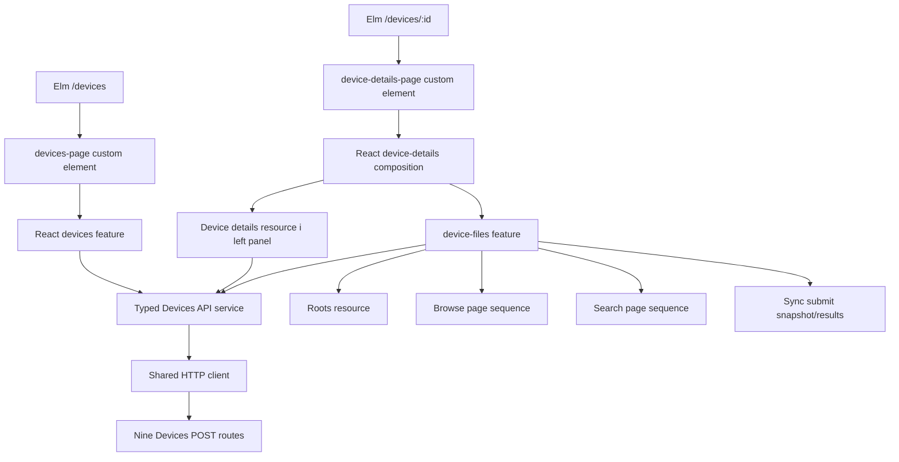
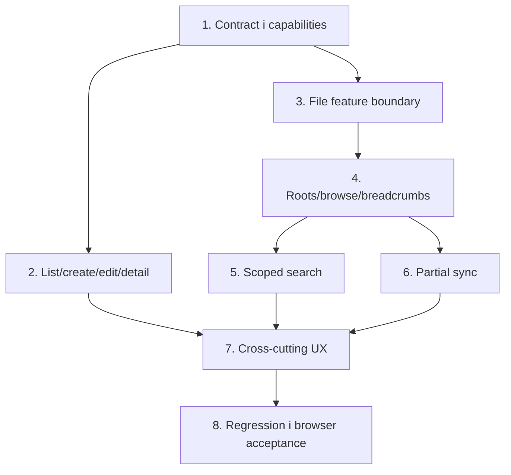

# План реалізації фронтенду «Пристрої»: етап 1

- **Статус:** Виконано
- **Версія:** 1.0
- **Дата:** 2026-07-24
- **Технічна специфікація:** [`TECHNICAL_SPEC_STAGE_1.md`](./TECHNICAL_SPEC_STAGE_1.md), версія 0.14
- **Функціональний дизайн:** [`DEVICES.md`](./DEVICES.md), версія 0.13
- **План API:** [`API_IMPLEMENTATION_PLAN.md`](./API_IMPLEMENTATION_PLAN.md), версія 1.0, статус «Виконано»

## 1. Призначення документа

Цей документ визначає послідовний план завершення фронтенду першого етапу «Пристроїв» поверх нормативного API з дев’яти `POST`-маршрутів. План охоплює чинні Elm-маршрути `/devices` і `/devices/:id`, змонтовані в них React custom elements, сторінку списку, створення й рольове редагування пристрою, деталі, файлову ієрархію, scoped search та absolute-path partial sync.

План є вузькою адаптацією чинного React/Elm інтерфейсу. Він не проєктує нову інформаційну архітектуру Devices, не переносить бізнес-правила з бекенду у браузер і не відновлює вилучений legacy-контракт. Якщо цей документ суперечить `TECHNICAL_SPEC_STAGE_1.md` або `DEVICES.md`, пріоритет мають ці два документи.

API cutover і generated bindings уже виконані. Тому цей план не повторює backend/API-роботи, а фіксує наявний frontend baseline, закриває залишкові розбіжності сторінок списку й деталей та додає відсутній наскрізний файловий UI.

## 2. Вихідний стан і зафіксовані передумови

### 2.1. Уже реалізована основа

На початок цього плану в репозиторії вже є:

- рівно дев’ять нормативних Devices API routes без archive/restore/files-list aliases;
- згенеровані з Rust типи нового контракту у `wdintel-web/src/Bindings.elm` і `wdintel-web/src/Bindings.ts`;
- типізований `wdintel-web/src/ts/react/services/api/devices.ts` з операціями list, unit stats, detail, create, update, roots, browse, search і sync;
- unit tests API-сервісу для цільових request/response shapes;
- чинні Elm routes `Pages.Devices` і `Pages.Devices.Id_` як тонкі оболонки React custom elements;
- custom elements `devices-page` і `device-details-page` з MUI theme provider, передаванням ролей і коректним unmount;
- React-сторінка списку з MRT, server-side list loading, пошуком, lifecycle/unit filters, pagination та create/edit drawer;
- React-сторінка деталей з цільовим `DeviceDetails`, рольовим edit drawer і скасуванням застарілих detail requests;
- create/update форми з `source_label`, `external_url`, `custom_fields`, `name`, AOR і unit та з patch mapping;
- явний frontend helper `canReadDevices`, який не надає Devices-ролям загального права `Cyber`;
- видалений legacy UI архівування/відновлення, тегів, опису, спеціалізованих `hostname`/`ssh_port` та старого flat file list.

Ці частини потрібно зберегти й розширити, а не реалізовувати вдруге в паралельному стилі.

### 2.2. Залишкові розбіжності чинного UI

Перед додаванням файлового UI потрібно закрити такі розбіжності зі специфікацією:

- MRT не має окремих видимих колонок `source_label` і `created_at` та відповідного server-side sort mapping;
- рядок без аналітичної назви не показує явну ознаку «Потребує аналітичної назви»;
- lifecycle-колонка прихована за замовчуванням, хоча active/archive стан має бути видимим текстом;
- початкове завантаження списку об’єднує unit stats із довідниками так, що помилка незалежного запиту може втратити власний стан;
- ліва панель деталей не показує стабільний `device.id`;
- текст archived edit state згадує позаетапне відновлення;
- сторінка деталей не має правої файлової панелі;
- roots, browse, search і sync API ще не мають UI consumers;
- немає state reconciliation після partial sync і browser acceptance для файлових сценаріїв.

### 2.3. Незмінні API-передумови

Frontend використовує наявний API як завершений контракт:

| Операція | Route | Request/response | Frontend-власник |
| --- | --- | --- | --- |
| Список | `/api/device/list` | `ListDevicesReq` → `ListDevicesRsp` | Devices list query state і MRT. |
| Статистика підрозділів | `/api/device/unit-stats` | no body → `DeviceUnitStatsRsp` | Незалежний sidebar state. |
| Деталі | `/api/device/detail` | `DeviceDetailReq` → `DeviceDetails` | Device detail resource. |
| Створення | `/api/device/create` | `CreateDeviceReq` → `DeviceDetails` | Create drawer. |
| Редагування | `/api/device/update` | `UpdateDeviceReq` → `DeviceDetails` | Edit drawer і reconciliation. |
| Корені | `/api/device/files/roots` | `ListDeviceFileRootsReq` → `ListDeviceFileRootsRsp` | File roots resource. |
| Browse | `/api/device/files/browse` | `BrowseDeviceFilesReq` → `BrowseDeviceFilesRsp` | Directory page sequence та breadcrumbs. |
| Search | `/api/device/files/search` | `SearchDeviceFilesReq` → `SearchDeviceFilesRsp` | Search page sequence. |
| Sync | `/api/device/files/sync` | `SyncDeviceFilesReq` → `SyncDeviceFilesRsp` | Batch dialog і ordered per-item results. |

Frontend не змінює wire names, не вводить DTO-копії та не підтримує legacy response shapes. Якщо backend DTO потрібно змінити, зміна починається у Rust registration і завершується `just gen-front`; generated `Bindings.elm` та `Bindings.ts` вручну не редагуються.

## 3. Межі плану

### 3.1. У межах

- точне приведення list/create/edit/detail UI до frontend-секції технічної специфікації;
- незалежне початкове завантаження device list і unit stats;
- server-side MRT sorting, pagination і lifecycle presentation;
- рольове відображення source та analytical form sections;
- права файлова панель у чинному `/devices/:id` layout;
- root selector, direct-child browse, breadcrumbs і cursor pagination;
- scoped search з name, kind, MIME, extension і modified-time filters;
- absolute-path batch sync для нових і відомих файлів;
- ordered partial accepted/rejected presentation і field-error binding;
- окремі loading, empty, error і retry states для незалежних ресурсів;
- shared `401` transition, видимі `400`/`403`/`404`/`500`/`503` та dependency errors;
- role й archived lifecycle gating для кожної дії;
- responsive, keyboard і focus behavior чинних сторінок, drawer та dialog;
- focused frontend tests і десять нормативних browser scenarios з реальним backend.

### 3.2. Поза межами

- нові сторінки, routes або окремий edit route;
- повний filter builder для device list;
- UI для `needs_analytical_name` або AOR list filters;
- архівування чи відновлення пристрою;
- file content, S3, content state, preview або download;
- файлова аналітика, processed/hidden state, hide/restore;
- create, rename, move чи delete roots/directories як окремі дії;
- клієнтське моделювання filesystem snapshots або видалення відсутніх у batch файлів;
- парсинг source absolute path, побудова canonical roots або directory IDs у браузері;
- deep-link URL contract для вибраного root/directory/search state;
- handwritten DTO, encoder чи decoder замість generated bindings;
- backend validation, migrations, indexes, concurrency або retry algorithms;
- compatibility aliases для вилучених routes чи fields;
- mock/local-storage fallback замість робочого backend під час acceptance.

## 4. Архітектурні принципи

1. **Elm лишається маршрутною оболонкою.** `Pages.Devices` і `Pages.Devices.Id_` перевіряють section access/settings, монтують custom element і не отримують React/API state machine.
2. **React feature boundaries відповідають екранам.** `routes/devices/` володіє list/create/edit, `routes/device-details/` — device detail composition, а окремий `device-files/` feature — усім file state та UI.
3. **Generated DTO є єдиним wire source.** API service може нормалізувати runtime JSON і серіалізувати generated snake_case contract, але route components не оголошують паралельні backend DTO.
4. **Компоненти не викликають `fetch` напряму.** Усі дев’ять операцій проходять через `services/api/devices.ts`, спільний HTTP client і чинний unauthorized detector.
5. **Backend лишається джерелом істини.** Device state береться з `DeviceDetails`, accepted file/root — із sync response, а tree — з наступного roots/browse/search read.
6. **Немає optimistic writes.** UI може показувати in-flight state, але не змінює persisted device, root, hierarchy чи timestamps до підтвердженої відповіді.
7. **Source path є opaque exact input.** UI не trim-ить, не split-ить, не join-ить і не canonicalize-ить `absolute_path`; root та `path_components` показуються лише з response.
8. **Кожен ресурс має власний async state.** Device detail не залежить від roots, list не залежить від unit stats, browse не залежить від search, а помилка одного ресурсу не очищує успішні дані іншого.
9. **Stale response не змінює новий scope.** Device ID, list query, parent entry, search filters і submit snapshot мають request identity; попередній request abort-иться або ігнорується за generation guard.
10. **Cursor належить точному query fingerprint.** Cursor page можна append-ити лише до тієї самої комбінації device, scope, mode, filters, limit та server order.
11. **Directory navigation використовує IDs.** Перехід по root, child directory і breadcrumb передає returned `entry_id`; display segments не є адресою.
12. **Capabilities є action-specific.** `can_read`, `can_write_source_data` і `can_write_analytical_data` обчислюються окремо; спільний `canEdit` не передається як заміна конкретного дозволу.
13. **Archived device є read-only.** Details, roots, browse і search доступні, edit та sync controls відсутні незалежно від write role.
14. **Помилки видимі й локальні.** `401` виконує shared login transition; інші top-level помилки показуються через `PowerAlert` у власній UI-секції; per-item sync errors лишаються біля рядка.
15. **Невизначений create result не повторюється автоматично.** Після transport uncertainty UI перечитує list/roots/browse й дозволяє лише свідоме рішення користувача.
16. **Stage 1 UI мінімальний.** Використовуються чинні layout, MRT, drawers, MUI theme та Power wrappers; не додається друга design system або універсальна file manager abstraction.
17. **Доступність є частиною поведінки.** Усі interactive controls мають labels, keyboard path, видимий focus і коректне повернення focus після drawer/dialog.

## 5. Цільова схема взаємодії

### 5.1. Межі orchestration

`useDevicesPage` відповідає лише за list/create/edit flow. `useDeviceDetailsPage` відповідає за `DeviceDetails`, detail edit flow і lookup loading для analytical form. Він не повинен вирости у спільний hook для roots, browse, search і sync.

File orchestration розміщується в окремому `device-files/` feature та отримує лише:

- `device.id`;
- `device.archived`;
- `can_write_source_data`;
- callback для показу page-level повідомлення лише тоді, коли помилка не належить локальній файловій секції.

Зворотного імпорту list feature у file feature немає. Спільними лишаються API service, error helpers, date formatter, role resolver і Power components.

### 5.2. Власники frontend state

| Ресурс | Стан | Ключ identity | Reset/invalidation |
| --- | --- | --- | --- |
| Capabilities | `canRead`, `canWriteSource`, `canWriteAnalytical` | Поточний масив ролей | Зміна custom-element attribute/ролей. |
| Device list | items, total, hasMore, statusCounts, loading/error | Normalized list filters + sorting | Будь-яка зміна filter/sort; offset повертається до `0`. |
| Unit stats | items, loading/error | Поточний user/section | Незалежний reload; list data не очищується. |
| AOR/unit lookups | options, loading/error | Поточний edit session | Lazy load лише для видимої analytical section. |
| Device detail | `DeviceDetails`, loading/refresh/error | `deviceId` | Зміна route ID, reload або unmount. |
| Roots | roots, loading/error | `deviceId` | Зміна device; refresh після sync. |
| Browse | breadcrumbs, entries, nextCursor, loading/error | `deviceId + parentEntryId + limit` | Перехід directory/breadcrumb/root або device change. |
| Search | filters, entries, nextCursor, loading/error | `deviceId + scopeEntryId + normalized filters + limit` | Зміна scope/filter або вихід із search mode. |
| Sync dialog | editable rows, frozen submit snapshot, per-row results, submitting/error | Local dialog session + submit generation | Close/reopen; кожен submit створює новий ordered snapshot. |

Кожен async resource розрізняє initial loading, background refresh і load-more. Load-more failure не замінює вже завантажені rows загальною error page.

### 5.3. Query fingerprint і pagination

Для list, browse та search pure helper формує стабільний normalized fingerprint без cursor/offset. Під час відповіді UI перевіряє fingerprint і generation request-а:

- initial request замінює page sequence;
- load-more request append-ить лише до sequence з тим самим fingerprint;
- повторне натискання «Завантажити ще» під час request заблоковане;
- зміна scope/filter/sort одразу анулює попередній cursor;
- browse і search мають різні page sequences навіть за однакового scope;
- `next_cursor: null` прибирає load-more action;
- UI не виводить `total` для filesystem і не симулює offset.

Search state зберігає `scopeEntryId` і окремо останній успішний browse parent. Вихід із search mode повертає вже завантажений browse view, а не відтворює directory з display path.

### 5.4. Reconciliation після mutations

Після create/update пристрою UI використовує повний returned `DeviceDetails`:

- create закриває drawer, перечитує list із поточним query і надає navigation до returned `id`;
- update замінює detail resource та відповідний list item, якщо він присутній;
- timestamps не генеруються клієнтом;
- якщо update змінив відповідність поточним filters, authoritative list reload вирішує, чи лишається item у таблиці.

Після sync:

- accepted rows у dialog використовують `accepted.root` та `accepted.file` як підтверджений результат;
- rejected rows зберігають exact input і field errors для виправлення;
- roots перечитуються;
- поточний browse parent перечитується, якщо він ще існує;
- активний search повторюється з тим самим валідним scope/filter;
- якщо попередній synthetic directory було pruning-нуто й browse/search отримує `404`, UI очищує недійсний scope і повертає користувача до root selector;
- UI ніколи не трактує відсутній у batch відомий файл як видалений.

### 5.5. Capability і lifecycle contract

| Дія | Cyber | DeviceSource | DeviceAnalyst | Admin | Додаткова умова |
| --- | :---: | :---: | :---: | :---: | --- |
| List/detail/files read | так | так | так | так | Devices section enabled. |
| Create device | ні | так | так | так | — |
| Edit source fields | ні | так | так | так | Active device. |
| Edit analytical fields | ні | ні | так | так | Active device. |
| Sync file metadata | ні | так | так | так | Active device. |

`DeviceAnalyst` успадковує source-write capability лише у Devices feature. Це не робить його загальною роллю `Cyber`. UI gating покращує UX, але кожна відповідь `403` усе одно обробляється як authoritative відмова без локальної mutation.

## 6. Цільова структура frontend-коду

| Шлях | Єдина відповідальність |
| --- | --- |
| `wdintel-web/src/Pages/Devices.elm` | Thin `/devices` route, section/settings gate і mount `devices-page`. |
| `wdintel-web/src/Pages/Devices/Id_.elm` | Thin `/devices/:id` route, section/settings gate і mount `device-details-page`. |
| `wdintel-web/src/ts/react/devices-page-element.tsx` | List custom-element lifecycle, theme і roles transport. |
| `wdintel-web/src/ts/react/device-details-page-element.tsx` | Detail custom-element lifecycle, route ID, theme і roles transport. |
| `wdintel-web/src/ts/react/services/api/devices.ts` | Єдиний typed adapter дев’яти Devices routes, serializers і runtime normalizers. |
| `wdintel-web/src/ts/react/utils/roles.ts` | Спільні action-specific Devices capability helpers без розширення generic `Cyber`. |
| `wdintel-web/src/ts/react/routes/devices/helpers.ts` | Pure list row, request, server-sort і formatter helpers. |
| `wdintel-web/src/ts/react/routes/devices/device-form.ts` | Pure create/update form validation і patch diff. |
| `wdintel-web/src/ts/react/routes/devices/use-devices-page.load.ts` | Незалежні list, unit-stats і lookup load lanes з abort/generation guards. |
| `wdintel-web/src/ts/react/routes/devices/use-devices-page.ts` | List/create/edit orchestration та view model. |
| `wdintel-web/src/ts/react/routes/devices/components/*` | MRT, toolbar, row actions, custom fields і upsert drawer. |
| `wdintel-web/src/ts/react/routes/device-details/use-device-details-page.ts` | Device detail/edit orchestration без filesystem state. |
| `wdintel-web/src/ts/react/routes/device-details/components/DeviceDetailsLeftPanel.tsx` | Повне read-only представлення `DeviceDetails`. |
| `wdintel-web/src/ts/react/routes/device-details/index.tsx` | Двопанельна responsive composition деталей і file feature. |
| `wdintel-web/src/ts/react/routes/device-details/device-files/index.tsx` | Композиція roots, browse/search і sync states правої панелі. |
| `wdintel-web/src/ts/react/routes/device-details/device-files/use-device-files.ts` | Публічний view model file feature та orchestration mode transitions. |
| `wdintel-web/src/ts/react/routes/device-details/device-files/use-device-files.load.ts` | Roots/browse/search requests, cursors, cancellation і stale-response guards. |
| `wdintel-web/src/ts/react/routes/device-details/device-files/use-device-files.sync.ts` | Dialog session, frozen submit snapshot, ordered result mapping і post-sync refresh. |
| `wdintel-web/src/ts/react/routes/device-details/device-files/helpers.ts` | Pure query normalization, fingerprints, path-segment presentation і error-index mapping. |
| `wdintel-web/src/ts/react/routes/device-details/device-files/components/*` | Root selector, breadcrumbs, browser rows, search controls і sync dialog. |

Фактичне розбиття невеликих presentational components можна укрупнити, якщо файли залишаються читабельними. Не можна, навпаки, складати весь файловий workflow у `device-details/index.tsx` або один великий hook.

## 7. Цільова UI-поведінка

### 7.1. Device list

Початковий list request і unit-stats request стартують паралельно, але завершуються у різні resource states. Успішний список відображається навіть за помилки статистики; sidebar показує локальну помилку й retry.

MRT зберігає чинний `TableStateProvider`, shared default options і local-storage normalization. Цільовий stable column order містить:

1. row actions/number columns за shared MRT rules;
2. «Назва»;
3. «Джерельна мітка»;
4. «AOR»;
5. «Підрозділ»;
6. «Створено»;
7. «Оновлено»;
8. «Стан».

Колонка «Назва» показує `name ?? source_label`; для `name === null` поруч є текстова або доступно підписана ознака «Потребує аналітичної назви». `source_label` однаково показується окремою колонкою. «Стан» видима за замовчуванням і має текст «Активний» або «Архівний», не лише колір.

Sorting повністю server-side:

- `name` → `display_title_asc|desc`;
- `createdAt` → `created_at_asc|desc`;
- `updatedAt` → `updated_at_asc|desc`;
- без user sort → `updated_at_desc`;
- unsupported display columns не вмикають client sort.

Зміна global search, archived state, unit filter або sort створює новий list fingerprint і скидає offset. Наступна сторінка append-иться лише до того самого fingerprint. Row/title navigation відкриває `/devices/:id`; archived row не має edit action.

### 7.2. Create та edit drawers

Create drawer показує тільки source fields: required `source_label`, nullable `external_url` і довільні `custom_fields`. Він не монтує й не серіалізує `name`, `aor_ids`, `unit_id`, файли чи системні поля навіть для Analyst/Admin.

Custom-fields editor:

- працює з локальними rows «ключ — значення»;
- trim-ить ключ лише для нормалізації request;
- відхиляє порожні й дубльовані після trim ключі;
- не надає спеціальної семантики `hostname`, `ssh_port` або іншим назвам;
- не trim-ить значення.

Edit drawer ділить controls на source й analytical sections. Невидима за capability section не має editable controls. AOR/unit dictionaries завантажуються лише перед відкриттям доступної analytical section; їхня помилка не руйнує вже завантажені device details.

Update request містить тільки diff:

- очищена `name` → `null`;
- очищений unit → `unit_id: null`;
- очищені AOR → `aor_ids: []`;
- змінені AOR передаються повним набором;
- custom-field additions/changes → string values;
- custom-field removals → `null`;
- empty patch не submit-иться.

Submit однієї форми має один in-flight guard. Field errors прив’язуються до controls, інші помилки лишають drawer відкритим і показуються через `PowerAlert`. Невизначений create response не запускає automatic retry.

### 7.3. Device details

Ліва панель показує:

- stable `id` з можливістю коректно скопіювати його як текст;
- display title і nullable analytical `name`;
- `source_label`, `external_url`, усі `custom_fields`;
- AOR names і unit name;
- `created_by`;
- active/archive state;
- localized `created_at`, `updated_at`, nullable `archived_at`.

Відсутні значення мають один спільний placeholder. RFC 3339 values проходять чинний date-time formatter; `_ms`, raw epoch або client timestamps не повертаються.

Archived device читається з `include_archived: true`. Його detail, roots, browse і search доступні, але edit та sync actions відсутні. UI не пропонує restore і не пояснює read-only mode дією, якої Stage 1 не має.

### 7.4. Roots, browse і breadcrumbs

Після успішного detail load file feature незалежно завантажує roots. Empty roots state пояснює відсутність синхронізованих файлових метаданих; за наявності write permission і active device він може вести до sync dialog, але не створює root окремою дією.

Root selector показує returned `name` і `path_syntax`, а його value є `entry_id`. Після explicit selection UI викликає browse з `parent_entry_id = root.entry_id` і `include_breadcrumbs = true`.

Browse view:

- зберігає server order directories-before-files без client resort;
- directory row переходить за returned `entry_id`;
- file та directory з однаковою назвою показуються окремо;
- duplicate files з однаковим path/name і різними IDs показуються окремими rows;
- breadcrumbs відображають root-to-current segments і переходять за returned ancestor ID;
- `path_components` показуються segment-wise лише як context;
- exact `absolute_path` файла показується окремим технічним значенням;
- `next_cursor` керує explicit «Завантажити ще»;
- total/count не обчислюється;
- немає directory/root create, rename, move або delete actions.

Initial loading, empty directory, initial error, background refresh і load-more error мають різні presentation. Error не очищує breadcrumbs/entries, якщо вони вже були успішно завантажені.

### 7.5. Scoped search

Search запускається лише в scope поточної root/directory. Controls Stage 1 містять:

- literal name query з UX-перевіркою мінімум трьох Unicode symbols, коли поле непорожнє;
- kinds `directory|file`;
- MIME type values;
- extension values без автоматичного додавання крапки;
- inclusive modified-from/modified-to date-time controls.

UI не створює повний filter builder. Search виконується explicit submit/Enter, а не request-ом на кожен keystroke. Empty arrays/inputs нормалізуються до no-filter request shape; invalid local date range не submit-иться, а backend field errors лишаються authoritative.

Result rows показують returned relative `path_components` як окремі segments. UI не склеює їх у source pathname. Directory result може стати новим browse parent за його `entry_id`; дія «Повернутися до папки» відновлює попередній browse parent ID і його page state.

Зміна scope або будь-якого filter створює новий fingerprint, очищує лише search page sequence та cursor і не очищує browse data. Search load-more використовує той самий fixed server order, що browse.

### 7.6. Absolute-path partial sync

Sync dialog доступний лише для active device з `can_write_source_data`. Dialog має один `path_syntax` для всього submit і від 1 до дозволеної backend contract-ом кількості file rows. Frontend не копіює backend max-length і batch constants у паралельний набір конфігурації; envelope/limit errors показуються з server response.

Кожен editable row має локальний stable key, який не надсилається, і поля:

- optional existing `file_id` або відсутній ID для create;
- required exact `absolute_path`;
- optional nullable `mime_type`;
- optional nullable `extension`;
- optional nullable created/modified date-time.

Inputs `name`, `root_entry_id` і `path_components` відсутні. Введений `absolute_path` зберігається byte-for-byte як JavaScript string без trim/canonicalization. Existing file row можна відкрити з browse/search action із returned `file_id` і technical state; new row не отримує client UUID.

Перед request dialog фіксує immutable ordered submit snapshot. Поки request триває, порядок/видалення submitted rows і повторний submit заблоковані. `results[index]` зіставляється зі snapshot, а не з потенційно зміненим масивом форми.

Після response:

- accepted row стає підтвердженим result із `operation`, canonical `root` та `file`;
- filename, root і components беруться тільки з accepted response;
- rejected row зберігає exact input, `kind`, message та field errors;
- paths `files[n].field` мапляться через frozen index до конкретного control;
- `not_found`, `conflict`, `dependency` та `internal` без field errors показуються на рівні row;
- accepted rows не submit-яться повторно разом із виправленими rejected rows;
- partial success показує accepted і rejected одночасно, а не загальне «успішно» або «помилка».

Після закриття dialog виконується reconciliation із секції 5.4. Якщо transport response невідомий, dialog показує uncertainty message та пропонує refresh roots/current view; він не повторює keyless create автоматично.

### 7.7. Помилки, доступність і responsive layout

Top-level error contract відображається так:

| Помилка | UI-поведінка |
| --- | --- |
| `400 Form` | Exact field path біля control; unmatched errors — локальний `PowerAlert`. |
| `400 BL` | Локальний `PowerAlert` без втрати введених даних. |
| `401` | Чинний shared redirect/login transition. |
| `403` | Видимий `PowerAlert`; mutation state не застосовується. |
| `404` detail | Page error state; filesystem child/scope `404` лишається у правій панелі. |
| `500`/`503` | Локальний retryable `PowerAlert`; успішні sibling resources зберігаються. |
| Sync `dependency|internal` | Per-row error у `200` response, не global request failure. |

На desktop detail page зберігає ліву information panel і праву file panel. На tablet/mobile панелі стають послідовними без горизонтального overflow; root/search/actions переносяться на новий рядок, а довгі exact paths можуть переноситися або прокручуватися всередині власного контейнера.

Для buttons, icon buttons, alerts, chips, menus і date-time controls використовуються відповідні `Power*` wrappers, коли їхній контракт підходить. Dialog/drawer закривається Escape лише коли немає небезпечного in-flight transition, focus не повертається в `aria-hidden` subtree, icon-only actions мають accessible names, а breadcrumbs доступні з клавіатури.

## 8. Загальний критерій завершення кожного етапу

Перед переходом до наступного етапу мають виконуватися такі умови:

- немає stub, placeholder control, fake success, compatibility alias або тимчасового local-data fallback;
- новий UI використовує generated bindings і `services/api/devices.ts`;
- request cancellation або generation guard захищає змінений async scope;
- initial, empty, error, refresh і submit states, яких стосується етап, мають завершену поведінку;
- `401` і non-401 errors не ігноруються;
- capability й archived gating перевірені на рівні visible action;
- pure mapping/state logic має focused unit tests, а interactive contract — component test;
- touched TS/TSX/JS/CSS/JSON відформатовані Prettier;
- edited Elm route компілюється, якщо він змінювався;
- `just build-front` проходить;
- етап не змінює backend schema/API або unrelated frontend modules;
- робота наступного етапу не використовується як виправдання незавершеного observable state поточного.

## 9. Етапи реалізації

### Етап 1. Закріплення frontend contract і capability baseline

#### Мета

Зафіксувати один frontend contract і спільну модель Devices capabilities до розширення UI.

#### Роботи

1. Перевірити, що `services/api/devices.ts` є єдиним caller дев’яти routes і використовує generated requests/responses.
2. Зафіксувати serializers для nullable/omitted update fields та snake_case sync body без parallel DTO у route modules.
3. Виділити один pure Devices capability resolver поверх чинних role helpers: read, source write, analytical write.
4. Перевести list і detail hooks на однаковий resolver; залишити `canEdit` тільки derived convenience для відкриття drawer, але не для section/action gating.
5. Перевірити custom elements: roles attribute update rerender-ить capability view, route ID update abort-ить/знецінює попередній detail request.
6. Прибрати залишкові UI тексти або tests, що припускають archive/restore, `_ms`, flattened AOR/unit, tags чи flat files.
7. Розширити service/role/custom-element tests для exact paths, payloads, permission isolation і shared `401`.

#### Ключові рішення

- Generic `Cyber` helper не розширюється ролями Devices.
- Runtime normalizer захищає межу HTTP, але не перетворюється на handwritten replacement generated DTO.
- Новий filesystem UI починається лише після стабілізації capability contract.

#### Перевірка

- усі дев’ять service methods мають correct route/method/body tests;
- жоден frontend caller не посилається на archive, restore або files/list;
- Cyber, DeviceSource, DeviceAnalyst та Admin дають точну action matrix;
- зміна roles/device ID у custom-element tests не лишає stale render;
- `just build-front` проходить.

#### Робочий стан після етапу

Frontend має один нормативний API/capability baseline, на якому list, details і file feature не можуть розійтися у правах або wire shapes.

### Етап 2. Завершення list, create/edit і detail presentation

#### Мета

Закрити всі розбіжності вже наявних device surfaces до підключення файлової панелі.

#### Роботи

1. Додати `sourceLabel` і `createdAt` до row view, MRT columns, default column order та visibility config.
2. Зробити lifecycle column видимою за замовчуванням і показувати текстовий active/archive state.
3. Додати accessible indicator «Потребує аналітичної назви» до derived title за `name === null`.
4. Доповнити server-sort mapper для display title, created та updated timestamps; unsupported columns не передавати як sort.
5. Перевірити normalization stored MRT column order після додавання колонок без ручного очищення localStorage.
6. Розділити list і unit-stats load/error lanes. AOR/unit dictionaries для filters/forms не повинні перетворювати list success на error.
7. Перевірити offset reset і stale append guard для search, archived filter, unit filter та sorting.
8. Довести create drawer до exact source-only payload і transport-uncertainty behavior.
9. Довести edit drawer до role sections, lazy analytical lookups і exact patch diff.
10. Додати stable `device.id` та всі нормативні fields до left panel; прибрати restore wording з archived state.
11. Переконатися, що returned `DeviceDetails` замінює local detail/list state, а filter-sensitive list після mutation перечитується.

#### Ключові рішення

- MRT продовжує використовувати shared defaults, `TableStateProvider` і server-side sorting.
- Жоден column renderer не приховує source label через наявну analytical name.
- Помилка unit stats локалізована в sidebar та має retry.
- Create й update не поділяються на кілька requests за field group.

#### Перевірка

- pure tests sort mapper, request builder, row view і update patch diff;
- component tests усіх цільових колонок, name indicator, lifecycle default і archived row actions;
- create form ніколи не серіалізує analytical fields;
- source-only, analytical-only, mixed, clear-name/unit/AOR і custom-field-removal update tests;
- detail component показує ID, timestamps, archived_at і однакові absent values;
- list залишається видимим за unit-stats error;
- focused Devices React tests і `just build-front` проходять.

#### Робочий стан після етапу

List/create/edit/detail повністю відповідають Stage 1 без файлового UI і без legacy presentation assumptions.

### Етап 3. Межа file feature та незалежна права панель

#### Мета

Підготувати двопанельну detail composition і filesystem state boundary без розростання detail hook.

#### Роботи

1. Додати `device-files/` feature з власними types/helpers/load/sync boundaries.
2. Залишити `useDeviceDetailsPage` власником лише detail/edit resource та lookups.
3. Додати responsive right-panel slot у `device-details/index.tsx`, який монтується після доступного `DeviceDetails`.
4. Передати file feature тільки device ID, archived state і source-write capability.
5. Реалізувати незалежний roots resource з initial/loading/empty/error/retry states.
6. Додати окремі abort controllers або generation guards для roots, browse, search і sync reconciliation.
7. При зміні `deviceId` атомарно очистити filesystem scopes/cursors і заборонити late response старого device.
8. Перевірити, що roots error не змінює detail success і не закриває edit drawer.
9. Для archived device завантажувати read resources, але не монтувати sync action.

#### Ключові рішення

- File state не зберігається в Elm, MRT provider або global store.
- Stage 1 не додає URL deep links для root/directory/search.
- На цьому етапі не показується dead browser/search/sync control: visible файловий flow завершується в наступних етапах до інтеграційного прийняття.

#### Перевірка

- detail success + roots loading/error/empty render independently;
- route ID change і unmount abort/ignore all late file loads;
- archived device має roots read і не має sync action;
- mobile/tablet/desktop composition не обрізає left panel;
- focused detail/file-shell tests і `just build-front` проходять.

#### Робочий стан після етапу

Detail page має ізольовану праву filesystem boundary, готову прийняти повний browser без змішування з device edit orchestration.

### Етап 4. Root selector, direct-child browse і breadcrumbs

#### Мета

Реалізувати повну ID-based folder navigation і cursor pagination.

#### Роботи

1. Відобразити roots у normative server order з `name`, `path_syntax` і `entry_id` як control value.
2. Після explicit root selection викликати browse з root `entry_id` та breadcrumbs enabled.
3. Реалізувати directory/file rows без client sorting і без path-based identity.
4. Directory click переводить browse scope на returned `entry_id`; file row не має позаетапних content/analytics actions.
5. Відобразити returned breadcrumbs і переходити за ancestor `entry_id`.
6. Показати root та relative components окремими segments; exact file path — окремим technical value.
7. Додати initial page, explicit load-more, `next_cursor` append і retry load-more.
8. Ввести stable browse fingerprint і не append-ити response після parent/device change.
9. Показувати duplicate file rows окремо за stable file/entry IDs.
10. Обробити stale directory `404` локально з refresh roots action.
11. Додати empty directory state без create-directory control.

#### Ключові рішення

- Browse order повністю належить backend; frontend не сортує навіть поточну сторінку.
- Breadcrumb label та path component ніколи не стають request address.
- Root не має окремої create mutation.
- Cursor є continuation token, а не client-decodable offset.

#### Перевірка

- zero, one і multiple roots, включно з POSIX, drive та UNC names;
- root browse, два directory levels і перехід кожним breadcrumb;
- directories-before-files order зберігається без local sort;
- duplicate path/name files мають окремі rows;
- load-more append, cursor exhaustion, retry та stale response tests;
- browse error не прибирає device details або вже завантажені entries;
- focused file browser tests і `just build-front` проходять.

#### Робочий стан після етапу

Користувач може пройти весь accumulated filesystem forest через roots, direct children, breadcrumbs і stable cursor pages, використовуючи лише returned IDs.

### Етап 5. Scoped search і technical filters

#### Мета

Додати мінімальний searchable subtree flow без нового route або повного filter builder.

#### Роботи

1. Додати explicit browse/search mode та зберігати current directory як `scope_entry_id`.
2. Реалізувати compact controls для name query, kinds, MIME, extensions і modified range.
3. Використати чинні Power date-time controls і спільний date serializer; не використовувати native `datetime-local`.
4. Нормалізувати empty controls у no-filter request і формувати stable search fingerprint.
5. Не submit-ити непорожній name query коротший за три symbols або локально очевидний `from > to`.
6. На scope/filter change очищати лише search cursor/results і abort-ити попередній search.
7. Відобразити results у server order із returned `path_components` segments та exact path окремо для files.
8. Directory result відкриває browse за returned `entry_id`.
9. Додати explicit повернення до попереднього browse state.
10. Реалізувати search load-more, empty, initial error і load-more error states.
11. Не показувати entries поза returned subtree і не намагатися перевіряти subtree membership на клієнті.

#### Ключові рішення

- Search виконується submit/Enter, а не неконтрольованим request-per-keystroke.
- `%`, `_` і `\` передаються literal без client wildcard escaping logic.
- Browse й search page sequences не перезаписують одна одну.
- Search result context є display-only і не round-trip-иться у path.

#### Перевірка

- empty filters, valid three-symbol query і literal special characters;
- kinds, MIME, extension, from/to та combined filters у exact request body;
- query/scope change cursor reset і stale page rejection;
- result directory opens by ID; back-to-browse restores prior parent;
- path components показуються segment-wise;
- search error не очищує browse або device detail;
- focused search tests і `just build-front` проходять.

#### Робочий стан після етапу

Права панель підтримує scoped hierarchy search з усіма technical filters контракту й коректним поверненням до folder browse.

### Етап 6. Absolute-path batch sync і ordered partial results

#### Мета

Реалізувати source-write batch dialog, який точно відображає partial semantics і не створює filesystem logic у браузері.

#### Роботи

1. Додати sync action лише для active device з source-write capability.
2. Реалізувати batch-level `path_syntax` і editable rows із contract fields.
3. Додати new row без `file_id` та existing-file action із browse/search, яка передає незмінний returned `file_id`.
4. Не додавати controls або serializer fields для name/root/components.
5. Зберігати exact path без trim і серіалізувати optional metadata/timestamps у generated request shape.
6. Використати local stable row keys і frozen ordered submit snapshot.
7. Заблокувати duplicate submit та mutation submitted row order під час request.
8. Зіставити кожен `results[index]` зі snapshot і розрізнити accepted/rejected.
9. Для accepted показати operation, returned canonical root, file name/components та exact source path.
10. Для rejected прив’язати validation paths до row controls і показати non-field kind/message локально.
11. Після partial success дозволити виправити й повторно submit-ити тільки rejected rows; accepted rows не надсилати знову.
12. Показати transport uncertainty без automatic retry.
13. Після close/explicit finish виконати roots/browse/search reconciliation без optimistic tree mutation.
14. Обробити pruned current directory через local `404` fallback до roots.

#### Ключові рішення

- One batch має один syntax, але може створити кілька derived roots.
- UI не вгадує, чи committed item після втрати transport response.
- `accepted.root` і `accepted.file` — єдині дані для confirmed result card; tree все одно перечитується.
- Missing files у batch нічого не видаляють і не змінюють UI state.
- Per-item `dependency`/`internal` у HTTP `200` не перетворюються на global request success message.

#### Перевірка

- create rows без ID та update rows із stable file ID;
- POSIX multi-root, Windows drive і UNC batch request bodies;
- exact spaces/Unicode/separators у path не змінюються клієнтом;
- accepted created/updated mapping за index;
- mixed accepted/rejected, all rejected і exact field error binding;
- not-found, conflict, dependency й internal row states;
- duplicate submit заблокований; rejected-only resubmit не дублює accepted creates;
- transport uncertainty не викликає automatic second request;
- post-sync roots/current browse/search refresh;
- focused dialog/hook tests і `just build-front` проходять.

#### Робочий стан після етапу

Frontend надає повний Stage 1 ingest flow для exact absolute paths, stable file updates і видимого partial success без client-side hierarchy mutation.

### Етап 7. Наскрізне узгодження permissions, errors, accessibility і responsive UX

#### Мета

Прибрати розбіжності між окремими завершеними flows і перевірити сторінки як єдину систему.

#### Роботи

1. Пройти всі visible actions за capability matrix: create, row edit, detail edit sections, sync, existing-file sync.
2. Перевірити archived read-only mode у list/detail/files і відсутність edit/sync controls.
3. Для role revoke після load обробити `403` без local mutation та без повторного показу forbidden action після roles attribute update.
4. Уніфікувати shared `401` redirect для list/detail/lookups/roots/browse/search/sync.
5. Розмістити кожен `PowerAlert` у resource boundary, яка породила error; sibling success data не очищувати.
6. Перевірити top-level form path mapping для device й sync envelope та per-item mapping для sync results.
7. Перевірити retry actions: list, unit stats, detail, roots, browse initial/load-more, search initial/load-more; mutation retry лишається свідомою дією.
8. Перевірити desktop двопанельний layout і stacked tablet/mobile layout приблизно на 1280, 768 та 360 px.
9. Перевірити wrapping/scroll довгих UUID, URLs, root names, components та absolute paths.
10. Перевірити keyboard navigation MRT, row actions, root selector, breadcrumbs, search controls, file rows, drawer і dialog.
11. Перевірити focus restore при menu → dialog/drawer transitions і відсутність `aria-hidden` console warnings.
12. Замінити raw MUI controls на наявні Power wrappers там, де wrapper має потрібний контракт.
13. Переконатися, що custom elements однаково реагують на theme та unmount без pending-state warnings.

#### Ключові рішення

- Hidden action не замінює server authorization; `403` завжди має завершену UX-поведінку.
- Колір не є єдиним носієм lifecycle, result або error status.
- File panel не розширює висоту сторінки неконтрольовано на desktop і не створює nested keyboard trap.

#### Перевірка

- component permission matrix для чотирьох ролей і archived state;
- `400`/`403`/`404`/`500`/`503`, per-item dependency та `401` scenarios;
- keyboard-only create/edit/browse/search/sync smoke;
- mobile/tablet/desktop visual smoke без console errors;
- frontend targeted suite і `just build-front` проходять.

#### Робочий стан після етапу

Усі frontend flows мають узгоджені permissions, lifecycle, error, responsive й accessibility contracts і готові до реального browser acceptance.

### Етап 8. Focused regression і реальний browser acceptance

#### Мета

Довести повну відповідність frontend-секції специфікації без mock або звуження сценаріїв.

#### Роботи

1. Запустити focused API-service, helpers, form, table, detail, file hook/component, role та custom-element tests.
2. Запустити повний frontend unit pipeline після targeted fixes.
3. Скомпілювати обидві Elm route wrappers окремо, якщо вони змінювалися.
4. Запустити production frontend build.
5. Підняти frontend і backend з міграціями цільового Stage 1 та реальними `main`/`wd_files` test data.
6. Підготувати users/roles для Cyber, DeviceSource, DeviceAnalyst і Admin без зміни production permissions.
7. Виконати всі десять browser scenarios нижче та зафіксувати observed result, network route і console state.
8. Після browser проходу видалити лише тимчасові test data/resources, не змінюючи migrations або contract.
9. Перевірити відсутність викликів legacy routes у network log і source callers.

#### Обов’язкові automated checks

- `cd wdintel-web && npm run format:staged` після frontend edits;
- targeted `npx vitest run` для змінених specs під `routes/devices`, `routes/device-details`, `services/api/devices` і role/custom-element helpers;
- `cd wdintel-web && elm make src/Pages/Devices.elm --output=/dev/null` за зміни list wrapper;
- `cd wdintel-web && elm make src/Pages/Devices/Id_.elm --output=/dev/null` за зміни detail wrapper;
- `just test-fe`;
- `just build-front`.

#### Нормативні browser scenarios

1. Перевірити device list search, active/archive states, unit filter, server sorting і pagination.
2. Відкрити active та archived `/devices/:id` і побачити details незалежно від результату файлового request.
3. Як DeviceSource створити пристрій лише з `source_label`, `external_url` і `custom_fields`.
4. Як DeviceSource змінити source fields без analytical controls; як DeviceAnalyst задати й очистити `name`, AOR та unit.
5. Одним POSIX batch створити files у `/var/log` і `/home/user`, а Windows batch — у drive та UNC roots; побачити canonical roots із response.
6. В одному root синхронізувати nested files із двома однаковими absolute paths і різними `file_id`, пройти щонайменше два directory levels, breadcrumbs і cursor pagination.
7. Виконати scoped search, перевірити path context і відсутність entries поза subtree.
8. Оновити наявний file новим absolute path до іншого root і побачити той самий `file_id`, нові root/parent/name та pruning порожніх старих synthetic directories.
9. Отримати accepted і rejected items в одному batch, виправити validation error і побачити canonical response без повторного створення accepted file.
10. Перевірити read-only Cyber, write states DeviceSource/DeviceAnalyst/Admin, archived read-only mode, field error, `403`, dependency error і `401`.

Кожен сценарій вважається пройденим лише після спостереження реального response та UI state. Component test із mocked service не замінює browser acceptance з backend.

#### Фінальний критерій

План завершений, коли:

- `/devices` і `/devices/:id` реалізують усі frontend flows Stage 1;
- UI викликає лише дев’ять нормативних Devices routes та чинні AOR/unit dictionary routes;
- generated bindings є єдиним backend type source;
- list, details, roots, browse, search і sync мають незалежні завершені async/error states;
- role/archive gating відповідає capability matrix;
- path identity, cursor і sync result mapping не реалізують backend semantics у браузері;
- автоматизовані frontend checks проходять;
- усі десять browser scenarios пройдені без frontend console errors;
- немає legacy controls, calls, fields, mocks, placeholders або compatibility paths.

#### Робочий стан після етапу

Frontend першого етапу повністю реалізує секцію «Інтерфейс (фронтенд)» технічної специфікації та працює наскрізно з цільовим API й файловим реєстром.

## 10. Залежності між етапами

Етапи 2 і 3 можна виконувати паралельно після етапу 1, оскільки вони мають різних state owners. Search залежить від завершеної browse scope/navigation model. Sync технічно може початися після file boundary, але його reconciliation і existing-file action залежать від roots/browse, тому приймається після етапу 4. Етап 7 починається лише після завершення всіх observable flows, а етап 8 не допускає заміни реального backend моками.

## 11. Трасування вимог до етапів

| Скоуп | Вимоги й нормативні секції | Основні етапи |
| --- | --- | --- |
| Elm routes, custom elements і вузька адаптація | «Принцип і межі реалізації», `DEV-INT-010` | 1, 3, 7, 8 |
| Device list, unit stats, filters, server sort і pagination | «Маршрути й початкове завантаження», «Список пристроїв», `DEV-ID-001`, `DEV-ID-007` | 1, 2, 8 |
| Source-only create | «Створення пристрою», `DEV-ID-012`, `DEV-ACC-012` | 1, 2, 8 |
| Role-separated patch update | «Редагування пристрою», `DEV-ACC-011`, `DEV-ACC-012`, `DEV-INT-011` | 1, 2, 7, 8 |
| Complete details й archived read-only | «Деталі пристрою», `DEV-ID-001`, `DEV-LC-007` | 2, 3, 7, 8 |
| Canonical roots і ID-based navigation | «Файлова ієрархія та синхронізація», `DEV-FILE-020`, `DEV-FILE-021`, `DEV-INT-019`, `DEV-UX-010` | 3, 4, 8 |
| Direct-child browse, breadcrumbs і duplicates | `DEV-FILE-023`, `DEV-INT-020`, `DEV-UX-011` | 4, 8 |
| Cursor pagination | `DEV-INT-022`, `DEV-NFR-005` | 4, 5, 8 |
| Scoped search і technical filters | `DEV-INT-021`, `DEV-UX-012`, `DEV-NFR-009` | 5, 8 |
| Absolute paths і multi-root sync | `DEV-FILE-020`–`DEV-FILE-022`, `DEV-INT-005` | 6, 8 |
| Stable file update, move й accumulated semantics | `DEV-FILE-019`, `DEV-FILE-024`, `DEV-FILE-025`, `DEV-LC-007`, `DEV-INT-012` | 6, 8 |
| Ordered partial errors | `DEV-NFR-004`, `DEV-UX-005`, `DEV-UX-006` | 6, 7, 8 |
| Role states й visible server errors | «Рольові стани», «Стани, помилки й узгодження стану» | 1, 2, 3, 6, 7, 8 |
| Мінімальна ручна перевірка | «Мінімальна ручна перевірка frontend» | 8 |

## 12. Артефакти завершеної реалізації

Після виконання плану мають існувати й бути узгодженими:

- оновлені list/create/edit/detail React modules і focused tests;
- окремий `device-files/` feature з roots, browse, search, sync та tests;
- незмінно тонкі Elm route wrappers і custom-element boundaries;
- один typed Devices API service без legacy methods;
- один action-specific permission contract у frontend;
- generated bindings без ручних змін;
- test evidence для targeted і повного frontend pipeline;
- browser acceptance evidence для всіх десяти нормативних сценаріїв;
- відсутність frontend references до archive/restore/files-list, `_ms`, tags, content, file analytics та спеціалізованих `hostname`/`ssh_port` controls.
